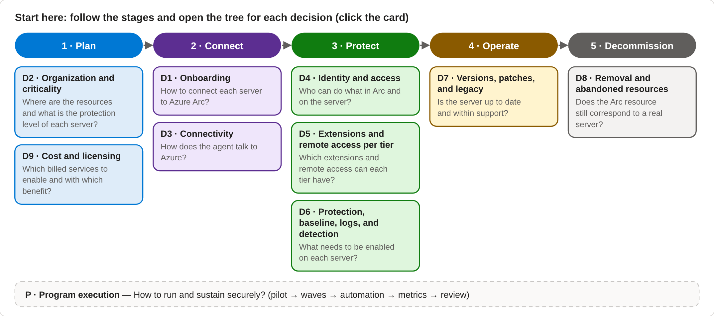
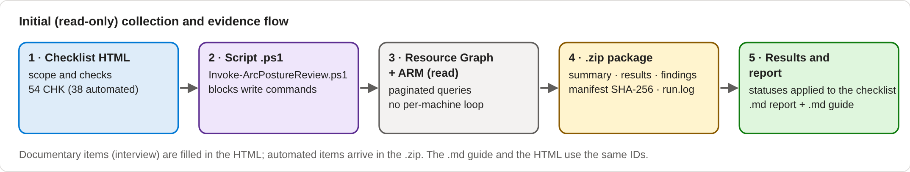
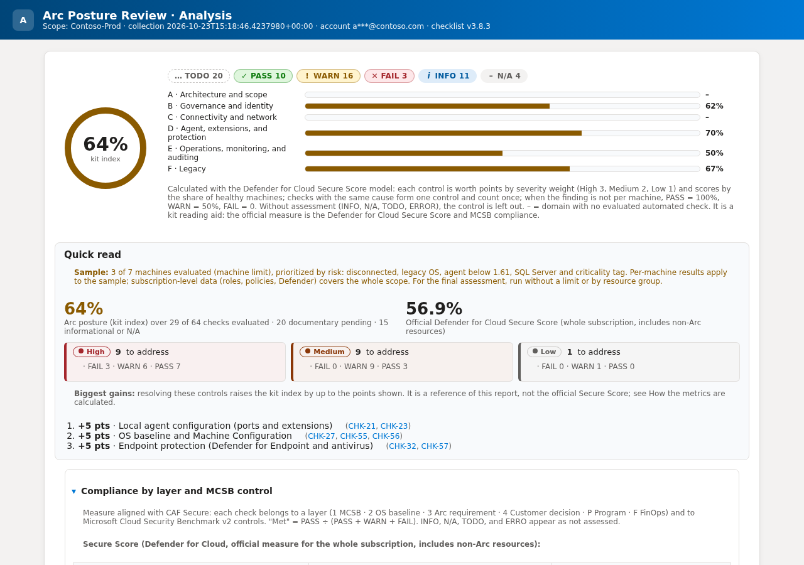
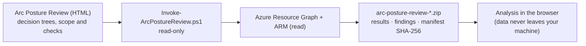

# Arc Posture Review

[](https://github.com/fabiotreze/arc-posture-review/releases)
[](LICENSE)
[](LICENSE-DOCS)

**English** · [Português](README.pt-BR.md)

Read-only security assessment kit for **Azure Arc-enabled servers** and **SQL Server enabled by Azure Arc**. One offline HTML file guides the assessment, generates a read-only PowerShell collector, and analyzes the evidence package locally in your browser.

> Personal, independent project. Not an official Microsoft tool. Built from years of field delivery experience and public Microsoft documentation, consolidated with the help of AI agents and reviewed by the author. Validate recommendations against official documentation; you are responsible for how you use it. See [DISCLAIMER.md](DISCLAIMER.md).

## What it is for

**Focus: the security posture of Azure Arc-enabled servers** (and SQL Server enabled by Azure Arc). It answers one question: *is this Arc estate configured, protected and operated securely, and what should be fixed first?*

Security decisions start before the first server is connected (onboarding credentials, network path) and end after it is removed (orphaned resources, leftover identities). That is why the guide covers the whole server lifecycle: plan, connect, protect, operate, decommission.

| You want to | Use | Result |
|---|---|---|
| **Assess an existing Arc estate** (main use) | Steps 2–5: generate the read-only script, run it in Cloud Shell, load the `.zip` | Findings per check, prioritized action plan, report |
| **Plan or review an onboarding** | Guide → *Start here* → decision trees D1–D3, D2 and D9; documentary checks as a design checklist | Design decisions recorded before the rollout |
| **Prepare a security conversation or workshop** | Guide, decision trees and the sample report | Shared vocabulary and a structured agenda |
| **Track progress** | Run the collection again and compare the `.json` exports | Before/after evidence |

**Why so many references and diagrams?** Every check points to the public Microsoft source behind it (Microsoft Cloud Security Benchmark control, Cloud Adoption Framework, product documentation), and every decision has a tree that explains the *why*. Findings can be traced and defended instead of being opinions.

**What it is not:** it does not install, connect or change anything (read-only); it does not replace Defender for Cloud, Secure Score or Azure Policy (it reads them); and it is not official Microsoft guidance.

## What you get

- **Public Microsoft method:** the *sustain security posture* cycle of the [Cloud Adoption Framework — Secure](https://learn.microsoft.com/azure/cloud-adoption-framework/secure/overview), measured against the [Microsoft Cloud Security Benchmark](https://learn.microsoft.com/security/benchmark/azure/introduction) (MCSB v2, mapped to CIS Controls v8.1, NIST SP 800-53, PCI-DSS v4, NIST CSF 2.0 and ISO 27001).
- **64 checks** (45 automated, 19 documentary), each with assessment layer, MCSB control and decision tree.
- **9 decision trees** (onboarding, organization, connectivity, identity, extensions, protection, versions and legacy, decommissioning, cost) plus program execution.
- **Read-only collector** (`Invoke-ArcPostureReview.ps1`): Azure Resource Graph and Azure CLI read commands only, paginated, multi-subscription or management group, effective-permission pre-check (Reader is enough), and an optional machine limit for large estates (risk-prioritized sample).
- **Local analysis:** quick read, kit index on the Secure Score model (points by severity, share of healthy machines, same root cause counted once), compliance by layer and MCSB control, Defender for Cloud Secure Score, one-row-per-action plan with gain, timeframe and owner, 9 recommended alerts, agent and extension versions on the run date, cost estimate, and evidence per finding.
- **Two report layers:** a concise executive assessment for decisions and a separate evidence appendix with contracts, criteria, traceability and complete findings links.
- **Clean PDF:** `python tools/Generate-CleanPdf.py <saved-report.html>` generates and validates an A4 PDF without browser URL/date headers or footers.
- **Coverage inventory:** the guide (Appendix J) shows the totals per domain, severity, layer and decision tree, and what changed since the previous version.
- **Agent security floor:** machines below Connected Machine agent **1.61** fail the version check (known local elevation-of-privilege CVEs: CVE-2025-49692, CVE-2025-26627, CVE-2025-55316, CVE-2026-26117), and the services catalog covers the agent scheduled tasks and extension services.
- **Package validation:** origin, structure, manifest SHA-256 and size limits; tampered packages are rejected. The script prints the `.zip` SHA-256 so you can confirm the origin.
- **Outputs**, in **English** and **Brazilian Portuguese** (the language is part of the file name):

  | File | What it contains | Use it for |
  |---|---|---|
  | `arc-posture-review-<date>.zip` | Collected data, results and findings per check (from the script) | Evidence; load it in step 3 |
  | `arc-posture-review-analysis-<date>.<lang>.html` | **One file:** the full analysis plus the checklist record (status, collection evidence and notes for every check, session notes) | The deliverable: share, archive or print to PDF |
  | `arc-posture-review-report.<lang>.md` / `.json` | Same content as text and as data | Edit the text, or compare runs |
- **Accessible UI:** status shown by icon, text and color (Advisor/Defender palette), AA contrast, dark mode, high-contrast and reduced-motion support.

## Current lab and assessment risks

| Risk | Control before treating the result as final |
|---|---|
| A machine-limited run can hide findings outside the sample | Use `MaxMachines = 0` for the final run, or run complete scopes by resource group. Treat a limited run as discovery only. |
| `PARTIAL`, `ERROR` or `TODO` can be mistaken for a healthy state | Treat them as **not assessed**. Resolve permissions, provider, API and documentary gaps, then recollect. |
| Live version metadata can be unavailable and fall back to static support tables | Confirm the source shown in the finding and recheck current Microsoft release notes on the run date. |
| Evidence and exported reports contain environment and personal data | Use authorized accounts and controlled storage, keep e-mail masking enabled, and never attach evidence to public issues. |
| Local static/browser gates do not prove live Azure collection and import/export | Before release, run the collector in the authorized lab and execute `Test-ReportVisual.py --package <fresh-lab.zip>`. |

## Privacy and data protection (LGPD / GDPR)

- **Nothing leaves the browser.** The page has no server side: the `.zip` is read and analyzed locally with JavaScript. A Content Security Policy in the page blocks every network connection (`connect-src 'none'`), and there are no external scripts, fonts or trackers. You can check it in the page source or in the browser developer tools (*Network* tab).
- **What the browser keeps:** only the checklist choices, statuses, notes and scope fields, in the browser local storage, so you can continue later. The package itself and the collected data are not stored. Use **Clear data in this browser** (step 3) to erase them.
- **Personal data in the package:** the collecting account e-mail, the people who operated the machines (Activity Log `caller`), and identifiers such as principal IDs and machine names. The page asks for confirmation before loading a package, and **Hide e-mails in saved files** (on by default) replaces e-mails with `a***@domain` in the saved `.html`, `.md` and `.json`.
- **Roles:** the organization that owns the environment is the data controller. This project does not receive, store or process any collected data. GitHub Pages only serves the static page (see the [GitHub Privacy Statement](https://docs.github.com/site-policy/privacy-policies/github-general-privacy-statement)); for restricted environments, download the `.html` and use it offline.
- **Good practice:** collect with a least-privilege account, keep the package and reports in an access-controlled location, share them only with authorized people, and delete them at the end of the engagement.

## See it before you run it





**Sample report** (browser analysis) from a sanitized lab fixture (7 Arc-enabled servers; SQL Server and Defender for Servers), anonymized: subscription, account, IDs and governance resource names replaced.
[Open the sample report](https://fabiotreze.github.io/arc-posture-review/docs/examples/sample-analysis.en-US.html) · [Português](https://fabiotreze.github.io/arc-posture-review/docs/examples/sample-analysis.pt-BR.html)



## v4 report (canonical assessment)

Since v4.0.0 the same evidence package also produces a canonical, deterministic assessment (`assessment-result.v4.json`), rendered as a bilingual EN-US/PT-BR HTML report. The browser analysis described above is unchanged.


- **Traceable:** every control follows Evidence → Observation → Claim → Control → Security Scenario (64 controls, 11 scenarios); missing evidence never becomes a pass, and attack paths are never asserted as confirmed.
- **Execution first:** status tiles, a data-gap callout and a NOW action plan in canonical priority order, with a collapsible evidence trace for each failing or at-risk check.
- **Azure portal links (optional):** a resource index bound to the run (`runId` and package SHA-256) adds portal links per finding row; links inferred from a single-subscription package are marked as inferred.
- **Before/after:** evaluate with `--baseline` to show verified improvements, regressions and unchanged controls.

```powershell
python assurance/v4/checkpoint5/cli/arc_posture.py evaluate --evidence arc-posture-review-<date>.zip --output assessment-result.v4.json
pwsh tools/New-V4Report.ps1 -Assessment assessment-result.v4.json -OutputDirectory report-v4
# optional: Azure portal links per finding row
python tools/New-ResourceIndex.py --evidence arc-posture-review-<date>.zip --assessment assessment-result.v4.json --output resource-index.v4.json
python assurance/v4/checkpoint6/report/render_v4.py --input assessment-result.v4.json --output report-v4/arc-posture-review.v4.en-US.html --locale en-US --resources resource-index.v4.json
# optional: before/after against a previous package
python assurance/v4/checkpoint5/cli/arc_posture.py evaluate --evidence <after>.zip --baseline <before>.zip --output assessment-result.v4.json
```

Methodology: [docs/v4/methodology-v4.md](docs/v4/methodology-v4.md) · Security review: [docs/v4/security-review-record-v4.0.0.md](docs/v4/security-review-record-v4.0.0.md) · Release manifest, notes and checksums: [release/v4.0.0/](release/v4.0.0/)

## Use

| Option | How |
|---|---|
| Online | https://fabiotreze.github.io/arc-posture-review/ (English) · [Português](https://fabiotreze.github.io/arc-posture-review/arc-posture-review.pt-BR.html) |
| Offline | Download [`arc-posture-review.en-US.html`](arc-posture-review.en-US.html) or [`arc-posture-review.pt-BR.html`](arc-posture-review.pt-BR.html) and open it in Edge or Chrome |
| Script only | [`scripts/Invoke-ArcPostureReview.ps1`](scripts/Invoke-ArcPostureReview.ps1): all 64 checks, current subscription by default |
| **Canonical project guide** | [`arc-posture-review.en-US.html`](arc-posture-review.en-US.html) · [`arc-posture-review.pt-BR.html`](arc-posture-review.pt-BR.html) (integrated, offline; not official Microsoft guidance) |

Flow: **Start here → Prepare collection → Run summary → Analysis → Plan and delivery**



1. Open the HTML and follow **Start here**: pick your decisions in the visual trees, then choose the scope (current subscription, list or management group) and the checks.
2. Download the script and run it in **Azure Cloud Shell (PowerShell)**: `./Invoke-ArcPostureReview.ps1`
   - or use the standalone script: `./Invoke-ArcPostureReview.ps1 -Subscriptions <id1>,<id2>` or `-ManagementGroup <name>`.
3. Load the generated `.zip` in the HTML and compare the SHA-256 shown with the one printed by the script.
4. Review the analysis, apply statuses and export the report.

**Permissions:** Reader on the management group or subscriptions. The script checks effective permissions first and marks affected checks as partial when something is missing.

**Privacy:** form fields are kept only in your browser local storage. The evidence package and reports contain environment data: treat them as confidential and never attach them to issues.

## Repository

```
index.html                         English version (GitHub Pages)
arc-posture-review.en-US.html      offline HTML, English
arc-posture-review.pt-BR.html      offline HTML, Portuguese
scripts/Invoke-ArcPostureReview.ps1  standalone read-only collector (review it before running)
docs/guide.en-US.md · guide.pt-BR.md  authoring mirrors used to maintain the integrated HTML guide
docs/examples/                     anonymized sample reports (en-US, pt-BR)
docs/images/                       screenshots used in the README
tools/Generate-CleanPdf.py         clean, validated PDF generation (no browser header/footer)
criteria/checks.*.json             canonical bilingual source for all 64 checks and final result criteria
assurance/v4/                      v4 engine, CLI, renderer and gates (checkpoints 1-10)
docs/v4/                           v4 methodology, threat model and security review record
release/v4.0.0/                    release manifest, notes and SHA256SUMS
tools/New-V4Report.ps1             renders the v4 HTML report (EN-US and PT-BR)
tools/New-ResourceIndex.py         optional Azure portal links for the v4 report
tools/Invoke-V4FinalGates.py       v4 gate profiles (pr-quality, report-quality, release, methodology, security-regression)
validation/v3.9.5/                 sanitized acceptance reports, PDFs, screenshots, logs and hashes
```

## Validate before publishing

The report layout and saved-file behavior are release contracts, not manual edits. After changing the generator or report:

```bash
python -m pip install -r requirements-dev.txt
python -m playwright install chromium
python tools/Sync-ReportAssets.py
python tools/Test-CriteriaCoverage.py
python tools/Test-ReportContract.py
python tools/Test-LabCorrections.py
python tools/Test-ReportVisual.py --package tests/fixtures/reviewed-lab-sanitized.zip --artifacts build/validation
python tools/Test-LocalizationParity.py --en build/validation/e2e-en-US.html --pt build/validation/e2e-pt-BR.html
python tools/Generate-CleanPdf.py build/validation/e2e-en-US.html --output build/validation/e2e-en-US.pdf
python tools/Generate-CleanPdf.py build/validation/e2e-pt-BR.html --output build/validation/e2e-pt-BR.pdf
```

`Sync-ReportAssets.py` generates the collector catalog/default check list and each renderer's `ITEMS` array from `criteria/checks.*.json`, then keeps the shared responsive CSS, CSP-hashed saved-report runtime, embedded collector, `index.html`, both languages and both sample reports aligned. `Test-CriteriaCoverage.py` enforces 64 ordered bilingual criteria, 45 automatic `$Eval` blocks, 19 manual checks, and the explicit CHK-12/18/19/24/28/29/31/43 contracts. The remaining tests check version parity, section order, CSP integrity, internal links, one action block per priority, desktop/mobile overflow, offline query copy and print expansion. `tools/Test-BeforePublish.ps1` runs these gates together with PSScriptAnalyzer and the Git/release checks.

**v4 gates:** `python tools/Invoke-V4FinalGates.py --profile release` (also `pr-quality`, `report-quality`, `methodology` and `security-regression`) runs in an isolated copy and leaves the working tree unchanged. The `v4 release gate` workflow runs the release profile on demand and uploads the log as evidence.

For a full local import/export test, use an authorized evidence package that will not be committed:

```bash
python tools/Test-ReportVisual.py --package /path/to/arc-posture-review-YYYYMMDD-HHMMSS.zip
```

## Feedback

Questions, corrections and proposals are welcome through [issues](../../issues), citing the official Microsoft documentation. Never include customer or environment data. Security issues: see [SECURITY.md](SECURITY.md).

## License

- **Code** (the PowerShell script and the JavaScript, CSS and PowerShell inside the HTML files): [MIT](LICENSE).
- **Documentation and playbook text** (docs/, README, DISCLAIMER and the text of the HTML files): [CC BY 4.0](LICENSE-DOCS). Suggested credit: *"Arc Posture Review" by Fabio Rodrigues Vieira Costa, https://github.com/fabiotreze/arc-posture-review*.
- Third-party content referenced or briefly quoted (Microsoft Learn, public security research) and trademarks (Microsoft, Azure, Azure Arc) are not relicensed and remain with their owners.
