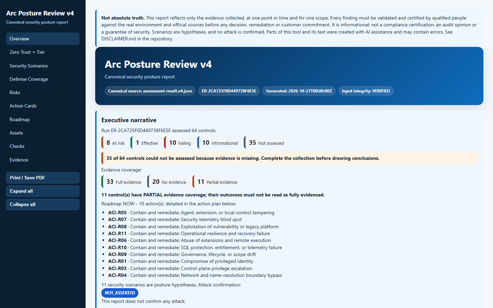

# Arc Posture Review

[](https://github.com/fabiotreze/arc-posture-review/releases)
[](LICENSE)
[](LICENSE-DOCS)

**English** · [Português](README.pt-BR.md)

Read-only security posture review for **Azure Arc-enabled servers** and **SQL Server enabled by Azure Arc**. A read-only PowerShell collector produces an evidence package; the v4 engine turns it into a deterministic assessment and a bilingual (EN-US/PT-BR) HTML report with a prioritized action plan.

> Personal, independent project. Not an official Microsoft tool. Validate recommendations against official Microsoft documentation; you are responsible for how you use it. See [DISCLAIMER.md](DISCLAIMER.md).



## Quick start (Azure Cloud Shell · PowerShell)

```powershell
Invoke-WebRequest https://github.com/fabiotreze/arc-posture-review/releases/latest/download/Invoke-ArcPostureReview.ps1 -OutFile Invoke-ArcPostureReview.ps1
./Invoke-ArcPostureReview.ps1 -V4Report
```

| Output | Content |
|---|---|
| `arc-posture-review/arc-posture-review-<date>.zip` | Evidence package (results, findings, manifest SHA-256). The script prints its SHA-256. |
| `arc-posture-review/arc-posture-review-<date>-v4/` | `arc-posture-review.v4.en-US.html`, `arc-posture-review.v4.pt-BR.html`, `assessment.v4.json`, `resource-index.v4.json` |

Scope options: `-Subscriptions <id1>,<id2>` or `-ManagementGroup <name>` (default: current subscription). `-V4Report` needs git and Python 3.10+; Cloud Shell has both. If they are missing, the collection still completes and the manual commands are printed.

## What the report shows

- **64 controls** (45 automated, 19 documentary) and **11 security scenarios**, each traced Evidence → Observation → Claim → Control → Scenario.
- **Execution first:** status tiles, data-gap callout, executive narrative and a NOW action plan in canonical priority order, with a collapsible evidence trace per failing or at-risk check.
- **Navigation:** sticky menu with print/expand/collapse; every `CHK-xx` links to its row in *Checks*; Zero Trust × Tier view with outcome bars.
- **Azure portal links** per finding row (resource index bound to the run `runId` and package SHA-256).
- **Before/after** only when a baseline package is supplied (`--baseline`).
- Missing evidence never becomes a pass; attack paths are never asserted as confirmed.

## v4 commands

<details>
<summary><b>Generate the report from an existing package</b></summary>

```powershell
python assurance/v4/checkpoint5/cli/arc_posture.py evaluate --evidence arc-posture-review-<date>.zip --output assessment.v4.json
python tools/New-ResourceIndex.py --evidence arc-posture-review-<date>.zip --assessment assessment.v4.json --output resource-index.v4.json
python assurance/v4/checkpoint6/report/render_v4.py --input assessment.v4.json --resources resource-index.v4.json --locale en-US --output arc-posture-review.v4.en-US.html
python assurance/v4/checkpoint6/report/render_v4.py --input assessment.v4.json --resources resource-index.v4.json --locale pt-BR --output arc-posture-review.v4.pt-BR.html
```

Run from a clone of this repository. On Windows, `py -3` works in place of `python`.
</details>

<details>
<summary><b>Before/after against a previous package</b></summary>

```powershell
python assurance/v4/checkpoint5/cli/arc_posture.py evaluate --evidence <after>.zip --baseline <before>.zip --output assessment.v4.json
```

Then render as above. Both inputs must be collector packages (`.zip`), not rendered reports. Without `--baseline` the report states that no baseline was supplied and shows no trend.
</details>

<details>
<summary><b>Run the collector locally (Windows / PowerShell 7)</b></summary>

```powershell
az login
./scripts/Invoke-ArcPostureReview.ps1 -V4Report
```

Review the script before running it. Azure access is read-only (Azure Resource Graph and Azure CLI read commands).
</details>

<details>
<summary><b>Permissions and privacy (LGPD / GDPR)</b></summary>

- **Permissions:** Reader on the subscriptions or management group. The script checks effective permissions first and marks affected checks as partial when something is missing.
- **Personal data:** the package and reports contain environment data (collecting account, Activity Log `caller`, principal IDs, machine names). Keep them in access-controlled storage, share only with authorized people and delete them at the end of the engagement. Never attach them to public issues.
- **Roles:** the organization that owns the environment is the data controller. This project does not receive, store or process any collected data.
</details>

<details>
<summary><b>Before treating a result as final</b></summary>

| Risk | Control |
|---|---|
| Machine-limited run hides findings outside the sample | Final run without machine limit (`MaxMachines = 0`) or complete scopes. |
| `PARTIAL`, `ERROR`, `TODO`, `UNASSESSED` read as healthy | Treat as **not assessed**; fix permissions/providers and collect again. |
| Version metadata fell back to static tables | Check the source shown in the finding against current Microsoft release notes. |
</details>

<details>
<summary><b>Browser analysis (guided checklist)</b></summary>

The offline HTML guide generates the collector, records checklist decisions and analyzes the `.zip` locally in the browser (no network: `connect-src 'none'`).

- Online: https://fabiotreze.github.io/arc-posture-review/ · [Português](https://fabiotreze.github.io/arc-posture-review/arc-posture-review.pt-BR.html)
- Offline: [`arc-posture-review.en-US.html`](arc-posture-review.en-US.html) · [`arc-posture-review.pt-BR.html`](arc-posture-review.pt-BR.html)
</details>

<details>
<summary><b>Validate changes (maintainers)</b></summary>

```powershell
python -m pip install -r requirements-dev.txt
python tools/Invoke-V4FinalGates.py --profile pr-quality
python tools/Invoke-V4FinalGates.py --profile release
```

Profiles: `pr-quality`, `report-quality`, `release`, `methodology`, `security-regression`. They run in an isolated copy and leave the working tree unchanged. The v4 Playwright tests can use an installed Edge or Chrome via `ARC_REVIEW_BROWSER` (path to the executable).
</details>

<details>
<summary><b>Repository map</b></summary>

```
scripts/Invoke-ArcPostureReview.ps1   read-only collector (-V4Report renders the v4 report)
assurance/v4/                         v4 engine, CLI, renderer and gates (checkpoints)
tools/New-ResourceIndex.py            Azure portal links for the v4 report
tools/Invoke-V4FinalGates.py          v4 gate profiles
criteria/checks.*.json                canonical bilingual source of the 64 checks
docs/v4/                              methodology, threat model, security review record
release/                              release manifests, notes and SHA256SUMS
arc-posture-review.*.html, index.html offline guide and browser analysis
```
</details>

Methodology: [docs/v4/methodology-v4.md](docs/v4/methodology-v4.md) · Security review: [docs/v4/security-review-record-v4.0.0.md](docs/v4/security-review-record-v4.0.0.md) · Changes: [CHANGELOG.md](CHANGELOG.md)

## Feedback and license

Questions and corrections via [issues](../../issues), citing official Microsoft documentation; never include customer or environment data. Security issues: [SECURITY.md](SECURITY.md).

Code: [MIT](LICENSE). Documentation and text: [CC BY 4.0](LICENSE-DOCS) — credit: *"Arc Posture Review" by Fabio Rodrigues Vieira Costa, https://github.com/fabiotreze/arc-posture-review*. Third-party content and trademarks (Microsoft, Azure, Azure Arc) remain with their owners.
