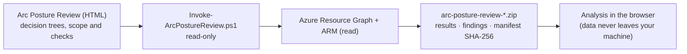

# Arc Posture Review

[](LICENSE)
[](LICENSE-DOCS)

**English** · [Português](README.pt-BR.md)

Read-only security assessment kit for **Azure Arc-enabled servers** and **SQL Server enabled by Azure Arc**. One offline HTML file guides the assessment, generates a read-only PowerShell collector, and analyzes the evidence package locally in your browser.

> Personal, independent project. Not an official Microsoft tool. Built from years of field delivery experience and public Microsoft documentation, consolidated with the help of AI agents and reviewed by the author. Validate recommendations against official documentation; you are responsible for how you use it. See [DISCLAIMER.md](DISCLAIMER.md).

## What you get

- **Public Microsoft method:** the *sustain security posture* cycle of the [Cloud Adoption Framework — Secure](https://learn.microsoft.com/azure/cloud-adoption-framework/secure/overview), measured against the [Microsoft Cloud Security Benchmark](https://learn.microsoft.com/security/benchmark/azure/introduction) (MCSB v1, mapped to CIS Controls v8, NIST SP 800-53 and PCI-DSS).
- **54 checks** (38 automated, 16 documentary), each with assessment layer, MCSB control and decision tree.
- **9 decision trees** (onboarding, organization, connectivity, identity, extensions, protection, versions and legacy, decommissioning, cost) plus program execution.
- **Read-only collector** (`Invoke-ArcPostureReview.ps1`): Azure Resource Graph and Azure CLI read commands only, paginated, multi-subscription or management group, effective-permission pre-check (Reader is enough).
- **Local analysis:** compliance by layer and MCSB control, Defender for Cloud Secure Score, action plan with timeframe and owner, 9 recommended alerts, agent and extension versions on the run date, cost estimate, and evidence per finding.
- **Agent security floor:** machines below Connected Machine agent **1.61** fail the version check (known local elevation-of-privilege CVEs: CVE-2025-49692, CVE-2025-26627, CVE-2025-55316, CVE-2026-26117), and the services catalog covers the agent scheduled tasks and extension services.
- **Package validation:** origin, structure, manifest SHA-256 and size limits; tampered packages are rejected. The script prints the `.zip` SHA-256 so you can confirm the origin.
- **Reports** in HTML, Markdown and JSON, in **English** and **Brazilian Portuguese**.
- **Accessible UI:** status shown by icon, text and color (Advisor/Defender palette), AA contrast, dark mode, high-contrast and reduced-motion support.

## Use

| Option | How |
|---|---|
| Online | https://fabiotreze.github.io/arc-posture-review/ (English) · [Português](https://fabiotreze.github.io/arc-posture-review/arc-posture-review.pt-BR.html) |
| Offline | Download [`arc-posture-review.en-US.html`](arc-posture-review.en-US.html) or [`arc-posture-review.pt-BR.html`](arc-posture-review.pt-BR.html) and open it in Edge or Chrome |
| Script only | [`scripts/Invoke-ArcPostureReview.ps1`](scripts/Invoke-ArcPostureReview.ps1): all 54 checks, current subscription by default |
| Read the guide | [docs/guide.en-US.md](docs/guide.en-US.md) · [docs/guide.pt-BR.md](docs/guide.pt-BR.md) |

Flow: **Start here → Prepare collection → Run summary → Analysis → Plan and delivery**



1. Open the HTML and follow **Start here**: pick your decisions in the visual trees, then choose the scope (current subscription, list or management group) and the checks.
2. Download the script and run it in **Azure Cloud Shell (PowerShell)**: `./Invoke-ArcPostureReview.ps1`
   - or use the standalone script: `./Invoke-ArcPostureReview.ps1 -Subscriptions <id1>,<id2>` or `-ManagementGroup <name>`.
3. Load the generated `.zip` in the HTML and compare the SHA-256 shown with the one printed by the script.
4. Review the analysis, apply statuses and export the report.

**Permissions:** Reader on the management group or subscriptions. The script checks effective permissions first and marks affected checks as partial when something is missing.

**Privacy:** form fields are kept only in your browser local storage. The evidence package and reports contain environment data: treat them as confidential and never attach them to issues.

## Repository

```
index.html                         English version (GitHub Pages)
arc-posture-review.en-US.html      offline HTML, English
arc-posture-review.pt-BR.html      offline HTML, Portuguese
scripts/Invoke-ArcPostureReview.ps1  standalone read-only collector (review it before running)
docs/guide.en-US.md · guide.pt-BR.md  playbook with decision trees (Mermaid renders on GitHub)
```

## Feedback

Questions, corrections and proposals are welcome through [issues](../../issues), citing the official Microsoft documentation. Never include customer or environment data. Security issues: see [SECURITY.md](SECURITY.md).

## License

- **Code** (the PowerShell script and the JavaScript, CSS and PowerShell inside the HTML files): [MIT](LICENSE).
- **Documentation and playbook text** (docs/, README, DISCLAIMER and the text of the HTML files): [CC BY 4.0](LICENSE-DOCS). Suggested credit: *"Arc Posture Review" by Fabio Rodrigues Vieira Costa, https://github.com/fabiotreze/arc-posture-review*.
- Third-party content referenced or briefly quoted (Microsoft Learn, public security research) and trademarks (Microsoft, Azure, Azure Arc) are not relicensed and remain with their owners.
