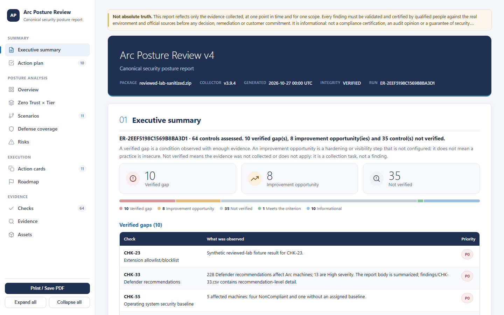

# Arc Posture Review

[](https://github.com/fabiotreze/arc-posture-review/releases)
[](LICENSE)
[](LICENSE-DOCS)

**English** · [Português](README.pt-BR.md)

Read-only security posture review for **Azure Arc-enabled servers** and **SQL Server enabled by Azure Arc**. A read-only PowerShell collector produces an evidence package; the v4 engine turns it into a deterministic assessment and a bilingual (EN-US/PT-BR) HTML report with a prioritized action plan.

> Personal, independent project. Not an official Microsoft tool. Validate recommendations against official Microsoft documentation; you are responsible for how you use it. See [DISCLAIMER.md](DISCLAIMER.md).



## Start here — 3 steps

**Collect → Open → Deliver.** Everything is read-only.

### 1 · Collect (Azure Cloud Shell · PowerShell)

```powershell
Invoke-WebRequest https://github.com/fabiotreze/arc-posture-review/releases/latest/download/Invoke-ArcPostureReview.ps1 -OutFile Invoke-ArcPostureReview.ps1
./Invoke-ArcPostureReview.ps1 -Subscriptions "<subscription name or id>"
```

> **Always pass `-Subscriptions` (or `-ManagementGroup`) with the subscription(s) that contain your Arc machines.** Without it, only the CLI's current default subscription is queried; if the machines live elsewhere the report shows 0 machines and most checks become N/A. Check the `Scope:` line in the output before trusting the result.

| Output (in `arc-posture-review/`) | Content |
|---|---|
| `arc-posture-review-<date>.zip` | **One package:** the evidence (results, findings, manifest SHA-256) and, in `report/`, the canonical v4 report (Zero Trust × Tier, scenarios, action plan) in EN-US and PT-BR. **Download this file** from Cloud Shell. |
| `arc-posture-review-<date>.zip.sha256` | Its SHA-256, to verify the download. |

The report step needs Python 3.10+ (Cloud Shell has it). The collector downloads a small, stdlib-only kit published with the same release and runs it only if its SHA-256 equals the value pinned in the script; nothing is written to Azure. If Python or the download is unavailable, the run still completes with the evidence package and a warning. Use `-NoV4Report` to skip the report step.

### 2 · Open the analysis

Open the app at <https://fabiotreze.github.io/arc-posture-review/> (or the `index.html` from this repository), go to step 3 and load the `.zip`. Step 4 shows the analysis. It opens with a **verdict** (verified gaps, improvement opportunities and what is still not verified, plus the three actions to do first), followed by kit index, domains, priorities, evidence and the action plan. **Open v4 report (Zero Trust)** opens the canonical v4 report that came in the same `.zip`.

### 3 · Deliver

In step 4, **Save analysis (.html)**, **Save v4 report (.html)** or **Print / PDF** (use `python tools/Generate-CleanPdf.py <saved.html>` for a clean PDF). Check *Hide e-mails in saved files* before sharing.

### Only if the `.zip` has no `report/` · Generate the canonical v4 report yourself

When the collector could not run the report step (no Python 3.10+ in the shell), generate it from the same `.zip` in a clone of this repository:

```powershell
git clone https://github.com/fabiotreze/arc-posture-review.git; cd arc-posture-review
python assurance/v4/checkpoint5/cli/arc_posture.py evaluate --evidence <path-to>.zip --output assessment.v4.json
python tools/New-ResourceIndex.py --evidence <path-to>.zip --assessment assessment.v4.json --output resource-index.v4.json
python assurance/v4/checkpoint6/report/render_v4.py --input assessment.v4.json --resources resource-index.v4.json --locale en-US --output arc-posture-review.v4.en-US.html
```

Use `--locale pt-BR` for the Portuguese version. More options (baseline, before/after) are under *v4 commands* below.

### Which document do I read?

| I want to… | Read |
|---|---|
| Run the review | This page, steps 1–3 |
| Understand each check and what to do about it | [docs/guide.en-US.md](docs/guide.en-US.md) (also inside the app, step 1) |
| Know how results are decided (evidence, coverage, wording) | [docs/v4/methodology-v4.md](docs/v4/methodology-v4.md) and [docs/v4.1.1-posture-vs-evidence.md](docs/v4.1.1-posture-vs-evidence.md) |
| See which queries and permissions are used | [docs/v4/query-evidence-matrix.md](docs/v4/query-evidence-matrix.md) |
| Review security and known limitations | [docs/v4/threat-model-v4.md](docs/v4/threat-model-v4.md), [docs/v4/known-issues.md](docs/v4/known-issues.md), [SECURITY.md](SECURITY.md) |
| See what changed | [CHANGELOG.md](CHANGELOG.md) |

Scope options: `-Subscriptions <id1>,<id2>` or `-ManagementGroup <name>` (default: only the current CLI subscription, which is rarely what you want).

Optional inputs that turn PARTIAL checks into conclusive ones:

| Parameter | Effect |
|---|---|
| `-AllowedRegions brazilsouth,brazilsoutheast` | Approved Azure regions (data residency policy). Without it, **CHK-05** stays PARTIAL because there is nothing to compare the machine metadata regions against. |
| `-RequiredTags env,owner,...` | Tags required by your governance (**CHK-06**). |
| `-MaxMachines <n>` | Limits large estates to a risk-prioritized sample; use `0` (default) for the final run. |

Example: `./Invoke-ArcPostureReview.ps1 -Subscriptions "<name or id>" -AllowedRegions brazilsouth`

## What the report shows

- **64 controls** (45 automated, 19 documentary) and **11 security scenarios**, each traced Evidence → Observation → Claim → Control → Scenario.
- **Execution first:** a report-style executive summary (verified gaps, improvement opportunities and not-verified controls, with check titles and a reading legend) and a NOW action plan grouped by what to do (remediate verified gaps, improve posture, complete evidence collection), in canonical priority order, with a collapsible evidence trace per listed check.
- **Navigation:** grouped side menu (Summary, Posture analysis, Execution, Evidence) with icons, counts and a highlight that follows the scroll; a mobile menu drawer; a filter by ID, title or outcome in *Checks* (with titles and plain-language outcomes); every `CHK-xx` links to its row; back-to-top, print and expand/collapse; Zero Trust × Tier view with outcome bars.
- **Azure portal links** per finding row (resource index bound to the run `runId` and package SHA-256).
- **Before/after** only when a baseline package is supplied (`--baseline`).
- Missing evidence never becomes a pass; attack paths are never asserted as confirmed.
- **Posture, not accusation:** a missing configuration is an improvement opportunity and missing evidence is a collection task. Only conditions observed with enough evidence (for example NonCompliant, an expired agent, a Free Defender tier) are verified gaps. See the reading guide in `docs/guide.en-US.md`, section 1.3.

## v4 commands

<details>
<summary><b>Generate the report from an existing package</b></summary>

```powershell
python assurance/v4/checkpoint5/cli/arc_posture.py evaluate --evidence arc-posture-review-<date>.zip --output assessment.v4.json
python tools/New-ResourceIndex.py --evidence arc-posture-review-<date>.zip --assessment assessment.v4.json --output resource-index.v4.json
python assurance/v4/checkpoint6/report/render_v4.py --input assessment.v4.json --resources resource-index.v4.json --locale en-US --output arc-posture-review.v4.en-US.html
python assurance/v4/checkpoint6/report/render_v4.py --input assessment.v4.json --resources resource-index.v4.json --locale pt-BR --output arc-posture-review.v4.pt-BR.html
```

Run from a clone of this repository. On Windows, `py -3` works in place of `python`.
</details>

<details>
<summary><b>Before/after against a previous package</b></summary>

```powershell
python assurance/v4/checkpoint5/cli/arc_posture.py evaluate --evidence <after>.zip --baseline <before>.zip --output assessment.v4.json
```

Then render as above. Both inputs must be collector packages (`.zip`), not rendered reports. Without `--baseline` the report states that no baseline was supplied and shows no trend.
</details>

<details>
<summary><b>Run the collector locally (Windows / PowerShell 7)</b></summary>

```powershell
az login
./scripts/Invoke-ArcPostureReview.ps1 -Subscriptions "<subscription name or id>"
```

Review the script before running it. Azure access is read-only (Azure Resource Graph and Azure CLI read commands).
</details>

<details>
<summary><b>Permissions and privacy (LGPD / GDPR)</b></summary>

- **Permissions:** Reader on the subscriptions or management group. The script checks effective permissions first and marks affected checks as partial when something is missing.
- **Personal data:** the package and reports contain environment data (collecting account, Activity Log `caller`, principal IDs, machine names). Keep them in access-controlled storage, share only with authorized people and delete them at the end of the engagement. Never attach them to public issues.
- **Roles:** the organization that owns the environment is the data controller. This project does not receive, store or process any collected data.
</details>

<details>
<summary><b>Before treating a result as final</b></summary>

| Risk | Control |
|---|---|
| Machine-limited run hides findings outside the sample | Final run without machine limit (`MaxMachines = 0`) or complete scopes. |
| `PARTIAL`, `ERROR`, `TODO`, `UNASSESSED` read as healthy | Treat as **not assessed**; fix permissions/providers and collect again. |
| Version metadata fell back to static tables | Check the source shown in the finding against current Microsoft release notes. |
</details>

<details>
<summary><b>Browser analysis (guided checklist)</b></summary>

The offline HTML guide generates the collector, records checklist decisions and analyzes the `.zip` locally in the browser (no network: `connect-src 'none'`).

- Online: https://fabiotreze.github.io/arc-posture-review/ · [Português](https://fabiotreze.github.io/arc-posture-review/arc-posture-review.pt-BR.html)
- Offline: [`arc-posture-review.en-US.html`](arc-posture-review.en-US.html) · [`arc-posture-review.pt-BR.html`](arc-posture-review.pt-BR.html)
</details>

<details>
<summary><b>Validate changes (maintainers)</b></summary>

```powershell
python -m pip install -r requirements-dev.txt
python tools/Invoke-V4FinalGates.py --profile pr-quality
python tools/Invoke-V4FinalGates.py --profile release
```

Profiles: `pr-quality`, `report-quality`, `release`, `methodology`, `security-regression`. They run in an isolated copy and leave the working tree unchanged. The v4 Playwright tests can use an installed Edge or Chrome via `ARC_REVIEW_BROWSER` (path to the executable).
</details>

<details>
<summary><b>Repository map</b></summary>

```
scripts/Invoke-ArcPostureReview.ps1   read-only collector (renders and zips the v4 report by default)
assurance/v4/                         v4 engine, CLI, renderer and gates (checkpoints)
tools/New-ResourceIndex.py            Azure portal links for the v4 report
tools/Invoke-V4FinalGates.py          v4 gate profiles
criteria/checks.*.json                canonical bilingual source of the 64 checks
docs/v4/                              methodology, threat model, security review record
release/                              release manifests, notes and SHA256SUMS
arc-posture-review.*.html, index.html offline guide and browser analysis
```
</details>

Methodology: [docs/v4/methodology-v4.md](docs/v4/methodology-v4.md) · Security review: [docs/v4/security-review-record-v4.0.0.md](docs/v4/security-review-record-v4.0.0.md) · Changes: [CHANGELOG.md](CHANGELOG.md)

## Feedback and license

Questions and corrections via [issues](../../issues), citing official Microsoft documentation; never include customer or environment data. Security issues: [SECURITY.md](SECURITY.md).

Code: [MIT](LICENSE). Documentation and text: [CC BY 4.0](LICENSE-DOCS) — credit: *"Arc Posture Review" by Fabio Rodrigues Vieira Costa, https://github.com/fabiotreze/arc-posture-review*. Third-party content and trademarks (Microsoft, Azure, Azure Arc) remain with their owners.
