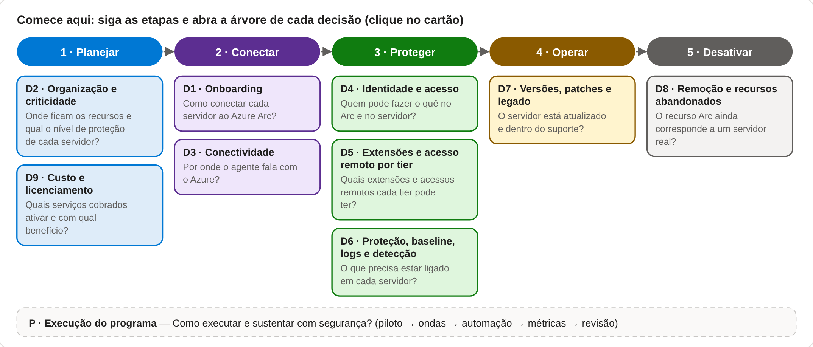
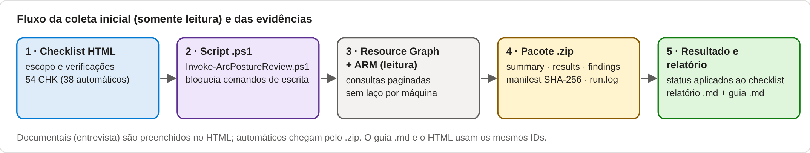
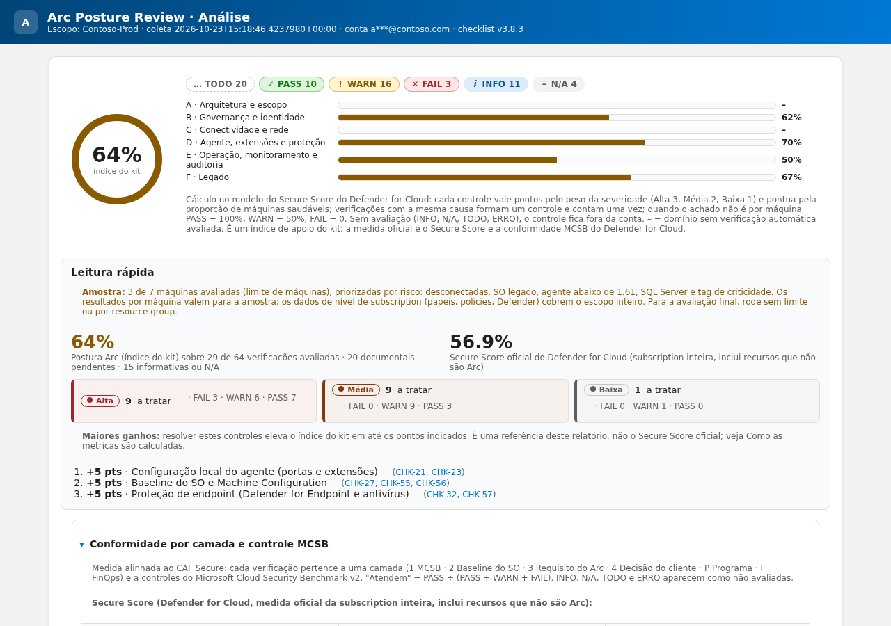
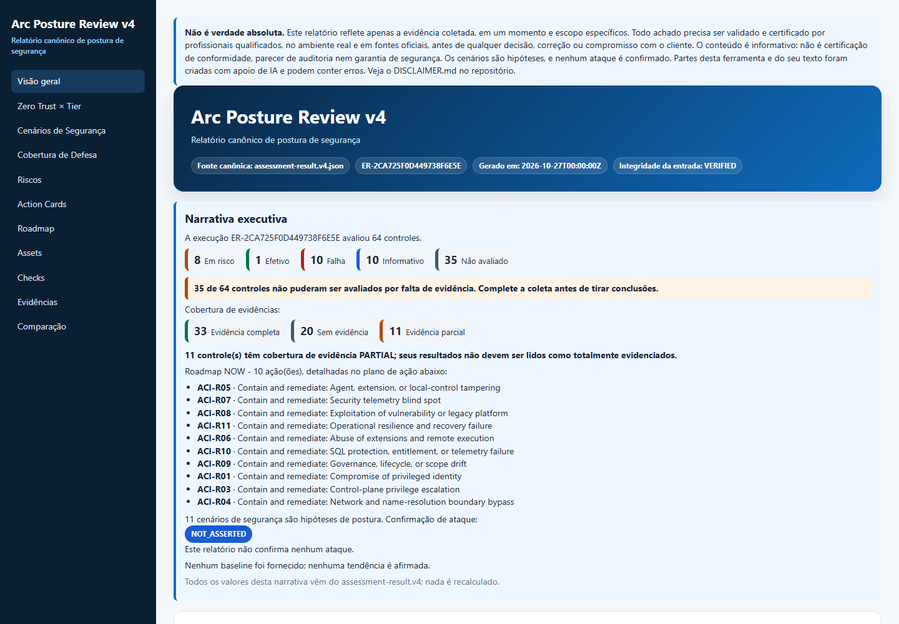

# Arc Posture Review

[](https://github.com/fabiotreze/arc-posture-review/releases)
[](LICENSE)
[](LICENSE-DOCS)

[English](README.md) · **Português**

Kit somente leitura para avaliar a segurança de **servidores habilitados pelo Azure Arc** e do **SQL Server habilitado pelo Azure Arc**. Um único HTML offline guia a avaliação, gera um coletor PowerShell somente leitura e analisa o pacote de evidências localmente no navegador.

> Projeto pessoal e independente. Não é uma ferramenta oficial da Microsoft. Construído a partir de anos de experiência em entregas de campo e da documentação pública da Microsoft, consolidado com apoio de agentes de IA e revisado pelo autor. Valide as recomendações na documentação oficial; o uso é de responsabilidade de quem executa. Veja [DISCLAIMER.md](DISCLAIMER.md).

## Para que serve

**Foco: a postura de segurança dos servidores habilitados pelo Azure Arc** (e do SQL Server habilitado pelo Azure Arc). Responde a uma pergunta: *este ambiente Arc está configurado, protegido e operado com segurança, e o que corrigir primeiro?*

As decisões de segurança começam antes do primeiro servidor conectado (credenciais de onboarding, caminho de rede) e terminam depois que ele é removido (recursos órfãos, identidades esquecidas). Por isso o guia cobre o ciclo de vida inteiro do servidor: planejar, conectar, proteger, operar, desativar.

| Você quer | Use | Resultado |
|---|---|---|
| **Avaliar um ambiente Arc existente** (uso principal) | Etapas 2–5: gerar o script somente leitura, rodar no Cloud Shell, carregar o `.zip` | Achados por verificação, plano de ação priorizado, relatório |
| **Planejar ou revisar um onboarding** | Guia → *Comece aqui* → árvores D1–D3, D2 e D9; itens documentais como checklist de desenho | Decisões registradas antes do rollout |
| **Preparar uma conversa ou workshop de segurança** | Guia, árvores de decisão e relatório de exemplo | Vocabulário comum e pauta estruturada |
| **Acompanhar a evolução** | Rodar a coleta de novo e comparar os `.json` exportados | Evidência de antes e depois |

**Por que tantas referências e diagramas?** Cada verificação aponta para a fonte pública da Microsoft que a sustenta (controle do Microsoft Cloud Security Benchmark, Cloud Adoption Framework, documentação do produto), e cada decisão tem uma árvore que explica o *porquê*. Os achados podem ser rastreados e defendidos, em vez de serem opinião.

**O que não é:** não instala, não conecta e não altera nada (somente leitura); não substitui o Defender for Cloud, o Secure Score ou o Azure Policy (ele os lê); e não é orientação oficial da Microsoft.

## O que entrega

- **Método público da Microsoft:** ciclo de sustentação de postura do [Cloud Adoption Framework — Secure](https://learn.microsoft.com/azure/cloud-adoption-framework/secure/overview), medido pelo [Microsoft Cloud Security Benchmark](https://learn.microsoft.com/security/benchmark/azure/introduction) (MCSB v2, com mapeamento para CIS Controls v8.1, NIST SP 800-53, PCI-DSS v4, NIST CSF 2.0 e ISO 27001).
- **64 verificações** (45 automáticas, 19 documentais), cada uma com camada, controle MCSB e árvore de decisão.
- **9 árvores de decisão** (onboarding, organização, conectividade, identidade, extensões, proteção, versões e legado, remoção, custo) e execução do programa.
- **Coletor somente leitura** (`Invoke-ArcPostureReview.ps1`): apenas leitura via Azure Resource Graph e Azure CLI, paginado, várias subscriptions ou management group, com verificação prévia de permissões (Reader basta) e limite opcional de máquinas para ambientes grandes (amostra priorizada por risco).
- **Análise local:** leitura rápida, índice do kit no modelo do Secure Score (pontos por severidade, proporção de máquinas saudáveis, mesma causa contada uma vez), conformidade por camada e por controle MCSB, Secure Score do Defender for Cloud, plano de ação em uma linha por ação com ganho, prazo e responsável, 9 alertas recomendados, versões do agente e das extensões na data da execução, estimativa de custo e evidências por achado.
- **Duas camadas do relatório:** avaliação executiva conciso para decisão e apêndice de evidências separado, com contratos, critérios, rastreabilidade e links para os achados completos.
- **PDF limpo:** `python tools/Generate-CleanPdf.py <relatorio-salvo.html>` gera e valida PDF A4 sem cabeçalhos/rodapés do navegador com URL e data.
- **Inventário de cobertura:** o guia (Anexo J) mostra os totais por domínio, severidade, camada e árvore de decisão, e o que mudou desde a versão anterior.
- **Piso de segurança do agente:** máquinas abaixo da versão **1.61** do Connected Machine agent falham na verificação de versão (CVEs públicas de elevação de privilégio local: CVE-2025-49692, CVE-2025-26627, CVE-2025-55316, CVE-2026-26117), e o catálogo de serviços cobre as tarefas agendadas do agente e os serviços das extensões.
- **Validação do pacote:** origem, estrutura, SHA-256 do manifest e limites de tamanho; pacote alterado é rejeitado. O script imprime o SHA-256 do `.zip` para confirmar a origem.
- **Arquivos gerados**, em **português** e **inglês** (o idioma faz parte do nome do arquivo):

  | Arquivo | O que contém | Para que usar |
  |---|---|---|
  | `arc-posture-review-<data>.zip` | Dados coletados, resultados e itens de cada verificação (gerado pelo script) | Evidência; carregar na etapa 3 |
  | `arc-posture-review-analysis-<data>.<idioma>.html` | **Um único arquivo:** a análise completa mais o registro do checklist (status, evidência da coleta e notas de cada verificação, notas da sessão) | A entrega: compartilhar, arquivar ou imprimir em PDF |
  | `arc-posture-review-report.<idioma>.md` / `.json` | O mesmo conteúdo em texto e em dados | Editar o texto ou comparar execuções |
- **Interface acessível:** status por ícone, texto e cor (paleta do Advisor/Defender), contraste AA, modo escuro, alto contraste e movimento reduzido.

## Riscos atuais do lab e da avaliação

| Risco | Controle antes de tratar o resultado como final |
|---|---|
| Uma execução com limite de máquinas pode ocultar achados fora da amostra | Use `MaxMachines = 0` na rodada final ou execute escopos completos por resource group. Trate a rodada limitada só como descoberta. |
| `PARTIAL`, `ERROR` ou `TODO` pode ser confundido com estado saudável | Trate como **não avaliado**. Corrija lacunas de permissão, provider, API e documentação e colete novamente. |
| Metadados de versão ao vivo podem ficar indisponíveis e cair para tabelas estáticas | Confirme a fonte exibida no achado e valide as release notes atuais da Microsoft na data da execução. |
| Evidências e relatórios exportados contêm dados do ambiente e dados pessoais | Use contas autorizadas e armazenamento controlado, mantenha a máscara de e-mail ligada e nunca anexe evidências em issues públicas. |
| Gates locais estáticos/de navegador não comprovam a coleta ao vivo no Azure nem o fluxo completo de importação/exportação | Antes da release, rode o coletor no lab autorizado e execute `Test-ReportVisual.py --package <fresh-lab.zip>`. |

## Privacidade e proteção de dados (LGPD)

- **Nada sai do navegador.** A página não tem servidor: o `.zip` é lido e analisado localmente, em JavaScript. Uma Content Security Policy na própria página bloqueia qualquer conexão de rede (`connect-src 'none'`), e não há scripts, fontes ou rastreadores externos. Dá para conferir no código-fonte da página ou nas ferramentas do desenvolvedor do navegador (aba *Rede*).
- **O que fica no navegador:** só as escolhas, os status, as notas e os campos de escopo do checklist, no armazenamento local do navegador, para você continuar depois. O pacote e os dados coletados não são guardados. Use **Limpar dados deste navegador** (etapa 3) para apagar.
- **Dados pessoais no pacote:** e-mail da conta de coleta, quem operou as máquinas (campo `caller` do Activity Log) e identificadores como IDs de principal e nomes de máquinas. A página pede confirmação antes de carregar o pacote, e **Ocultar e-mails nos arquivos salvos** (ligado por padrão) troca os e-mails por `a***@dominio` nos `.html`, `.md` e `.json` salvos.
- **Papéis:** a organização dona do ambiente é a controladora dos dados. Este projeto não recebe, não guarda e não trata nenhum dado coletado. O GitHub Pages só entrega a página estática (veja a [Declaração de Privacidade do GitHub](https://docs.github.com/site-policy/privacy-policies/github-general-privacy-statement)); em ambientes restritos, baixe o `.html` e use offline.
- **Boas práticas:** colete com conta de menor privilégio, guarde o pacote e os relatórios em local com controle de acesso, compartilhe só com quem tem autorização e apague ao fim do trabalho.

## Veja antes de rodar





**Relatório de exemplo** (análise no navegador) de uma fixture sanitizada de laboratório (7 servidores Arc; SQL Server e Defender for Servers), anonimizado: subscription, conta, IDs e nomes de recursos de governança substituídos.
[Abrir o relatório de exemplo](https://fabiotreze.github.io/arc-posture-review/docs/examples/sample-analysis.pt-BR.html) · [English](https://fabiotreze.github.io/arc-posture-review/docs/examples/sample-analysis.en-US.html)



## Relatório v4 (avaliação canônica)

Desde a v4.0.0, o mesmo pacote de evidências também gera uma avaliação canônica e determinística (`assessment-result.v4.json`), exibida em um relatório HTML bilíngue EN-US/PT-BR. A análise no navegador descrita acima não muda.



- **Rastreável:** cada controle segue Evidência → Observação → Afirmação → Controle → Cenário de segurança (64 controles, 11 cenários); evidência ausente nunca vira aprovação, e caminhos de ataque nunca são afirmados como confirmados.
- **Execução primeiro:** indicadores de status, aviso de lacunas de dados e plano de ação AGORA na ordem canônica de prioridade, com rastro da evidência recolhível para cada verificação com falha ou em risco.
- **Links para o portal Azure (opcional):** um índice de recursos vinculado à execução (`runId` e SHA-256 do pacote) adiciona links do portal por linha de achado; links inferidos de pacote com uma única subscription são marcados como inferidos.
- **Antes/depois:** avalie com `--baseline` para mostrar melhorias verificadas, regressões e controles inalterados.

```powershell
python assurance/v4/checkpoint5/cli/arc_posture.py evaluate --evidence arc-posture-review-<data>.zip --output assessment-result.v4.json
pwsh tools/New-V4Report.ps1 -Assessment assessment-result.v4.json -OutputDirectory report-v4
# opcional: links do portal Azure por linha de achado
python tools/New-ResourceIndex.py --evidence arc-posture-review-<data>.zip --assessment assessment-result.v4.json --output resource-index.v4.json
python assurance/v4/checkpoint6/report/render_v4.py --input assessment-result.v4.json --output report-v4/arc-posture-review.v4.pt-BR.html --locale pt-BR --resources resource-index.v4.json
# opcional: antes/depois contra um pacote anterior
python assurance/v4/checkpoint5/cli/arc_posture.py evaluate --evidence <depois>.zip --baseline <antes>.zip --output assessment-result.v4.json
```

Metodologia: [docs/v4/methodology-v4.md](docs/v4/methodology-v4.md) · Revisão de segurança: [docs/v4/security-review-record-v4.0.0.md](docs/v4/security-review-record-v4.0.0.md) · Manifesto, notas e checksums da release: [release/v4.0.0/](release/v4.0.0/)

## Como usar

| Opção | Como |
|---|---|
| Online | https://fabiotreze.github.io/arc-posture-review/arc-posture-review.pt-BR.html |
| Offline | Baixe [`arc-posture-review.pt-BR.html`](arc-posture-review.pt-BR.html) (ou [`.en-US.html`](arc-posture-review.en-US.html)) e abra no Edge ou Chrome |
| Só o script | [`scripts/Invoke-ArcPostureReview.ps1`](scripts/Invoke-ArcPostureReview.ps1): as 64 verificações, subscription atual por padrão |
| **Guia canônico do projeto** | [`arc-posture-review.pt-BR.html`](arc-posture-review.pt-BR.html) · [`arc-posture-review.en-US.html`](arc-posture-review.en-US.html) (integrado, offline; não é orientação oficial da Microsoft) |

1. Abra o HTML e siga o **Comece aqui**: escolha as decisões nas árvores visuais e depois o escopo e as verificações.
2. Baixe o script e execute no **Azure Cloud Shell (PowerShell)**: `./Invoke-ArcPostureReview.ps1` (ou `-Subscriptions <id1>,<id2>` / `-ManagementGroup <nome>`).
   - Acrescente `-V4Report` para gerar também o relatório v4 ao lado do pacote (clona a tag da mesma versão; requer git e Python 3.10+). Se faltarem, a coleta termina normalmente e o comando manual é exibido.
3. Carregue o `.zip` gerado e compare o SHA-256 exibido com o impresso pelo script.
4. Revise a análise, aplique os status e exporte o relatório.

**Permissões:** Reader no management group ou nas subscriptions. **Privacidade:** os campos ficam só no navegador da sua máquina; pacote e relatórios têm dados do ambiente e são confidenciais.

## Repositório

```
index.html                           versão em inglês (GitHub Pages)
arc-posture-review.en-US.html        HTML offline, inglês
arc-posture-review.pt-BR.html        HTML offline, português
scripts/Invoke-ArcPostureReview.ps1  coletor somente leitura avulso (revise antes de executar)
docs/guide.en-US.md · guide.pt-BR.md espelhos de autoria usados para manter o guia HTML integrado
docs/examples/                       relatórios de exemplo anonimizados (en-US, pt-BR)
docs/images/                         imagens usadas no README
tools/Generate-CleanPdf.py           geração de PDF limpa e validada (sem cabeçalho/rodapé do navegador)
criteria/checks.*.json               fonte canônica bilíngue dos 64 checks e dos critérios finais de resultado
assurance/v4/                        motor, CLI, renderer e gates da v4 (checkpoints 1-10)
docs/v4/                             metodologia, modelo de ameaças e registro da revisão de segurança da v4
release/v4.0.0/                      manifesto, notas e SHA256SUMS da release
tools/New-V4Report.ps1               gera o relatório HTML v4 (EN-US e PT-BR)
tools/New-ResourceIndex.py           links opcionais do portal Azure no relatório v4
tools/Invoke-V4FinalGates.py         perfis de gate da v4 (pr-quality, report-quality, release, methodology, security-regression)
validation/v3.9.5/                   relatórios, PDFs, capturas, logs e hashes de aceite sanitizados
```

## Validar antes de publicar

O layout e o comportamento do relatório salvo são contratos de release, não edições manuais. Depois de alterar o gerador ou o relatório:

```bash
python -m pip install -r requirements-dev.txt
python -m playwright install chromium
python tools/Sync-ReportAssets.py
python tools/Test-CriteriaCoverage.py
python tools/Test-ReportContract.py
python tools/Test-LabCorrections.py
python tools/Test-ReportVisual.py --package tests/fixtures/reviewed-lab-sanitized.zip --artifacts build/validation
python tools/Test-LocalizationParity.py --en build/validation/e2e-en-US.html --pt build/validation/e2e-pt-BR.html
python tools/Generate-CleanPdf.py build/validation/e2e-en-US.html --output build/validation/e2e-en-US.pdf
python tools/Generate-CleanPdf.py build/validation/e2e-pt-BR.html --output build/validation/e2e-pt-BR.pdf
```

`Sync-ReportAssets.py` gera o catálogo/lista padrão do coletor e o array `ITEMS` de cada renderer a partir de `criteria/checks.*.json`; depois mantém alinhados o CSS responsivo compartilhado, o runtime do relatório salvo protegido por hash no CSP, o coletor embutido, o `index.html`, os dois idiomas e os dois relatórios de exemplo. `Test-CriteriaCoverage.py` exige 64 critérios bilíngues ordenados, 45 blocos automáticos `$Eval`, 19 checks manuais e os contratos explícitos de CHK-12/18/19/24/28/29/31/43. Os demais testes verificam versões, ordem das seções, integridade do CSP, links internos, um bloco de ação por prioridade, overflow no desktop/celular, cópia offline das consultas e expansão para impressão. `tools/Test-BeforePublish.ps1` executa esses gates junto com o PSScriptAnalyzer e as verificações de Git/release.

**Gates da v4:** `python tools/Invoke-V4FinalGates.py --profile release` (e também `pr-quality`, `report-quality`, `methodology` e `security-regression`) roda em uma cópia isolada e não altera a árvore de trabalho. O workflow `v4 release gate` executa o perfil de release sob demanda e publica o log como evidência.

Para um teste local completo de importação e exportação, use um pacote de evidências autorizado que não será commitado:

```bash
python tools/Test-ReportVisual.py --package /caminho/arc-posture-review-AAAAMMDD-HHMMSS.zip
```

## Contribuições

Dúvidas, correções e sugestões são bem-vindas por [issues](../../issues), citando a documentação oficial da Microsoft. Nunca inclua dados de clientes ou do seu ambiente. Questões de segurança: veja [SECURITY.md](SECURITY.md).

## Licença

- **Código** (o script PowerShell e o JavaScript, CSS e PowerShell dentro dos HTML): [MIT](LICENSE).
- **Documentação e texto do playbook** (docs/, README, DISCLAIMER e o texto dos HTML): [CC BY 4.0](LICENSE-DOCS). Crédito sugerido: *"Arc Posture Review" por Fabio Rodrigues Vieira Costa, https://github.com/fabiotreze/arc-posture-review*.
- Conteúdo de terceiros referenciado ou citado brevemente (Microsoft Learn, pesquisas públicas de segurança) e marcas (Microsoft, Azure, Azure Arc) não são relicenciados e continuam com seus donos.
