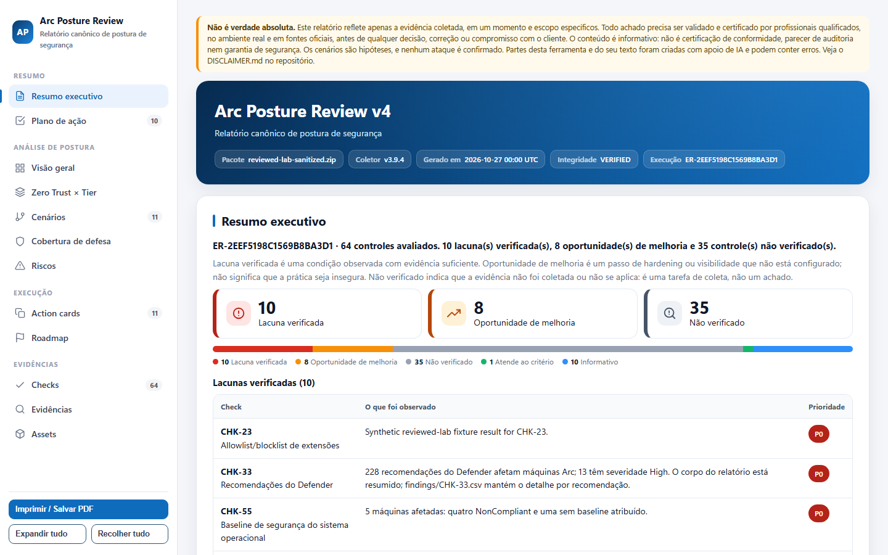

# Arc Posture Review

[](https://github.com/fabiotreze/arc-posture-review/releases)
[](LICENSE)
[](LICENSE-DOCS)

[English](README.md) · **Português**

Avaliação somente leitura da postura de segurança de **servidores habilitados pelo Azure Arc** e do **SQL Server habilitado pelo Azure Arc**. Um coletor PowerShell somente leitura gera um pacote de evidências; o motor v4 transforma esse pacote em uma avaliação determinística e em um relatório HTML bilíngue (PT-BR/EN-US) com plano de ação priorizado.

> Projeto pessoal e independente. Não é uma ferramenta oficial da Microsoft. Valide as recomendações na documentação oficial da Microsoft; o uso é de responsabilidade de quem executa. Veja [DISCLAIMER.md](DISCLAIMER.md).



## Comece aqui — 3 passos

**Coletar → Abrir → Entregar.** Tudo é somente leitura.

### 1 · Coletar (Azure Cloud Shell · PowerShell)

```powershell
Invoke-WebRequest https://github.com/fabiotreze/arc-posture-review/releases/latest/download/Invoke-ArcPostureReview.ps1 -OutFile Invoke-ArcPostureReview.ps1
./Invoke-ArcPostureReview.ps1 -Subscriptions "<nome ou id da subscription>"
```

> **Sempre informe `-Subscriptions` (ou `-ManagementGroup`) com a(s) subscription(s) que contêm as máquinas Arc.** Sem isso, só a subscription padrão atual do CLI é consultada; se as máquinas estiverem em outra, o relatório mostra 0 máquinas e a maioria das verificações vira N/A. Confira a linha `Scope:` na saída antes de confiar no resultado.

| Saída (em `arc-posture-review/`) | Conteúdo |
|---|---|
| `arc-posture-review-<data>.zip` | O pacote de evidências (resultados, achados, SHA-256 do manifest). **Baixe este arquivo** do Cloud Shell. |
| `arc-posture-review-<data>.zip.sha256` | O SHA-256 dele, para conferir o download. |

### 2 · Abrir a análise

Abra o app em <https://fabiotreze.github.io/arc-posture-review/> (ou o `index.html` deste repositório), vá ao passo 3 e carregue o `.zip`. O passo 4 mostra a análise: índice do kit, domínios, prioridades, evidências e plano de ação.

### 3 · Entregar

No passo 4, use **Salvar análise (.html)** ou **Imprimir / PDF** (para um PDF limpo, `python tools/Generate-CleanPdf.py <salvo.html>`). Marque *Ocultar e-mails nos arquivos salvos* antes de compartilhar.

### Opcional · Relatório canônico v4 (Zero Trust × Tier, cenários, action cards)

O relatório canônico v4 **não** é gerado pelo coletor; ele sai do mesmo `.zip`, com Python 3.10+ em um clone deste repositório:

```powershell
git clone https://github.com/fabiotreze/arc-posture-review.git; cd arc-posture-review
python assurance/v4/checkpoint5/cli/arc_posture.py evaluate --evidence <caminho-do>.zip --output assessment.v4.json
python tools/New-ResourceIndex.py --evidence <caminho-do>.zip --assessment assessment.v4.json --output resource-index.v4.json
python assurance/v4/checkpoint6/report/render_v4.py --input assessment.v4.json --resources resource-index.v4.json --locale pt-BR --output arc-posture-review.v4.pt-BR.html
```

Use `--locale en-US` para a versão em inglês. Mais opções (baseline, antes/depois) estão em *Comandos v4*, abaixo.

### Qual documento ler?

| Quero… | Leia |
|---|---|
| Executar a avaliação | Esta página, passos 1–3 |
| Entender cada check e o que fazer | [docs/guide.pt-BR.md](docs/guide.pt-BR.md) (também dentro do app, passo 1) |
| Saber como os resultados são decididos (evidência, cobertura, linguagem) | [docs/v4/methodology-v4.md](docs/v4/methodology-v4.md) e [docs/v4.1.1-posture-vs-evidence.md](docs/v4.1.1-posture-vs-evidence.md) |
| Ver quais consultas e permissões são usadas | [docs/v4/query-evidence-matrix.md](docs/v4/query-evidence-matrix.md) |
| Revisar segurança e limitações conhecidas | [docs/v4/threat-model-v4.md](docs/v4/threat-model-v4.md), [docs/v4/known-issues.md](docs/v4/known-issues.md), [SECURITY.md](SECURITY.md) |
| Ver o que mudou | [CHANGELOG.md](CHANGELOG.md) |

Escopo: `-Subscriptions <id1>,<id2>` ou `-ManagementGroup <nome>` (padrão: somente a subscription atual do CLI, o que raramente é o desejado).

Parâmetros opcionais que transformam verificações PARTIAL em conclusivas:

| Parâmetro | Efeito |
|---|---|
| `-AllowedRegions brazilsouth,brazilsoutheast` | Regiões Azure aprovadas (política de residência de dados). Sem ele, o **CHK-05** fica PARTIAL, pois não há com o que comparar as regiões de metadados das máquinas. |
| `-RequiredTags env,owner,...` | Tags exigidas pela sua governança (**CHK-06**). |
| `-MaxMachines <n>` | Limita ambientes grandes a uma amostra priorizada por risco; use `0` (padrão) na execução final. |

Exemplo: `./Invoke-ArcPostureReview.ps1 -Subscriptions "<nome ou id>" -AllowedRegions brazilsouth`

## O que o relatório mostra

- **64 controles** (45 automáticos, 19 documentais) e **11 cenários de segurança**, cada um rastreado Evidência → Observação → Afirmação → Controle → Cenário.
- **Execução primeiro:** resumo executivo em formato de relatório (lacunas verificadas, oportunidades de melhoria e controles não verificados, com título dos checks e legenda de leitura) e plano de ação AGORA agrupado pelo que fazer (corrigir lacunas verificadas, melhorar a postura, completar a coleta de evidências), na ordem canônica de prioridade, com rastro de evidência recolhível para cada check listado.
- **Navegação:** menu lateral agrupado (Resumo, Análise de postura, Execução, Evidências) com ícones, contadores e destaque que acompanha a rolagem; menu em gaveta no celular; filtro por ID, título ou resultado em *Checks* (com títulos e resultados em linguagem clara); cada `CHK-xx` leva à linha correspondente; voltar ao topo, imprimir e expandir/recolher; visão Zero Trust × Tier com barras de resultado.
- **Links para o portal Azure** por linha de achado (índice de recursos vinculado ao `runId` e ao SHA-256 do pacote).
- **Antes/depois** somente quando um pacote de baseline é informado (`--baseline`).
- Evidência ausente nunca vira aprovação; caminhos de ataque nunca são afirmados como confirmados.
- **Postura, não acusação:** configuração ausente é oportunidade de melhoria e evidência ausente é tarefa de coleta. Só condições observadas com evidência suficiente (por exemplo NonCompliant, agente expirado, Defender no tier Free) são lacunas verificadas. Veja o guia de leitura em `docs/guide.pt-BR.md`, seção 1.3.

## Comandos v4

<details>
<summary><b>Gerar o relatório a partir de um pacote existente</b></summary>

```powershell
python assurance/v4/checkpoint5/cli/arc_posture.py evaluate --evidence arc-posture-review-<data>.zip --output assessment.v4.json
python tools/New-ResourceIndex.py --evidence arc-posture-review-<data>.zip --assessment assessment.v4.json --output resource-index.v4.json
python assurance/v4/checkpoint6/report/render_v4.py --input assessment.v4.json --resources resource-index.v4.json --locale pt-BR --output arc-posture-review.v4.pt-BR.html
python assurance/v4/checkpoint6/report/render_v4.py --input assessment.v4.json --resources resource-index.v4.json --locale en-US --output arc-posture-review.v4.en-US.html
```

Execute a partir de um clone deste repositório. No Windows, `py -3` funciona no lugar de `python`.
</details>

<details>
<summary><b>Antes/depois contra um pacote anterior</b></summary>

```powershell
python assurance/v4/checkpoint5/cli/arc_posture.py evaluate --evidence <depois>.zip --baseline <antes>.zip --output assessment.v4.json
```

Depois gere o HTML como acima. As duas entradas precisam ser pacotes do coletor (`.zip`), não relatórios já gerados. Sem `--baseline`, o relatório informa que não houve baseline e não mostra tendência.
</details>

<details>
<summary><b>Executar o coletor localmente (Windows / PowerShell 7)</b></summary>

```powershell
az login
./scripts/Invoke-ArcPostureReview.ps1 -Subscriptions "<nome ou id da subscription>"
```

Revise o script antes de executar. O acesso ao Azure é somente leitura (Azure Resource Graph e comandos de leitura do Azure CLI).
</details>

<details>
<summary><b>Permissões e privacidade (LGPD)</b></summary>

- **Permissões:** Reader nas subscriptions ou no management group. O script verifica as permissões efetivas antes e marca como parciais as verificações afetadas quando falta algo.
- **Dados pessoais:** o pacote e os relatórios contêm dados do ambiente (conta de coleta, `caller` do Activity Log, IDs de principal, nomes de máquinas). Guarde em local com controle de acesso, compartilhe só com pessoas autorizadas e apague ao fim do trabalho. Nunca anexe em issues públicas.
- **Papéis:** a organização dona do ambiente é a controladora dos dados. Este projeto não recebe, não guarda e não trata nenhum dado coletado.
</details>

<details>
<summary><b>Antes de tratar um resultado como final</b></summary>

| Risco | Controle |
|---|---|
| Execução com limite de máquinas oculta achados fora da amostra | Rodada final sem limite (`MaxMachines = 0`) ou escopos completos. |
| `PARTIAL`, `ERROR`, `TODO`, `UNASSESSED` lidos como saudável | Trate como **não avaliado**; corrija permissões/providers e colete de novo. |
| Metadados de versão caíram para tabelas estáticas | Confira a fonte exibida no achado nas release notes atuais da Microsoft. |
</details>

<details>
<summary><b>Análise no navegador (checklist guiado)</b></summary>

O guia HTML offline gera o coletor, registra as decisões do checklist e analisa o `.zip` localmente no navegador (sem rede: `connect-src 'none'`).

- Online: https://fabiotreze.github.io/arc-posture-review/arc-posture-review.pt-BR.html · [English](https://fabiotreze.github.io/arc-posture-review/)
- Offline: [`arc-posture-review.pt-BR.html`](arc-posture-review.pt-BR.html) · [`arc-posture-review.en-US.html`](arc-posture-review.en-US.html)
</details>

<details>
<summary><b>Validar alterações (mantenedores)</b></summary>

```powershell
python -m pip install -r requirements-dev.txt
python tools/Invoke-V4FinalGates.py --profile pr-quality
python tools/Invoke-V4FinalGates.py --profile release
```

Perfis: `pr-quality`, `report-quality`, `release`, `methodology`, `security-regression`. Rodam em uma cópia isolada e não alteram a árvore de trabalho. Os testes Playwright da v4 podem usar o Edge ou Chrome instalado via `ARC_REVIEW_BROWSER` (caminho do executável).
</details>

<details>
<summary><b>Mapa do repositório</b></summary>

```
scripts/Invoke-ArcPostureReview.ps1   coletor somente leitura (gera e compacta o relatório v4 por padrão)
assurance/v4/                         motor, CLI, renderer e gates da v4 (checkpoints)
tools/New-ResourceIndex.py            links do portal Azure no relatório v4
tools/Invoke-V4FinalGates.py          perfis de gate da v4
criteria/checks.*.json                fonte canônica bilíngue das 64 verificações
docs/v4/                              metodologia, modelo de ameaças, registro da revisão de segurança
release/                              manifestos, notas e SHA256SUMS das releases
arc-posture-review.*.html, index.html guia offline e análise no navegador
```
</details>

Metodologia: [docs/v4/methodology-v4.md](docs/v4/methodology-v4.md) · Revisão de segurança: [docs/v4/security-review-record-v4.0.0.md](docs/v4/security-review-record-v4.0.0.md) · Mudanças: [CHANGELOG.md](CHANGELOG.md)

## Contribuições e licença

Dúvidas e correções por [issues](../../issues), citando a documentação oficial da Microsoft; nunca inclua dados de clientes ou do ambiente. Questões de segurança: [SECURITY.md](SECURITY.md).

Código: [MIT](LICENSE). Documentação e textos: [CC BY 4.0](LICENSE-DOCS) — crédito: *"Arc Posture Review" por Fabio Rodrigues Vieira Costa, https://github.com/fabiotreze/arc-posture-review*. Conteúdo de terceiros e marcas (Microsoft, Azure, Azure Arc) continuam com seus donos.
