# Azure Arc — Security playbook (public × private)

**Version v3.6.1 — 2026-10-23.** Guide and checklist aligned 1:1: the same IDs (CHK, D1–D9, DEC/REQ/CTL/OPS/LEG, ALR) appear in the guide and in the checklist, and each item points to the other.

> Personal, independent project: it consolidates field experience and public Microsoft documentation, with AI assistance and author review. Not official documentation. Read Appendix I before use.

## 0) Start here

Three steps: **1.** go through the stages below and open the tree for each decision (click the card); **2.** generate and run the read-only script (step 2 of the HTML); **3.** load the .zip and follow the action plan.

```mermaid
%% svg:start
flowchart LR
  subgraph S0["1 · Plan"]
    D2["D2 · Organization and criticality"]
    D9["D9 · Cost and licensing"]
  end
  subgraph S1["2 · Connect"]
    D1["D1 · Onboarding"]
    D3["D3 · Connectivity"]
  end
  subgraph S2["3 · Protect"]
    D4["D4 · Identity and access"]
    D5["D5 · Extensions and remote access per tier"]
    D6["D6 · Protection, baseline, logs, and detection"]
  end
  subgraph S3["4 · Operate"]
    D7["D7 · Versions, patches, and legacy"]
  end
  subgraph S4["5 · Decommission"]
    D8["D8 · Removal and abandoned resources"]
  end
  S0 --> S1 --> S2 --> S3 --> S4
```

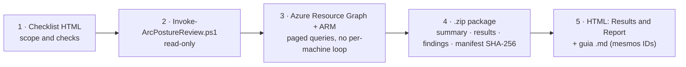

## 1) Assessment method

The kit follows the public Microsoft practice to **sustain the security posture** from the [Cloud Adoption Framework — Secure](https://learn.microsoft.com/en-us/azure/cloud-adoption-framework/secure/overview): recurring assessment, prioritized remediation, control automation and evidence-based reporting. The measurement standard is the [Microsoft Cloud Security Benchmark (MCSB)](https://learn.microsoft.com/en-us/security/benchmark/azure/overview), the default Defender for Cloud benchmark, whose controls map to **CIS Controls v8.1**, **NIST SP 800-53 Rev.5**, **PCI-DSS v4**, **NIST CSF 2.0**, **ISO 27001:2022** and **SOC 2**. The IDs used are from **MCSB v2** (preview, supersedes v1). The published [Arc-enabled servers security baseline](https://learn.microsoft.com/en-us/security/benchmark/azure/baselines/azure-arc-enabled-servers-security-baseline) still uses v1; because control IDs are kept across versions (v2 removed the Governance and strategy domain and added DevOps and AI), the *In the Arc baseline?* column remains valid.

### 1.1 Applied cycle

| Cycle stage | What the kit does | Where |
|---|---|---|
| **Assess** | Read-only collection + documentary items | Steps 2 and 3 of the HTML |
| **Measure** | Status per check, grouped by layer and MCSB control; Defender Secure Score | Step 4 (Analysis) |
| **Prioritize** | Severity × criticality (tier) × I/C/M timeline | What to do now / Action plan |
| **Remediate and automate** | Steps per check; Azure Policy and alerts ALR-01..09 | Action plan and Alerts |
| **Report** | Report with evidence; new collection to compare before × after | Step 5 (Plan and delivery) |

### 1.2 Assessment layers

Each check belongs to a layer. Only layers 1 to 3 measure compliance; layer 4 measures adherence to customer decisions.

| Layer | Meaning | Counts toward compliance? | Checks |
|---|---|---|---|
| 1 · MCSB | Microsoft Cloud Security Benchmark control, measured by Defender for Cloud or by the collection | Yes | 26 |
| 2 · OS baseline | Windows/Linux security baseline, audited by Machine Configuration | Yes | 5 |
| 3 · Arc requirement | Documented product requirement (support, ESU, network, extensions, removal) | Yes (own indicator) | 17 |
| 4 · Customer decision | Parameter decided by the customer (tier, regions, tags, retention, usage per tier) | No: measures adherence to the decision | 10 |
| P · Program | Program execution (pilot, waves, automation, review) | No | 4 |
| F · FinOps | Cost and licensing | No | 1 |

- Official source for the measurement: [Defender for Cloud regulatory compliance dashboard](https://learn.microsoft.com/en-us/azure/defender-for-cloud/regulatory-compliance-dashboard) (MCSB), [Secure Score](https://learn.microsoft.com/en-us/azure/defender-for-cloud/secure-score-security-controls) and [Machine Configuration](https://learn.microsoft.com/en-us/azure/governance/machine-configuration/overview) for the OS baseline.
- Controls listed in the Arc-enabled servers baseline: NS-1, NS-2, IM-1, IM-3, IM-8, PA-1, PA-7, DP-1, DP-3, DP-4, AM-2, LT-1, LT-4, BR-1. The others (PV, ES, LT-3/5/6, IR) apply to the server and to operations.
- The kit index follows the [Secure Score](https://learn.microsoft.com/en-us/azure/defender-for-cloud/secure-score-security-controls) model: each control is worth points by severity weight (High 3, Medium 2, Low 1) and scores by the share of healthy machines; checks with the same cause (for example, MDE missing in CHK-32 and CHK-57) form one control and count once; controls without assessment are left out; the gain of each action matches the Secure Score potential increase. When the finding is not per machine, PASS = 100%, WARN = 50%, FAIL = 0.
- The MCSB control table follows the regulatory compliance dashboard: a control is met when all of its checks pass.
- The index is a reading aid: it **does not replace** Secure Score or the Defender for Cloud MCSB compliance.

### 1.3 How to read the IDs and status

| Prefix | Meaning | Where it appears |
|---|---|---|
| **D1–D9, P** | Decision tree (or program execution) | Section 2 |
| **DEC / REQ / CTL / OPS / LEG** | Playbook item (decision, prerequisite, control, operation, legacy) | Details within each tree |
| **CHK-xx** | HTML checklist check (automated by the script or documentary with the customer) | Section 3 and in the HTML |
| **ALR-xx** | Recommended alert | Section 5 |

- Each playbook item ends with **Verified by** (CHKs that prove the item); each CHK lists the layer, the MCSB control, the tree and the playbook references.
- Status: **PASS**, **WARN**, **FAIL**, **INFO**, **N/A**, **ERRO** (collection failed), **PARCIAL** (missing permission in part of the scope) and **TODO** (pending documentary check).
- Automated checks are assessed by the read-only script; documentary checks, through interview or evidence with the customer.

## 2) Decision trees

Each tree answers one question with at most 5 decisions. The tree outcome becomes a parameter or criterion for the checks. The technical details (DEC/REQ/CTL/OPS/LEG items) are right below each tree.

| Tree | Question | MCSB controls | Checks |
|---|---|---|---|
| **D1** · Onboarding | How to connect each server to Azure Arc? | AM-1 | CHK-01, CHK-02, CHK-07 |
| **D2** · Organization and criticality | Where are the resources and what is the protection level of each server? | GS-2, GS-3, AM-1 | CHK-03, CHK-04, CHK-05, CHK-06 |
| **D3** · Connectivity | How does the agent talk to Azure? | NS-2, NS-10 | CHK-16, CHK-17, CHK-18, CHK-19, CHK-20 |
| **D4** · Identity and access | Who can do what in Arc and on the server? | IM-1, IM-3, IM-8, PA-1, PA-2, PA-4, PA-7 | CHK-10, CHK-11, CHK-12, CHK-13, CHK-14, CHK-15, CHK-25, CHK-35, CHK-56, CHK-60, CHK-62 |
| **D5** · Extensions and remote access per tier | Which extensions and remote access can each tier have? | AM-5, PA-7, IM-1, PV-3 | CHK-21, CHK-22, CHK-23, CHK-24, CHK-26 |
| **D6** · Protection, baseline, logs, and detection | What needs to be enabled on each server? | LT-1, LT-3, LT-5, LT-6, ES-1, PV-4, IR-3 | CHK-08, CHK-09, CHK-27, CHK-31, CHK-32, CHK-33, CHK-34, CHK-36, CHK-39, CHK-40, CHK-41, CHK-43, CHK-44, CHK-45, CHK-54, CHK-55, CHK-57, CHK-58, CHK-61, CHK-63 |
| **D7** · Versions, patches, and legacy | Is the server up to date and within support? | PV-6 | CHK-28, CHK-29, CHK-30, CHK-42, CHK-51, CHK-52 |
| **D8** · Removal and abandoned resources | Does the Arc resource still correspond to a real server? | AM-3 | CHK-37, CHK-38, CHK-49 |
| **D9** · Cost and licensing | Which billed services to enable and with which benefit? | — | CHK-53, CHK-59 |
| **P** · Program execution | How to run and sustain securely? | — | CHK-46, CHK-47, CHK-48, CHK-50 |

### D1 — Onboarding

**Question:** How to connect each server to Azure Arc?

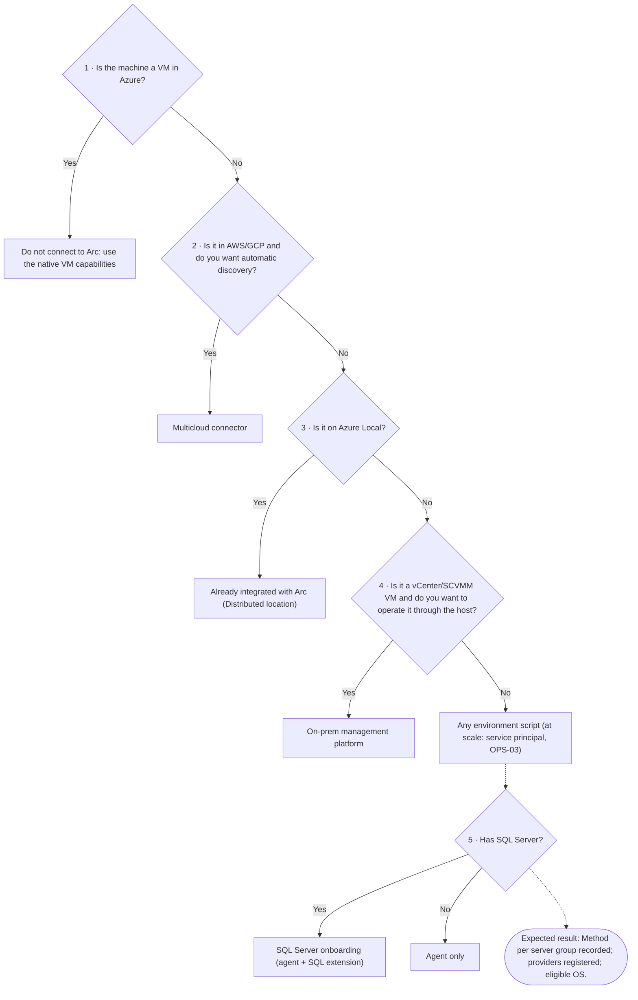

- **Verified by:** CHK-01, CHK-02, CHK-07
- **MCSB controls:** AM-1 · **Details:** DEC-01, DEC-02, REQ-01, REQ-05
- **CAF (Arc-enabled servers):** [Choose the Azure Arc service](https://learn.microsoft.com/en-us/azure/azure-arc/choose-service)

#### Tree D1 as a table

| # | Decision | If yes | If no |
|---|---|---|---|
| 1 | Is the machine a VM in Azure? | Do not connect to Arc: use the native VM capabilities | Continue |
| 2 | Is it in AWS/GCP and do you want automatic discovery? | Multicloud connector | Continue |
| 3 | Is it on Azure Local? | Already integrated with Arc (Distributed location) | Continue |
| 4 | Is it a vCenter/SCVMM VM and do you want to operate it through the host? | On-prem management platform | *Any environment* script (at scale: service principal, OPS-03) |
| 5 | Has SQL Server? | SQL Server onboarding (agent + SQL extension) | Agent only |

- **Expected result:** Method per server group recorded; providers registered; eligible OS.

#### DEC-01 — Which Arc service to use per environment type

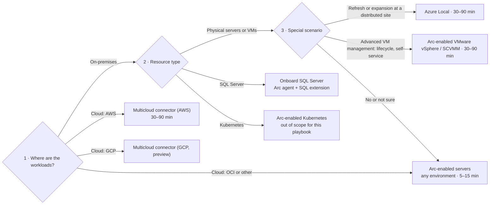

The flow follows the three questions of the portal **Help me choose** assistant (Azure Arc › *Explore onboarding methods*). All options start by deploying the Arc agent on the resource.

| Portal method | Best for | Initial onboarding time | Recommended environments |
|---|---|---|---|
| **Any environment** (generated script) | Flexibility | 5–15 min | AWS, GCP, Azure Local, VMware, SCVMM; also physical and OCI |
| **Multiclouds** (Multicloud connector) | Scale and automatic discovery in public cloud | 30–90 min | AWS; GCP in preview |
| **Distributed location** (Azure Local) | New or refreshed infrastructure | 30–90 min | Azure Local (Arc already integrated; joint Microsoft and vendor support) |
| **On-prem management platform** | Operate VMs from the host (create, resize, start/stop) | 30–90 min | VMware vCenter, SCVMM |

- **SQL Server:** the portal recommends SQL Server onboarding, with a script that installs the Arc agent and the SQL extension in any environment.
- **Cost:** inventory, organization, Resource Graph, SSH/Run Command/Custom Script and *VM self-service* on VMware/SCVMM are free; management and security services are charged when enabled (see **REQ-09**).
- **ESU:** VMs on Azure Local and Azure VMware Solution receive ESU at no cost and must **not** be enrolled in ESU via Arc.
- References: [Azure Arc pricing](https://azure.microsoft.com/en-us/pricing/details/azure-arc/core-control-plane/) · [Prepare to deliver ESUs](https://learn.microsoft.com/en-us/azure/azure-arc/servers/prepare-extended-security-updates) · [Arc-enabled servers deployment options](https://learn.microsoft.com/en-us/azure/azure-arc/servers/deployment-options)

> **Verified by:** CHK-02 — Arc service per environment type (Documentary)

#### DEC-02 — Mixed scenario (on-prem + AWS/GCP + OCI)

- **Recommended pattern**:
  - AWS/GCP requiring auto-discovery: **Multicloud connector**
  - OCI + on-premises: **Arc-enabled servers (standard deployment)**
- Result: a single governance in Azure for different origins.

> **Verified by:** CHK-02 — Arc service per environment type (Documentary)

#### REQ-01 — Eligibility inventory

- Supported OS, connectivity, local privilege to install the agent.

> **Verified by:** CHK-01 — Inventory and eligibility of Arc machines (Automated)

#### REQ-05 — Provider registration

Validate the providers below as the baseline of this guide:

| Provider | Reason |
|---|---|
| `Microsoft.HybridCompute` | Base Arc-enabled servers resource |
| `Microsoft.Network` | Private Link, network, and connectivity |
| `Microsoft.HybridConnectivity` | Hybrid connectivity features (includes scenarios with Admin Center) |
| `Microsoft.AzureArcData` | SQL Arc / Arc-enabled data services in the server scope |
| `Microsoft.Insights` | AMA, DCR/DCE, and diagnostics |
| `Microsoft.OperationalInsights` | Log Analytics (monitoring and SIEM) |
| `Microsoft.Security` | Defender for Cloud |
| `Microsoft.PolicyInsights` | Azure Policy compliance |
| `Microsoft.GuestConfiguration` | Machine Configuration / Guest Configuration |
| `Microsoft.Automation` | Automation Account and Hybrid Runbook Worker |
| `Microsoft.KeyVault` | Secrets and vault management |
| `Microsoft.ResourceGraph` | Inventory and hygiene queries at scale |
| `Microsoft.Maintenance` | Update Manager maintenance configurations |

> Final list of this playbook for Arc-enabled servers. In this context, do not include Kubernetes providers.

> In the checklist: **essential** (FAIL if missing) = `Microsoft.HybridCompute`, `Microsoft.GuestConfiguration`, `Microsoft.HybridConnectivity`; the others are **recommended** (WARN).

> **Verified by:** CHK-07 — Registered resource providers (Automated)

### D2 — Organization and criticality

**Question:** Where are the resources and what is the protection level of each server?

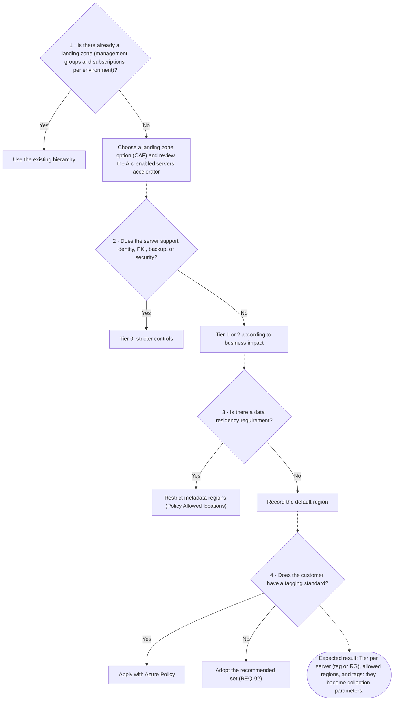

- **Verified by:** CHK-03, CHK-04, CHK-05, CHK-06
- **MCSB controls:** GS-2, GS-3, AM-1 · **Details:** DEC-03, DEC-04, REQ-02, CTL-08
- **CAF (Arc-enabled servers):** [Resource organization](https://learn.microsoft.com/en-us/azure/cloud-adoption-framework/scenarios/hybrid/arc-enabled-servers/eslz-resource-organization)

#### Tree D2 as a table

| # | Decision | If yes | If no |
|---|---|---|---|
| 1 | Is there already a landing zone (management groups and subscriptions per environment)? | Use the existing hierarchy | Choose a landing zone option (CAF) and review the Arc-enabled servers accelerator |
| 2 | Does the server support identity, PKI, backup, or security? | Tier 0: stricter controls | Tier 1 or 2 according to business impact |
| 3 | Is there a data residency requirement? | Restrict metadata regions (Policy *Allowed locations*) | Record the default region |
| 4 | Does the customer have a tagging standard? | Apply with Azure Policy | Adopt the recommended set (REQ-02) |

- **Expected result:** Tier per server (tag or RG), allowed regions, and tags: they become collection parameters.

#### DEC-03 — Landing zone and resource organization

- Structure by **Management Group / Subscription / Resource Group**.
- Separate platform/network/security from workloads.
- Define Arc RGs by environment/region.

> **Verified by:** CHK-03 — Landing zone and resource organization (Documentary)

#### DEC-04 — Criticality profile

- Classify machines into **Tier 0 / Tier 1 / Tier 2**.
- Tier 0 with the most restrictive controls (Run Command/Admin Center blocked by default).

> **Verified by:** CHK-04 — Criticality profile (Tier 0/1/2) (Documentary) · CHK-26 — Run Command and Admin Center per tier (Documentary)

#### REQ-02 — Tag model (recommended — good practice)

Tags are **optional**: a good-practice recommendation for governance, cost, and operations, not a requirement for Arc to work.

Recommended tags:
- `env` — environment (prd, hml, dev)
- `owner` — technical owner
- `criticality` — tier (Tier 0/1/2, see DEC-04)
- `costCenter` — cost center
- `dataClassification` — information classification
- `patchWindow` — maintenance window

The list is configurable in the checklist (*Recommended tags* field); a missing tag generates **INFO**, not a failure.

> **Verified by:** CHK-06 — Recommended tags (best practice) (Automated)

#### CTL-08 — Data residency and region

- Select the region based on latency/compliance criteria from onboarding.

> **Verified by:** CHK-05 — Metadata region and data residency (Automated)

### D3 — Connectivity

**Question:** How does the agent talk to Azure?

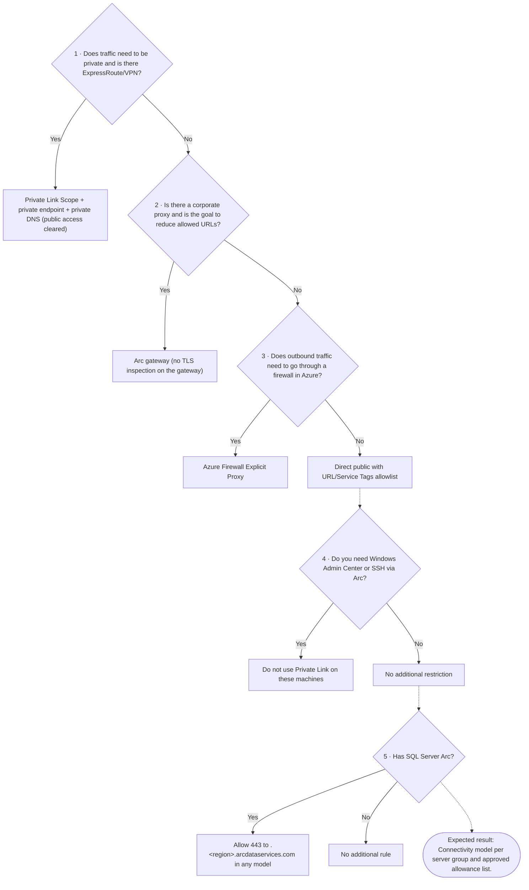

- **Verified by:** CHK-16, CHK-17, CHK-18, CHK-19, CHK-20
- **MCSB controls:** NS-2, NS-10 · **Details:** DEC-05, DEC-06, DEC-07, DEC-08, CTL-01, REQ-06
- **CAF (Arc-enabled servers):** [Network connectivity](https://learn.microsoft.com/en-us/azure/cloud-adoption-framework/scenarios/hybrid/arc-enabled-servers/eslz-arc-servers-connectivity)

#### Tree D3 as a table

| # | Decision | If yes | If no |
|---|---|---|---|
| 1 | Does traffic need to be private and is there ExpressRoute/VPN? | Private Link Scope + private endpoint + private DNS (public access cleared) | Continue |
| 2 | Is there a corporate proxy and is the goal to reduce allowed URLs? | Arc gateway (no TLS inspection on the gateway) | Continue |
| 3 | Does outbound traffic need to go through a firewall in Azure? | Azure Firewall Explicit Proxy | Direct public with URL/Service Tags allowlist |
| 4 | Do you need Windows Admin Center or SSH via Arc? | Do not use Private Link on these machines | No additional restriction |
| 5 | Has SQL Server Arc? | Allow 443 to `*.<region>.arcdataservices.com` in any model | No additional rule |

- **Expected result:** Connectivity model per server group and approved allowance list.

#### DEC-05 — Connectivity model

Options, from most restrictive to least restrictive (see diagram A.2):
1. **Private (preferred)** — Private Link Scope + Private Endpoint via ExpressRoute/VPN + `privatelink.his.arc.azure.com` and `privatelink.guestconfiguration.azure.com` zones (Kubernetes: `privatelink.dp.kubernetesconfiguration.azure.com`). Clear *Allow public network access* on the scope.
2. **Controlled public** — Arc gateway (DEC-06), explicit proxy/Azure Firewall (DEC-07), or direct with allowlist (DEC-08).

Points from the current documentation to consider:
- With Private Link, traffic to **Microsoft Entra ID and Azure Resource Manager does not go through the scope** and follows the default route: allow the Service Tags `AzureActiveDirectory` and `AzureResourceManager` (or use Resource Management Private Link for ARM).
- Each machine is associated with **one** Private Link Scope; **one** scope per VNet; scope and machine in the same region.
- **Windows Admin Center and SSH via Arc are not supported over Private Link.**
- Other services (Azure Monitor/AMPLS, Key Vault, Automation, Storage) require their own private endpoints.
- Do not mix machines with and without Private Link in the same VNet/DNS zone.
- **SQL Server enabled by Azure Arc:** the connection to the *Azure Arc data processing service* (`*.<region>.arcdataservices.com`, used to upload inventory and usage/billing data) **does not support Private Link** — it is listed under *Unsupported configurations*. Even with the server on Private Link, allow outbound TCP 443 to `*.<region>.arcdataservices.com` (direct or via explicit proxy/Azure Firewall — *Private Path* pattern), with Entra ID authentication. See CTL-04.

> **Verified by:** CHK-17 — Connectivity model in use (Automated) · CHK-18 — Private Link Scope public access (Automated) · CHK-20 — Connectivity decision and network allowances (Documentary) · CHK-34 — SQL Server: Defender for SQL and least privilege (Automated)

#### DEC-06 — When to use Arc Gateway

- Reduces outbound allow rules to **7 FQDNs** (gateway URL, `management.azure.com`, `login.microsoftonline.com`, `<region>.login.microsoft.com`, `gbl.his.arc.azure.com`, `<region>.his.arc.azure.com`, `packages.microsoft.com`/`download.microsoft.com`).
- Flow: agents → local **ArcProxy** → corporate proxy → Arc gateway → service.
- It remains a **controlled public model** (onboarding with the *Public endpoint* method).
- Limitations: no *proxy bypass*; not recommended with **TLS inspection** (exclude `*.gw.arc.azure.com` from inspection); up to 5 gateways per subscription; ~2,000 servers per gateway per region.
- AMA, Hybrid Worker, Key Vault, Update Manager and Defender may still require additional endpoints.
- Permission: **Azure Arc gateway manager** role; audit trail in `arcproxy.log` (`azcmagent logs`).

> **Verified by:** CHK-17 — Connectivity model in use (Automated) · CHK-20 — Connectivity decision and network allowances (Documentary)

#### DEC-07 — When to use Azure Firewall Explicit Proxy

- Use when private transit to Azure Firewall (ER/S2S) with central control is needed.
- Validate preview/feature limitations.
- Keeps outbound control centralized in Azure Firewall; Entra ID and ARM still require allow rules.

> **Verified by:** CHK-17 — Connectivity model in use (Automated) · CHK-20 — Connectivity decision and network allowances (Documentary)

#### DEC-08 — Controlled direct public

- Only when private is not feasible.
- Require a strict URL/FQDN allowlist + monitoring.
- Use the official URL list (network requirements) or Service Tags; review on every agent update.

> **Verified by:** CHK-17 — Connectivity model in use (Automated) · CHK-20 — Connectivity decision and network allowances (Documentary)

#### CTL-01 — Corporate DNS integrated with Azure

- Conditional forwarding to Azure DNS Private Resolver + Private DNS Zones.
- Coordinated change with network/DNS teams.
- Validate private resolution from a server: `nslookup gbl.his.arc.azure.com` and `nslookup agentserviceapi.guestconfiguration.azure.com` must return private IPs.

> **Verified by:** CHK-19 — Arc private DNS (Automated) · CHK-20 — Connectivity decision and network allowances (Documentary)

#### REQ-06 — Cross-subscription

- Private Endpoint/PLS/ExpressRoute across subscriptions requires RBAC on both sides.
- Validate the manual approval flow when there is a Pending state.

> **Verified by:** CHK-16 — Cross-subscription scenarios (Documentary)

### D4 — Identity and access

**Question:** Who can do what in Arc and on the server?

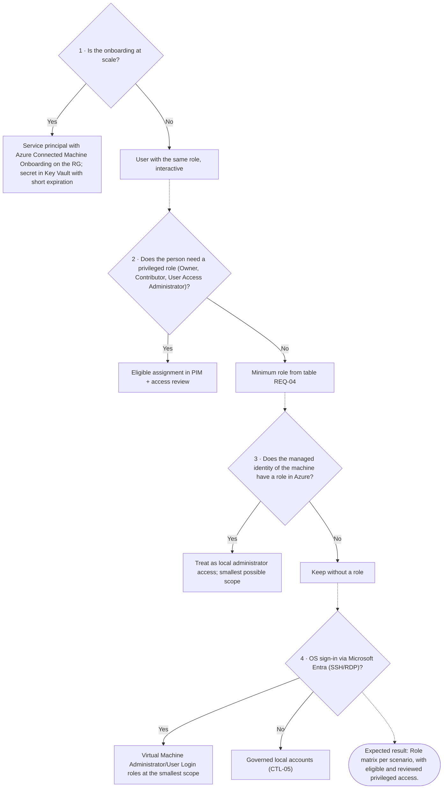

- **Verified by:** CHK-10, CHK-11, CHK-12, CHK-13, CHK-14, CHK-15, CHK-25, CHK-35, CHK-56, CHK-60, CHK-62
- **MCSB controls:** IM-1, IM-3, IM-8, PA-1, PA-2, PA-4, PA-7 · **Details:** REQ-03, REQ-04, REQ-08, CTL-05
- **CAF (Arc-enabled servers):** [Identity and access management](https://learn.microsoft.com/en-us/azure/cloud-adoption-framework/scenarios/hybrid/arc-enabled-servers/eslz-identity-and-access-management)

#### Tree D4 as a table

| # | Decision | If yes | If no |
|---|---|---|---|
| 1 | Is the onboarding at scale? | Service principal with *Azure Connected Machine Onboarding* on the RG; secret in Key Vault with short expiration | User with the same role, interactive |
| 2 | Does the person need a privileged role (Owner, Contributor, User Access Administrator)? | Eligible assignment in PIM + access review | Minimum role from table REQ-04 |
| 3 | Does the managed identity of the machine have a role in Azure? | Treat as local administrator access; smallest possible scope | Keep without a role |
| 4 | OS sign-in via Microsoft Entra (SSH/RDP)? | *Virtual Machine Administrator/User Login* roles at the smallest scope | Governed local accounts (CTL-05) |

- **Expected result:** Role matrix per scenario, with eligible and reviewed privileged access.

#### REQ-03 — Identity model

- Entra groups by role (platform, security, operations).
- PIM/JIT for privileged roles.

> **Verified by:** CHK-10 — Privileged roles in scope (Automated) · CHK-13 — Identity model, PIM, and access review (Documentary) · CHK-62 — Conditional Access and MFA for Azure administrators (Documentary)

#### REQ-04 — Minimum RBAC by scenario

| Scenario | Minimum permission |
|---|---|
| Onboarding into RG | **Azure Connected Machine Onboarding** (or Contributor) |
| Read/modify/remove Arc machine | **Azure Connected Machine Resource Administrator** |
| Operate Arc extensions (install/update/remove) | Dedicated role at the minimum required scope (avoid broad Contributor) |
| Select RG in Generate Script (portal) | **Reader** |
| Associate machine with Private Link Scope | `Microsoft.HybridCompute/privateLinkScopes/read` on the PLS |
| Register provider | `*/register/action` (Owner/Contributor at the subscription scope) |

> **Verified by:** CHK-10 — Privileged roles in scope (Automated) · CHK-11 — Arc-specific roles (Automated) · CHK-12 — Managed identity of the machines (Automated) · CHK-25 — Entra access to the OS (SSH/RDP/WAC) (Automated) · CHK-62 — Conditional Access and MFA for Azure administrators (Documentary)

#### REQ-08 — Secrets and credentials

- No secrets in scripts/files.
- Use Key Vault + rotation + RBAC + PIM.
- Prefer Managed Identity/UAMI when possible.

**At-scale onboarding with a service principal (including GPO).** The onboarding service principal secret is available to the installation process (in the script or in the shared folder of the GPO deployment). Public IBM X-Force research describes the abuse of exposed onboarding secrets and of service principals with excessive roles to run code on machines and use Arc for persistence ([IBM X-Force](https://www.ibm.com/think/x-force/identifying-abusing-azure-arc-for-hybrid-escalation-persistence)). To reduce the risk:
- service principal **with the Azure Connected Machine Onboarding role only**, on the target resource group (never Resource Administrator, Contributor or Owner);
- secret or certificate with a **short validity**, rotated at the end of each wave and **revoked** when onboarding is complete;
- for GPO deployment: restrict access to the shared folder, **unlink the GPO and remove the deployment scheduled task** when done;
- monitor creation of `Microsoft.HybridCompute/machines` resources outside planned waves and Run Command/extensions (ALR-05).
- References: [Service principal for onboarding at scale](https://learn.microsoft.com/en-us/azure/azure-arc/servers/onboard-service-principal#create-a-service-principal-for-onboarding-at-scale) · [Group Policy onboarding](https://learn.microsoft.com/en-us/azure/azure-arc/servers/onboard-group-policy-powershell) · [Managed identity on Arc](https://learn.microsoft.com/en-us/azure/azure-arc/servers/managed-identity-authentication) · [Privileged access rapid modernization plan](https://learn.microsoft.com/en-us/security/privileged-access-workstations/security-rapid-modernization-plan)

> **Verified by:** CHK-12 — Managed identity of the machines (Automated) · CHK-14 — Onboarding secrets and credentials (Documentary) · CHK-15 — Key Vaults (Automated)

#### CTL-05 — Local accounts and HIMDS GPO

- Keep the default local/virtual account model of the agent.
- Ensure the local **Log on as a service** right for `NT SERVICE\himds` (or `NT SERVICE\ALL SERVICES`).

> **Verified by:** CHK-35 — Local accounts and HIMDS GPO (Documentary) · CHK-36 — Local collection on a sample (agent and services) (Documentary) · CHK-56 — Local administrators audit (Automated) · CHK-60 — Local administrator password (Windows LAPS) (Documentary) · CHK-61 — System disk encryption (BitLocker/dm-crypt) (Documentary)

### D5 — Extensions and remote access per tier

**Question:** Which extensions and remote access can each tier have?

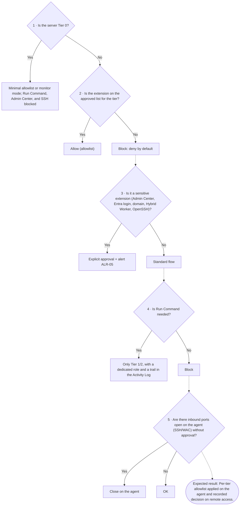

- **Verified by:** CHK-21, CHK-22, CHK-23, CHK-24, CHK-26
- **MCSB controls:** AM-5, PA-7, IM-1, PV-3 · **Details:** CTL-02, CTL-03
- **CAF (Arc-enabled servers):** [Security, governance and compliance](https://learn.microsoft.com/en-us/azure/cloud-adoption-framework/scenarios/hybrid/arc-enabled-servers/eslz-security-governance-and-compliance)

#### Tree D5 as a table

| # | Decision | If yes | If no |
|---|---|---|---|
| 1 | Is the server Tier 0? | Minimal allowlist or *monitor* mode; Run Command, Admin Center, and SSH blocked | Continue |
| 2 | Is the extension on the approved list for the tier? | Allow (allowlist) | Block: deny by default |
| 3 | Is it a sensitive extension (Admin Center, Entra login, domain, Hybrid Worker, OpenSSH)? | Explicit approval + alert ALR-05 | Standard flow |
| 4 | Is Run Command needed? | Only Tier 1/2, with a dedicated role and a trail in the Activity Log | Block |
| 5 | Are there inbound ports open on the agent (SSH/WAC) without approval? | Close on the agent | OK |

- **Expected result:** Per-tier allowlist applied on the agent and recorded decision on remote access.

#### CTL-02 — Extensions by allowlist/blocklist

- Deny by default.
- Allow only the approved set per profile (Tier 0/1/2/SQL/legacy).
- Treat as **sensitive** (explicit review): `AdminCenter`, `AADLoginForWindows`, `AADSSHLoginForLinux`, `AADSSHLoginForWindows`, `JsonADDomainExtension`, `HybridWorkerForWindows`, `WindowsOpenSSH`.

> **Verified by:** CHK-22 — Agent mode (Automated) · CHK-23 — Extension allowlist/blocklist (Automated) · CHK-24 — Sensitive extensions (Automated)

#### CTL-03 — Secure remote operations

- Run Command and Admin Center with an explicit decision per tier.
- Tier 0: block by default.

> **Verified by:** CHK-21 — Inbound ports on the agent (SSH/WAC) (Automated) · CHK-24 — Sensitive extensions (Automated) · CHK-25 — Entra access to the OS (SSH/RDP/WAC) (Automated) · CHK-26 — Run Command and Admin Center per tier (Documentary) · CHK-44 — Sensitive operations in the period (Automated)

### D6 — Protection, baseline, logs, and detection

**Question:** What needs to be enabled on each server?

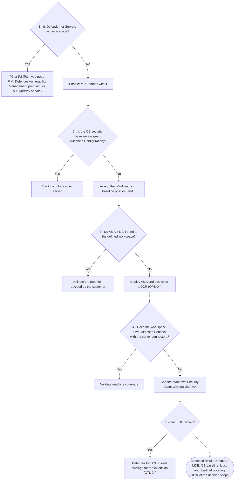

- **Verified by:** CHK-08, CHK-09, CHK-27, CHK-31, CHK-32, CHK-33, CHK-34, CHK-36, CHK-39, CHK-40, CHK-41, CHK-43, CHK-44, CHK-45, CHK-54, CHK-55, CHK-57, CHK-58, CHK-61, CHK-63
- **MCSB controls:** LT-1, LT-3, LT-5, LT-6, ES-1, PV-4, IR-3 · **Details:** REQ-07, CTL-04, CTL-06, CTL-07, OPS-04
- **CAF (Arc-enabled servers):** [Management and monitoring](https://learn.microsoft.com/en-us/azure/cloud-adoption-framework/scenarios/hybrid/arc-enabled-servers/eslz-management-and-monitoring-arc-server)

#### Tree D6 as a table

| # | Decision | If yes | If no |
|---|---|---|---|
| 1 | Is Defender for Servers active in scope? | P1 or P2 (P2 if you need FIM, Defender Vulnerability Management premium, or 500 MB/day of data) | Enable; MDE comes with it |
| 2 | Is the OS security baseline assigned (Machine Configuration)? | Track compliance per server | Assign the Windows/Linux baseline policies (audit) |
| 3 | Do AMA + DCR send to the defined workspace? | Validate the retention decided by the customer | Deploy AMA and associate a DCR (OPS-04) |
| 4 | Does the workspace have Microsoft Sentinel with the server connectors? | Validate machine coverage | Connect Windows Security Events/Syslog via AMA |
| 5 | Has SQL Server? | Defender for SQL + least privilege for the extension (CTL-04) | — |

- **Expected result:** Defender, MDE, OS baseline, logs, and Sentinel covering 100% of the decided scope.

#### REQ-07 — Policy and baseline

- Use Arc built-ins and initiatives by profile.
- Treat the old baseline as support, prioritizing current Arc documentation.

> **Verified by:** CHK-08 — Azure Policy and baseline assignments (Automated) · CHK-09 — Policy compliance on the machines (Automated) · CHK-27 — Guest configuration (Machine Configuration) (Automated) · CHK-55 — Operating system security baseline (Automated)

#### CTL-04 — Least privilege in SQL Arc

- Apply the official least-privilege model of the SQL Arc extension.
- Starting with extension **1.1.2859.223**, with automatic update enabled, least privilege is applied automatically.
- The extension *deployer* runs as `NT AUTHORITY\SYSTEM` and needs the login with **CONNECT SQL** on each instance; hardening that removes this login causes the extension to fail.

**SQL extension network (official documentation — Prerequisites and Overview › Unsupported configurations):**

| Destination | Use | Private Link | Arc gateway |
|---|---|---|---|
| `*.<region>.arcdataservices.com` (`dataprocessingservice.<region>…`) | Inventory and usage upload for billing (PAYG/pCore) | **Not supported** — requires outbound 443 | Covered (the *Azure Extension for SQL Server* scenario does not require extra endpoints) |
| `telemetry.<region>.arcdataservices.com` | Agent/extension logs and DMV data | Not supported | Covered |
| `login.microsoftonline.com`, `login.microsoft.com`, `enterpriseregistration.windows.net`, `graph.microsoft.com` | Microsoft Entra authentication for SQL | — | — |

- Without a connection to the data processing service, inventory and PAYG billing become outdated: monitor *Last Usage Upload Time* and test with `Invoke-WebRequest dataprocessingservice.<region>.arcdataservices.com` (expected HTTP 200).

**Relevant unsupported configurations:** Windows Server earlier than 2016 (insufficient TLS), SQL Server 2012 and earlier, SQL Server in containers or in Azure VMs, Business Intelligence edition, AG with a replica in an FCI, instances with the same name on the same host, and Private Link for the data processing service.

> **Verified by:** CHK-30 — Extension versions and automatic upgrade (Automated) · CHK-34 — SQL Server: Defender for SQL and least privilege (Automated) · CHK-56 — Local administrators audit (Automated) · CHK-60 — Local administrator password (Windows LAPS) (Documentary)

#### CTL-06 — Defender for Cloud onboarding

- Enable Defender for Servers on the subscription.
- Onboard machines through Arc.
- Confirm integration with Defender for Endpoint.
- Track **active security alerts** and **vulnerabilities (CVE)** of Arc machines in Defender for Cloud; vulnerability coverage depends on the plan (P1 or P2) and on MDE.
- Severity and priority follow the Defender classification; the Advisor Security category repeats the Defender recommendations.

> **Verified by:** CHK-31 — Defender for Servers (Automated) · CHK-32 — Defender for Endpoint (Automated) · CHK-33 — Defender recommendations (Automated) · CHK-54 — Threats and vulnerabilities (Defender for Cloud) (Automated) · CHK-55 — Operating system security baseline (Automated) · CHK-57 — Healthy antivirus and EDR (Automated) · CHK-63 — Defender for Servers per Arc machine (Automated)

#### CTL-07 — Sentinel

- Use AMA + DCR + workspace for collection and correlation in Sentinel.

> **Verified by:** CHK-39 — Azure Monitor Agent (Automated) · CHK-40 — DCR association (Automated) · CHK-41 — Microsoft Sentinel and machine coverage (Automated)

#### OPS-04 — AMA deployment at scale

- Prefer Policy for continuous installation/reinstallation.
- Do not forget DCR/DCE/workspace.

> **Verified by:** CHK-39 — Azure Monitor Agent (Automated) · CHK-40 — DCR association (Automated) · CHK-58 — Insights and telemetry per machine (Automated)

### D7 — Versions, patches, and legacy

**Question:** Is the server up to date and within support?

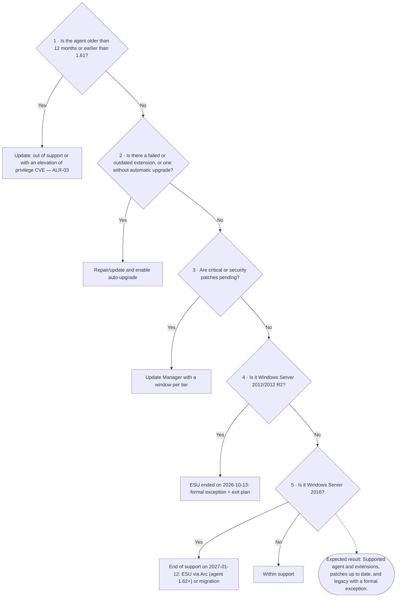

- **Verified by:** CHK-28, CHK-29, CHK-30, CHK-42, CHK-51, CHK-52
- **MCSB controls:** PV-6 · **Details:** OPS-05, OPS-06, OPS-10, LEG-01, LEG-02, LEG-03, LEG-04
- **CAF (Arc-enabled servers):** [Management and monitoring](https://learn.microsoft.com/en-us/azure/cloud-adoption-framework/scenarios/hybrid/arc-enabled-servers/eslz-management-and-monitoring-arc-server)

#### Tree D7 as a table

| # | Decision | If yes | If no |
|---|---|---|---|
| 1 | Is the agent older than 12 months or earlier than 1.61? | Update: out of support or with an elevation of privilege CVE — ALR-03 | Continue |
| 2 | Is there a failed or outdated extension, or one without automatic upgrade? | Repair/update and enable auto-upgrade | Continue |
| 3 | Are critical or security patches pending? | Update Manager with a window per tier | Continue |
| 4 | Is it Windows Server 2012/2012 R2? | ESU ended on 2026-10-13: formal exception + exit plan | Continue |
| 5 | Is it Windows Server 2016? | End of support on 2027-01-12: ESU via Arc (agent 1.62+) or migration | Within support |

- **Expected result:** Supported agent and extensions, patches up to date, and legacy with a formal exception.

#### OPS-05 — Arc agent update

- Use `manage-agent` as the process source.
- Define the version policy and rollout window.
- Address Advisor recommendations.

**Support policy (official release notes):** only Connected Machine agent versions **released in the last 12 months** are supported by the product group; stay within the window or enable *automatic agent upgrade* (preview).

| Version | Release | Version | Release |
|---|---|---|---|
| 1.68 | Sep/2026 (latest) | 1.62 | mar/2026 |
| 1.67 | Aug/2026 | 1.61 | fev/2026 |
| 1.66 | jul/2026 | 1.60 | jan/2026 |
| 1.65 | jun/2026 | 1.59 | dez/2025 |
| 1.64 | mai/2026 | 1.58 | nov/2025 |
| 1.63 | abr/2026 | 1.57 | out/2025 |

- On 2026-10-22 the cutoff is **Oct/2025**: versions up to 1.56 are out of support. Table used by the checklist (agent version CHK); update monthly from the release notes.
- Recent versions included relevant security fixes (e.g., HIMDS protection against impersonation and port protection in 1.68; IPC hardening in 1.67; CVE-2026-21224 in 1.60).
- **Attention:** starting in **February 2027** the agent no longer accepts certificates with a negative serial number (RFC 5280). Validate proxies with TLS inspection and internal PKI.

**Published agent vulnerabilities (security floor: 1.61).** All are local elevation of privilege (a user with low-privileged access to the server reaches SYSTEM and, in the most recent case, the machine identity in Azure). The fix is to update the agent; the checklist marks any machine below 1.61 as FAIL.

| CVE | Affected versions | Fixed in | Summary | Sources |
|---|---|---|---|---|
| CVE-2025-49692 | 1.48 e 1.49 | 1.50+ | MSI repair by an unprivileged user creates the `azcmagent` scheduled task with an exploitable console window | [MSRC](https://msrc.microsoft.com/update-guide/vulnerability/CVE-2025-49692) · [Reversec](https://labs.reversec.com/advisories/2026/01/azure-connected-machine-agent-elevation-of-privilege-vulnerability-console-popup) |
| CVE-2025-26627 | earlier than the March 2025 update | March 2025 | Command injection in an agent component (local, low privilege) | [MSRC](https://msrc.microsoft.com/update-guide/vulnerability/CVE-2025-26627) |
| CVE-2025-55316 | earlier than 1.55 | 1.55 | The daily `azcmagent` scheduled task (01:00–02:00, SYSTEM) trusted the `himds` pipe without validating its owner | [MSRC](https://msrc.microsoft.com/update-guide/vulnerability/CVE-2025-55316) · [Reversec](https://labs.reversec.com/advisories/2026/01/azure-connected-machine-agent-elevation-of-privilege-vulnerability-scheduled-task) |
| CVE-2026-26117 | earlier than 1.61 | 1.61 | Delayed-start services (HIMDS, Guest Configuration, Arc Proxy) allowed taking port 40342 before HIMDS, stealing the machine identity and binding it to another tenant | [MSRC](https://msrc.microsoft.com/update-guide/vulnerability/CVE-2026-26117) · [Cymulate](https://cymulate.com/blog/cve-2026-26117-azure-arc-windows-lpe-cloud-identity-takeover/) |

| CVE-2025-58724 | Connected Machine agent | see MSRC | Improper access control in the agent (local, authenticated user) | [MSRC](https://msrc.microsoft.com/update-guide/vulnerability/CVE-2025-58724) |
| CVE-2026-62895 | Arc SQL Server extension | see MSRC | Permissive cross-domain policy in the SQL extension (network) | [MSRC](https://msrc.microsoft.com/update-guide/vulnerability/CVE-2026-62895) |

- **Microsoft-hosted service:** CVEs such as CVE-2026-24302 are marked as *exclusively hosted service*: Microsoft fixes them on the service side and no server action is required. For each new Azure Arc CVE, check in MSRC whether customer action is needed (agent or extension) or whether it is service-side.
- Monthly follow-up (OPS-12): public list of Azure Arc CVEs in [OpenCVE](https://app.opencve.io/cve/?product=azure_arc&vendor=microsoft) and in the [Security Update Guide](https://msrc.microsoft.com/update-guide/); keep automatic upgrade on for the agent and extensions.
- Besides updating: restrict who can sign in locally to Arc servers (exploitation requires a local user), do not grant broad roles to the machine identity (CTL-05, D4) and monitor unexpected child processes of the agent services with Defender for Endpoint.
- Confirm the fixed version of each CVE in the Microsoft Security Update Guide (MSRC); third-party research is cited only as technical context.

> **Verified by:** CHK-29 — Agent version within support (Automated)

#### OPS-06 — Extension updates

- Enable auto-upgrade when eligible.
- Validate compatibility by OS/profile.

**SQL extension (Azure extension for SQL Server):** only versions **released in the last 12 months** are supported. Current auto-upgrade target: **1.1.3518.465** (Aug/2026, least privilege enabled by default). Versions marked *no longer available* in the release notes must be updated.
- Other extensions: keep automatic update enabled and compare with the newest version in the fleet (the checklist flags outdated ones).

> **Verified by:** CHK-28 — Failed extensions (Automated) · CHK-30 — Extension versions and automatic upgrade (Automated)

#### OPS-10 — Patch management and WSUS

- Update Manager respects the OS update source.
- Windows: Windows Update or WSUS.
- WSUS: publish Microsoft/third-party updates according to policy.

> **Verified by:** CHK-42 — Patch assessment (Update Manager/WSUS) (Automated)

#### LEG-01 — Positioning (2012/2012 R2 and 2016)

- **Windows Server 2012/2012 R2:** ESU via Arc **ended on 2026-10-13**; the licenses were deactivated on 2026-10-14 (00:00 UTC). Servers on this version no longer receive security updates: treat them as a risk exception, with isolation and an immediate exit plan.
- **Windows Server 2016:** end of support on **2027-01-12**. ESU via Arc can be configured since 2026-08-03, with billing starting 2027-01-13 and coverage of up to three years. Requires agent **1.62+** and Software Assurance (or Server Subscription) for on-premises workloads; SPLA is not accepted.
- VMs on Azure Local and Azure VMware Solution receive free ESU and must not use ESU via Arc.

> **Verified by:** CHK-51 — Legacy, end of support, and ESU (Automated) · CHK-52 — Legacy exceptions and exit plan (Documentary)

#### LEG-02 — Permitted use

- Arc core and features compatible with the official matrix.
- Block extensions not supported in the legacy profile by policy.

> **Verified by:** CHK-52 — Legacy exceptions and exit plan (Documentary)

#### LEG-03 — Minimum security

- TLS 1.2 in the OS/.NET/SQL according to version.
- Windows Server 2016: ESU license via Arc assigned before 2027-01-12 and agent 1.62+.
- Windows Server 2012/2012 R2 after 2026-10-13: no patches; network segmentation, enhanced monitoring (Defender/MDE), and an approved migration timeframe.

> **Verified by:** CHK-51 — Legacy, end of support, and ESU (Automated)

#### LEG-04 — Modernization plan

- Define migration to Windows Server 2019/2022/2025 in the official roadmap (2012/2012 R2 immediately; 2016 before the end of ESU).

> **Verified by:** CHK-52 — Legacy exceptions and exit plan (Documentary)

### D8 — Removal and abandoned resources

**Question:** Does the Arc resource still correspond to a real server?

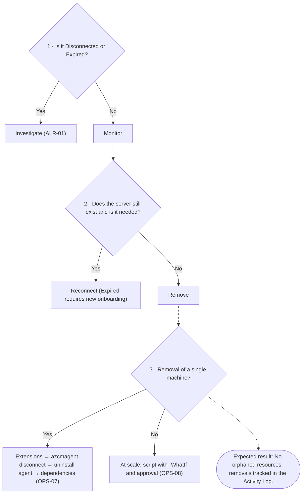

- **Verified by:** CHK-37, CHK-38, CHK-49
- **MCSB controls:** AM-3 · **Details:** OPS-07, OPS-08, OPS-09

#### Tree D8 as a table

| # | Decision | If yes | If no |
|---|---|---|---|
| 1 | Is it Disconnected or Expired? | Investigate (ALR-01) | Monitor |
| 2 | Does the server still exist and is it needed? | Reconnect (Expired requires new onboarding) | Remove |
| 3 | Removal of a single machine? | Extensions → azcmagent disconnect → uninstall agent → dependencies (OPS-07) | At scale: script with -WhatIf and approval (OPS-08) |

- **Expected result:** No orphaned resources; removals tracked in the Activity Log.

#### OPS-07 — Correct Arc removal (individual)

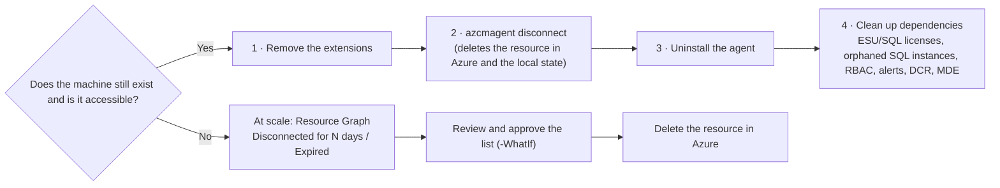

1. **Remove all extensions** before disconnecting: uninstalling the agent does not remove the extensions, and they are not recognized if the server returns to Arc.
2. **`azcmagent disconnect`** as administrator: deletes the resource in Azure and clears the local state (prompts for sign-in with delete permission; `--use-device-code` if the local account is different). If the resource was already deleted in Azure, use `azcmagent disconnect --force-local-only`. **On Arc VMs on Azure Local, use only `--force-local-only`**, otherwise the VM may be deleted in Azure and on-premises.
3. **Uninstall the agent**: on Windows through Programs and Features or `msiexec /x {product code} /qn`; on Linux with `apt purge`, `yum remove`, or `zypper remove azcmagent`. The agent folder remains on Windows.
4. **Clean up dependencies**: license assignments (ESU, SQL pCore), orphaned SQL Arc instances, managed identity RBAC roles, alerts, and DCR associations; confirm in Defender whether the device should leave MDE.

- Reference: [Uninstall the Azure Connected Machine agent](https://learn.microsoft.com/en-us/azure/azure-arc/servers/uninstall-agent)

> **Verified by:** CHK-49 — Individual and at-scale removal (Documentary)

#### OPS-08 — Removal at scale (stale/disconnected)

- Resources left **Disconnected** (server decommissioned without a clean removal) clutter the inventory: find them with Resource Graph by `status == 'Disconnected'` and `lastStatusChange` older than N days.
- The official documentation provides a cleanup script (`Cleanup-StaleArcServers.ps1`) with `-WhatIf`, scope by subscription or management group and per-item confirmation.
- Deletion requires Contributor/Owner or `Microsoft.HybridCompute/machines/delete`: it is **outside** the collector of this checklist, which is read-only.
- **Expired** (more than 45 days without connection) does not recover on its own: redo the onboarding or remove it.
- After the cleanup, verify in the next collection (disconnected machines, orphaned SQL instances and licenses).
- Reference: [Remove stale server resources](https://learn.microsoft.com/en-us/azure/azure-arc/servers/uninstall-agent#remove-stale-server-resources)

> **Verified by:** CHK-37 — Disconnected or expired machines (Automated) · CHK-49 — Individual and at-scale removal (Documentary)

#### OPS-09 — Advisor (reliability)

- Track and remediate:
  - disconnected 30+ days
  - identity expiration risk
  - expired resource (re-onboarding)

> **Verified by:** CHK-37 — Disconnected or expired machines (Automated) · CHK-38 — Advisor recommendations (Automated)

### D9 — Cost and licensing

**Question:** Which billed services to enable and with which benefit?

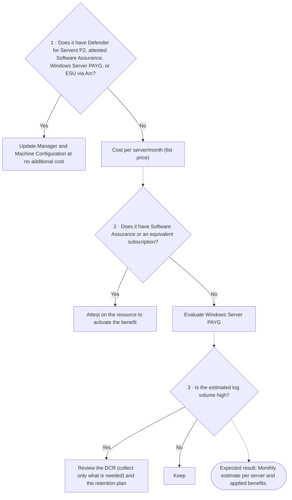

- **Verified by:** CHK-53, CHK-59
- **MCSB controls:** — · **Details:** REQ-09
- **CAF (Arc-enabled servers):** [Cost governance](https://learn.microsoft.com/en-us/azure/cloud-adoption-framework/scenarios/hybrid/arc-enabled-servers/eslz-cost-governance)

#### Tree D9 as a table

| # | Decision | If yes | If no |
|---|---|---|---|
| 1 | Does it have Defender for Servers P2, attested Software Assurance, Windows Server PAYG, or ESU via Arc? | Update Manager and Machine Configuration at no additional cost | Cost per server/month (list price) |
| 2 | Does it have Software Assurance or an equivalent subscription? | Attest on the resource to activate the benefit | Evaluate Windows Server PAYG |
| 3 | Is the estimated log volume high? | Review the DCR (collect only what is needed) and the retention plan | Keep |

- **Expected result:** Monthly estimate per server and applied benefits.

#### REQ-09 — Cost and licensing (free × billed)

The **Arc control plane is free**; the cost comes from the services enabled on each server. Values are **list prices (USD)** from the Azure Arc pricing page, checked on 2026-10-22. The actual value varies by agreement, currency, and region.

| Group | Service | Billing (list) | No additional cost when |
|---|---|---|---|
| Control plane | Inventory, tags, resource groups, management groups, Resource Graph, RBAC | Free | always |
| Control plane | SSH Arc, Run Command, Custom Script Extension | Free | always |
| Control plane | Self-service VMs on VMware vCenter and SCVMM (lifecycle and power) | Free | always |
| Security | Defender for Servers Plan 1 / Plan 2 | US$ 5 / US$ 15 per server/month | — |
| Operations | Azure Update Manager | US$ 5 per server/month (daily proration) | Defender P2, attested Software Assurance, WS PAYG, or ESU via Arc |
| Governance | Machine Configuration + Change Tracking & Inventory | US$ 6 per server/month (server with 1+ assignment) | Defender P2, attested Software Assurance, WS PAYG, or ESU via Arc |
| Operations | Essential Machine Management (preview) | US$ 9,01 per server/month | Software Assurance, WS PAYG, ESU, or Defender P2 |
| Logs | Azure Monitor Logs | US$ 2,76 per GB ingested | — |
| Security | Microsoft Sentinel | US$ 5,22 per GB ingested | — |
| License | Windows Server pay-as-you-go via Arc | US$ 33,58 per core/month | — |
| License | ESU Windows Server 2016 via Arc | billing starting 2027-01-13 | VMs on Azure Local and AVS (free ESU, without Arc) |
| License | SQL Server pay-as-you-go and SQL ESU | see pricing page and calculator | — |

**Rules that change the bill**
- **Software Assurance is not inferred:** the benefit (Update Manager, Change Tracking, Machine Configuration, Windows Admin Center, Best Practices Assessment and others) requires **attestation per server** in *Azure Arc › Licenses › Azure Benefits - Windows Server* or enrollment in WS PAYG. Requirements: agent 1.47+, Windows Server 2012+, server **Connected** and licensed.
- **Machine Configuration** is charged only for servers with one or more assignments; a machine offline for the entire hour is not charged; Azure Security Benchmark and *Regulatory Compliance* initiative assignments are not charged. Policies that do not use guest configuration (including those that install AMA/Defender and auto-tag) have no cost.
- Change Tracking and Best Practices Assessment use Log Analytics: ingestion is charged even with the benefit.
- Defender P2 already includes Update Manager and Machine Configuration: do not pay for both.

**Cost governance (recommended)**
- Tag `costCenter` (REQ-02) and budgets/alerts in Cost Management by resource group or tag; filter on the type `Microsoft.HybridCompute/machines`.
- Review the Machine Configuration policy parameter that includes Arc servers when the assessment is not needed on hybrid machines.
- Define which logs to collect per DCR, retention per table and *commitment tier* according to volume; separate operational data from security data when it makes sense.

**How the checklist measures:** the cost check estimates, per connected server, Defender, Update Manager, Machine Configuration/Change Tracking and WS PAYG, shows the benefits in place and the possible savings from attesting Software Assurance. Log Analytics and Sentinel are marked as variable (they depend on volume).

- References: [Azure Arc pricing](https://azure.microsoft.com/en-us/pricing/details/azure-arc/core-control-plane/) · [Windows Server Management enabled by Azure Arc](https://learn.microsoft.com/en-us/azure/azure-arc/servers/windows-server-management-overview) · [Prepare to deliver ESUs](https://learn.microsoft.com/en-us/azure/azure-arc/servers/prepare-extended-security-updates) · [Cost governance for Arc-enabled servers (CAF, retired article, removal planned on 2026-10-30)](https://learn.microsoft.com/en-us/azure/cloud-adoption-framework/scenarios/hybrid/arc-enabled-servers/eslz-cost-governance)

> **Verified by:** CHK-53 — Cost: billed services and benefits per machine (Automated) · CHK-59 — Map of Arc capabilities in use (Automated)

### P — Program execution

**Question:** How to run and sustain securely?

Sequence: pilot (OPS-01) → waves with rollback (OPS-02) → official automation (OPS-03) → health metrics (OPS-11) → periodic review and new collection to compare before × after (OPS-12). These items do not count toward compliance.

- **Verified by:** CHK-46, CHK-47, CHK-48, CHK-50

#### OPS-01 — Mandatory pilot (30 days recommended)

- Representative (non-critical) scope, metrics, and success criteria.

> **Verified by:** CHK-46 — Pilot executed and accepted (Documentary)

#### OPS-02 — Rollout in waves

- Waves 1, 2, 3 with advance/pause/rollback criteria.

> **Verified by:** CHK-47 — Rollout in waves and rollback (Documentary)

#### OPS-03 — Official automation methods

- Service Principal onboarding
- PowerShell/Ansible
- Azure Policy (deploy/remediation)
- Azure Automation (runbooks)

> **Verified by:** CHK-48 — Automation method per environment (Documentary)

#### OPS-11 — Minimum health metrics

- `Connected`
- heartbeat
- `Succeeded` extensions
- policy compliance

> **Verified by:** CHK-09 — Policy compliance on the machines (Automated) · CHK-28 — Failed extensions (Automated) · CHK-37 — Disconnected or expired machines (Automated) · CHK-50 — Health KPIs and periodic review (Documentary) · CHK-58 — Insights and telemetry per machine (Automated) · CHK-59 — Map of Arc capabilities in use (Automated)

#### OPS-12 — Periodic review

- Monthly RBAC/PIM review
- Biweekly review of noncompliance and remediations
- Monthly review of **Service Health security advisories** (Service Health › Security advisories): the full detail requires a role above Reader, so it is manual and not part of the collector.
- Track the evolution of the Defender for Cloud **Secure Score** (the executive summary of the report shows the value from the collection).

> **Verified by:** CHK-13 — Identity model, PIM, and access review (Documentary) · CHK-50 — Health KPIs and periodic review (Documentary)

## 3) Verification checklist (CHK)

Same list, in the same order, as `arc-posture-review.en-US.html`. Layer: 1 MCSB · 2 OS baseline · 3 Arc requirement · 4 Customer decision · P Program · F FinOps.

### A · Architecture and scope

| ID | Check | Type | Sev. | Layer | MCSB | Tree | What it checks | Criterion | References |
|---|---|---|---|---|---|---|---|---|---|
| CHK-01 | Inventory and eligibility of Arc machines | Automated | Low | 3 | AM-1 | D1 | Machines by status, operating system, region, manufacturer/model, and detected SQL Server. | Informational: baseline for the other controls. | REQ-01 |
| CHK-02 | Arc service per environment type | Documentary | Medium | 4 | AM-2 | D1 | Source of each machine (on-premises, VMware, SCVMM, AWS/GCP, OCI) and chosen service (Arc-enabled servers, multicloud connector, Arc VMware/SCVMM). | Evidence: decision recorded per source. | DEC-01, DEC-02 |
| CHK-03 | Landing zone and resource organization | Documentary | Medium | 4 | AM-1, AM-3 | D2 | Management group, subscriptions, and resource groups per environment and region; platform separated from workloads. | Evidence: approved design. | DEC-03 |
| CHK-04 | Criticality profile (Tier 0/1/2) | Documentary | High | 4 | AM-1, PA-1 | D2 | Server classification and stricter controls for Tier 0. | Evidence: list of servers per tier and controls per tier. | DEC-04 |
| CHK-05 | Metadata region and data residency | Automated | Medium | 4 | AM-2 | D2 | Region of each machine compared with the allowed regions (optional). | WARN if any machine is outside the allowed regions; INFO without a list. | CTL-08 |

### B · Governance and identity

| ID | Check | Type | Sev. | Layer | MCSB | Tree | What it checks | Criterion | References |
|---|---|---|---|---|---|---|---|---|---|
| CHK-06 | Recommended tags (best practice) | Automated | Low | 4 | AM-1 | D2 | Tags of each machine compared with the recommended list (optional). | INFO when any recommended tag is missing; N/A without a list. | REQ-02 |
| CHK-07 | Registered resource providers | Automated | Medium | 3 | — | D1 | Registration state per subscription. | FAIL if HybridCompute, GuestConfiguration, or HybridConnectivity are not registered; WARN for the recommended ones. | REQ-05 |
| CHK-08 | Azure Policy and baseline assignments | Automated | Medium | 1 | PV-2, AM-2 | D6 | Assignments in scope and enforcement mode. | WARN if no assignment relates to Arc/security; reports those in DoNotEnforce. | REQ-07 |
| CHK-09 | Policy compliance on the machines | Automated | Medium | 1 | PV-2, PV-4 | D6 | NonCompliant states grouped by assignment and definition. | WARN if there is noncompliance. | REQ-07, OPS-11 |
| CHK-10 | Privileged roles in scope | Automated | High | 1 | PA-1, PA-7 | D4 | Owner, User Access Administrator, RBAC Administrator, and Contributor by principal type. | WARN if there is direct Owner/UAA/RBAC Admin for a user. | REQ-03, REQ-04 |
| CHK-11 | Arc-specific roles | Automated | Medium | 1 | PA-7 | D4 | Azure Connected Machine Onboarding, Resource Administrator, and similar roles. | WARN if the onboarding role is assigned to a user. | REQ-04 |
| CHK-12 | Managed identity of the machines | Automated | High | 1 | IM-3, PA-7 | D4 | Roles assigned to the managed identities of Arc machines. | FAIL if there is a privileged role: the local administrator of the machine inherits this access in Azure. | REQ-04, REQ-08 |
| CHK-13 | Identity model, PIM, and access review | Documentary | High | 1 | PA-2, PA-4 | D4 | Entra groups by function, PIM/JIT for privileged roles, and periodic review. | Evidence: group matrix and PIM configuration. | REQ-03, OPS-12 |
| CHK-14 | Onboarding secrets and credentials | Documentary | High | 1 | IM-8 | D4 | Dedicated service principal, secret with expiration stored in a vault, no secrets in scripts; managed identity when possible. | Evidence: rotation procedure and storage location. | REQ-08 |
| CHK-15 | Key Vaults | Automated | Low | 1 | DP-8 | D4 | Public access, purge protection, and RBAC permission model. | WARN if any vault does not follow the baseline. | REQ-08 |
| CHK-16 | Cross-subscription scenarios | Documentary | Medium | 4 | AM-1, AM-4 | D3 | Private Endpoint, Private Link Scope, and ExpressRoute across subscriptions; approval of Pending connections. | Evidence: RBAC on both sides and approval flow. | REQ-06 |
| CHK-53 | Cost: billed services and benefits per machine | Automated | Medium | F | — | D9 | Monthly list-price estimate (USD) per connected server: Defender for Servers P1/P2, Update Manager, Machine Configuration/Change Tracking, and Windows Server PAYG; benefits that offset part of the cost (attested Software Assurance, WS PAYG, ESU via Arc, Defender P2); variable items (Log Analytics, Sentinel). | INFO with the estimate; WARN if any Windows Server pays for Update Manager/Machine Configuration without an attested benefit (opportunity if there is Software Assurance). | REQ-09 |
| CHK-56 | Local administrators audit | Automated | Medium | 2 | PA-1, PA-7 | D4 | Audit of the local Administrators group through Machine Configuration (built-in Administrators group membership policies) on connected Windows machines. | WARN if no connected Windows machine has the audit or if there is non-compliance; INFO with partial coverage. | CTL-04, CTL-05 |
| CHK-60 | Local administrator password (Windows LAPS) | Documentary | High | 2 | PA-1, IM-8 | D4 | Windows LAPS (backed up to Active Directory or Microsoft Entra ID) or an equivalent solution: unique, rotated local administrator password on each server. | Evidence: Windows LAPS policy applied (GPO or Intune) and a sample of servers with a managed password. | CTL-04, CTL-05 |
| CHK-62 | Conditional Access and MFA for Azure administrators | Documentary | High | 1 | IM-6, IM-7 | D4 | Microsoft Entra Conditional Access policies that require MFA (and, ideally, a compliant device or privileged access workstation) for the Azure portal, CLI and management APIs. | Evidence: Conditional Access policy for Azure management covering the accounts with roles in the Arc scope. | REQ-03, REQ-04 |

### C · Connectivity and network

| ID | Check | Type | Sev. | Layer | MCSB | Tree | What it checks | Criterion | References |
|---|---|---|---|---|---|---|---|---|---|
| CHK-17 | Connectivity model in use | Automated | Medium | 1 | NS-2 | D3 | Machines via Private Link, via proxy, Arc gateways, and public endpoints. | Informational: compare with the connectivity decision. | DEC-05, DEC-06, DEC-07, DEC-08 |
| CHK-18 | Private Link Scope public access | Automated | High | 1 | NS-2 | D3 | publicNetworkAccess of each Azure Arc Private Link Scope. | FAIL if any scope allows public access; N/A without Private Link. | DEC-05 |
| CHK-19 | Arc private DNS | Automated | Medium | 3 | NS-10 | D3 | privatelink.his.arc.azure.com and privatelink.guestconfiguration.azure.com zones and DNS Private Resolver. | WARN if there is Private Link without the zones in scope (they may be in the hub). | CTL-01 |
| CHK-20 | Connectivity decision and network allowances | Documentary | High | 4 | NS-2, NS-9 | D3 | Chosen model (private, Arc gateway, explicit proxy, or direct), FQDN/Service Tags allowlist, Entra ID and ARM allowed, no TLS inspection on the gateway. | Evidence: approved decision and firewall/proxy rules. | DEC-05, DEC-06, DEC-07, DEC-08, CTL-01 |

### D · Agent, extensions, and protection

| ID | Check | Type | Sev. | Layer | MCSB | Tree | What it checks | Criterion | References |
|---|---|---|---|---|---|---|---|---|---|
| CHK-21 | Inbound ports on the agent (SSH/WAC) | Automated | High | 3 | IM-1, NS-8 | D5 | incomingConnectionsPorts of the agent. | WARN if there are open ports. | CTL-03 |
| CHK-22 | Agent mode | Automated | Medium | 3 | PV-3 | D5 | configMode (full/monitor), extensions, and guest configuration enabled. | Informational. | CTL-02 |
| CHK-23 | Extension allowlist/blocklist | Automated | High | 3 | AM-5 | D5 | extensionsAllowList and extensionsBlockList configured on the agent. | WARN if the machine accepts any extension. | CTL-02 |
| CHK-24 | Sensitive extensions | Automated | High | 4 | AM-5, PA-7 | D5 | Windows Admin Center, OpenSSH, Entra login, AD join, Hybrid Worker, and Custom Script. | WARN: review the need and who can use them. | CTL-02, CTL-03 |
| CHK-25 | Entra access to the OS (SSH/RDP/WAC) | Automated | Medium | 1 | IM-1 | D4 | Virtual Machine Administrator/User Login and Windows Admin Center Administrator Login. | Informational: validate scope and use of groups. | CTL-03, REQ-04 |
| CHK-26 | Run Command and Admin Center per tier | Documentary | High | 4 | PA-7 | D5 | Formal usage decision per tier; Tier 0 blocked by default. | Evidence: approved decision and applied control (allowlist/RBAC). | CTL-03, DEC-04 |
| CHK-27 | Guest configuration (Machine Configuration) | Automated | Medium | 2 | PV-4 | D6 | guestConfigurationEnabled on the agent. | WARN if disabled (no policy auditing inside the OS). | REQ-07 |
| CHK-28 | Failed extensions | Automated | Medium | 3 | — | D7 | provisioningState of all extensions. | FAIL if not Succeeded. | OPS-06, OPS-11 |
| CHK-29 | Agent version within support | Automated | High | 3 | PV-6 | D7 | Version of each Connected Machine agent × release date in the release notes, with the age in months on the run date; only versions released in the last 12 months are supported (table of 2026-10-22: latest 1.68, Sep/2026). Includes the 1.61 security floor (published elevation of privilege CVEs). | FAIL if any agent is out of support; WARN if supported but older than 6 months. FAIL also for versions earlier than 1.61. | OPS-05 |
| CHK-30 | Extension versions and automatic upgrade | Automated | Medium | 3 | PV-6 | D7 | SQL extension × 12-month support window (release notes; current target 1.1.3518.465); other extensions × newest version in the fleet; enableAutomaticUpgrade. | FAIL if the SQL extension is out of support; WARN if any extension is behind the newest in the fleet or has no automatic upgrade. | OPS-06, CTL-04 |
| CHK-31 | Defender for Servers | Automated | High | 1 | LT-1 | D6 | VirtualMachines plan per subscription (tier and subplan). | FAIL if Free. | CTL-06 |
| CHK-32 | Defender for Endpoint | Automated | High | 1 | ES-1 | D6 | Connected machines without the MDE.Windows/MDE.Linux extension. | WARN if there are machines without the sensor via Arc. | CTL-06, Lateral movement |
| CHK-33 | Defender recommendations | Automated | Medium | 1 | PV-5, PV-4 | D6 | Unhealthy assessments on Arc machines, by severity. | WARN if there are pending recommendations. | CTL-06 |
| CHK-34 | SQL Server: Defender for SQL and least privilege | Automated | Medium | 1 | LT-1, PA-7 | D6 | Machines with SQL, Defender for SQL plan, SQL extension version/automatic upgrade (least privilege starting with 1.1.2859.223), SQL on a machine associated with Private Link (the data processing service *.<region>.arcdataservices.com does not support Private Link) and SQL on an unsupported OS (earlier than Windows Server 2016). | WARN if any of these cases occur; N/A without SQL. | CTL-04, DEC-05 |
| CHK-35 | Local accounts and HIMDS GPO | Documentary | Medium | 3 | — | D4 | Log on as a service right for NT SERVICE\himds; default agent accounts preserved. | Evidence: GPO/local configuration on a sample. | CTL-05 |
| CHK-36 | Local collection on a sample (agent and services) | Documentary | Medium | 3 | — | D6 | azcmagent show, azcmagent check, azcmagent config list, and catalog Windows services on a sample per profile. Includes the agent scheduled tasks (azcmagent) and the GPO deployment task, and the service startup types. | Evidence: outputs attached to the package. | CTL-05, Service catalog, Evidence matrix |
| CHK-54 | Threats and vulnerabilities (Defender for Cloud) | Automated | High | 1 | LT-1, PV-5, IR-3 | D6 | Active security alerts on Arc machines, vulnerabilities (CVE) by reach and severity, and Secure Score by subscription, with the Defender classification itself. | FAIL if there is an active High alert; WARN if there is an active alert or a High/Critical vulnerability; the Secure Score is informational. | CTL-06, Lateral movement |
| CHK-55 | Operating system security baseline | Automated | High | 2 | PV-4 | D6 | Assignment and compliance of the Azure compute security baseline (Windows and Linux) through Machine Configuration on each connected machine. | FAIL if a connected machine has no baseline assigned; WARN if a machine is non-compliant; PASS if all are assigned and compliant. | REQ-07, CTL-06 |
| CHK-57 | Healthy antivirus and EDR | Automated | High | 1 | ES-1, ES-2, ES-3 | D6 | Defender for Cloud endpoint protection recommendations (antimalware, EDR, Defender for Endpoint) and presence of the MDE extension on connected machines. | FAIL if a high or medium severity endpoint protection recommendation has Unhealthy machines; WARN if there is a low severity recommendation or a connected machine without the MDE extension. | CTL-06 |
| CHK-61 | System disk encryption (BitLocker/dm-crypt) | Documentary | Medium | 2 | DP-4 | D6 | Encryption of the operating system volume, which protects the Arc agent private key against offline attacks (CAF recommendation). | Evidence: BitLocker/dm-crypt active on the OS volume of Arc machines or a recorded exception. | CTL-05 |
| CHK-63 | Defender for Servers per Arc machine | Automated | High | 1 | LT-1, ES-1 | D6 | Defender for Servers plan read on each Arc machine (resource-level Pricings): tier, subplan, whether it inherits from the subscription, and enabled extensions. | FAIL if any machine has no Defender for Servers (Free); WARN if the machine plan differs from the subscription plan; PASS if all machines inherit the subscription plan. | CTL-06 |

### E · Operations, monitoring, and auditing

| ID | Check | Type | Sev. | Layer | MCSB | Tree | What it checks | Criterion | References |
|---|---|---|---|---|---|---|---|---|---|
| CHK-37 | Disconnected or expired machines | Automated | High | 3 | AM-3 | D8 | Status other than Connected and days since the last change. | FAIL if there is Disconnected/Expired. Expired requires a new onboarding; a disconnected machine does not receive policies, patches, or extensions. | OPS-08, OPS-09, OPS-11 |
| CHK-38 | Advisor recommendations | Automated | Low | 3 | — | D8 | Advisor recommendations for Arc machines. | Informational. | OPS-09 |
| CHK-39 | Azure Monitor Agent | Automated | Medium | 1 | LT-3, LT-5 | D6 | Connected machines without AMA. | WARN if there are machines without AMA. | OPS-04, CTL-07 |
| CHK-40 | DCR association | Automated | Medium | 1 | LT-3, LT-5 | D6 | Machines with AMA and no associated Data Collection Rule; DCRs in use and destination workspaces. | WARN: agent installed without collecting data. | OPS-04, CTL-07 |
| CHK-41 | Microsoft Sentinel and machine coverage | Automated | Medium | 1 | LT-5, IR-3 | D6 | Workspaces with Sentinel; DCRs that send data to them (flows), Arc machines covered by those DCRs, retention, and Activity Log export to Sentinel. | WARN if there is no Sentinel in scope or if no Arc machine sends data to it; INFO with the coverage. | CTL-07, Lateral movement |
| CHK-42 | Patch assessment (Update Manager/WSUS) | Automated | Medium | 1 | PV-6 | D7 | Periodic assessment (AutomaticByPlatform) and pending critical/security patches. | WARN if there is no periodic assessment or there are pending items. | OPS-10 |
| CHK-43 | Activity Log export | Automated | High | 1 | LT-3, LT-5 | D6 | Subscription diagnostic settings to Log Analytics. | FAIL if there is no export (native retention of 90 days). | Evidence matrix, Lateral movement |
| CHK-44 | Sensitive operations in the period | Automated | High | 1 | LT-3, IR-4 | D6 | Run Command, extension installation/removal, machine removal, and licenses. | WARN if there are Run Command operations or removals: review author and justification. | CTL-03, Evidence matrix, Lateral movement |
| CHK-45 | Log Analytics retention | Automated | Low | 1 | LT-6 | D6 | retentionInDays of the workspaces. | WARN if less than 90 days. | Evidence matrix |
| CHK-46 | Pilot executed and accepted | Documentary | Medium | P | — | P | Representative scope, metrics, and success criteria (30 days recommended). | Evidence: pilot report. | OPS-01 |
| CHK-47 | Rollout in waves and rollback | Documentary | Medium | P | — | P | Waves with advance, pause, and rollback criteria. | Evidence: approved plan. | OPS-02 |
| CHK-48 | Automation method per environment | Documentary | Medium | P | AM-2, PV-2 | P | Onboarding (service principal, SCCM/GPO, PowerShell/Ansible), Azure Policy, and Automation per environment. | Evidence: versioned script and method per environment. | OPS-03 |
| CHK-49 | Individual and at-scale removal | Documentary | Medium | 3 | AM-3 | D8 | Remove extensions, azcmagent disconnect, uninstall the agent, and clean up orphaned resources via Resource Graph. | Evidence: documented procedure. | OPS-07, OPS-08 |
| CHK-50 | Health KPIs and periodic review | Documentary | Medium | P | PV-2, PA-4 | P | % Connected, heartbeat, Succeeded extensions, and policy compliance; monthly RBAC/PIM review. | Evidence: dashboard and review cadence. | OPS-11, OPS-12 |
| CHK-58 | Insights and telemetry per machine | Automated | Medium | 3 | LT-3, LT-4 | D6 | Which data each connected machine sends through Data Collection Rules: performance, VM Insights and dependency map, events/Syslog, security events and Change Tracking. | WARN if a connected machine has neither performance data nor security events; INFO with the telemetry matrix. | OPS-04, OPS-11 |
| CHK-59 | Map of Arc capabilities in use | Automated | Low | 3 | AM-1 | D9 | Azure Arc capabilities active in the fleet: AMA, MDE, SQL, Change Tracking/FIM, VM Insights, Key Vault, Hybrid Worker, Admin Center, SSH, Entra ID login, Custom Script, periodic patch assessment, Windows Server Management benefits, Hotpatch and ESU. | Informational: shows what is in use and what is available but unused. | REQ-09, OPS-11 |

### F · Legacy

| ID | Check | Type | Sev. | Layer | MCSB | Tree | What it checks | Criterion | References |
|---|---|---|---|---|---|---|---|---|---|
| CHK-51 | Legacy, end of support, and ESU | Automated | High | 3 | PV-6 | D7 | Windows Server 2008/2012/2012 R2 (2012 ESU ended on 2026-10-13) and Windows Server 2016 (end of support on 2027-01-12; ESU via Arc with agent 1.62+), with the ESU license state. | FAIL if there is 2008/2012/2012 R2 after ESU ends; WARN if there is 2016 without an assigned ESU or with an agent earlier than 1.62. | LEG-01, LEG-03 |
| CHK-52 | Legacy exceptions and exit plan | Documentary | High | 4 | AM-3, PV-6 | D7 | Exception register with owner, timeframe, and compensating controls; unsupported extensions blocked; migration to WS2019+. | Evidence: approved exception register and roadmap. | LEG-01, LEG-02, LEG-04 |

## 4) Action plan by check

When a check returns **FAIL** or **WARN** (or a documentary item is pending), follow the corresponding row. Timeframes: **I** = immediate (0–7 days), **C** = up to 30 days, **M** = up to 90 days.

| CHK | Check | Timeframe | Owner | What to do | How to decide | Documentation |
|---|---|---|---|---|---|---|
| CHK-01 | Inventory and eligibility of Arc machines | C | Platform | (1) Use the inventory as a baseline: status, OS, region, and detected SQL per machine. (2) Separate machines by environment (production, staging) and by workload before any automation. | No decision: this is the basis for prioritizing the other actions. | [Agent overview](https://learn.microsoft.com/en-us/azure/azure-arc/servers/agent-overview) · [Plan at-scale deployment](https://learn.microsoft.com/en-us/azure/azure-arc/servers/plan-at-scale-deployment) |
| CHK-02 | Arc service per environment type | C | Architecture | (1) Record, for each source (physical, VMware, SCVMM, AWS/GCP, OCI), the chosen onboarding method. | Follow DEC-01: if VM lifecycle is needed, use Arc VMware/SCVMM; on AWS/GCP with automatic discovery, Multicloud connector; in other cases, Arc-enabled servers. | [Onboarding options](https://learn.microsoft.com/en-us/azure/azure-arc/servers/deployment-options) |
| CHK-03 | Landing zone and resource organization | C | Architecture | (1) Define management groups, subscriptions, and resource groups by environment and region; separate platform from workloads. | Use the same structure as the Azure landing zone; a resource group per environment/region simplifies RBAC, policy, and cost. | [Plan at-scale deployment](https://learn.microsoft.com/en-us/azure/azure-arc/servers/plan-at-scale-deployment) |
| CHK-04 | Criticality profile (Tier 0/1/2) | C | Security | (1) Classify servers into Tier 0/1/2 and record the list. (2) Apply stricter controls to Tier 0 (no Run Command/SSH/WAC, minimal allowlist). | Tier 0 = controls identity or security (AD, PKI, backup, management tools). When in doubt, classify in the higher tier. | [Arc security overview](https://learn.microsoft.com/en-us/azure/azure-arc/servers/security-overview) |
| CHK-05 | Metadata region and data residency | M | Governance | (1) Confirm the regions allowed by the customer data policy. (2) Move metadata to the allowed region: requires removing the machine and redoing its onboarding. | Machine metadata is stored in the region of the Arc resource. Change it only if there is a regulatory or contractual requirement. | [Data residency](https://learn.microsoft.com/en-us/azure/azure-arc/servers/data-residency) |
| CHK-06 | Recommended tags (best practice) | M | Governance | (1) Define the tag standard (optional) and enforce it with Azure Policy (inherit from the resource group or require at creation). | Tags are a best practice, not a requirement. Prioritize those that feed cost (costCenter) and operations (owner, patchWindow). | [Resource tags](https://learn.microsoft.com/en-us/azure/azure-resource-manager/management/tag-resources) |
| CHK-07 | Registered resource providers | I | Platform | (1) Register the required providers in each subscription: Microsoft.HybridCompute, Microsoft.GuestConfiguration, Microsoft.HybridConnectivity (and Microsoft.AzureArcData for SQL). | Mandatory when FAIL: without the providers, onboarding and extensions fail. | [Prerequisites (resource providers)](https://learn.microsoft.com/en-us/azure/azure-arc/servers/prerequisites) |
| CHK-08 | Azure Policy and baseline assignments | C | Governance | (1) Assign the Arc security baseline and the onboarding policies (AMA, Defender, Machine Configuration) at the management group. (2) Review assignments in DoNotEnforce. | Start in audit mode (Audit/AuditIfNotExists) and only then enable DeployIfNotExists with a remediation task. | [Arc built-in policies](https://learn.microsoft.com/en-us/azure/azure-arc/servers/policy-reference) · [Machine Configuration](https://learn.microsoft.com/en-us/azure/governance/machine-configuration/overview) |
| CHK-09 | Policy compliance on the machines | C | Governance | (1) Open the noncompliant rules with the most machines and create a remediation task or a documented exception. | Fix security ones and those affecting the most machines first; exceptions only with an owner and a timeframe. | [Arc built-in policies](https://learn.microsoft.com/en-us/azure/azure-arc/servers/policy-reference) |
| CHK-10 | Privileged roles in scope | I | Security | (1) Remove direct Owner/User Access Administrator assignments from users; use groups. (2) Enable PIM (just-in-time activation) for privileged roles. | Permanent assignment to a user only for an emergency (break-glass) account, documented. | [Privileged Identity Management](https://learn.microsoft.com/en-us/entra/id-governance/privileged-identity-management/pim-configure) · [Identity and authorization](https://learn.microsoft.com/en-us/azure/azure-arc/servers/security-identity-authorization) |
| CHK-11 | Arc-specific roles | C | Security | (1) Assign the onboarding role to a dedicated service principal, scoped to the target resource group. | Users must not keep the onboarding role after deployment. | [Onboarding with a service principal](https://learn.microsoft.com/en-us/azure/azure-arc/servers/onboard-service-principal) · [Identity and authorization](https://learn.microsoft.com/en-us/azure/azure-arc/servers/security-identity-authorization) |
| CHK-12 | Managed identity of the machines | I | Security | (1) Remove privileged roles (Owner, Contributor, Administrator) from the managed identities of Arc machines. (2) Grant only the minimum role for the specific resource (for example, read access to a Key Vault). | Anyone who is a local administrator of the machine can use its identity: treat it as access by that administrator in Azure. | [Identity and authorization](https://learn.microsoft.com/en-us/azure/azure-arc/servers/security-identity-authorization) |
| CHK-13 | Identity model, PIM, and access review | C | Security | (1) Define Entra groups by role, PIM for privileged roles, and quarterly access reviews. | Follow least privilege: Arc-specific roles before Contributor. | [Privileged Identity Management](https://learn.microsoft.com/en-us/entra/id-governance/privileged-identity-management/pim-configure) · [Identity and authorization](https://learn.microsoft.com/en-us/azure/azure-arc/servers/security-identity-authorization) |
| CHK-14 | Onboarding secrets and credentials | C | Security | (1) Use a dedicated service principal for onboarding, with a short-lived secret stored in a vault. (2) Remove secrets from scripts and rotate them after each wave. (3) Service principal with Azure Connected Machine Onboarding only; for GPO deployment, restrict the shared folder and remove the GPO and the scheduled task when done. | If the secret appeared in a script or repository, rotate it immediately. | [Onboarding with a service principal](https://learn.microsoft.com/en-us/azure/azure-arc/servers/onboard-service-principal) |
| CHK-15 | Key Vaults | C | Security | (1) Enable purge protection and the RBAC permission model; restrict public access on the vaults used by Arc. | Prioritize the vaults that store onboarding secrets or server certificates. | [Secure the Key Vault](https://learn.microsoft.com/en-us/azure/key-vault/general/secure-key-vault) |
| CHK-16 | Cross-subscription scenarios | C | Network | (1) Map dependencies between subscriptions (Private Link Scope, DNS, workspace, DCR) and the RBAC required on both sides. | Shared resources (hub, SOC) must be in the collection scope or have a defined owner. | [Private Link](https://learn.microsoft.com/en-us/azure/azure-arc/servers/private-link-security) |
| CHK-17 | Connectivity model in use | C | Network | (1) Compare the model in use with the connectivity decision (DEC-05 to DEC-08) and record the exceptions. | Private (Private Link) when policy requires traffic without internet; Arc gateway to reduce FQDNs; explicit proxy when it is already the corporate standard. | [Network requirements](https://learn.microsoft.com/en-us/azure/azure-arc/servers/network-requirements) · [Private Link](https://learn.microsoft.com/en-us/azure/azure-arc/servers/private-link-security) · [Arc gateway](https://learn.microsoft.com/en-us/azure/azure-arc/servers/arc-gateway) |
| CHK-18 | Private Link Scope public access | I | Network | (1) Disable public access on the Private Link Scope that should be private. | If machines still depend on public access, migrate them first and then disable it. | [Private Link](https://learn.microsoft.com/en-us/azure/azure-arc/servers/private-link-security) |
| CHK-19 | Arc private DNS | C | Network | (1) Create or link the privatelink.his.arc.azure.com and privatelink.guestconfiguration.azure.com zones and the on-premises DNS forwarding. | If the zones are in the hub, include the hub subscription in the collection to confirm. | [Private Link](https://learn.microsoft.com/en-us/azure/azure-arc/servers/private-link-security) |
| CHK-20 | Connectivity decision and network allowances | C | Network | (1) Approve the connectivity model and the allowed endpoints (FQDNs or Service Tags), with no TLS inspection of agent traffic. | Entra ID and ARM remain public even with Private Link: allow these destinations. | [Network requirements](https://learn.microsoft.com/en-us/azure/azure-arc/servers/network-requirements) |
| CHK-21 | Inbound ports on the agent (SSH/WAC) | I | Security | (1) Close inbound ports on the agent where SSH/WAC is not used: azcmagent config set incomingconnections.ports "". | Keep them open only on machines with approved use (outside Tier 0) and with access through Entra. | [SSH for Arc servers](https://learn.microsoft.com/en-us/azure/azure-arc/servers/ssh-arc-overview) · [Arc security overview](https://learn.microsoft.com/en-us/azure/azure-arc/servers/security-overview) |
| CHK-22 | Agent mode | C | Security | (1) Use monitor mode on machines that only need inventory and monitoring. | Full mode for managed servers; monitor mode for sensitive servers where remote execution is not wanted. | [Arc security overview](https://learn.microsoft.com/en-us/azure/azure-arc/servers/security-overview) |
| CHK-23 | Extension allowlist/blocklist | C | Security | (1) Define the extension allowlist per profile (for example, AMA, MDE, SQL, Machine Configuration) and apply it with azcmagent or policy. | Start with Tier 0 and exposed servers; on the others, at least a blocklist for CustomScript and RunCommand where they are not used. | [Extension security (allowlist/blocklist)](https://learn.microsoft.com/en-us/azure/azure-arc/servers/security-extensions) |
| CHK-24 | Sensitive extensions | C | Security | (1) Review each sensitive extension (WAC, OpenSSH, Entra login, Hybrid Worker, Custom Script): keep it only where there is approved use. | Remove if there is no owner and no use in the last 90 days. | [Extension security (allowlist/blocklist)](https://learn.microsoft.com/en-us/azure/azure-arc/servers/security-extensions) · [Run Command](https://learn.microsoft.com/en-us/azure/azure-arc/servers/run-command) |
| CHK-25 | Entra access to the OS (SSH/RDP/WAC) | C | Security | (1) Restrict Virtual Machine Administrator/User Login and WAC Administrator Login to groups and to the required scope. | Administrator sign-in only through a group with PIM. | [SSH for Arc servers](https://learn.microsoft.com/en-us/azure/azure-arc/servers/ssh-arc-overview) |
| CHK-26 | Run Command and Admin Center per tier | C | Security | (1) Decide per tier on the use of Run Command and Admin Center and enforce it through the allowlist and RBAC. | Tier 0: blocked by default. Others: allowed with auditing and alerting. | [Run Command](https://learn.microsoft.com/en-us/azure/azure-arc/servers/run-command) · [Extension security (allowlist/blocklist)](https://learn.microsoft.com/en-us/azure/azure-arc/servers/security-extensions) |
| CHK-27 | Guest configuration (Machine Configuration) | C | Governance | (1) Enable guest configuration on the agent on machines that must be audited by policy. | Disable only if there is a formal decision (for example, monitor mode) and another configuration control. | [Machine Configuration](https://learn.microsoft.com/en-us/azure/governance/machine-configuration/overview) |
| CHK-28 | Failed extensions | I | Operations | (1) Group failures by cause (finding cause column). (2) Missing OS dependency (Python): the extension message itself (for example MDE.Linux and OS update on Linux) states that Python is missing; install the distribution python3 package and reapply the extension. (3) Blocked by the allowlist: decide whether the extension goes into the profile allowlist or whether the assignment should be removed (for example, a patch assessment policy or Hybrid Worker pushed to Tier 0); do not leave it permanently failed. (4) Other causes: fix (network, OS version, conflict), reinstall, and remove orphaned extensions. | The allowlist is a security decision per tier: if the service is needed in the tier, include it; if not, remove the assignment at the source (policy or service). Prioritize MDE, AMA, SQL, and patching. | [Troubleshoot extension issues](https://learn.microsoft.com/en-us/azure/azure-arc/servers/troubleshoot-vm-extensions) · [Extension security (allowlist/blocklist)](https://learn.microsoft.com/en-us/azure/azure-arc/servers/security-extensions) |
| CHK-29 | Agent version within support | I | Operations | (1) Update the agent on machines out of support (released more than 12 months before the collection date). (2) Prioritize machines below 1.61: CVE-2026-26117 and earlier CVEs allow elevation to SYSTEM and use of the machine identity. (3) Plan updates for those older than 6 months; standardize monthly updates through Update Manager, WSUS, or the package manager. | Out of support = mandatory. Between 6 and 12 months = include in the next window. | [Agent release notes](https://learn.microsoft.com/en-us/azure/azure-arc/servers/agent-release-notes) · [Manage and update the agent](https://learn.microsoft.com/en-us/azure/azure-arc/servers/manage-agent) |
| CHK-30 | Extension versions and automatic upgrade | C | Operations | (1) Update the SQL extension that is outside the 12-month window. (2) Enable automatic extension upgrade and bring outdated extensions in line with the newest version in the fleet. | Automatic upgrade is the recommended default; disable it only with a documented reason. | [Automatic extension upgrade](https://learn.microsoft.com/en-us/azure/azure-arc/servers/manage-automatic-vm-extension-upgrade) · [SQL Arc with least privilege](https://learn.microsoft.com/en-us/sql/sql-server/azure-arc/configure-least-privilege) |
| CHK-31 | Defender for Servers | I | Security | (1) Enable Defender for Servers (Plan 1 or 2) on the subscription. | Plan 2 when you need agentless vulnerability assessment, FIM, and when you would already use Update Manager/Machine Configuration (included). Plan 1 for basic endpoint protection. | [Plan Defender for Servers](https://learn.microsoft.com/en-us/azure/defender-for-cloud/plan-defender-for-servers) · [Azure Arc pricing](https://azure.microsoft.com/en-us/pricing/details/azure-arc/core-control-plane/) |
| CHK-32 | Defender for Endpoint | I | Security | (1) Install the Defender for Endpoint sensor (MDE.Windows/MDE.Linux) on machines without it, through Defender for Cloud. | If MDE was already installed by another tool, confirm the onboarding in the Defender portal. | [Integration with Defender for Endpoint](https://learn.microsoft.com/en-us/azure/defender-for-cloud/integration-defender-for-endpoint) |
| CHK-33 | Defender recommendations | C | Security | (1) Address High recommendations first, grouping by type (SQL ones usually dominate the volume). | Remediate or exempt with justification; a recommendation without an owner becomes a formal exception. | [Plan Defender for Servers](https://learn.microsoft.com/en-us/azure/defender-for-cloud/plan-defender-for-servers) |
| CHK-34 | SQL Server: Defender for SQL and least privilege | C | DBA | (1) Enable Defender for SQL in subscriptions with SQL. (2) Update the SQL extension to a version with least privilege and auto-upgrade. (3) Review SQL on machines with Private Link (the data processing service does not use Private Link) and SQL on an OS earlier than Windows Server 2016. | SQL on an unsupported OS goes into the modernization plan (LEG). | [Defender for SQL on servers](https://learn.microsoft.com/en-us/azure/defender-for-cloud/defender-for-sql-usage) · [SQL Arc with least privilege](https://learn.microsoft.com/en-us/sql/sql-server/azure-arc/configure-least-privilege) · [Private Link](https://learn.microsoft.com/en-us/azure/azure-arc/servers/private-link-security) |
| CHK-35 | Local accounts and HIMDS GPO | M | Operations | (1) Ensure 'Log on as a service' for NT SERVICE\himds in the GPO and preserve the default agent accounts. | Validate on a sample before changing GPOs in production. | [Agent overview](https://learn.microsoft.com/en-us/azure/azure-arc/servers/agent-overview) |
| CHK-36 | Local collection on a sample (agent and services) | M | Operations | (1) Run azcmagent show, azcmagent check, and azcmagent config list on a sample per profile and attach the output to the package. (2) Record the agent scheduled tasks and services: Get-ScheduledTask -TaskName azcmagent (daily, SYSTEM) and Get-Service himds, GCArcService, ExtensionService, arcproxy with their startup type. | Minimum sample: one machine per network profile and per OS. | [Agent overview](https://learn.microsoft.com/en-us/azure/azure-arc/servers/agent-overview) · [Troubleshoot agent connection issues](https://learn.microsoft.com/en-us/azure/azure-arc/servers/troubleshoot-agent-onboard) |
| CHK-37 | Disconnected or expired machines | I | Operations | (1) Disconnected: check the himds service, network, and proxy (azcmagent check) and reconnect. (2) Expired (more than 45 days without connection): redo the onboarding. (3) Decommissioned or migrated: remove the Arc resource to avoid leaving orphans. | If the machine no longer exists, remove it. If it exists, reconnect it. Expired always requires new onboarding. | [Troubleshoot agent connection issues](https://learn.microsoft.com/en-us/azure/azure-arc/servers/troubleshoot-agent-onboard) · [Uninstall the agent and clean up resources](https://learn.microsoft.com/en-us/azure/azure-arc/servers/uninstall-agent) |
| CHK-38 | Advisor recommendations | M | Operations | (1) Review and address Advisor recommendations for Arc resources. | Follow the severity indicated by Advisor. | [Azure Advisor](https://learn.microsoft.com/en-us/azure/advisor/advisor-overview) |
| CHK-39 | Azure Monitor Agent | C | Operations | (1) Deploy AMA to connected machines through Azure Policy (DeployIfNotExists) or DCR. | If the machine does not need logs, document it; otherwise, AMA is the standard (MMA was retired). | [Azure Monitor Agent](https://learn.microsoft.com/en-us/azure/azure-monitor/agents/azure-monitor-agent-overview) |
| CHK-40 | DCR association | C | Operations | (1) Associate a DCR with machines that have AMA (security events, performance, and Syslog according to the profile). | AMA without a DCR collects nothing: define DCRs per profile before expanding. | [Data collection with DCR](https://learn.microsoft.com/en-us/azure/azure-monitor/agents/azure-monitor-agent-data-collection) |
| CHK-41 | Microsoft Sentinel and machine coverage | C | Security | (1) Confirm the SOC workspace with Sentinel and connect the security events of the Arc machines. | If Sentinel is in another subscription, include it in the collection or record the dependency. | [Microsoft Sentinel](https://learn.microsoft.com/en-us/azure/sentinel/overview) |
| CHK-42 | Patch assessment (Update Manager/WSUS) | C | Operations | (1) Enable periodic assessment (AutomaticByPlatform) and address pending critical and security patches. | Periodic assessment is billed outside the benefits (Defender P2, attested SA, WS PAYG, ESU): consider it in REQ-09. | [Azure Update Manager](https://learn.microsoft.com/en-us/azure/update-manager/overview) · [Periodic patch assessment](https://learn.microsoft.com/en-us/azure/update-manager/assessment-options) |
| CHK-43 | Activity Log export | I | Security | (1) Create a subscription diagnostic setting that sends the Activity Log to Log Analytics. | Without export, native retention is 90 days: insufficient for investigation. | [Activity Log](https://learn.microsoft.com/en-us/azure/azure-monitor/essentials/activity-log) |
| CHK-44 | Sensitive operations in the period | C | Security | (1) Review the author and justification of sensitive operations (Run Command, extensions, removals). (2) Create alerts for these operations. | An operation without a ticket or without a known author must be investigated. | [Activity Log](https://learn.microsoft.com/en-us/azure/azure-monitor/essentials/activity-log) · [Create an Activity Log alert](https://learn.microsoft.com/en-us/azure/azure-monitor/alerts/alerts-create-activity-log-alert-rule) |
| CHK-45 | Log Analytics retention | M | Security | (1) Set the retention of security workspaces to the defined minimum (90 days or more). | Retention per table: longer for security, shorter for performance, controlling cost. | [Log Analytics retention](https://learn.microsoft.com/en-us/azure/azure-monitor/logs/data-retention-configure) |
| CHK-46 | Pilot executed and accepted | C | Project | (1) Run a representative pilot with metrics and success criteria (30 days). | Without an accepted pilot, do not start waves. | [Plan at-scale deployment](https://learn.microsoft.com/en-us/azure/azure-arc/servers/plan-at-scale-deployment) |
| CHK-47 | Rollout in waves and rollback | C | Project | (1) Plan waves with criteria for advancing, pausing, and rollback. | Proceed only when the metrics of the previous wave are within expectations. | [Plan at-scale deployment](https://learn.microsoft.com/en-us/azure/azure-arc/servers/plan-at-scale-deployment) |
| CHK-48 | Automation method per environment | C | Platform | (1) Standardize the onboarding and automation method per environment and version the scripts. | One official method per environment; avoid manual installation. | [Onboarding options](https://learn.microsoft.com/en-us/azure/azure-arc/servers/deployment-options) |
| CHK-49 | Individual and at-scale removal | M | Operations | (1) Document individual removal (extensions, azcmagent disconnect, uninstallation, dependency cleanup) and at-scale removal (Resource Graph + official script with -WhatIf). (2) On Arc VMs on Azure Local, use only azcmagent disconnect --force-local-only. | Machine exists: individual removal. Does not exist or Expired: at-scale deletion after owner approval. Removing orphans avoids cost and false alerts. | [Uninstall the agent and clean up resources](https://learn.microsoft.com/en-us/azure/azure-arc/servers/uninstall-agent) |
| CHK-50 | Health KPIs and periodic review | M | Operations | (1) Publish a dashboard with % Connected, Succeeded extensions, compliance, agent within support, and Secure Score; monthly review. (2) Review Service Health security advisories monthly (manual: the details require a role above Reader). | Use the recommended alerts as the basis for the indicators. | [Azure Advisor](https://learn.microsoft.com/en-us/azure/advisor/advisor-overview) |
| CHK-51 | Legacy, end of support, and ESU | I | Infrastructure | (1) Windows Server 2012/2012 R2: isolate, monitor, and migrate (no patches since 2026-10-13). (2) Windows Server 2016: assign the ESU license through Arc before 2027-01-12 and update the agent to 1.62+. | ESU for 2016 requires Software Assurance (or Server Subscription); without it, prioritize migration. | [ESU via Azure Arc](https://learn.microsoft.com/en-us/azure/azure-arc/servers/prepare-extended-security-updates) · [Windows Server Management (SA benefits)](https://learn.microsoft.com/en-us/azure/azure-arc/servers/windows-server-management-overview) |
| CHK-52 | Legacy exceptions and exit plan | C | Infrastructure | (1) Record legacy exceptions with owner, timeframe, and compensating controls, and approve the migration roadmap. | Every legacy machine needs an exit date. | [ESU via Azure Arc](https://learn.microsoft.com/en-us/azure/azure-arc/servers/prepare-extended-security-updates) |
| CHK-53 | Cost: billed services and benefits per machine | C | FinOps | (1) Attest Software Assurance on eligible Windows servers (Azure Arc › Azure Benefits - Windows Server). (2) Review Defender P1 × P2 and the Machine Configuration policies that include Arc servers unnecessarily. (3) Create a budget and alert in Cost Management by resource group or tag. | Attest only with SA or a valid subscription license. If most servers use Update Manager and Machine Configuration, Defender Plan 2 may be worthwhile. | [Windows Server Management (SA benefits)](https://learn.microsoft.com/en-us/azure/azure-arc/servers/windows-server-management-overview) · [Azure Arc pricing](https://azure.microsoft.com/en-us/pricing/details/azure-arc/core-control-plane/) · [Plan Defender for Servers](https://learn.microsoft.com/en-us/azure/defender-for-cloud/plan-defender-for-servers) |
| CHK-54 | Threats and vulnerabilities (Defender for Cloud) | I | Security | (1) Investigate and address active High alerts in Defender for Cloud/XDR (machine, process, user, and timeline). (2) Prioritize High/Critical vulnerabilities by the number of affected machines and remediate through Update Manager or WSUS. (3) Track Secure Score in the executive summary and in the monthly review. | Severity is the Defender severity. An active alert without an owner is an incident; a vulnerability with no available fix requires an exception with a compensating control. | [Plan Defender for Servers](https://learn.microsoft.com/en-us/azure/defender-for-cloud/plan-defender-for-servers) · [Integration with Defender for Endpoint](https://learn.microsoft.com/en-us/azure/defender-for-cloud/integration-defender-for-endpoint) |
| CHK-55 | Operating system security baseline | C | Security | (1) Assign the built-in Azure compute security baseline policy (Windows and Linux) at the management group or subscription of the Arc machines, first in audit mode. (2) Address non-compliant settings by priority (Critical and Important) and record exceptions with a justification. (3) For Windows Server 2025, evaluate the customizable baseline (OSConfig) before applying automatic remediation. | The baseline is the cloud equivalent of the security GPO: start by auditing, compare with the current GPO and only then remediate. It does not cover LAPS or BitLocker (CHK-60 and CHK-61). | [Windows security baseline (Machine Configuration)](https://learn.microsoft.com/en-us/azure/governance/policy/samples/guest-configuration-baseline-windows) · [Linux security baseline (Machine Configuration)](https://learn.microsoft.com/en-us/azure/governance/policy/samples/guest-configuration-baseline-linux) · [Machine Configuration](https://learn.microsoft.com/en-us/azure/governance/machine-configuration/overview) · [CAF: Arc security, governance and compliance](https://learn.microsoft.com/en-us/azure/cloud-adoption-framework/scenarios/hybrid/arc-enabled-servers/eslz-security-governance-and-compliance) |
| CHK-56 | Local administrators audit | C | Security | (1) Assign the Machine Configuration policy that audits local Administrators group members, with the approved list per profile. (2) Remove unapproved accounts and groups; a local administrator also controls the agent and can use the machine identity. | Whoever is a local administrator controls the agent: treat it as privileged access (CTL-04). | [Machine Configuration](https://learn.microsoft.com/en-us/azure/governance/machine-configuration/overview) · [CAF: Arc security, governance and compliance](https://learn.microsoft.com/en-us/azure/cloud-adoption-framework/scenarios/hybrid/arc-enabled-servers/eslz-security-governance-and-compliance) · [Identity and authorization](https://learn.microsoft.com/en-us/azure/azure-arc/servers/security-identity-authorization) |
| CHK-57 | Healthy antivirus and EDR | I | Security | (1) Address the Defender for Cloud endpoint protection recommendations (outdated antimalware, missing or failing EDR). (2) Install or fix Defender for Endpoint on machines without the MDE extension (or confirm onboarding done by another tool). | Healthy antivirus and EDR on every connected machine; exceptions only with a recorded compensating control. | [Integration with Defender for Endpoint](https://learn.microsoft.com/en-us/azure/defender-for-cloud/integration-defender-for-endpoint) · [Plan Defender for Servers](https://learn.microsoft.com/en-us/azure/defender-for-cloud/plan-defender-for-servers) |
| CHK-58 | Insights and telemetry per machine | C | Operations | (1) Define DCRs per profile: performance and VM Insights (operations), security events (SOC/Sentinel), events or Syslog (troubleshooting) and Change Tracking (change auditing). (2) Associate the DCRs with machines without telemetry and validate that data arrives in the workspace. | A machine without security events is invisible to the SOC; without performance data, invisible to operations. Adjust collection to the ingestion cost. | [Data collection with DCR](https://learn.microsoft.com/en-us/azure/azure-monitor/agents/azure-monitor-agent-data-collection) · [Azure Monitor Agent](https://learn.microsoft.com/en-us/azure/azure-monitor/agents/azure-monitor-agent-overview) · [VM Insights](https://learn.microsoft.com/en-us/azure/azure-monitor/vm/vminsights-overview) · [Change Tracking e Inventory](https://learn.microsoft.com/en-us/azure/automation/change-tracking/overview-monitoring-agent) |
| CHK-59 | Map of Arc capabilities in use | M | Platform | (1) Compare capabilities in use with those available: with Software Assurance or WS PAYG, Update Manager, Change Tracking, Machine Configuration, Admin Center, Remote Support, Best Practices Assessment and Site Recovery configuration have no additional cost. (2) Evaluate Hotpatch on Windows Server 2025 servers (fewer reboots and a shorter exposure window). (3) Disable extensions without an owner or without use (CHK-24). | Each active capability expands what can be done on the server: enable it with an owner, a reason and access control. | [Windows Server Management (SA benefits)](https://learn.microsoft.com/en-us/azure/azure-arc/servers/windows-server-management-overview) · [Hotpatch do Windows Server](https://learn.microsoft.com/en-us/windows-server/get-started/hotpatch) · [Change Tracking e Inventory](https://learn.microsoft.com/en-us/azure/automation/change-tracking/overview-monitoring-agent) · [VM Insights](https://learn.microsoft.com/en-us/azure/azure-monitor/vm/vminsights-overview) |
| CHK-60 | Local administrator password (Windows LAPS) | C | Identity | (1) Apply Windows LAPS through GPO (backup to Active Directory) or Intune, with rotation and restricted access to the password. (2) Disable or rename the built-in local administrator where an alternative exists. | A repeated local administrator password enables lateral movement between servers and use of the machine identity in Azure. | [Windows LAPS](https://learn.microsoft.com/en-us/windows-server/identity/laps/laps-overview) · [CAF: Arc security, governance and compliance](https://learn.microsoft.com/en-us/azure/cloud-adoption-framework/scenarios/hybrid/arc-enabled-servers/eslz-security-governance-and-compliance) |
| CHK-61 | System disk encryption (BitLocker/dm-crypt) | M | Infrastructure | (1) Enable BitLocker (Windows) or dm-crypt (Linux) on the operating system volume of Arc servers, starting with Tier 0 and physically exposed servers. (2) Store recovery keys in AD or Entra ID and test recovery. | Without encryption, the agent private key can be copied from a disk or backup and used to impersonate the server. | [BitLocker](https://learn.microsoft.com/en-us/windows/security/operating-system-security/data-protection/bitlocker/) · [CAF: Arc security, governance and compliance](https://learn.microsoft.com/en-us/azure/cloud-adoption-framework/scenarios/hybrid/arc-enabled-servers/eslz-security-governance-and-compliance) |
| CHK-62 | Conditional Access and MFA for Azure administrators | I | Identity | (1) Require MFA through Conditional Access for the Azure management app, with no exceptions for administrative accounts. (2) For roles that run code on servers (Contributor, Resource Administrator), also require a compliant device or privileged access workstation and activation through PIM. | Whoever manages Azure can run code on Arc servers: that person identity is part of the server attack surface. | [Microsoft Entra Conditional Access](https://learn.microsoft.com/en-us/entra/identity/conditional-access/overview) · [Mandatory MFA for Azure](https://learn.microsoft.com/en-us/entra/identity/authentication/concept-mandatory-multifactor-authentication) · [Privileged access rapid modernization plan](https://learn.microsoft.com/en-us/security/privileged-access-workstations/security-rapid-modernization-plan) · [Privileged Identity Management](https://learn.microsoft.com/en-us/entra/id-governance/privileged-identity-management/pim-configure) |
| CHK-63 | Defender for Servers per Arc machine | I | Security | (1) Enable Defender for Servers on Arc machines with no plan (Free), at the subscription or on the machine itself. (2) Review machines whose plan differs from the subscription: confirm whether the exception is intentional (for example, P1 for cost) and record the reason; without a reason, remove the machine-level setting so it inherits the subscription plan again. | A machine-level plan overrides the subscription plan: a machine can stay on P1 or Free in a P2 subscription without showing in the per-subscription view. | [Defender for Servers at resource level](https://learn.microsoft.com/en-us/azure/defender-for-cloud/tutorial-enable-servers-plan) · [Pricings - Get (Defender for Cloud REST API)](https://learn.microsoft.com/en-us/rest/api/defenderforcloud-composite/pricings/get) · [Plan Defender for Servers](https://learn.microsoft.com/en-us/azure/defender-for-cloud/plan-defender-for-servers) |

## 5) Recommended alerts

Alerts to continuously track what the checklist found. Minimum version values calculated on 2026-10-23 (agent 1.61+, SQL extension build 3211+): review every month.

- Log search alerts that use arg("") are created in the Log Analytics workspace (rule scope) and only read Resource Graph; the feature is in preview and the arg part returns at most 1,000 records.
- The rule needs read access to the queried resources; associate an action group (email, Teams, ITSM).
- Activity Log alerts are per subscription; create one rule per operation or use a condition with multiple operations.
- Documentation: [Create a log search alert](https://learn.microsoft.com/en-us/azure/azure-monitor/alerts/alerts-create-log-alert-rule) · [Create an Activity Log alert](https://learn.microsoft.com/en-us/azure/azure-monitor/alerts/alerts-create-activity-log-alert-rule) · [Query Resource Graph from Log Analytics](https://learn.microsoft.com/en-us/azure/azure-monitor/logs/azure-monitor-data-explorer-proxy)

### ALR-01 — Disconnected or expired Arc machine

- Type: Log search (Resource Graph through arg) · Sev 2 · every 1 h · trigger if results > 0
- Relacionado a: CHK-37

```kusto
arg("").resources
| where type =~ 'microsoft.hybridcompute/machines'
| where tostring(properties.status) != 'Connected'
| project name, resourceGroup, subscriptionId, status = tostring(properties.status), lastStatusChange = tostring(properties.lastStatusChange)
```

### ALR-02 — Failed Arc extension

- Type: Log search (Resource Graph through arg) · Sev 3 · every 1 h · trigger if results > 0
- Relacionado a: CHK-28

```kusto
arg("").resources
| where type =~ 'microsoft.hybridcompute/machines/extensions'
| where tostring(properties.provisioningState) =~ 'Failed'
| project machine = tostring(split(id, '/')[8]), resourceGroup, extension = name, version = tostring(properties.typeHandlerVersion)
```

### ALR-03 — Arc agent out of support (more than 12 months)

- Type: Log search (Resource Graph through arg) · Sev 3 · daily · trigger if results > 0 · review the minimum number every month
- Relacionado a: CHK-29

```kusto
arg("").resources
| where type =~ 'microsoft.hybridcompute/machines'
| extend minor = toint(split(tostring(properties.agentVersion), '.')[1])
| where minor < 61
| project name, resourceGroup, agentVersion = tostring(properties.agentVersion)
```

### ALR-04 — SQL extension out of support

- Type: Log search (Resource Graph through arg) · Sev 3 · daily · trigger if results > 0 · review the minimum build every month
- Relacionado a: CHK-30

```kusto
arg("").resources
| where type =~ 'microsoft.hybridcompute/machines/extensions'
| where name =~ 'WindowsAgent.SqlServer' or name =~ 'LinuxAgent.SqlServer'
| extend build = toint(split(tostring(properties.typeHandlerVersion), '.')[2])
| where build < 3211
| project machine = tostring(split(id, '/')[8]), resourceGroup, version = tostring(properties.typeHandlerVersion)
```

### ALR-05 — Run Command, extension installed/removed, or machine removed

- Type: Activity Log (Administrative) · Sev 2 · operations: Microsoft.HybridCompute/machines/runCommands/write, .../extensions/write, .../extensions/delete, Microsoft.HybridCompute/machines/delete
- Relacionado a: CHK-44, CHK-24, CHK-26

### ALR-06 — Machine with AMA without heartbeat

- Type: Log search (workspace) · Sev 2 · every 15 min · trigger if results > 0
- Relacionado a: CHK-39, CHK-40

```kusto
Heartbeat
| where _ResourceId has 'microsoft.hybridcompute/machines'
| summarize last = max(TimeGenerated) by Computer, _ResourceId
| where last < ago(15m)
```

### ALR-07 — Pending critical or security patches

- Type: Log search (Resource Graph through arg) · Sev 3 · daily · trigger if results > 0
- Relacionado a: CHK-42

```kusto
arg("").patchassessmentresources
| where type =~ 'microsoft.hybridcompute/machines/patchassessmentresults'
| extend critical = toint(properties.availablePatchCountByClassification.critical), security = toint(properties.availablePatchCountByClassification.security)
| where critical > 0 or security > 0
| project machine = tostring(split(id, '/')[8]), critical, security
```

### ALR-08 — New role assignment at the scope

- Type: Activity Log (Administrative) · Sev 2 · operation: Microsoft.Authorization/roleAssignments/write
- Relacionado a: CHK-10, CHK-12

### ALR-09 — Windows Server 2012/2016 connected without ESU

- Type: Log search (Resource Graph through arg) · Sev 3 · weekly · trigger if results > 0
- Relacionado a: CHK-51

```kusto
arg("").resources
| where type =~ 'microsoft.hybridcompute/machines'
| where tostring(properties.osSku) has_any ('2012', '2016')
| where tostring(properties.licenseProfile.esuProfile.licenseAssignmentState) != 'Assigned'
| project name, resourceGroup, osSku = tostring(properties.osSku)
```

## Appendix A) Visual maps

### A.1 Playbook flow

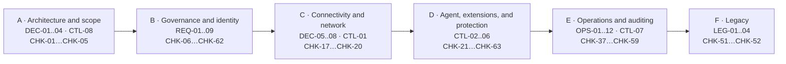

### A.2 Connectivity architecture (public × private)

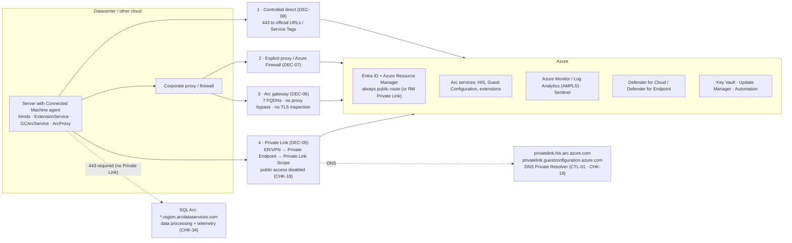

> With Private Link, Entra ID and ARM still use the public route (Service Tags `AzureActiveDirectory` and `AzureResourceManager`). Windows Admin Center and SSH via Arc are not supported over Private Link. **SQL Server enabled by Azure Arc:** the data processing service (`*.<region>.arcdataservices.com`) does not support Private Link and requires outbound 443 (direct or via proxy). Arc gateway uses the *Public endpoint* method — they are alternatives.

### A.3 Collection and evidence flow


#### Permissions of the account that runs the collection

The script is read-only and, before collecting, reads the **effective permissions** of the account in each subscription (`Microsoft.Authorization/permissions` API, which considers groups and management group inheritance). This is necessary because Azure Resource Graph **does not fail** when permission is missing: it just returns fewer rows, and a PASS could be false.

| Area | Verified actions | If missing |
|---|---|---|
| Arc: machines, extensions, and SQL | `Microsoft.HybridCompute/machines/read`, `.../machines/extensions/read`, `.../privateLinkScopes/read`, `Microsoft.AzureArcData/sqlServerInstances/read` | Affected CHK becomes **PARCIAL** (some subscriptions) or **ERRO** (all) |
| Network, DNS, and Key Vault | `Microsoft.Network/privateDnsZones/read`, `Microsoft.KeyVault/vaults/read` | idem |
| RBAC | `Microsoft.Authorization/roleAssignments/read`, `.../roleDefinitions/read` | idem |
| Azure Policy | `Microsoft.Authorization/policyAssignments/read`, `Microsoft.PolicyInsights/policyStates/queryResults/read` | idem |
| Defender for Cloud | `Microsoft.Security/pricings/read`, `Microsoft.Security/assessments/read` | idem |
| Monitoring and logs | `Microsoft.Insights/dataCollectionRuleAssociations/read`, `.../diagnosticSettings/read`, `.../eventtypes/values/read`, `Microsoft.OperationalInsights/workspaces/read` | idem |
| Patches | `Microsoft.HybridCompute/machines/patchAssessmentResults/read` | idem |
| Advisor | `Microsoft.Advisor/recommendations/read` | idem |
| Cost (optional) | `Microsoft.CostManagement/query/read`, `Microsoft.Consumption/usageDetails/read` | informational only: the current collection **does not read cost** |

- Recommended role: **Reader** on the management group (or on each subscription in scope). It covers all of the actions above (`*/read`); no write role is needed. Roles such as *Security Reader* alone do not cover Arc, Policy and Monitor.
- To read cost at billing scopes (EA/MCA), billing roles may be required, which are outside the scope of this script.
- The result appears in the console, in `findings/permissions.csv`, in `summary.md`, in `results.json` (`permissions`) and in the analysis tab of the HTML.
- References: [Azure RBAC — Management and governance permissions](https://learn.microsoft.com/en-us/azure/role-based-access-control/permissions/management-and-governance) · [Azure built-in roles](https://learn.microsoft.com/en-us/azure/role-based-access-control/built-in-roles) · [Permissions in Azure Resource Graph](https://learn.microsoft.com/en-us/azure/governance/resource-graph/overview#permissions-in-azure-resource-graph)

### A.4 End-to-end lifecycle

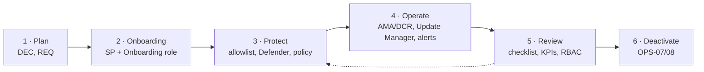

### A.5 Identity and access (onboarding and operations)

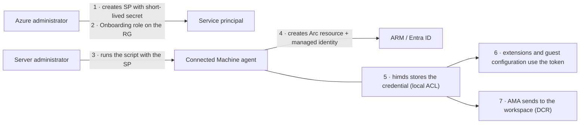

- The local administrator of the machine can obtain managed identity tokens: treat any role given to this identity as access for that administrator in Azure (CHK-12).
- Members of the local group *Hybrid agent extension applications* also request tokens from himds (CTL-05).
- References: [Identity and authorization](https://learn.microsoft.com/en-us/azure/azure-arc/servers/security-identity-authorization) · [Arc Jumpstart](https://jumpstart.azure.com)

### A.6 Removal (individual and at scale)

The complete flow is in **OPS-07** (individual) and **OPS-08** (at scale), within tree **D8**.

## Appendix B) Executive flow by checklist phase

| Phase | Playbook items | Checks |
|---|---|---|
| A · Architecture and scope | DEC-01..DEC-04, CTL-08 | CHK-01, CHK-02, CHK-03, CHK-04, CHK-05 |
| B · Governance and identity | REQ-01..REQ-09 | CHK-06, CHK-07, CHK-08, CHK-09, CHK-10, CHK-11, CHK-12, CHK-13, CHK-14, CHK-15, CHK-16, CHK-53, CHK-56, CHK-60, CHK-62 |
| C · Connectivity and network | DEC-05..DEC-08, CTL-01 | CHK-17, CHK-18, CHK-19, CHK-20 |
| D · Agent, extensions, and protection | CTL-02..CTL-06 | CHK-21, CHK-22, CHK-23, CHK-24, CHK-25, CHK-26, CHK-27, CHK-28, CHK-29, CHK-30, CHK-31, CHK-32, CHK-33, CHK-34, CHK-35, CHK-36, CHK-54, CHK-55, CHK-57, CHK-61, CHK-63 |
| E · Operations, monitoring, and auditing | OPS-01..OPS-12, CTL-07 | CHK-37, CHK-38, CHK-39, CHK-40, CHK-41, CHK-42, CHK-43, CHK-44, CHK-45, CHK-46, CHK-47, CHK-48, CHK-49, CHK-50, CHK-58, CHK-59 |
| F · Legacy | LEG-01..LEG-04 | CHK-51, CHK-52 |

## Appendix C) Windows services catalog (Arc core + extensions)

Objective: standardize operational evidence of **services created/triggered** by Azure Arc and extensions.

> Important: service name, account and startup type may vary by agent/extension version and security baseline. The agent services (HIMDS, Guest Configuration, Extension Service, Arc Proxy) use delayed automatic start; CVE-2026-26117 exploited that window (fixed in 1.61). Use this table as a baseline and confirm on the host (`Get-Service`, `sc qc`, `Get-CimInstance Win32_Service`).

| Service (Windows) | Origin | Typical account | Typical startup | Role | Official reference |
|---|---|---|---|---|---|
| `himds` (Azure Hybrid Instance Metadata Service) | Arc agent (core) | `NT SERVICE\himds` | Auto | Local IMDS endpoint and Arc machine identity (tokens/metadata/heartbeat). | https://learn.microsoft.com/en-us/azure/azure-arc/servers/agent-overview |
| `ArcProxy` (Azure Arc Proxy) | Arc agent (core) | `NT AUTHORITY\NetworkService` | Auto | Local Arc agent proxy and egress/proxy control of agent traffic. | https://learn.microsoft.com/en-us/azure/azure-arc/servers/arc-gateway |
| `GCArcService` (Guest Configuration Arc Service) | Arc agent (core) + Machine Configuration | `LocalSystem` | Auto | Machine Configuration assessment/enforcement inside the guest OS. | https://learn.microsoft.com/en-us/azure/governance/machine-configuration/overview |
| `ExtensionService` (Guest Configuration Extension Service) | Arc agent (core) | `LocalSystem` | Auto | Installs/updates/removes Arc extensions and applies the allowlist/blocklist. | https://learn.microsoft.com/en-us/azure/azure-arc/servers/security-extensions |
| `SqlServerExtension` (Microsoft Sql Server Extension Service) | `WindowsAgent.SqlServer` | `NT Service\SqlServerExtension` | Auto | SQL Arc inventory/management (licensing, management features, and SQL Arc integration). | https://learn.microsoft.com/en-us/sql/sql-server/azure-arc/prerequisites |
| `Microsoft Defender for SQL` (local ATP service) | `AdvancedThreatProtection.Windows` | `NT AUTHORITY\LOCAL SERVICE` | Manual | Defender for SQL: threat detection and VA for eligible instances. | https://learn.microsoft.com/en-us/azure/defender-for-cloud/defender-for-sql-usage |
| `AzureNetworkWatcherAgent` | `NetworkWatcherAgentWindows` | `LocalSystem` | Auto | Connection Monitor/Network Watcher support from the server. | https://learn.microsoft.com/en-us/azure/network-watcher/network-watcher-monitoring-overview |
| `WindowsAdminCenter` / `WindowsAdminCenterAccountManagement` | `AdminCenter` | `NetworkService` / `LocalSystem` | Auto / Manual | Gateway and identity mapping for remote administration through Arc + WAC. | https://learn.microsoft.com/windows-server/manage/windows-admin-center/azure/manage-arc-hybrid-machines |
| `HybridWorkerService` | `HybridWorkerForWindows` | `LocalSystem` | Auto | Local execution of Automation Account runbooks. | https://learn.microsoft.com/en-us/azure/automation/extension-based-hybrid-runbook-worker-install |
| `Sense` | MDE (onboard via `MDE.Windows`) | `LocalSystem` | Auto | Defender for Endpoint sensor (native OS service; the Arc extension performs the onboarding). | https://learn.microsoft.com/en-us/azure/defender-for-cloud/quickstart-onboard-machines |
| Scheduled task `azcmagent` | Arc agent (core, 1.48+) | `SYSTEM` | Daily, 01:00–02:00 | Checks and applies the agent automatic upgrade (`azcmagent_check_updates.ps1`). It was the target of CVE-2025-49692 and CVE-2025-55316: keep the agent updated and alert on changes to the task. | https://learn.microsoft.com/en-us/azure/azure-arc/servers/manage-agent |
| GPO deployment scheduled task | Group Policy onboarding | `SYSTEM` | When the GPO applies | Installs and connects the agent using the service principal from the shared folder. Remove the GPO and the task when onboarding is complete. | https://learn.microsoft.com/en-us/azure/azure-arc/servers/onboard-group-policy-powershell |
| `MMAExtensionHeartbeatService` (legacy) | Legacy Log Analytics Agent (MMA) | `LocalSystem` | Manual | Legacy MMA leftover; must be removed/migrated to AMA according to the current baseline. | https://learn.microsoft.com/en-us/azure/azure-monitor/agents/azure-monitor-agent-migration |

Recommended evidence model per server:
- `ServiceName`, `DisplayName`, `Status`, `StartType`, `StartName`, `PathName`
- corresponding Arc extension (`publisher`, `type`, `provisioningState`, `typeHandlerVersion`)
- correlation with Activity Log for extension operations

> **Verified by:** CHK-36 — Local collection on a sample (agent and services) (Documentary)

## Appendix D) Traceability matrix (playbook → checks)

| Item | Title | Checks |
|---|---|---|
| DEC-01 | Which Arc service to use per environment type | CHK-02 |
| DEC-02 | Mixed scenario (on-prem + AWS/GCP + OCI) | CHK-02 |
| DEC-03 | Landing zone and resource organization | CHK-03 |
| DEC-04 | Criticality profile | CHK-04, CHK-26 |
| DEC-05 | Connectivity model | CHK-17, CHK-18, CHK-20, CHK-34 |
| DEC-06 | When to use Arc Gateway | CHK-17, CHK-20 |
| DEC-07 | When to use Azure Firewall Explicit Proxy | CHK-17, CHK-20 |
| DEC-08 | Controlled direct public | CHK-17, CHK-20 |
| REQ-01 | Eligibility inventory | CHK-01 |
| REQ-02 | Tag model (recommended — good practice) | CHK-06 |
| REQ-03 | Identity model | CHK-10, CHK-13, CHK-62 |
| REQ-04 | Minimum RBAC by scenario | CHK-10, CHK-11, CHK-12, CHK-25, CHK-62 |
| REQ-05 | Provider registration | CHK-07 |
| REQ-06 | Cross-subscription | CHK-16 |
| REQ-07 | Policy and baseline | CHK-08, CHK-09, CHK-27, CHK-55 |
| REQ-08 | Secrets and credentials | CHK-12, CHK-14, CHK-15 |
| REQ-09 | Cost and licensing (free × billed) | CHK-53, CHK-59 |
| CTL-01 | Corporate DNS integrated with Azure | CHK-19, CHK-20 |
| CTL-02 | Extensions by allowlist/blocklist | CHK-22, CHK-23, CHK-24 |
| CTL-03 | Secure remote operations | CHK-21, CHK-24, CHK-25, CHK-26, CHK-44 |
| CTL-04 | Least privilege in SQL Arc | CHK-30, CHK-34, CHK-56, CHK-60 |
| CTL-05 | Local accounts and HIMDS GPO | CHK-35, CHK-36, CHK-56, CHK-60, CHK-61 |
| CTL-06 | Defender for Cloud onboarding | CHK-31, CHK-32, CHK-33, CHK-54, CHK-55, CHK-57, CHK-63 |
| CTL-07 | Sentinel | CHK-39, CHK-40, CHK-41 |
| CTL-08 | Data residency and region | CHK-05 |
| OPS-01 | Mandatory pilot (30 days recommended) | CHK-46 |
| OPS-02 | Rollout in waves | CHK-47 |
| OPS-03 | Official automation methods | CHK-48 |
| OPS-04 | AMA deployment at scale | CHK-39, CHK-40, CHK-58 |
| OPS-05 | Arc agent update | CHK-29 |
| OPS-06 | Extension updates | CHK-28, CHK-30 |
| OPS-07 | Correct Arc removal (individual) | CHK-49 |
| OPS-08 | Removal at scale (stale/disconnected) | CHK-37, CHK-49 |
| OPS-09 | Advisor (reliability) | CHK-37, CHK-38 |
| OPS-10 | Patch management and WSUS | CHK-42 |
| OPS-11 | Minimum health metrics | CHK-09, CHK-28, CHK-37, CHK-50, CHK-58, CHK-59 |
| OPS-12 | Periodic review | CHK-13, CHK-50 |
| LEG-01 | Positioning (2012/2012 R2 and 2016) | CHK-51, CHK-52 |
| LEG-02 | Permitted use | CHK-52 |
| LEG-03 | Minimum security | CHK-51 |
| LEG-04 | Modernization plan | CHK-52 |
| — | Service catalog | CHK-36 |
| — | Evidence matrix | CHK-36, CHK-43, CHK-44, CHK-45 |
| — | Lateral movement | CHK-32, CHK-41, CHK-43, CHK-44, CHK-54 |

## Appendix E) Evidence validation matrix (customer audit)

| Playbook step | Official basis for validation | What it proves at the customer |  |
|---|---|---|---|
| 1) Control plane (who/trigger) | Activity Log + Activity Log schema (`activity-log` + `activity-log-schema`) | `caller`, `operationName`, `correlationId`, `resourceId`, `status`, time | CHK-44, CHK-43 |
| 2) Run Command operation | Arc Run Command + REST `machine-run-commands` | that `create/get/list/delete` of run command occurred on the Arc resource | CHK-44, CHK-26 |
| 3) Command status and output | PowerShell `Get-AzConnectedMachineRunCommand` + `New-AzConnectedMachineRunCommand` | `InstanceViewExecutionState`, `ExitCode`, `output` (limited), use of `OutputBlobUri`/`ErrorBlobUri` | CHK-26 |
| 4) Central retention/auditing | Diagnostic settings + Resource logs (`resource-logs`) | export to Log Analytics/Event Hub/Storage and preserved trail | CHK-43, CHK-45 |
| 5) Evidence on the Arc host/extension | Arc security overview + manage-vm-extensions + agent-overview | local validation of extension execution and agent behavior | CHK-36 |
| 6) Lateral movement/detection | Defender for Servers + MDE integration + Defender XDR advanced hunting | correlation of processes, connections, alerts, and identity within the event window | CHK-32, CHK-33, CHK-41 |

> **Verified by:** CHK-36 — Local collection on a sample (agent and services) (Documentary) · CHK-43 — Activity Log export (Automated) · CHK-44 — Sensitive operations in the period (Automated) · CHK-45 — Log Analytics retention (Automated)

## Appendix F) Lateral movement: investigation trail

To investigate possible lateral movement in the Arc context, the main official track is:
1. **Activity Log + Resource logs** to track control operations (e.g., Run Command creation/execution, extension changes, and configuration changes).
2. **Defender for Servers + Defender for Endpoint (EDR)** for behavioral detection on the host and attack correlation.
3. **Sentinel** for multi-source correlation and threat hunting.

In the public reference documentation, there is no single Arc article specifically titled “lateral movement”; the recommended design is the combination of the controls above.

> **Verified by:** CHK-32 — Defender for Endpoint (Automated) · CHK-41 — Microsoft Sentinel and machine coverage (Automated) · CHK-43 — Activity Log export (Automated) · CHK-44 — Sensitive operations in the period (Automated) · CHK-54 — Threats and vulnerabilities (Defender for Cloud) (Automated)

## Appendix G) Mapping of checks to MCSB v2

Basis for each row: [Arc-enabled servers baseline](https://learn.microsoft.com/en-us/security/benchmark/azure/baselines/azure-arc-enabled-servers-security-baseline), [MCSB](https://learn.microsoft.com/en-us/security/benchmark/azure/overview), and product documentation. *In the Arc baseline?* indicates whether the control appears in the published service baseline.

| CHK | Check | Layer | MCSB v2 control | In the Arc baseline? | How to measure | Tree |
|---|---|---|---|---|---|---|
| CHK-01 | Inventory and eligibility of Arc machines | 3 · Arc requirement | AM-1 | No | Collection (Resource Graph) | D1 |
| CHK-02 | Arc service per environment type | 4 · Customer decision | AM-2 | No | Recorded decision | D1 |
| CHK-03 | Landing zone and resource organization | 4 · Customer decision | AM-1, AM-3 | No | Recorded decision | D2 |
| CHK-04 | Criticality profile (Tier 0/1/2) | 4 · Customer decision | AM-1, PA-1 | PA-1 | Recorded decision (Tier by tag or RG) | D2 |
| CHK-05 | Metadata region and data residency | 4 · Customer decision | AM-2 | No | Collection × customer-defined regions | D2 |
| CHK-06 | Recommended tags (best practice) | 4 · Customer decision | AM-1 | No | Collection × customer-defined tags | D2 |
| CHK-07 | Registered resource providers | 3 · Arc requirement | — | No | Collection (providers) | D1 |
| CHK-08 | Azure Policy and baseline assignments | 1 · MCSB | PV-2, AM-2 | AM-2 | Defender: MCSB regulatory compliance | D6 |
| CHK-09 | Policy compliance on the machines | 1 · MCSB | PV-2, PV-4 | No | Defender: MCSB regulatory compliance | D6 |
| CHK-10 | Privileged roles in scope | 1 · MCSB | PA-1, PA-7 | PA-1, PA-7 | Collection (RBAC) + MCSB control | D4 |
| CHK-11 | Arc-specific roles | 1 · MCSB | PA-7 | PA-7 | Collection (RBAC) | D4 |
| CHK-12 | Managed identity of the machines | 1 · MCSB | IM-3, PA-7 | IM-3, PA-7 | Collection (machine identity RBAC) | D4 |
| CHK-13 | Identity model, PIM, and access review | 1 · MCSB | PA-2, PA-4 | No | Documentary evidence | D4 |
| CHK-14 | Onboarding secrets and credentials | 1 · MCSB | IM-8 | IM-8 | Documentary evidence | D4 |
| CHK-15 | Key Vaults | 1 · MCSB | DP-8 | No | Defender: Key Vault recommendations | D4 |
| CHK-16 | Cross-subscription scenarios | 4 · Customer decision | AM-1, AM-4 | No | Recorded decision | D3 |
| CHK-17 | Connectivity model in use | 1 · MCSB | NS-2 | NS-2 | Collection (model in use) | D3 |
| CHK-18 | Private Link Scope public access | 1 · MCSB | NS-2 | NS-2 | Collection (Private Link Scope) | D3 |
| CHK-19 | Arc private DNS | 3 · Arc requirement | NS-10 | No | Collection (DNS zones) | D3 |
| CHK-20 | Connectivity decision and network allowances | 4 · Customer decision | NS-2, NS-9 | NS-2 | Recorded decision | D3 |
| CHK-21 | Inbound ports on the agent (SSH/WAC) | 3 · Arc requirement | IM-1, NS-8 | IM-1 | Collection (agent ports) | D5 |
| CHK-22 | Agent mode | 3 · Arc requirement | PV-3 | No | Collection (agent mode) | D5 |
| CHK-23 | Extension allowlist/blocklist | 3 · Arc requirement | AM-5 | No | Collection (allowlist/blocklist) | D5 |
| CHK-24 | Sensitive extensions | 4 · Customer decision | AM-5, PA-7 | No | Collection × decision per tier | D5 |
| CHK-25 | Entra access to the OS (SSH/RDP/WAC) | 1 · MCSB | IM-1 | IM-1 | Collection (login RBAC) | D4 |
| CHK-26 | Run Command and Admin Center per tier | 4 · Customer decision | PA-7 | PA-7 | Recorded decision | D5 |
| CHK-27 | Guest configuration (Machine Configuration) | 2 · OS baseline | PV-4 | No | Collection (guest configuration) | D6 |
| CHK-28 | Failed extensions | 3 · Arc requirement | — | No | Collection (failed extensions) | D7 |
| CHK-29 | Agent version within support | 3 · Arc requirement | PV-6 | No | Collection × release notes | D7 |
| CHK-30 | Extension versions and automatic upgrade | 3 · Arc requirement | PV-6 | No | Collection × release notes | D7 |
| CHK-31 | Defender for Servers | 1 · MCSB | LT-1 | LT-1 | Collection (Defender plans) | D6 |
| CHK-32 | Defender for Endpoint | 1 · MCSB | ES-1 | No | Collection (MDE) | D6 |
| CHK-33 | Defender recommendations | 1 · MCSB | PV-5, PV-4 | No | Defender: recommendations | D6 |
| CHK-34 | SQL Server: Defender for SQL and least privilege | 1 · MCSB | LT-1, PA-7 | No | Collection + Defender for SQL recommendations | D6 |
| CHK-35 | Local accounts and HIMDS GPO | 3 · Arc requirement | — | No | Documentary evidence | D4 |
| CHK-36 | Local collection on a sample (agent and services) | 3 · Arc requirement | — | No | Documentary evidence | D6 |
| CHK-37 | Disconnected or expired machines | 3 · Arc requirement | AM-3 | No | Collection (status) | D8 |
| CHK-38 | Advisor recommendations | 3 · Arc requirement | — | No | Advisor (reliability) | D8 |
| CHK-39 | Azure Monitor Agent | 1 · MCSB | LT-3, LT-5 | No | Collection (AMA) | D6 |
| CHK-40 | DCR association | 1 · MCSB | LT-3, LT-5 | No | Collection (DCR) | D6 |
| CHK-41 | Microsoft Sentinel and machine coverage | 1 · MCSB | LT-5, IR-3 | No | Collection (Sentinel and DCR) | D6 |
| CHK-42 | Patch assessment (Update Manager/WSUS) | 1 · MCSB | PV-6 | No | Collection (patch assessment) + Defender recommendation | D7 |
| CHK-43 | Activity Log export | 1 · MCSB | LT-3, LT-5 | No | Collection (diagnostic settings) | D6 |
| CHK-44 | Sensitive operations in the period | 1 · MCSB | LT-3, IR-4 | No | Collection (Activity Log) | D6 |
| CHK-45 | Log Analytics retention | 1 · MCSB | LT-6 | No | Collection × customer-defined retention | D6 |
| CHK-46 | Pilot executed and accepted | P · Program | — | No | Program evidence | P |
| CHK-47 | Rollout in waves and rollback | P · Program | — | No | Program evidence | P |
| CHK-48 | Automation method per environment | P · Program | AM-2, PV-2 | No | Program evidence | P |
| CHK-49 | Individual and at-scale removal | 3 · Arc requirement | AM-3 | No | Documented procedure | D8 |
| CHK-50 | Health KPIs and periodic review | P · Program | PV-2, PA-4 | No | Program evidence | P |
| CHK-51 | Legacy, end of support, and ESU | 3 · Arc requirement | PV-6 | No | Collection × official ESU dates | D7 |
| CHK-52 | Legacy exceptions and exit plan | 4 · Customer decision | AM-3, PV-6 | No | Formal exception | D7 |
| CHK-53 | Cost: billed services and benefits per machine | F · FinOps | — | No | Collection × pricing page | D9 |
| CHK-54 | Threats and vulnerabilities (Defender for Cloud) | 1 · MCSB | LT-1, PV-5, IR-3 | LT-1 | Defender (alerts, vulnerabilities, Secure Score) | D6 |
| CHK-55 | Operating system security baseline | 2 · OS baseline | PV-4 | PV-4 | Collection (guest configuration and compliance) | D6 |
| CHK-56 | Local administrators audit | 2 · OS baseline | PA-1, PA-7 | No | Collection (guest configuration) | D4 |
| CHK-57 | Healthy antivirus and EDR | 1 · MCSB | ES-1, ES-2, ES-3 | ES-2 | Defender (recommendations) and extensions | D6 |
| CHK-58 | Insights and telemetry per machine | 3 · Arc requirement | LT-3, LT-4 | No | Collection (DCRs and associations) | D6 |
| CHK-59 | Map of Arc capabilities in use | 3 · Arc requirement | AM-1 | No | Collection (extensions and licenses) | D9 |
| CHK-60 | Local administrator password (Windows LAPS) | 2 · OS baseline | PA-1, IM-8 | No | Interview and evidence | D4 |
| CHK-61 | System disk encryption (BitLocker/dm-crypt) | 2 · OS baseline | DP-4 | No | Interview and evidence | D6 |
| CHK-62 | Conditional Access and MFA for Azure administrators | 1 · MCSB | IM-6, IM-7 | No | Interview and evidence | D4 |
| CHK-63 | Defender for Servers per Arc machine | 1 · MCSB | LT-1, ES-1 | LT-1 | Collection (Defender plan per machine) | D6 |

MCSB families: **NS** Network security · **IM** Identity management · **PA** Privileged access · **DP** Data protection · **AM** Asset management · **LT** Logging and threat detection · **IR** Incident response · **PV** Posture and vulnerability management · **ES** Endpoint security · **BR** Backup and recovery · **DS** DevOps security · **AI** Artificial intelligence security · **GS** Governance and strategy (v1 only).

## Appendix H) Official Microsoft references

### Architecture and decision
- Azure landing zone (current CAF):  
  https://learn.microsoft.com/en-us/azure/cloud-adoption-framework/ready/landing-zone/
- Choose the right Azure Arc service for machines:  
  https://learn.microsoft.com/en-us/azure/azure-arc/choose-service
- Plan and deploy Azure Arc-enabled servers:  
  https://learn.microsoft.com/en-us/azure/azure-arc/servers/plan-at-scale-deployment
- Azure Arc-enabled servers overview:  
  https://learn.microsoft.com/en-us/azure/azure-arc/servers/overview
- Azure Well-Architected Framework:  
  https://learn.microsoft.com/en-us/azure/well-architected/

### Agent, scale, and lifecycle
- Deployment options:  
  https://learn.microsoft.com/en-us/azure/azure-arc/servers/deployment-options
- Agent overview:  
  https://learn.microsoft.com/en-us/azure/azure-arc/servers/agent-overview
- Prerequisites:  
  https://learn.microsoft.com/en-us/azure/azure-arc/servers/prerequisites
- Network requirements:  
  https://learn.microsoft.com/en-us/azure/azure-arc/servers/network-requirements
- Connected Machine agent release notes (12-month support):  
  https://learn.microsoft.com/en-us/azure/azure-arc/servers/agent-release-notes
- Manage agent versions:  
  https://learn.microsoft.com/en-us/azure/azure-arc/servers/manage-agent
- Uninstall agent:  
  https://learn.microsoft.com/en-us/azure/azure-arc/servers/uninstall-agent
- Resolve Azure Advisor recommendations:  
  https://learn.microsoft.com/en-us/azure/azure-arc/servers/resolve-azure-advisor-recommendations

### Connectivity
- Private Link for Arc servers:  
  https://learn.microsoft.com/en-us/azure/azure-arc/servers/private-link-security
- Arc gateway:  
  https://learn.microsoft.com/en-us/azure/azure-arc/servers/arc-gateway
- Azure Firewall explicit proxy for Arc:  
  https://learn.microsoft.com/en-us/azure/azure-arc/azure-firewall-explicit-proxy
- DNS Private Resolver:  
  https://learn.microsoft.com/en-us/azure/dns/dns-private-resolver-overview
- Private DNS:  
  https://learn.microsoft.com/en-us/azure/dns/private-dns-overview
- Private endpoint cross-subscription approval:  
  https://learn.microsoft.com/en-us/azure/private-link/how-to-approve-private-link-cross-subscription

### Governance and RBAC
- Azure Policy overview:  
  https://learn.microsoft.com/azure/governance/policy/overview
- Arc policy reference (built-ins):  
  https://learn.microsoft.com/en-us/azure/azure-arc/servers/policy-reference
- Azure RBAC built-in roles:  
  https://learn.microsoft.com/en-us/azure/role-based-access-control/built-in-roles
- Azure Connected Machine Onboarding role:  
  https://learn.microsoft.com/en-us/azure/role-based-access-control/built-in-roles#azure-connected-machine-onboarding
- Azure Connected Machine Resource Administrator role:  
  https://learn.microsoft.com/en-us/azure/role-based-access-control/built-in-roles#azure-connected-machine-resource-administrator
- Resource providers and types:  
  https://learn.microsoft.com/en-us/azure/azure-resource-manager/management/resource-providers-and-types

### Security, Defender, Sentinel, and operations
- Security overview for Arc-enabled servers:  
  https://learn.microsoft.com/en-us/azure/azure-arc/servers/security-overview
- Security extensions (allowlist/blocklist):  
  https://learn.microsoft.com/en-us/azure/azure-arc/servers/security-extensions#allowlists-and-blocklists
- Manage Arc VM extensions:  
  https://learn.microsoft.com/en-us/azure/azure-arc/servers/manage-vm-extensions
- Identity and access authorization for Arc-enabled servers:  
  https://learn.microsoft.com/en-us/azure/azure-arc/servers/security-identity-authorization
- Manage Arc-enabled servers with Windows Admin Center:  
  https://learn.microsoft.com/windows-server/manage/windows-admin-center/azure/manage-arc-hybrid-machines
- Run command on Arc-enabled servers:  
  https://learn.microsoft.com/en-us/azure/azure-arc/servers/run-command
- Azure CLI (run-command):  
  https://learn.microsoft.com/en-us/cli/azure/connectedmachine/run-command?view=azure-cli-latest
- PowerShell (New-AzConnectedMachineRunCommand):  
  https://learn.microsoft.com/en-us/powershell/module/az.connectedmachine/new-azconnectedmachineruncommand?view=azps-16.4.0
- PowerShell (Get-AzConnectedMachineRunCommand):  
  https://learn.microsoft.com/en-us/powershell/module/az.connectedmachine/get-azconnectedmachineruncommand?view=azps-16.4.0
- REST API (Machine Run Commands):  
  https://learn.microsoft.com/en-us/rest/api/hybridcompute/machine-run-commands?view=rest-hybridcompute-2026-09-01
- Azure Monitor Activity Log:  
  https://learn.microsoft.com/en-us/azure/azure-monitor/fundamentals/activity-log
- Azure Monitor Resource logs:  
  https://learn.microsoft.com/en-us/azure/azure-monitor/logs/resource-logs
- Defender for Cloud onboarding for non-Azure machines:  
  https://learn.microsoft.com/en-us/azure/defender-for-cloud/quickstart-onboard-machines
- Plan Defender for Servers:  
  https://learn.microsoft.com/en-us/azure/defender-for-cloud/plan-defender-for-servers
- Defender for Endpoint integration in Defender for Cloud:  
  https://learn.microsoft.com/en-us/azure/defender-for-cloud/integration-defender-for-endpoint
- Just-in-time VM access:  
  https://learn.microsoft.com/en-us/azure/defender-for-cloud/just-in-time-access-overview
- Defender for Endpoint EDR overview:  
  https://learn.microsoft.com/en-us/defender-endpoint/overview-endpoint-detection-response
- Defender for Servers intro:  
  https://learn.microsoft.com/en-us/azure/defender-for-cloud/defender-for-servers-introduction

### Complementary reference (non-normative)
- Azure Arc Jumpstart:  
  https://azurearcjumpstart.io/
- Defender for SQL on machines:  
  https://learn.microsoft.com/en-us/azure/defender-for-cloud/defender-for-sql-usage
- Microsoft Sentinel overview:  
  https://learn.microsoft.com/en-us/azure/sentinel/overview
- Deploy AMA on Arc-enabled servers:  
  https://learn.microsoft.com/en-us/azure/azure-arc/servers/azure-monitor-agent-deployment
- Update Manager overview:  
  https://learn.microsoft.com/en-us/azure/update-manager/overview
- Update Manager support matrix (includes WSUS):  
  https://learn.microsoft.com/en-us/azure/update-manager/support-matrix

### SQL Arc
- SQL extension release notes (12-month support, auto-upgrade target):  
  https://learn.microsoft.com/en-us/sql/sql-server/azure-arc/release-notes?view=sql-server-ver17
- Unsupported configurations (includes Private Link for the data processing service):  
  https://learn.microsoft.com/en-us/sql/sql-server/azure-arc/overview?view=sql-server-ver17#unsupported-configurations
- Prerequisites (network, data processing service, NT AUTHORITY\SYSTEM):  
  https://learn.microsoft.com/en-us/sql/sql-server/azure-arc/prerequisites?view=sql-server-ver17
- Private Path (explicit proxy/Azure Firewall for SQL Arc):  
  https://learn.microsoft.com/en-us/sql/sql-server/azure-arc/configure-private-path?view=sql-server-ver17
- Troubleshoot data processing service and telemetry endpoints:  
  https://learn.microsoft.com/en-us/sql/sql-server/azure-arc/troubleshoot-telemetry-endpoint?view=sql-server-ver17
- Manage automatic connection (tag ArcSQLServerExtensionDeployment):  
  https://learn.microsoft.com/en-us/sql/sql-server/azure-arc/manage-autodeploy?view=sql-server-ver17
- SQL Server enabled by Azure Arc overview:  
  https://learn.microsoft.com/en-us/sql/sql-server/azure-arc/overview?view=sql-server-ver17
- SQL Arc least privilege:  
  https://learn.microsoft.com/en-us/sql/sql-server/azure-arc/configure-least-privilege?view=sql-server-ver17
- SQL Arc license and billing:  
  https://learn.microsoft.com/en-us/sql/sql-server/azure-arc/manage-license-billing?view=sql-server-ver17

### Microsoft blogs (curated)
- Azure Arc Blog (TechCommunity):  
  https://techcommunity.microsoft.com/category/azure/blog/azurearcblog
- Microsoft Defender for Cloud Blog (TechCommunity):  
  https://techcommunity.microsoft.com/category/microsoft-defender-for-cloud/blog/microsoftdefendercloudblog

### CAF — Azure Arc-enabled servers (landing zone accelerator)

> **Note:** Microsoft marked these hybrid CAF articles as deprecated, with removal planned for 2026-10-30. They remain useful as design reference (you can download the PDF from each page); current guidance is in the Azure Architecture Center: [Get started with Azure hybrid and adaptive cloud architecture](https://learn.microsoft.com/en-us/azure/architecture/hybrid/hybrid-start-here) and [Azure hybrid options](https://learn.microsoft.com/en-us/azure/architecture/guide/technology-choices/hybrid-considerations).

- Hybrid and multicloud: enterprise-scale landing zone (flow: new to Azure? → landing zone option → Arc-enabled servers accelerator → onboarding → ESU):  
  https://learn.microsoft.com/en-us/azure/cloud-adoption-framework/scenarios/hybrid/enterprise-scale-landing-zone
- Choose the Azure Arc service:  
  https://learn.microsoft.com/en-us/azure/azure-arc/choose-service
- Resource organization (D2):  
  https://learn.microsoft.com/en-us/azure/cloud-adoption-framework/scenarios/hybrid/arc-enabled-servers/eslz-resource-organization
- Network connectivity (D3):  
  https://learn.microsoft.com/en-us/azure/cloud-adoption-framework/scenarios/hybrid/arc-enabled-servers/eslz-arc-servers-connectivity
- Identity and access management (D4):  
  https://learn.microsoft.com/en-us/azure/cloud-adoption-framework/scenarios/hybrid/arc-enabled-servers/eslz-identity-and-access-management
- Security, governance and compliance (D5, D6):  
  https://learn.microsoft.com/en-us/azure/cloud-adoption-framework/scenarios/hybrid/arc-enabled-servers/eslz-security-governance-and-compliance
- Management and monitoring (D6, D7):  
  https://learn.microsoft.com/en-us/azure/cloud-adoption-framework/scenarios/hybrid/arc-enabled-servers/eslz-management-and-monitoring-arc-server
- Automation disciplines (P):  
  https://learn.microsoft.com/en-us/azure/cloud-adoption-framework/scenarios/hybrid/arc-enabled-servers/eslz-automation-arc-server
- Cost governance (D9):  
  https://learn.microsoft.com/en-us/azure/cloud-adoption-framework/scenarios/hybrid/arc-enabled-servers/eslz-cost-governance
- Landing zone identity and access design area:  
  https://learn.microsoft.com/en-us/azure/cloud-adoption-framework/ready/landing-zone/design-area/identity-access
- At-scale deployment planning:  
  https://learn.microsoft.com/en-us/azure/azure-arc/servers/plan-at-scale-deployment
- Azure Monitor Logs access control:  
  https://learn.microsoft.com/en-us/azure/azure-monitor/logs/manage-access
- Azure Arc learning path:  
  https://learn.microsoft.com/en-us/training/paths/manage-hybrid-infrastructure-with-azure-arc/

### Agent vulnerabilities and security research (context)
- Microsoft Security Update Guide (MSRC): CVE-2025-49692, CVE-2025-26627, CVE-2025-55316, CVE-2026-26117:  
  https://msrc.microsoft.com/update-guide/
- Reversec Labs — agent scheduled task and console window:  
  https://labs.reversec.com/advisories/2026/01/azure-connected-machine-agent-elevation-of-privilege-vulnerability-scheduled-task
- Cymulate — CVE-2026-26117:  
  https://cymulate.com/blog/cve-2026-26117-azure-arc-windows-lpe-cloud-identity-takeover/
- IBM X-Force — abusing Azure Arc for hybrid escalation and persistence:  
  https://www.ibm.com/think/x-force/identifying-abusing-azure-arc-for-hybrid-escalation-persistence

### Collection tool
- Azure Resource Graph overview:  
  https://learn.microsoft.com/en-us/azure/governance/resource-graph/overview
- Azure Resource Graph — pagination and limits:  
  https://learn.microsoft.com/en-us/azure/governance/resource-graph/concepts/work-with-data

### Microsoft Cloud Security Benchmark v2 (preview)
- Overview and domains:  
  https://learn.microsoft.com/en-us/security/benchmark/azure/overview
- Network security · Identity management · Privileged access · Data protection · Asset management:  
  https://learn.microsoft.com/en-us/security/benchmark/azure/mcsb-v2-network-security · https://learn.microsoft.com/en-us/security/benchmark/azure/mcsb-v2-identity-management · https://learn.microsoft.com/en-us/security/benchmark/azure/mcsb-v2-privileged-access · https://learn.microsoft.com/en-us/security/benchmark/azure/mcsb-v2-data-protection · https://learn.microsoft.com/en-us/security/benchmark/azure/mcsb-v2-asset-management
- Logging and threat detection · Incident response · Posture and vulnerability management · Endpoint security · Backup and recovery:  
  https://learn.microsoft.com/en-us/security/benchmark/azure/mcsb-v2-logging-threat-detection · https://learn.microsoft.com/en-us/security/benchmark/azure/mcsb-v2-incident-response · https://learn.microsoft.com/en-us/security/benchmark/azure/mcsb-v2-posture-vulnerability-management · https://learn.microsoft.com/en-us/security/benchmark/azure/mcsb-v2-endpoint-security · https://learn.microsoft.com/en-us/security/benchmark/azure/mcsb-v2-backup-recovery
- DevOps security · AI security (out of scope for Arc-enabled servers):  
  https://learn.microsoft.com/en-us/security/benchmark/azure/mcsb-v2-devops-security · https://learn.microsoft.com/en-us/security/benchmark/azure/mcsb-v2-artificial-intelligence-security
- Mapping to Azure Policy and to CIS Controls v8.1:  
  https://learn.microsoft.com/en-us/security/benchmark/azure/mcsb-v2-controls-policy-mapping · https://learn.microsoft.com/en-us/security/benchmark/azure/mcsb-v2-cis-controls-mapping
- Azure Policy regulatory compliance controls for Arc-enabled servers:  
  https://learn.microsoft.com/en-us/azure/azure-arc/servers/security-controls-policy

### Windows Server hardening and recovery
- Windows Server 2025 security baseline (Machine Configuration):  
  https://learn.microsoft.com/en-us/azure/governance/policy/samples/guest-configuration-baseline-windows-server-2025
- Best Practices Assessment for Windows Server through Arc (requires SA or WS PAYG):  
  https://learn.microsoft.com/en-us/windows-server/manage/azure-arc/best-practices-assessment-for-windows-server
- Windows Recovery Environment (WinRE), technical reference:  
  https://learn.microsoft.com/en-us/windows-hardware/manufacture/desktop/windows-recovery-environment--windows-re--technical-reference?view=windows-11
- Context (blogs, not official documentation): auditing and enabling WinRE on Arc (preview) · Windows Server hardening tools · third-party introductory guide:  
  https://techcommunity.microsoft.com/blog/azurearcblog/public-preview-audit-and-enable-windows-recovery-environment-winre-for-azure-arc/4462939 · https://techcommunity.microsoft.com/blog/itopstalkblog/some-tools-and-techniques-for-hardening-windows-server/4539840 · https://www.bdrshield.com/blog/beginners-guide-securing-your-servers-using-azure-arc/

### Arc capabilities for servers and OS hardening
- Windows Server Management enabled by Azure Arc (Update Manager, Change Tracking, Machine Configuration, Admin Center, Remote Support, Best Practices Assessment, Site Recovery):  
  https://learn.microsoft.com/en-us/azure/azure-arc/servers/windows-server-management-overview
- Hotpatch do Windows Server:  
  https://learn.microsoft.com/en-us/windows-server/get-started/hotpatch
- Windows security baseline (Machine Configuration):  
  https://learn.microsoft.com/en-us/azure/governance/policy/samples/guest-configuration-baseline-windows
- Linux security baseline (Machine Configuration):  
  https://learn.microsoft.com/en-us/azure/governance/policy/samples/guest-configuration-baseline-linux
- VM Insights:  
  https://learn.microsoft.com/en-us/azure/azure-monitor/vm/vminsights-overview
- Change Tracking e Inventory:  
  https://learn.microsoft.com/en-us/azure/automation/change-tracking/overview-monitoring-agent
- Windows LAPS:  
  https://learn.microsoft.com/en-us/windows-server/identity/laps/laps-overview
- BitLocker:  
  https://learn.microsoft.com/en-us/windows/security/operating-system-security/data-protection/bitlocker/
- Microsoft Entra Conditional Access:  
  https://learn.microsoft.com/en-us/entra/identity/conditional-access/overview
- Mandatory MFA for Azure:  
  https://learn.microsoft.com/en-us/entra/identity/authentication/concept-mandatory-multifactor-authentication

## Appendix I) Curation note

The CAF hybrid/enterprise-scale article for Arc is treated as a historical reference.  
The primary track of this guide is: **Landing Zone + Choose Service + Plan at Scale + Arc Overview + WAF**.

**Content origin.** This material consolidates knowledge from field deliveries carried out over several years and the public Microsoft documentation listed in Appendix H. The structure, text, code and translations were consolidated with the help of artificial intelligence agents and reviewed by the author.

**Use of artificial intelligence.** AI-assisted content may contain errors, omissions or outdated information. Validate each recommendation against the official documentation before applying it. AI does not replace the technical judgment of whoever conducts the assessment.

**Your responsibility.** Review the script before running it, test first in a non-production environment, use least-privilege accounts, follow your organization policies and data protection laws (for example LGPD and GDPR), and treat the collected package and reports as confidential. Decisions and changes in the environment are the responsibility of whoever approves and performs them.

## Appendix J) Version history

### Coverage inventory

Totals calculated from the catalog in every version. In parentheses, what changed compared with v3.6.0.

**By domain**

| Domínio | Checks | Automáticas | Documentary | High | Medium | Low |
|---|---|---|---|---|---|---|
| A · Architecture and scope | 5 | 2 | 3 | 1 | 3 | 1 |
| B · Governance and identity | 15 | 10 | 5 | 6 | 7 | 2 |
| C · Connectivity and network | 4 | 3 | 1 | 2 | 2 | 0 |
| D · Agent, extensions, and protection | 21 | 17 | 4 | 11 | 10 | 0 |
| E · Operations, monitoring, and auditing | 16 | 11 | 5 | 3 | 10 | 3 |
| F · Legacy | 2 | 1 | 1 | 2 | 0 | 0 |
| **Total** | **63** | **44** | **19** | **25** | **32** | **6** |

**By assessment layer and by decision tree**

| Layer | Checks | Tree | Checks |
|---|---|---|---|
| 1 · MCSB | 26 | D1 · Onboarding | 3 |
| 2 · OS baseline | 5 | D2 · Organization and criticality | 4 |
| 3 · Arc requirement | 17 | D3 · Connectivity | 5 |
| 4 · Customer decision | 10 | D4 · Identity and access | 11 |
| P · Program | 4 | D5 · Extensions and remote access per tier | 5 |
| F · FinOps | 1 | D6 · Protection, baseline, logs, and detection | 20 |
|  |  | D7 · Versions, patches, and legacy | 6 |
|  |  | D8 · Removal and abandoned resources | 3 |
|  |  | D9 · Cost and licensing | 2 |
|  |  | P · Program execution | 4 |

**By MCSB v2 domain**

| Domínio MCSB v2 | Checks | Note |
|---|---|---|
| NS · Network security | 5 |  |
| IM · Identity management | 6 |  |
| PA · Privileged access | 11 |  |
| DP · Data protection | 2 | Arc does not store customer data; server disk encryption is CHK-61. |
| AM · Asset management | 15 |  |
| LT · Logging and threat detection | 11 |  |
| IR · Incident response | 3 | Covered by the recommended alerts and by Defender. |
| PV · Posture and vulnerability management | 14 |  |
| ES · Endpoint security | 3 |  |
| BR · Backup and recovery | 0 | The Arc-enabled servers baseline marks backup as not supported by the service: server backup is the responsibility of the customer backup solution. |
| DS · DevOps security | 0 | Out of scope: there is no DevOps pipeline in Arc-enabled servers. |
| AI · Artificial intelligence security | 0 | Out of scope: there is no AI workload in Arc-enabled servers. |

**Other totals:** 9 recommended alerts · 9 decision trees · 56 documentation references in the action plan. New checks in this version: none.

### History

| Version | Data | Changes |
|---|---|---|
| v3.6.1 | 2026-10-23 | Fix: the 3.5.1 and 3.6.0 script stopped at start with an else not recognized error (log line placed between if and else). New automated check for this kind of error. |
| v3.6.0 | 2026-10-23 | Machine limit (MaxMachines) for large estates, with a sample notice in the report; a single analysis file with the checklist record; collected statuses applied when the package loads; button to return to the analysis; summary by severity; script reviewed with PSScriptAnalyzer (catch with -Verbose, standard verbs, parameters in the log). |
| v3.5.0 | 2026-10-23 | Kit index on the Defender for Cloud Secure Score model: points by severity, share of healthy machines, and checks with the same cause counted once; quick read with coverage, Secure Score and biggest gains; one-row-per-action plan; new indicators (Defender for Servers, compliant baseline, patches, telemetry); high-severity FAIL always immediate. |
| v3.4.0 | 2026-10-23 | New check CHK-63: Defender for Servers plan read on each Arc machine (FAIL without a plan, WARN if different from the subscription); the cost estimate uses the actual machine plan. |
| v3.3.0 | 2026-10-23 | Arc-centric scope: roles, policies, Key Vaults and workspaces count only when they reach the Arc machines (the others appear as ignored); Secure Score labeled as a subscription-wide measure; controls updated to MCSB v2 (preview), with the Governance and strategy domain remapped to AM, PV and PA; coverage inventory by MCSB v2 domain; references for MCSB v2, Windows Server 2025 baselines, Best Practices Assessment and Windows Recovery Environment. |
| v3.2.0 | 2026-10-23 | Eight new checks (CHK-55 to CHK-62): OS security baseline with compliance, local administrators audit, healthy antivirus and EDR, insights and telemetry per machine, map of Arc capabilities in use, Windows LAPS, disk encryption and Conditional Access/MFA for Azure administrators; coverage inventory per version; ERROR/PARTIAL statuses shown in English in the en-US version; references for Windows Server Management, Hotpatch, baselines, VM Insights, Change Tracking, LAPS, BitLocker and Conditional Access. |
| v3.1.0 | 2026-10-23 | Agent security floor 1.61 (CVE-2025-49692, CVE-2025-26627, CVE-2025-55316, CVE-2026-26117) in CHK-29 and ALR-03; CVE table including service-side and SQL extension CVEs; azcmagent scheduled task, GPO deployment task and delayed-start services in the services catalog; onboarding service principal and GPO hardening; CAF hybrid references (Arc-enabled servers design areas) and Arc service selection; active state on the Expand/Collapse all buttons. |
| v3.0.0 | 2026-10-23 | Project renamed to Arc Posture Review (repository, Invoke-ArcPostureReview.ps1 script, arc-posture-review-*.zip package, pt-BR and en-US files); status and severity colors following Advisor and Defender for Cloud, with icon, AA contrast, dark mode and high contrast; package compatibility by schema (v2.x packages are still accepted). |
| v2.6.0 | 2026-10-23 | English version (en-US) generated from the same source by segment translation (separate pt-BR and en-US files); structure and integrity validation of the imported package (origin, version, results, manifest SHA-256, files outside the manifest, size limits) and .zip SHA-256 printed by the script; readable table labels; missing dependency (Python) cause for failed extensions. |
| v2.5.0 | 2026-10-22 | Guide reorganized according to the CAF Secure method (sustainment cycle) measured by MCSB v1: assessment layers, MCSB control, and tree in each check; 9 decision trees (D1–D9) + program execution, with DEC/REQ/CTL/OPS/LEG items as details; appendices for maps, traceability, evidence, and MCSB mapping; HTML with collapsible sections and a scoreboard by layer and MCSB control. No content removed. |
| v2.4.0 | 2026-10-22 | CHK IDs unified with HTML checklist v2 (63 checks: 44 automated, 19 documentary); two-way traceability; tags become a recommendation (good practice); DEC-05/06 updated with current Private Link and Arc gateway documentation; new CHKs for region, Sentinel, and SQL (least privilege); flow, connectivity, and collection diagrams; threats and vulnerabilities (CHK-54). |
| v1.4.0 | — | Previous version (manual checklist CHK-01..22). |
