# Azure Arc — Playbook de segurança (público × privado)

**Versão v4.0.3 — 30/10/2026.** Guia e checklist alinhados 1:1: os mesmos IDs (CHK, D1–D9, DEC/REQ/CTL/OPS/LEG, ALR) aparecem no guia e no checklist, e cada item aponta para o outro.

> Projeto pessoal e independente: consolida experiência de campo e documentação pública da Microsoft, com apoio de IA e revisão do autor. Não é documentação oficial. Leia o Anexo I antes de usar.

> **Espelho de autoria:** o guia canônico desta release é o HTML integrado `arc-posture-review.pt-BR.html`. Este Markdown é mantido para edição e revisão; não é uma entrega separada.

> **Semântica de resultado:** Resultado do controle e Cobertura da evidência são independentes. Um PASS/WARN/FAIL conclusivo pode ter cobertura PARTIAL quando a condição observada prova o resultado, mas uma dependência externa ou um escopo maior não foi coletado. PARTIAL como resultado significa que a evidência não permite concluir PASS, WARN ou FAIL. A cobertura afeta a confiança; não apaga uma falha comprovada.

> **Riscos atuais para o lab:** execução com limite de máquinas é amostra de descoberta, não cobertura final; `PARTIAL` como resultado, `ERROR` e `TODO` significam não avaliado, não saudável; metadados de versão lidos do Azure podem cair para tabelas estáticas; e o ZIP/relatórios contêm dados sensíveis do ambiente. Para validar a release, importe e exporte um pacote novo e autorizado do lab depois que os gates locais passarem.

> **Relatório v4 (desde a v4.0.0):** o mesmo pacote de evidências também pode gerar o `assessment-result.v4.json` canônico (Evidência → Observação → Afirmação → Controle → Cenário) e um relatório HTML bilíngue com plano de ação AGORA, rastro da evidência por verificação e links opcionais do portal Azure. Os IDs das verificações, os critérios e as árvores de decisão deste guia não mudam; veja `docs/v4/methodology-v4.md` e o README.

## 0) Comece aqui

Três passos: **1.** percorra as etapas abaixo e abra a árvore de cada decisão (clique no cartão); **2.** gere e rode o script somente leitura (etapa 2 do HTML); **3.** carregue o .zip e siga o plano de ação.

### Entrega em PDF limpo

Salve o HTML da análise no idioma desejado e execute `python tools/Generate-CleanPdf.py <relatorio-salvo.html>`. O gerador expande as seções de evidência, remove scripts/botões interativos, aplica CSS A4 e valida que nenhum cabeçalho ou rodapé do navegador com URL/data entrou no PDF. Não use a caixa de impressão do navegador para o artefato de aceite do lab.

```mermaid
%% svg:start
flowchart LR
  subgraph S0["1 · Planejar"]
    D2["D2 · Organização e criticidade"]
    D9["D9 · Custo e licenciamento"]
  end
  subgraph S1["2 · Conectar"]
    D1["D1 · Onboarding"]
    D3["D3 · Conectividade"]
  end
  subgraph S2["3 · Proteger"]
    D4["D4 · Identidade e acesso"]
    D5["D5 · Extensões e acesso remoto por tier"]
    D6["D6 · Proteção, baseline, logs e detecção"]
  end
  subgraph S3["4 · Operar"]
    D7["D7 · Versões, patches e legado"]
  end
  subgraph S4["5 · Desativar"]
    D8["D8 · Remoção e recursos abandonados"]
  end
  S0 --> S1 --> S2 --> S3 --> S4
```

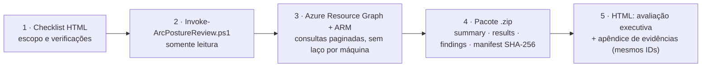

## 1) Método de avaliação

O kit segue a prática pública da Microsoft para **sustentar a postura de segurança** do [Cloud Adoption Framework — Secure](https://learn.microsoft.com/en-us/azure/cloud-adoption-framework/secure/overview): avaliação recorrente, remediação priorizada, automação de controles e relatório com evidências. O padrão de medida é o [Microsoft Cloud Security Benchmark (MCSB)](https://learn.microsoft.com/en-us/security/benchmark/azure/overview), o benchmark padrão do Defender for Cloud, cujos controles trazem o mapeamento para **CIS Controls v8.1**, **NIST SP 800-53 Rev.5**, **PCI-DSS v4**, **NIST CSF 2.0**, **ISO 27001:2022** e **SOC 2**. Os IDs usados são do **MCSB v2** (preview, substitui o v1). O [baseline de segurança do Arc-enabled servers](https://learn.microsoft.com/en-us/security/benchmark/azure/baselines/azure-arc-enabled-servers-security-baseline) publicado ainda usa o v1; como os IDs dos controles se mantêm entre as versões (o v2 retirou o domínio Governança e estratégia e acrescentou DevOps e IA), a coluna *No baseline do Arc?* continua válida.

### 1.1 Ciclo aplicado

| Etapa do ciclo | O que o kit faz | Onde |
|---|---|---|
| **Avaliar** | Coleta somente leitura + itens documentais | Etapas 2 e 3 do HTML |
| **Medir** | Status por verificação, agrupado por camada e controle MCSB; Secure Score do Defender | Etapa 4 (Análise) |
| **Priorizar** | Severidade × criticidade (tier) × prazo I/C/M | O que fazer agora / Plano de ação |
| **Remediar e automatizar** | Passos por verificação; Azure Policy e alertas ALR-01..09 | Plano de ação e Alertas |
| **Reportar** | Relatório com evidências; nova coleta para comparar antes × depois | Etapa 5 (Plano e entrega) |

### 1.2 Camadas de avaliação

Cada verificação pertence a uma camada. Só as camadas 1 a 3 medem conformidade; a camada 4 mede aderência às decisões do cliente.

| Camada | Significado | Entra na conformidade? | Verificações |
|---|---|---|---|
| 1 · MCSB | Controle do Microsoft Cloud Security Benchmark, medido pelo Defender for Cloud ou pela coleta | Sim | 26 |
| 2 · Baseline do SO | Baseline de segurança do Windows/Linux, auditado pelo Machine Configuration | Sim | 5 |
| 3 · Requisito do Arc | Requisito documentado do produto (suporte, ESU, rede, extensões, remoção) | Sim (indicador próprio) | 17 |
| 4 · Decisão do cliente | Parâmetro decidido pelo cliente (tier, regiões, tags, retenção, uso por tier) | Não: mede aderência à decisão | 10 |
| P · Programa | Execução do programa (piloto, ondas, automação, revisão) | Não | 4 |
| F · FinOps | Custo e licenciamento | Não | 2 |

- Fonte oficial da medida: [painel de conformidade regulatória do Defender for Cloud](https://learn.microsoft.com/en-us/azure/defender-for-cloud/regulatory-compliance-dashboard) (MCSB), [Secure Score](https://learn.microsoft.com/en-us/azure/defender-for-cloud/secure-score-security-controls) e [Machine Configuration](https://learn.microsoft.com/en-us/azure/governance/machine-configuration/overview) para o baseline do SO.
- Controles listados no baseline do Arc-enabled servers: NS-1, NS-2, IM-1, IM-3, IM-8, PA-1, PA-7, DP-1, DP-3, DP-4, AM-2, LT-1, LT-4, BR-1. Os demais (PV, ES, LT-3/5/6, IR) se aplicam ao servidor e à operação.
- O índice do kit segue o modelo do [Secure Score](https://learn.microsoft.com/en-us/azure/defender-for-cloud/secure-score-security-controls): cada controle vale pontos pelo peso da severidade (Alta 3, Média 2, Baixa 1) e pontua pela proporção de máquinas saudáveis; verificações com a mesma causa (por exemplo, MDE ausente na CHK-32 e na CHK-57) formam um controle e contam uma vez; controles sem avaliação ficam fora da conta; o ganho de cada ação equivale ao potencial de aumento do Secure Score. Quando o achado não é por máquina, PASS = 100%, WARN = 50%, FAIL = 0.
- A tabela por controle MCSB segue o painel de conformidade regulatória: o controle atende quando todas as verificações dele passam.
- O índice é um apoio de leitura: **não substitui** o Secure Score nem a conformidade MCSB do Defender for Cloud.

### 1.3 Como ler os IDs e status

| Prefixo | Significado | Onde aparece |
|---|---|---|
| **D1–D9, P** | Árvore de decisão (ou execução do programa) | Seção 2 |
| **DEC / REQ / CTL / OPS / LEG** | Item do playbook (decisão, pré-requisito, controle, operação, legado) | Detalhes dentro de cada árvore |
| **CHK-xx** | Verificação do checklist HTML (automática pelo script ou documental com o cliente) | Seção 3 e no HTML |
| **ALR-xx** | Alerta recomendado | Seção 5 |

- Cada item do playbook termina com **Verificado por** (CHK que comprovam o item); cada CHK lista a camada, o controle MCSB, a árvore e as referências do playbook.
- Status: **PASS**, **WARN**, **FAIL**, **INFO**, **N/A**, **ERRO** (coleta falhou), **PARCIAL** (faltou permissão em parte do escopo) e **TODO** (documental pendente).
- Automáticos são avaliados pelo script somente leitura; documentais, em entrevista ou evidência com o cliente.

## 2) Árvores de decisão

Cada árvore responde a uma pergunta com no máximo 5 decisões. O resultado da árvore vira parâmetro ou critério das verificações. Os detalhes técnicos (itens DEC/REQ/CTL/OPS/LEG) ficam logo abaixo de cada árvore.

| Árvore | Pergunta | Controles MCSB | Verificações |
|---|---|---|---|
| **D1** · Onboarding | Como conectar cada servidor ao Azure Arc? | AM-1 | CHK-01, CHK-02, CHK-07 |
| **D2** · Organização e criticidade | Onde ficam os recursos e qual o nível de proteção de cada servidor? | GS-2, GS-3, AM-1 | CHK-03, CHK-04, CHK-05, CHK-06 |
| **D3** · Conectividade | Por onde o agente fala com o Azure? | NS-2, NS-10 | CHK-16, CHK-17, CHK-18, CHK-19, CHK-20 |
| **D4** · Identidade e acesso | Quem pode fazer o quê no Arc e no servidor? | IM-1, IM-3, IM-8, PA-1, PA-2, PA-4, PA-7 | CHK-10, CHK-11, CHK-12, CHK-13, CHK-14, CHK-15, CHK-25, CHK-35, CHK-56, CHK-60, CHK-62 |
| **D5** · Extensões e acesso remoto por tier | Quais extensões e acessos remotos cada tier pode ter? | AM-5, PA-7, IM-1, PV-3 | CHK-21, CHK-22, CHK-23, CHK-24, CHK-26 |
| **D6** · Proteção, baseline, logs e detecção | O que precisa estar ligado em cada servidor? | LT-1, LT-3, LT-5, LT-6, ES-1, PV-4, IR-3 | CHK-08, CHK-09, CHK-27, CHK-31, CHK-32, CHK-33, CHK-34, CHK-36, CHK-39, CHK-40, CHK-41, CHK-43, CHK-44, CHK-45, CHK-54, CHK-55, CHK-57, CHK-58, CHK-61, CHK-63 |
| **D7** · Versões, patches e legado | O servidor está atualizado e dentro do suporte? | PV-6 | CHK-28, CHK-29, CHK-30, CHK-42, CHK-51, CHK-52 |
| **D8** · Remoção e recursos abandonados | O recurso Arc ainda corresponde a um servidor real? | AM-3 | CHK-37, CHK-38, CHK-49 |
| **D9** · Custo e licenciamento | Quais serviços cobrados ativar e com qual benefício? | — | CHK-53, CHK-59, CHK-64 |
| **P** · Execução do programa | Como executar e sustentar com segurança? | — | CHK-46, CHK-47, CHK-48, CHK-50 |

### D1 — Onboarding

**Pergunta:** Como conectar cada servidor ao Azure Arc?

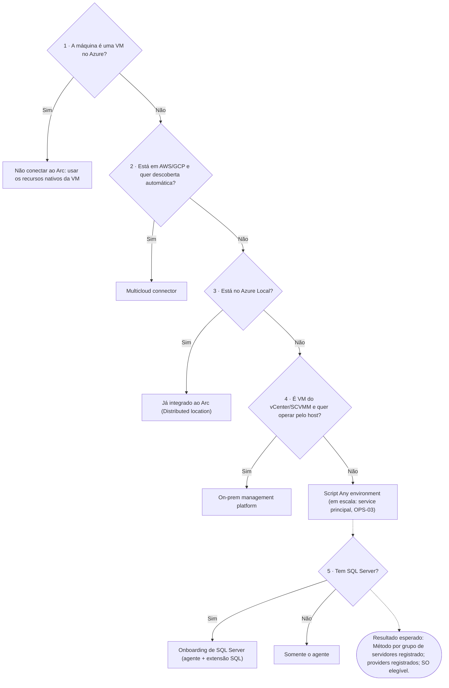

- **Verificado por:** CHK-01, CHK-02, CHK-07
- **Controles MCSB:** AM-1 · **Detalhes:** DEC-01, DEC-02, REQ-01, REQ-05
- **CAF (Arc-enabled servers):** [Escolher o serviço Azure Arc](https://learn.microsoft.com/en-us/azure/azure-arc/choose-service)

#### Árvore D1 em tabela

| # | Decisão | Se sim | Se não |
|---|---|---|---|
| 1 | A máquina é uma VM no Azure? | Não conectar ao Arc: usar os recursos nativos da VM | Seguir |
| 2 | Está em AWS/GCP e quer descoberta automática? | Multicloud connector | Seguir |
| 3 | Está no Azure Local? | Já integrado ao Arc (Distributed location) | Seguir |
| 4 | É VM do vCenter/SCVMM e quer operar pelo host? | On-prem management platform | Script *Any environment* (em escala: service principal, OPS-03) |
| 5 | Tem SQL Server? | Onboarding de SQL Server (agente + extensão SQL) | Somente o agente |

- **Resultado esperado:** Método por grupo de servidores registrado; providers registrados; SO elegível.

#### DEC-01 — Qual serviço Arc usar por tipo de ambiente

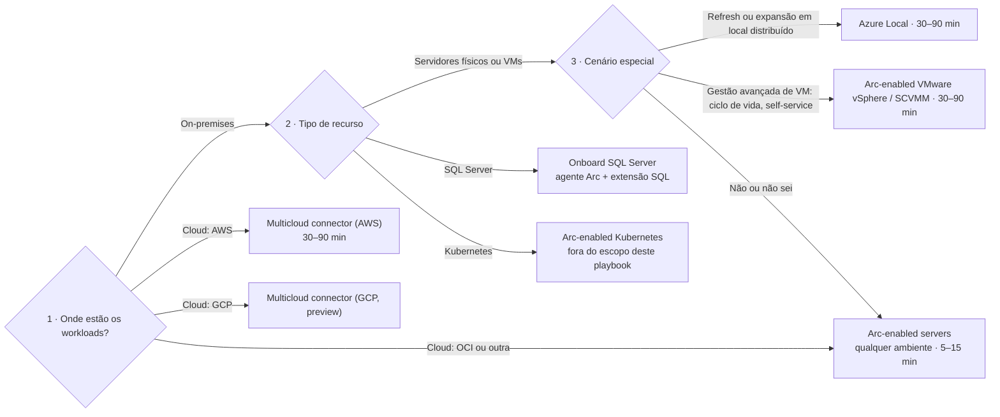

O fluxo segue as três perguntas do assistente **Help me choose** do portal (Azure Arc › *Explore onboarding methods*). Todas as opções começam pela implantação do agente Arc no recurso.

| Método no portal | Melhor para | Tempo inicial de onboarding | Ambientes indicados |
|---|---|---|---|
| **Any environment** (script gerado) | Flexibilidade | 5–15 min | AWS, GCP, Azure Local, VMware, SCVMM; também físico e OCI |
| **Multiclouds** (Multicloud connector) | Escala e descoberta automática em nuvem pública | 30–90 min | AWS; GCP em preview |
| **Distributed location** (Azure Local) | Infraestrutura nova ou renovada | 30–90 min | Azure Local (Arc já integrado; suporte conjunto Microsoft e fabricante) |
| **On-prem management platform** | Operar VMs a partir do host (criar, redimensionar, ligar/desligar) | 30–90 min | VMware vCenter, SCVMM |

- **SQL Server:** o portal recomenda o onboarding de SQL Server, com script que instala o agente Arc e a extensão SQL em qualquer ambiente.
- **Custo:** inventário, organização, Resource Graph, SSH/Run Command/Custom Script e o *VM self-service* em VMware/SCVMM são gratuitos; serviços de gestão e segurança são cobrados quando habilitados (ver **REQ-09**).
- **ESU:** VMs no Azure Local e no Azure VMware Solution recebem ESU sem custo e **não** devem ser inscritas no ESU via Arc.
- Referências: [Azure Arc pricing](https://azure.microsoft.com/en-us/pricing/details/azure-arc/core-control-plane/) · [Prepare to deliver ESUs](https://learn.microsoft.com/en-us/azure/azure-arc/servers/prepare-extended-security-updates) · [Arc-enabled servers deployment options](https://learn.microsoft.com/en-us/azure/azure-arc/servers/deployment-options)

> **Verificado por:** CHK-02 — Serviço Arc por tipo de ambiente (Documental)

#### DEC-02 — Cenário misto (on-prem + AWS/GCP + OCI)

- **Padrão recomendado**:
  - AWS/GCP com necessidade de auto-discovery: **Multicloud connector**
  - OCI + on-prem: **Arc-enabled servers (deploy padrão)**
- Resultado: uma governança única no Azure para origens diferentes.

> **Verificado por:** CHK-02 — Serviço Arc por tipo de ambiente (Documental)

#### REQ-01 — Inventário de elegibilidade

- SO suportado, conectividade, privilégio local para instalação do agente.

> **Verificado por:** CHK-01 — Inventário e elegibilidade das máquinas Arc (Automático)

#### REQ-05 — Registro de providers

Validar os providers abaixo como baseline deste guia:

| Provider | Motivo |
|---|---|
| `Microsoft.HybridCompute` | Recurso base de Arc-enabled servers |
| `Microsoft.Network` | Private Link, rede e conectividade |
| `Microsoft.HybridConnectivity` | Recursos de conectividade híbrida (inclui cenários com Admin Center) |
| `Microsoft.AzureArcData` | SQL Arc / Arc-enabled data services no escopo de servidores |
| `Microsoft.Insights` | AMA, DCR/DCE e diagnósticos |
| `Microsoft.OperationalInsights` | Log Analytics (monitoramento e SIEM) |
| `Microsoft.Security` | Defender for Cloud |
| `Microsoft.PolicyInsights` | Compliance de Azure Policy |
| `Microsoft.GuestConfiguration` | Machine Configuration / Guest Configuration |
| `Microsoft.Automation` | Automation Account e Hybrid Runbook Worker |
| `Microsoft.KeyVault` | Gestão de segredos e cofre |
| `Microsoft.ResourceGraph` | Consultas de inventário e higiene em escala |
| `Microsoft.Maintenance` | Configurações de manutenção do Update Manager |

> Lista final deste playbook para Arc-enabled servers. Não incluir, neste contexto, providers de Kubernetes.

> No checklist: **essenciais** (FAIL se ausentes) = `Microsoft.HybridCompute`, `Microsoft.GuestConfiguration`, `Microsoft.HybridConnectivity`; os demais são **recomendados** (WARN).

> **Verificado por:** CHK-07 — Resource providers registrados (Automático)

### D2 — Organização e criticidade

**Pergunta:** Onde ficam os recursos e qual o nível de proteção de cada servidor?

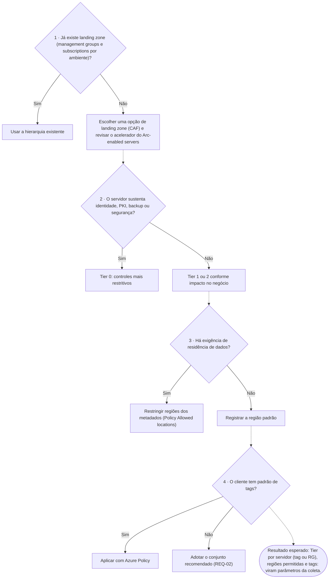

- **Verificado por:** CHK-03, CHK-04, CHK-05, CHK-06
- **Controles MCSB:** GS-2, GS-3, AM-1 · **Detalhes:** DEC-03, DEC-04, REQ-02, CTL-08
- **CAF (Arc-enabled servers):** [Organização de recursos](https://learn.microsoft.com/en-us/azure/cloud-adoption-framework/scenarios/hybrid/arc-enabled-servers/eslz-resource-organization)

#### Árvore D2 em tabela

| # | Decisão | Se sim | Se não |
|---|---|---|---|
| 1 | Já existe landing zone (management groups e subscriptions por ambiente)? | Usar a hierarquia existente | Escolher uma opção de landing zone (CAF) e revisar o acelerador do Arc-enabled servers |
| 2 | O servidor sustenta identidade, PKI, backup ou segurança? | Tier 0: controles mais restritivos | Tier 1 ou 2 conforme impacto no negócio |
| 3 | Há exigência de residência de dados? | Restringir regiões dos metadados (Policy *Allowed locations*) | Registrar a região padrão |
| 4 | O cliente tem padrão de tags? | Aplicar com Azure Policy | Adotar o conjunto recomendado (REQ-02) |

- **Resultado esperado:** Tier por servidor (tag ou RG), regiões permitidas e tags: viram parâmetros da coleta.

#### DEC-03 — Landing zone e organização de recursos

- Estruturar por **Management Group / Subscription / Resource Group**.
- Separar plataforma/rede/segurança de workloads.
- Definir RGs Arc por ambiente/região.

> **Verificado por:** CHK-03 — Landing zone e organização de recursos (Documental)

#### DEC-04 — Perfil de criticidade

- Classificar máquinas em **Tier 0 / Tier 1 / Tier 2**.
- Tier 0 com controles mais restritivos (Run Command/Admin Center bloqueados por padrão).

> **Verificado por:** CHK-04 — Perfil de criticidade (Tier 0/1/2) (Documental) · CHK-26 — Run Command e Admin Center por tier (Documental)

#### REQ-02 — Modelo de tags (recomendado — boa prática)

Tags são **opcionais**: recomendação de boa prática para governança, custo e operação, não requisito para o Arc funcionar.

Tags recomendadas:
- `env` — ambiente (prd, hml, dev)
- `owner` — responsável técnico
- `criticality` — tier (Tier 0/1/2, ver DEC-04)
- `costCenter` — centro de custo
- `dataClassification` — classificação da informação
- `patchWindow` — janela de manutenção

A lista é configurável no checklist (campo *Tags recomendadas*); ausência de tag gera **INFO**, não falha.

> **Verificado por:** CHK-06 — Tags recomendadas (boa prática) (Automático)

#### CTL-08 — Data residency e região

- Selecionar região com critério de latência/compliance desde o onboarding.

> **Verificado por:** CHK-05 — Região dos metadados e residência de dados (Automático)

### D3 — Conectividade

**Pergunta:** Por onde o agente fala com o Azure?

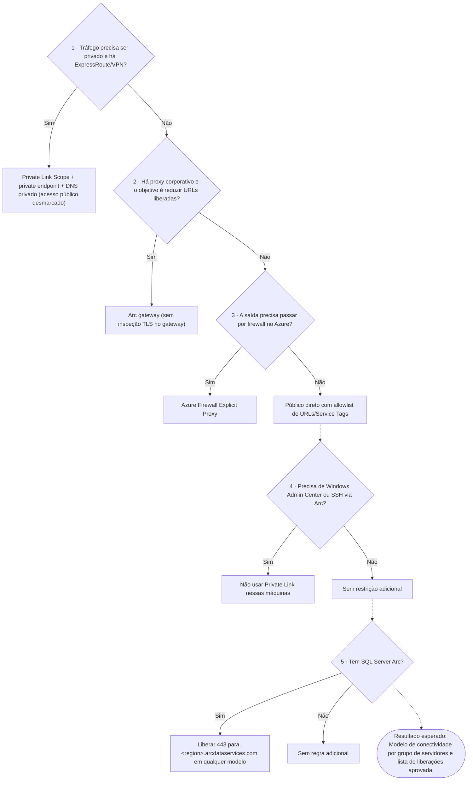

- **Verificado por:** CHK-16, CHK-17, CHK-18, CHK-19, CHK-20
- **Controles MCSB:** NS-2, NS-10 · **Detalhes:** DEC-05, DEC-06, DEC-07, DEC-08, CTL-01, REQ-06
- **CAF (Arc-enabled servers):** [Conectividade de rede](https://learn.microsoft.com/en-us/azure/cloud-adoption-framework/scenarios/hybrid/arc-enabled-servers/eslz-arc-servers-connectivity)

#### Árvore D3 em tabela

| # | Decisão | Se sim | Se não |
|---|---|---|---|
| 1 | Tráfego precisa ser privado e há ExpressRoute/VPN? | Private Link Scope + private endpoint + DNS privado (acesso público desmarcado) | Seguir |
| 2 | Há proxy corporativo e o objetivo é reduzir URLs liberadas? | Arc gateway (sem inspeção TLS no gateway) | Seguir |
| 3 | A saída precisa passar por firewall no Azure? | Azure Firewall Explicit Proxy | Público direto com allowlist de URLs/Service Tags |
| 4 | Precisa de Windows Admin Center ou SSH via Arc? | Não usar Private Link nessas máquinas | Sem restrição adicional |
| 5 | Tem SQL Server Arc? | Liberar 443 para `*.<region>.arcdataservices.com` em qualquer modelo | Sem regra adicional |

- **Resultado esperado:** Modelo de conectividade por grupo de servidores e lista de liberações aprovada.

#### DEC-05 — Modelo de conectividade

Opções, da mais restritiva para a menos restritiva (ver diagrama A.2):
1. **Privado (preferencial)** — Private Link Scope + Private Endpoint via ExpressRoute/VPN + zonas `privatelink.his.arc.azure.com` e `privatelink.guestconfiguration.azure.com` (Kubernetes: `privatelink.dp.kubernetesconfiguration.azure.com`). Desmarcar *Allow public network access* no escopo.
2. **Público controlado** — Arc gateway (DEC-06), proxy explícito/Azure Firewall (DEC-07) ou direto com allowlist (DEC-08).

Pontos da documentação atual a considerar:
- Com Private Link, o tráfego para **Microsoft Entra ID e Azure Resource Manager não passa pelo escopo** e segue pela rota padrão: liberar as Service Tags `AzureActiveDirectory` e `AzureResourceManager` (ou usar Resource Management Private Link para o ARM).
- Cada máquina se associa a **um** Private Link Scope; **um** escopo por VNet; escopo e máquina na mesma região.
- **Windows Admin Center e SSH via Arc não são suportados sobre Private Link.**
- Outros serviços (Azure Monitor/AMPLS, Key Vault, Automation, Storage) exigem seus próprios private endpoints.
- Não misturar, na mesma VNet/zona DNS, máquinas com e sem Private Link.
- **SQL Server enabled by Azure Arc:** a conexão com o *Azure Arc data processing service* (`*.<region>.arcdataservices.com`, usado para upload de inventário e de uso/cobrança) **não suporta Private Link** — está listada em *Unsupported configurations*. Mesmo com o servidor em Private Link, liberar saída TCP 443 para `*.<region>.arcdataservices.com` (direta ou via proxy explícito/Azure Firewall — padrão *Private Path*), com autenticação Entra ID. Ver CTL-04.

> **Verificado por:** CHK-17 — Modelo de conectividade em uso (Automático) · CHK-18 — Acesso público do Private Link Scope (Automático) · CHK-20 — Decisão de conectividade e liberações de rede (Documental) · CHK-34 — SQL Server: Defender for SQL e menor privilégio (Automático) · CHK-64 — SQL Server: licença e envio de uso (faturamento) (Automático)

#### DEC-06 — Quando usar Arc Gateway

- Reduz a liberação de saída a **7 FQDNs** (URL do gateway, `management.azure.com`, `login.microsoftonline.com`, `<region>.login.microsoft.com`, `gbl.his.arc.azure.com`, `<region>.his.arc.azure.com`, `packages.microsoft.com`/`download.microsoft.com`).
- Fluxo: agentes → **ArcProxy** local → proxy corporativo → Arc gateway → serviço.
- Continua sendo **modelo público controlado** (onboarding com método *Public endpoint*).
- Limitações: sem *proxy bypass*; não recomendado com **inspeção TLS** (excluir `*.gw.arc.azure.com` da inspeção); até 5 gateways por subscription; ~2.000 servidores por gateway por região.
- AMA, Hybrid Worker, Key Vault, Update Manager e Defender ainda podem exigir endpoints adicionais.
- Permissão: papel **Azure Arc gateway manager**; trilha de auditoria em `arcproxy.log` (`azcmagent logs`).

> **Verificado por:** CHK-17 — Modelo de conectividade em uso (Automático) · CHK-20 — Decisão de conectividade e liberações de rede (Documental)

#### DEC-07 — Quando usar Azure Firewall Explicit Proxy

- Usar quando precisa trânsito privado até Azure Firewall (ER/S2S) com controle central.
- Validar limitações de preview/recurso.
- Mantém o controle de saída centralizado no Azure Firewall; Entra ID e ARM continuam exigindo liberação.

> **Verificado por:** CHK-17 — Modelo de conectividade em uso (Automático) · CHK-20 — Decisão de conectividade e liberações de rede (Documental)

#### DEC-08 — Público direto controlado

- Apenas quando privado não for viável.
- Exigir allowlist estrita de URLs/FQDNs + monitoramento.
- Usar a lista oficial de URLs (network requirements) ou Service Tags; revisar a cada atualização do agente.

> **Verificado por:** CHK-17 — Modelo de conectividade em uso (Automático) · CHK-20 — Decisão de conectividade e liberações de rede (Documental)

#### CTL-01 — DNS corporativo integrado ao Azure

- Encaminhamento condicional para Azure DNS Private Resolver + Private DNS Zones.
- Mudança coordenada com times de rede/DNS.
- Validar a resolução privada a partir de um servidor: `nslookup gbl.his.arc.azure.com` e `nslookup agentserviceapi.guestconfiguration.azure.com` devem retornar IPs privados.

> **Verificado por:** CHK-19 — DNS privado do Arc (Automático) · CHK-20 — Decisão de conectividade e liberações de rede (Documental)

#### REQ-06 — Cross-subscription

- Private Endpoint/PLS/ExpressRoute entre subscriptions exige RBAC dos dois lados.
- Validar fluxo de aprovação manual quando houver estado Pending.

> **Verificado por:** CHK-16 — Cenários cross-subscription (Documental)

### D4 — Identidade e acesso

**Pergunta:** Quem pode fazer o quê no Arc e no servidor?

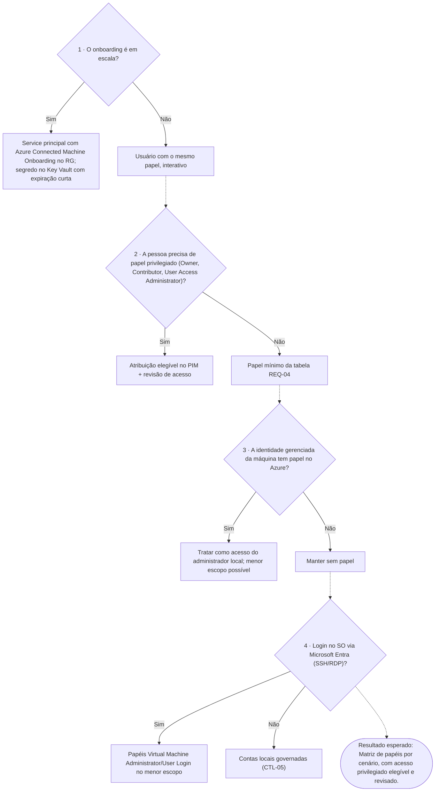

- **Verificado por:** CHK-10, CHK-11, CHK-12, CHK-13, CHK-14, CHK-15, CHK-25, CHK-35, CHK-56, CHK-60, CHK-62
- **Controles MCSB:** IM-1, IM-3, IM-8, PA-1, PA-2, PA-4, PA-7 · **Detalhes:** REQ-03, REQ-04, REQ-08, CTL-05
- **CAF (Arc-enabled servers):** [Identidade e gerenciamento de acesso](https://learn.microsoft.com/en-us/azure/cloud-adoption-framework/scenarios/hybrid/arc-enabled-servers/eslz-identity-and-access-management)

#### Árvore D4 em tabela

| # | Decisão | Se sim | Se não |
|---|---|---|---|
| 1 | O onboarding é em escala? | Service principal com *Azure Connected Machine Onboarding* no RG; segredo no Key Vault com expiração curta | Usuário com o mesmo papel, interativo |
| 2 | A pessoa precisa de papel privilegiado (Owner, Contributor, User Access Administrator)? | Atribuição elegível no PIM + revisão de acesso | Papel mínimo da tabela REQ-04 |
| 3 | A identidade gerenciada da máquina tem papel no Azure? | Tratar como acesso do administrador local; menor escopo possível | Manter sem papel |
| 4 | Login no SO via Microsoft Entra (SSH/RDP)? | Papéis *Virtual Machine Administrator/User Login* no menor escopo | Contas locais governadas (CTL-05) |

- **Resultado esperado:** Matriz de papéis por cenário, com acesso privilegiado elegível e revisado.

#### REQ-03 — Modelo de identidade

- Grupos Entra por função (plataforma, segurança, operações).
- PIM/JIT para papéis privilegiados.

> **Verificado por:** CHK-10 — Papéis privilegiados no escopo (Automático) · CHK-13 — Modelo de identidade, PIM e revisão de acesso (Documental) · CHK-62 — Acesso Condicional e MFA para quem administra o Azure (Documental)

#### REQ-04 — RBAC mínimo por cenário

| Cenário | Permissão mínima |
|---|---|
| Onboarding em RG | **Azure Connected Machine Onboarding** (ou Contributor) |
| Ler/alterar/remover máquina Arc | **Azure Connected Machine Resource Administrator** |
| Operar extensões Arc (instalar/atualizar/remover) | Papel dedicado no escopo mínimo necessário (evitar Contributor amplo) |
| Selecionar RG no Generate Script (portal) | **Reader** |
| Associar máquina a Private Link Scope | `Microsoft.HybridCompute/privateLinkScopes/read` no PLS |
| Registrar provider | `*/register/action` (Owner/Contributor no escopo da subscription) |

> **Verificado por:** CHK-10 — Papéis privilegiados no escopo (Automático) · CHK-11 — Papéis específicos do Arc (Automático) · CHK-12 — Identidade gerenciada das máquinas (Automático) · CHK-25 — Acesso Entra ao SO (SSH/RDP/WAC) (Automático) · CHK-62 — Acesso Condicional e MFA para quem administra o Azure (Documental)

#### REQ-08 — Segredos e credenciais

- Sem secret em script/arquivo.
- Usar Key Vault + rotação + RBAC + PIM.
- Preferir Managed Identity/UAMI quando possível.

**Onboarding em escala com service principal (inclusive por GPO).** O segredo do service principal de onboarding fica disponível para o processo de instalação (no script ou na pasta compartilhada da implantação por GPO). Pesquisa pública da IBM X-Force descreve o abuso de segredos de onboarding expostos e de service principals com papéis excessivos para executar código nas máquinas e usar o Arc como persistência ([IBM X-Force](https://www.ibm.com/think/x-force/identifying-abusing-azure-arc-for-hybrid-escalation-persistence)). Para reduzir o risco:
- service principal **só com o papel Azure Connected Machine Onboarding**, no resource group de destino (nunca Resource Administrator, Contributor ou Owner);
- segredo ou certificado com **validade curta**, rotacionado ao fim de cada onda e **revogado** ao concluir o onboarding;
- na implantação por GPO: restringir o acesso à pasta compartilhada, **desvincular a GPO e remover a tarefa agendada** de implantação ao concluir;
- monitorar criação de recursos `Microsoft.HybridCompute/machines` fora das ondas planejadas e Run Command/extensões (ALR-05).
- Referências: [Service principal para onboarding em escala](https://learn.microsoft.com/en-us/azure/azure-arc/servers/onboard-service-principal#create-a-service-principal-for-onboarding-at-scale) · [Onboarding por Group Policy](https://learn.microsoft.com/en-us/azure/azure-arc/servers/onboard-group-policy-powershell) · [Identidade gerenciada no Arc](https://learn.microsoft.com/en-us/azure/azure-arc/servers/managed-identity-authentication) · [Plano de modernização rápida de acesso privilegiado](https://learn.microsoft.com/en-us/security/privileged-access-workstations/security-rapid-modernization-plan)

> **Verificado por:** CHK-12 — Identidade gerenciada das máquinas (Automático) · CHK-14 — Segredos e credenciais de onboarding (Documental) · CHK-15 — Key Vaults (Automático)

#### CTL-05 — Contas locais e GPO do HIMDS

- Manter modelo padrão de contas locais/virtuais do agente.
- Garantir direito local **Log on as a service** para `NT SERVICE\himds` (ou `NT SERVICE\ALL SERVICES`).

> **Verificado por:** CHK-35 — Contas locais e GPO do HIMDS (Documental) · CHK-36 — Coleta local em amostra (agente e serviços) (Documental) · CHK-56 — Auditoria dos administradores locais (Automático) · CHK-60 — Senha do administrador local (Windows LAPS) (Documental) · CHK-61 — Criptografia do disco do sistema (BitLocker/dm-crypt) (Documental)

### D5 — Extensões e acesso remoto por tier

**Pergunta:** Quais extensões e acessos remotos cada tier pode ter?

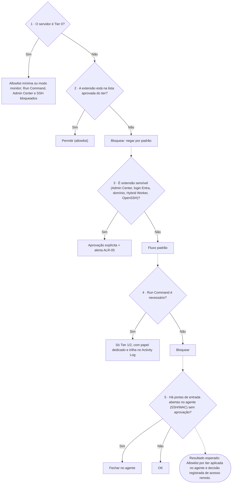

- **Verificado por:** CHK-21, CHK-22, CHK-23, CHK-24, CHK-26
- **Controles MCSB:** AM-5, PA-7, IM-1, PV-3 · **Detalhes:** CTL-02, CTL-03
- **CAF (Arc-enabled servers):** [Segurança, governança e conformidade](https://learn.microsoft.com/en-us/azure/cloud-adoption-framework/scenarios/hybrid/arc-enabled-servers/eslz-security-governance-and-compliance)

#### Árvore D5 em tabela

| # | Decisão | Se sim | Se não |
|---|---|---|---|
| 1 | O servidor é Tier 0? | Allowlist mínima ou modo *monitor*; Run Command, Admin Center e SSH bloqueados | Seguir |
| 2 | A extensão está na lista aprovada do tier? | Permitir (allowlist) | Bloquear: negar por padrão |
| 3 | É extensão sensível (Admin Center, login Entra, domínio, Hybrid Worker, OpenSSH)? | Aprovação explícita + alerta ALR-05 | Fluxo padrão |
| 4 | Run Command é necessário? | Só Tier 1/2, com papel dedicado e trilha no Activity Log | Bloquear |
| 5 | Há portas de entrada abertas no agente (SSH/WAC) sem aprovação? | Fechar no agente | OK |

- **Resultado esperado:** Allowlist por tier aplicada no agente e decisão registrada de acesso remoto.

#### CTL-02 — Extensões por allowlist/blocklist

- Negar por padrão.
- Liberar somente o conjunto aprovado por perfil (Tier 0/1/2/SQL/legado).
- Tratar como **sensíveis** (revisão explícita): `AdminCenter`, `AADLoginForWindows`, `AADSSHLoginForLinux`, `AADSSHLoginForWindows`, `JsonADDomainExtension`, `HybridWorkerForWindows`, `WindowsOpenSSH`.

> **Verificado por:** CHK-22 — Modo do agente (Automático) · CHK-23 — Allowlist/blocklist de extensões (Automático) · CHK-24 — Extensões sensíveis (Automático)

#### CTL-03 — Operação remota segura

- Run Command e Admin Center com decisão explícita por tier.
- Tier 0: bloquear por padrão.

> **Verificado por:** CHK-21 — Portas de entrada no agente (SSH/WAC) (Automático) · CHK-24 — Extensões sensíveis (Automático) · CHK-25 — Acesso Entra ao SO (SSH/RDP/WAC) (Automático) · CHK-26 — Run Command e Admin Center por tier (Documental) · CHK-44 — Operações sensíveis no período (Automático)

### D6 — Proteção, baseline, logs e detecção

**Pergunta:** O que precisa estar ligado em cada servidor?

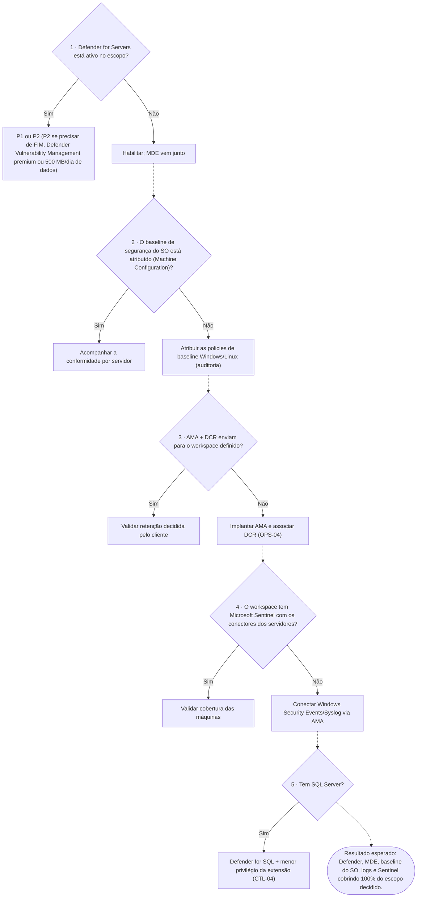

- **Verificado por:** CHK-08, CHK-09, CHK-27, CHK-31, CHK-32, CHK-33, CHK-34, CHK-36, CHK-39, CHK-40, CHK-41, CHK-43, CHK-44, CHK-45, CHK-54, CHK-55, CHK-57, CHK-58, CHK-61, CHK-63
- **Controles MCSB:** LT-1, LT-3, LT-5, LT-6, ES-1, PV-4, IR-3 · **Detalhes:** REQ-07, CTL-04, CTL-06, CTL-07, OPS-04
- **CAF (Arc-enabled servers):** [Gerenciamento e monitoramento](https://learn.microsoft.com/en-us/azure/cloud-adoption-framework/scenarios/hybrid/arc-enabled-servers/eslz-management-and-monitoring-arc-server)

#### Árvore D6 em tabela

| # | Decisão | Se sim | Se não |
|---|---|---|---|
| 1 | Defender for Servers está ativo no escopo? | P1 ou P2 (P2 se precisar de FIM, Defender Vulnerability Management premium ou 500 MB/dia de dados) | Habilitar; MDE vem junto |
| 2 | O baseline de segurança do SO está atribuído (Machine Configuration)? | Acompanhar a conformidade por servidor | Atribuir as policies de baseline Windows/Linux (auditoria) |
| 3 | AMA + DCR enviam para o workspace definido? | Validar retenção decidida pelo cliente | Implantar AMA e associar DCR (OPS-04) |
| 4 | O workspace tem Microsoft Sentinel com os conectores dos servidores? | Validar cobertura das máquinas | Conectar Windows Security Events/Syslog via AMA |
| 5 | Tem SQL Server? | Defender for SQL + menor privilégio da extensão (CTL-04) | — |

- **Resultado esperado:** Defender, MDE, baseline do SO, logs e Sentinel cobrindo 100% do escopo decidido.

#### REQ-07 — Política e baseline

- Usar built-ins e iniciativas Arc por perfil.
- Tratar baseline antiga como apoio, priorizando documentação Arc atual.

> **Verificado por:** CHK-08 — Atribuições de Azure Policy e baseline (Automático) · CHK-09 — Conformidade de policy nas máquinas (Automático) · CHK-27 — Guest configuration (Machine Configuration) (Automático) · CHK-55 — Baseline de segurança do sistema operacional (Automático)

#### CTL-04 — Least privilege no SQL Arc

- Aplicar modelo oficial de menor privilégio da extensão SQL Arc.
- A partir da extensão **1.1.2859.223**, com atualização automática habilitada, o menor privilégio é aplicado automaticamente.
- O *deployer* da extensão roda como `NT AUTHORITY\SYSTEM` e precisa do login com **CONNECT SQL** em cada instância; hardening que remove esse login faz a extensão falhar.

**Rede da extensão SQL (documentação oficial — Prerequisites e Overview › Unsupported configurations):**

| Destino | Uso | Private Link | Arc gateway |
|---|---|---|---|
| `*.<region>.arcdataservices.com` (`dataprocessingservice.<region>…`) | Upload de inventário e de uso para cobrança (PAYG/pCore) | **Não suportado** — exige saída 443 | Coberto (cenário *Azure Extension for SQL Server* não exige endpoints extras) |
| `telemetry.<region>.arcdataservices.com` | Logs do agente/extensão e dados de DMV | Não suportado | Coberto |
| `login.microsoftonline.com`, `login.microsoft.com`, `enterpriseregistration.windows.net`, `graph.microsoft.com` | Autenticação Microsoft Entra para o SQL | — | — |

- Sem conexão ao data processing service, o inventário e a cobrança PAYG ficam desatualizados: monitorar *Last Usage Upload Time* e testar com `Invoke-WebRequest dataprocessingservice.<region>.arcdataservices.com` (esperado HTTP 200).

**Configurações não suportadas relevantes:** Windows Server anterior ao 2016 (TLS insuficiente), SQL Server 2012 e anteriores, SQL Server em containers ou em VMs do Azure, edição Business Intelligence, AG com réplica em FCI, instâncias com o mesmo nome no mesmo host, e Private Link para o data processing service.

> **Verificado por:** CHK-30 — Versões e atualização automática das extensões (Automático) · CHK-34 — SQL Server: Defender for SQL e menor privilégio (Automático) · CHK-56 — Auditoria dos administradores locais (Automático) · CHK-60 — Senha do administrador local (Windows LAPS) (Documental)

#### CTL-06 — Defender for Cloud onboarding

- Habilitar Defender for Servers na subscription.
- Integrar máquinas via Arc.
- Confirmar integração com Defender for Endpoint.
- Acompanhar **alertas de segurança ativos** e **vulnerabilidades (CVE)** das máquinas Arc no Defender for Cloud; a cobertura de vulnerabilidades depende do plano (P1 ou P2) e do MDE.
- Severidade e prioridade seguem a classificação do próprio Defender; a categoria Security do Advisor repete as recomendações do Defender.

> **Verificado por:** CHK-31 — Defender for Servers (Automático) · CHK-32 — Defender for Endpoint (Automático) · CHK-33 — Recomendações do Defender (Automático) · CHK-54 — Ameaças e vulnerabilidades (Defender for Cloud) (Automático) · CHK-55 — Baseline de segurança do sistema operacional (Automático) · CHK-57 — Antivírus e EDR saudáveis (Automático) · CHK-63 — Defender for Servers por máquina Arc (Automático)

#### CTL-07 — Sentinel

- Usar AMA + DCR + workspace para coleta e correlação em Sentinel.

> **Verificado por:** CHK-39 — Azure Monitor Agent (Automático) · CHK-40 — Associação a DCR (Automático) · CHK-41 — Microsoft Sentinel e cobertura das máquinas (Automático)

#### OPS-04 — Deploy do AMA em escala

- Preferir Policy para instalação/reinstalação contínua.
- Não esquecer DCR/DCE/workspace.

> **Verificado por:** CHK-39 — Azure Monitor Agent (Automático) · CHK-40 — Associação a DCR (Automático) · CHK-58 — Insights e telemetria por máquina (Automático)

### D7 — Versões, patches e legado

**Pergunta:** O servidor está atualizado e dentro do suporte?

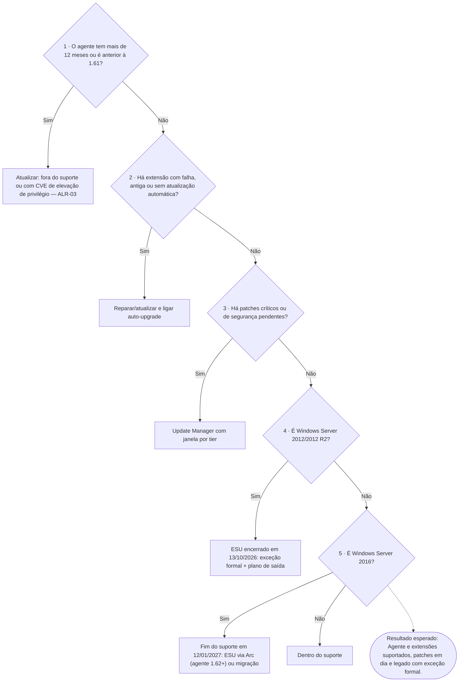

- **Verificado por:** CHK-28, CHK-29, CHK-30, CHK-42, CHK-51, CHK-52
- **Controles MCSB:** PV-6 · **Detalhes:** OPS-05, OPS-06, OPS-10, LEG-01, LEG-02, LEG-03, LEG-04
- **CAF (Arc-enabled servers):** [Gerenciamento e monitoramento](https://learn.microsoft.com/en-us/azure/cloud-adoption-framework/scenarios/hybrid/arc-enabled-servers/eslz-management-and-monitoring-arc-server)

#### Árvore D7 em tabela

| # | Decisão | Se sim | Se não |
|---|---|---|---|
| 1 | O agente tem mais de 12 meses ou é anterior à 1.61? | Atualizar: fora do suporte ou com CVE de elevação de privilégio — ALR-03 | Seguir |
| 2 | Há extensão com falha, antiga ou sem atualização automática? | Reparar/atualizar e ligar auto-upgrade | Seguir |
| 3 | Há patches críticos ou de segurança pendentes? | Update Manager com janela por tier | Seguir |
| 4 | É Windows Server 2012/2012 R2? | ESU encerrado em 13/10/2026: exceção formal + plano de saída | Seguir |
| 5 | É Windows Server 2016? | Fim do suporte em 12/01/2027: ESU via Arc (agente 1.62+) ou migração | Dentro do suporte |

- **Resultado esperado:** Agente e extensões suportados, patches em dia e legado com exceção formal.

#### OPS-05 — Atualização de agente Arc

- Usar `manage-agent` como fonte de processo.
- Definir política de versão e janela de rollout.
- Tratar recomendações do Advisor.

**Política de suporte (release notes oficiais):** somente versões do Connected Machine agent **lançadas nos últimos 12 meses** são suportadas pelo grupo de produto; manter dentro da janela ou habilitar *automatic agent upgrade* (preview).

| Versão | Lançamento | Versão | Lançamento |
|---|---|---|---|
| 1.68 | set/2026 (mais recente) | 1.62 | mar/2026 |
| 1.67 | ago/2026 | 1.61 | fev/2026 |
| 1.66 | jul/2026 | 1.60 | jan/2026 |
| 1.65 | jun/2026 | 1.59 | dez/2025 |
| 1.64 | mai/2026 | 1.58 | nov/2025 |
| 1.63 | abr/2026 | 1.57 | out/2025 |

- Em 22/10/2026 o corte é **out/2025**: versões até 1.56 estão fora do suporte. Tabela usada pelo checklist (CHK de versão do agente); atualizar mensalmente a partir das release notes.
- Versões recentes trouxeram correções de segurança relevantes (ex.: proteção do HIMDS contra personificação e proteção de portas na 1.68; hardening de IPC na 1.67; CVE-2026-21224 na 1.60).
- **Atenção:** a partir de **fevereiro de 2027** o agente deixa de aceitar certificados com número de série negativo (RFC 5280). Validar proxies com inspeção TLS e PKI interna.

**Vulnerabilidades publicadas do agente (piso de segurança: 1.61).** Todas são de elevação de privilégio local (um usuário com acesso de baixo privilégio ao servidor chega a SYSTEM e, no caso mais recente, à identidade da máquina no Azure). A correção é atualizar o agente; o checklist marca como FAIL qualquer máquina abaixo da 1.61.

| CVE | Versões afetadas | Corrigida em | Resumo | Fontes |
|---|---|---|---|---|
| CVE-2025-49692 | 1.48 e 1.49 | 1.50+ | Reparo do MSI por usuário sem privilégio cria a tarefa agendada `azcmagent` com janela de console explorável | [MSRC](https://msrc.microsoft.com/update-guide/vulnerability/CVE-2025-49692) · [Reversec](https://labs.reversec.com/advisories/2026/01/azure-connected-machine-agent-elevation-of-privilege-vulnerability-console-popup) |
| CVE-2025-26627 | anteriores à atualização de março de 2025 | março de 2025 | Injeção de comando em componente do agente (local, baixo privilégio) | [MSRC](https://msrc.microsoft.com/update-guide/vulnerability/CVE-2025-26627) |
| CVE-2025-55316 | anteriores à 1.55 | 1.55 | A tarefa agendada diária `azcmagent` (01:00–02:00, SYSTEM) confiava no pipe `himds` sem validar o dono | [MSRC](https://msrc.microsoft.com/update-guide/vulnerability/CVE-2025-55316) · [Reversec](https://labs.reversec.com/advisories/2026/01/azure-connected-machine-agent-elevation-of-privilege-vulnerability-scheduled-task) |
| CVE-2026-26117 | anteriores à 1.61 | 1.61 | Serviços com início atrasado (HIMDS, Guest Configuration, Arc Proxy) permitiam ocupar a porta 40342 antes do HIMDS, roubar a identidade da máquina e ligá-la a outro tenant | [MSRC](https://msrc.microsoft.com/update-guide/vulnerability/CVE-2026-26117) · [Cymulate](https://cymulate.com/blog/cve-2026-26117-azure-arc-windows-lpe-cloud-identity-takeover/) |

| CVE-2025-58724 | Connected Machine agent | ver MSRC | Controle de acesso inadequado no agente (local, usuário autenticado) | [MSRC](https://msrc.microsoft.com/update-guide/vulnerability/CVE-2025-58724) |
| CVE-2026-62895 | extensão SQL Server do Arc | ver MSRC | Política cross-domain permissiva na extensão SQL (rede) | [MSRC](https://msrc.microsoft.com/update-guide/vulnerability/CVE-2026-62895) |

- **Serviço hospedado pela Microsoft:** CVEs como a CVE-2026-24302 são marcadas como *exclusively hosted service*: a correção é do lado da Microsoft e não exige ação no servidor. Para cada CVE nova do Azure Arc, verifique no MSRC se há ação do cliente (agente ou extensão) ou se é do serviço.
- Acompanhamento mensal (OPS-12): lista pública de CVEs do produto Azure Arc no [OpenCVE](https://app.opencve.io/cve/?product=azure_arc&vendor=microsoft) e no [guia de atualizações de segurança](https://msrc.microsoft.com/update-guide/); manter a atualização automática do agente e das extensões.
- Além de atualizar: restringir quem faz logon local nos servidores Arc (a exploração exige um usuário local), não dar papéis amplos à identidade da máquina (CTL-05, D4) e monitorar processos filhos inesperados dos serviços do agente com o Defender for Endpoint.
- Confirme a versão corrigida de cada CVE no guia de atualizações de segurança da Microsoft (MSRC); as pesquisas de terceiros são citadas só como contexto técnico.

> **Verificado por:** CHK-29 — Versão do agente dentro do suporte (Automático)

#### OPS-06 — Atualização de extensões

- Habilitar auto-upgrade quando elegível.
- Validar compatibilidade por SO/perfil.

**Extensão SQL (Azure extension for SQL Server):** somente versões **lançadas nos últimos 12 meses** são suportadas. Alvo atual de auto-upgrade: **1.1.3518.465** (ago/2026, menor privilégio habilitado por padrão). Versões marcadas *no longer available* nas release notes devem ser atualizadas.
- **Azure Monitor Agent:** a Microsoft só suporta versões **lançadas no último ano** e publica correções só na versão mais recente. Mais recentes em out/2026: Windows **1.46**, Linux **1.45**. O checklist compara com a tabela oficial ([versões do AMA](https://learn.microsoft.com/en-us/azure/azure-monitor/agents/azure-monitor-agent-extension-versions)).
- **Versões lidas do Azure:** na coleta, o script consulta as versões publicadas do agente (*Agent Version - List*) e de cada extensão na região das máquinas (*Extension Metadata - List*) e compara com elas; os nomes dos papéis vêm do próprio Azure (*az role definition list*). As tabelas do kit (datas de lançamento, para a janela de 12 meses) ficam como reserva e como fonte das datas.
- **Defender for Endpoint:** a versão do sensor (plataforma antivírus e EDR) não aparece no Azure Resource Graph; confira no portal do Defender (inventário de dispositivos) contra as [releases do Defender for Endpoint](https://learn.microsoft.com/en-us/defender-endpoint/microsoft-defender-endpoint-releases). No Linux, cada versão expira em nove meses.
- Demais extensões: manter atualização automática habilitada e comparar com a versão mais nova do parque (o checklist sinaliza as defasadas).

> **Verificado por:** CHK-28 — Extensões com falha (Automático) · CHK-30 — Versões e atualização automática das extensões (Automático)

#### OPS-10 — Patch management e WSUS

- Update Manager respeita fonte de update do SO.
- Windows: Windows Update ou WSUS.
- WSUS: publicar updates Microsoft/terceiros conforme política.

> **Verificado por:** CHK-42 — Avaliação de patches (Update Manager/WSUS) (Automático)

#### LEG-01 — Posicionamento (2012/2012 R2 e 2016)

- **Windows Server 2012/2012 R2:** o ESU via Arc **terminou em 13/10/2026**; as licenças foram desativadas em 14/10/2026 (00:00 UTC). Servidores nessa versão não recebem mais atualizações de segurança: tratar como exceção de risco, com isolamento e plano de saída imediato.
- **Windows Server 2016:** fim do suporte em **12/01/2027**. O ESU via Arc pode ser configurado desde 03/08/2026, com cobrança a partir de 13/01/2027 e cobertura de até três anos. Requer agente **1.62+** e Software Assurance (ou Server Subscription) para cargas on-premises; SPLA não é aceito.
- VMs no Azure Local e no Azure VMware Solution recebem ESU gratuito e não devem usar o ESU via Arc.

> **Verificado por:** CHK-51 — Legado, fim de suporte e ESU (Automático) · CHK-52 — Exceções de legado e plano de saída (Documental)

#### LEG-02 — Uso permitido

- Arc core e recursos compatíveis com a matriz oficial.
- Bloquear por policy extensões não suportadas no perfil legado.

> **Verificado por:** CHK-52 — Exceções de legado e plano de saída (Documental)

#### LEG-03 — Segurança mínima

- TLS 1.2 no SO/.NET/SQL conforme versão.
- Windows Server 2016: licença ESU via Arc atribuída antes de 12/01/2027 e agente 1.62+.
- Windows Server 2012/2012 R2 após 13/10/2026: sem patches; segmentação de rede, monitoramento reforçado (Defender/MDE) e prazo de migração aprovado.

> **Verificado por:** CHK-51 — Legado, fim de suporte e ESU (Automático)

#### LEG-04 — Plano de modernização

- Definir migração para Windows Server 2019/2022/2025 em roadmap oficial (2012/2012 R2 imediato; 2016 antes do fim do ESU).

> **Verificado por:** CHK-52 — Exceções de legado e plano de saída (Documental)

### D8 — Remoção e recursos abandonados

**Pergunta:** O recurso Arc ainda corresponde a um servidor real?

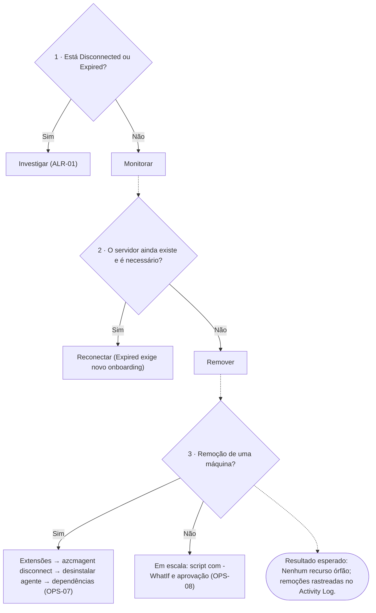

- **Verificado por:** CHK-37, CHK-38, CHK-49
- **Controles MCSB:** AM-3 · **Detalhes:** OPS-07, OPS-08, OPS-09

#### Árvore D8 em tabela

| # | Decisão | Se sim | Se não |
|---|---|---|---|
| 1 | Está Disconnected ou Expired? | Investigar (ALR-01) | Monitorar |
| 2 | O servidor ainda existe e é necessário? | Reconectar (Expired exige novo onboarding) | Remover |
| 3 | Remoção de uma máquina? | Extensões → azcmagent disconnect → desinstalar agente → dependências (OPS-07) | Em escala: script com -WhatIf e aprovação (OPS-08) |

- **Resultado esperado:** Nenhum recurso órfão; remoções rastreadas no Activity Log.

#### OPS-07 — Remoção correta de Arc (individual)

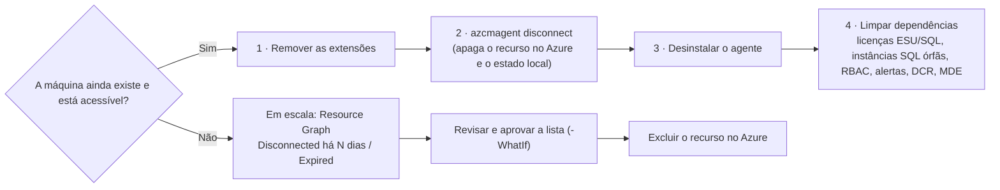

1. **Remover todas as extensões** antes de desconectar: desinstalar o agente não remove as extensões, e elas não são reconhecidas se o servidor voltar ao Arc.
2. **`azcmagent disconnect`** como administrador: apaga o recurso no Azure e limpa o estado local (pede login com permissão de exclusão; `--use-device-code` se a conta local for diferente). Se o recurso já foi apagado no Azure, usar `azcmagent disconnect --force-local-only`. **Em VMs Arc no Azure Local, usar somente `--force-local-only`**, senão a VM pode ser apagada no Azure e on-premises.
3. **Desinstalar o agente**: Windows por Programas e Recursos ou `msiexec /x {código do produto} /qn`; Linux com `apt purge`, `yum remove` ou `zypper remove azcmagent`. A pasta do agente permanece no Windows.
4. **Limpar dependências**: atribuições de licença (ESU, SQL pCore), instâncias SQL Arc órfãs, papéis RBAC da identidade gerenciada, alertas e associações de DCR; confirmar no Defender se o dispositivo deve sair do MDE.

- Referência: [Uninstall the Azure Connected Machine agent](https://learn.microsoft.com/en-us/azure/azure-arc/servers/uninstall-agent)

> **Verificado por:** CHK-49 — Remoção individual e em escala (Documental)

#### OPS-08 — Remoção em escala (stale/disconnected)

- Recursos que ficaram **Disconnected** (servidor desativado sem remoção limpa) poluem o inventário: localizar com Resource Graph por `status == 'Disconnected'` e `lastStatusChange` anterior a N dias.
- A documentação oficial traz um script de limpeza (`Cleanup-StaleArcServers.ps1`) com `-WhatIf`, escopo por subscription ou management group e confirmação por item.
- A exclusão exige Contributor/Owner ou `Microsoft.HybridCompute/machines/delete`: fica **fora** do coletor deste checklist, que é somente leitura.
- **Expired** (mais de 45 dias sem conexão) não volta sozinho: refazer o onboarding ou remover.
- Depois da limpeza, conferir na coleta seguinte (máquinas desconectadas, instâncias SQL órfãs e licenças).
- Referência: [Remove stale server resources](https://learn.microsoft.com/en-us/azure/azure-arc/servers/uninstall-agent#remove-stale-server-resources)

> **Verificado por:** CHK-37 — Máquinas desconectadas ou expiradas (Automático) · CHK-49 — Remoção individual e em escala (Documental)

#### OPS-09 — Advisor (confiabilidade)

- Acompanhar e corrigir:
  - desconectado 30+ dias
  - risco de expiração da identidade
  - recurso expirado (re-onboarding)

> **Verificado por:** CHK-37 — Máquinas desconectadas ou expiradas (Automático) · CHK-38 — Recomendações do Advisor (Automático)

### D9 — Custo e licenciamento

**Pergunta:** Quais serviços cobrados ativar e com qual benefício?

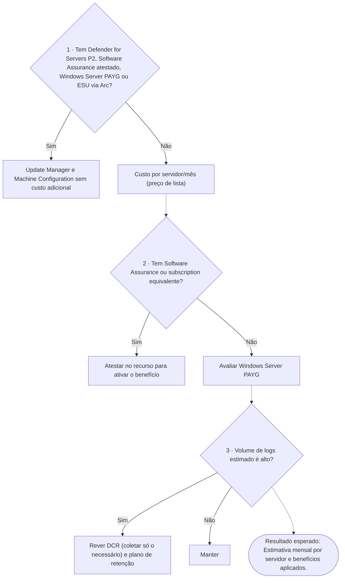

- **Verificado por:** CHK-53, CHK-59, CHK-64
- **Controles MCSB:** — · **Detalhes:** REQ-09
- **CAF (Arc-enabled servers):** [Governança de custos](https://learn.microsoft.com/en-us/azure/cloud-adoption-framework/scenarios/hybrid/arc-enabled-servers/eslz-cost-governance)

#### Árvore D9 em tabela

| # | Decisão | Se sim | Se não |
|---|---|---|---|
| 1 | Tem Defender for Servers P2, Software Assurance atestado, Windows Server PAYG ou ESU via Arc? | Update Manager e Machine Configuration sem custo adicional | Custo por servidor/mês (preço de lista) |
| 2 | Tem Software Assurance ou subscription equivalente? | Atestar no recurso para ativar o benefício | Avaliar Windows Server PAYG |
| 3 | Volume de logs estimado é alto? | Rever DCR (coletar só o necessário) e plano de retenção | Manter |

- **Resultado esperado:** Estimativa mensal por servidor e benefícios aplicados.

#### REQ-09 — Custo e licenciamento (gratuito × cobrado)

O **plano de controle do Arc é gratuito**; o custo vem dos serviços habilitados em cada servidor. Valores em **preço de lista (USD)** da página de preços do Azure Arc, consultada em 22/10/2026. O valor real varia por contrato, moeda e região.

| Grupo | Serviço | Cobrança (lista) | Sem custo adicional quando |
|---|---|---|---|
| Plano de controle | Inventário, tags, resource groups, management groups, Resource Graph, RBAC | Gratuito | sempre |
| Plano de controle | SSH Arc, Run Command, Custom Script Extension | Gratuito | sempre |
| Plano de controle | VM self-service em VMware vCenter e SCVMM (ciclo de vida e power) | Gratuito | sempre |
| Segurança | Defender for Servers Plano 1 / Plano 2 | US$ 5 / US$ 15 por servidor/mês | — |
| Operação | Azure Update Manager | US$ 5 por servidor/mês (rateio diário) | Defender P2, Software Assurance atestado, WS PAYG ou ESU via Arc |
| Governança | Machine Configuration + Change Tracking & Inventory | US$ 6 por servidor/mês (servidor com 1+ atribuição) | Defender P2, Software Assurance atestado, WS PAYG ou ESU via Arc |
| Operação | Essential Machine Management (preview) | US$ 9,01 por servidor/mês | Software Assurance, WS PAYG, ESU ou Defender P2 |
| Logs | Azure Monitor Logs | US$ 2,76 por GB ingerido | — |
| Segurança | Microsoft Sentinel | US$ 5,22 por GB ingerido | — |
| Licença | Windows Server pay-as-you-go via Arc | US$ 33,58 por core/mês | — |
| Licença | ESU Windows Server 2016 via Arc | cobrança a partir de 13/01/2027 | VMs no Azure Local e AVS (ESU gratuito, sem Arc) |
| Licença | SQL Server pay-as-you-go e ESU de SQL | ver página de preços e calculadora | — |

**Regras que mudam a conta**
- **Software Assurance não é inferido:** o benefício (Update Manager, Change Tracking, Machine Configuration, Windows Admin Center, Best Practices Assessment e outros) exige **atestado por servidor** em *Azure Arc › Licenses › Azure Benefits - Windows Server* ou inscrição no WS PAYG. Requisitos: agente 1.47+, Windows Server 2012+, servidor **Connected** e licenciado.
- **Machine Configuration** é cobrado só para servidores com uma ou mais atribuições; máquina offline durante a hora inteira não é cobrada; atribuições do Azure Security Benchmark e de iniciativas de *Regulatory Compliance* ficam fora da cobrança. Policies que não usam guest configuration (incluindo as que instalam AMA/Defender e auto-tag) não têm custo.
- Change Tracking e Best Practices Assessment usam Log Analytics: a ingestão é cobrada mesmo com o benefício.
- Defender P2 já inclui Update Manager e Machine Configuration: não pague os dois.

**Governança de custo (recomendado)**
- Tag `costCenter` (REQ-02) e orçamentos/alertas no Cost Management por resource group ou tag; filtrar o tipo `Microsoft.HybridCompute/machines`.
- Revisar o parâmetro das policies de Machine Configuration que inclui servidores Arc quando a avaliação não for necessária nos híbridos.
- Definir quais logs coletar por DCR, retenção por tabela e *commitment tier* conforme o volume; separar dados operacionais de segurança quando fizer sentido.

**Como o checklist mede:** a verificação de custo estima, por servidor conectado, Defender, Update Manager, Machine Configuration/Change Tracking e WS PAYG, indica os benefícios presentes e a economia possível ao atestar Software Assurance. Log Analytics e Sentinel são marcados como variáveis (dependem do volume).

- Referências: [Azure Arc pricing](https://azure.microsoft.com/en-us/pricing/details/azure-arc/core-control-plane/) · [Windows Server Management enabled by Azure Arc](https://learn.microsoft.com/en-us/azure/azure-arc/servers/windows-server-management-overview) · [Prepare to deliver ESUs](https://learn.microsoft.com/en-us/azure/azure-arc/servers/prepare-extended-security-updates) · [Cost governance for Arc-enabled servers (CAF, artigo descontinuado, remoção prevista em 30/10/2026)](https://learn.microsoft.com/en-us/azure/cloud-adoption-framework/scenarios/hybrid/arc-enabled-servers/eslz-cost-governance)

> **Verificado por:** CHK-53 — Custo: serviços cobrados e benefícios por máquina (Automático) · CHK-59 — Mapa de recursos do Arc em uso (Automático) · CHK-64 — SQL Server: licença e envio de uso (faturamento) (Automático)

### P — Execução do programa

**Pergunta:** Como executar e sustentar com segurança?

Sequência: piloto (OPS-01) → ondas com rollback (OPS-02) → automação oficial (OPS-03) → métricas de saúde (OPS-11) → revisão periódica e nova coleta para comparar antes × depois (OPS-12). Estes itens não entram na conformidade.

- **Verificado por:** CHK-46, CHK-47, CHK-48, CHK-50

#### OPS-01 — Piloto obrigatório (30 dias recomendado)

- Escopo representativo (não crítico), métricas e critérios de sucesso.

> **Verificado por:** CHK-46 — Piloto executado e aceito (Documental)

#### OPS-02 — Rollout por ondas

- Onda 1, 2, 3 com critérios de avanço/pausa/rollback.

> **Verificado por:** CHK-47 — Rollout por ondas e rollback (Documental)

#### OPS-03 — Métodos de automação oficiais

- Service Principal onboarding
- PowerShell/Ansible
- Azure Policy (deploy/remediação)
- Azure Automation (runbooks)

> **Verificado por:** CHK-48 — Método de automação por ambiente (Documental)

#### OPS-11 — Métricas mínimas de saúde

- `Connected`
- heartbeat
- extensões `Succeeded`
- compliance de policy

> **Verificado por:** CHK-09 — Conformidade de policy nas máquinas (Automático) · CHK-28 — Extensões com falha (Automático) · CHK-37 — Máquinas desconectadas ou expiradas (Automático) · CHK-50 — KPIs de saúde e revisão periódica (Documental) · CHK-58 — Insights e telemetria por máquina (Automático) · CHK-59 — Mapa de recursos do Arc em uso (Automático)

#### OPS-12 — Revisão periódica

- Revisão mensal de RBAC/PIM
- Revisão quinzenal de não conformidades e remediações
- Revisão mensal dos **avisos de segurança do Service Health** (Service Health › Security advisories): o detalhe completo exige papel acima de Reader, por isso é manual e não faz parte do coletor.
- Acompanhar a evolução do **Secure Score** do Defender for Cloud (o resumo executivo do relatório traz o valor da coleta).

> **Verificado por:** CHK-13 — Modelo de identidade, PIM e revisão de acesso (Documental) · CHK-50 — KPIs de saúde e revisão periódica (Documental)

## 3) Checklist de verificação (CHK)

Mesma lista, na mesma ordem, do `arc-posture-review.pt-BR.html`. Camada: 1 MCSB · 2 Baseline do SO · 3 Requisito do Arc · 4 Decisão do cliente · P Programa · F FinOps.

### A · Arquitetura e escopo

| ID | Verificação | Tipo | Sev. | Camada | MCSB | Árvore | O que verifica | Critério | Referências |
|---|---|---|---|---|---|---|---|---|---|
| CHK-01 | Inventário e elegibilidade das máquinas Arc | Automático | Baixa | 3 | AM-1 | D1 | Máquinas por status, sistema operacional, região, fabricante/modelo e SQL Server detectado. | Informativo: base para os demais controles. | REQ-01 |
| CHK-02 | Serviço Arc por tipo de ambiente | Documental | Média | 4 | AM-2 | D1 | Origem de cada máquina (on-premises, VMware, SCVMM, AWS/GCP, OCI) e serviço escolhido (Arc-enabled servers, multicloud connector, Arc VMware/SCVMM). | Evidência: decisão registrada por origem. | DEC-01, DEC-02 |
| CHK-03 | Landing zone e organização de recursos | Documental | Média | 4 | AM-1, AM-3 | D2 | Management group, subscriptions e resource groups por ambiente e região; plataforma separada de workloads. | Evidência: desenho aprovado. | DEC-03 |
| CHK-04 | Perfil de criticidade (Tier 0/1/2) | Documental | Alta | 4 | AM-1, PA-1 | D2 | Classificação dos servidores e controles mais restritivos para Tier 0. | Evidência: lista de servidores por tier e controles por tier. | DEC-04 |
| CHK-05 | Região dos metadados e residência de dados | Automático | Média | 4 | AM-2 | D2 | Região de cada máquina comparada com as regiões permitidas (opcional). | WARN se houver máquina fora das regiões permitidas; INFO sem lista. | CTL-08 |

### B · Governança e identidade

| ID | Verificação | Tipo | Sev. | Camada | MCSB | Árvore | O que verifica | Critério | Referências |
|---|---|---|---|---|---|---|---|---|---|
| CHK-06 | Tags recomendadas (boa prática) | Automático | Baixa | 4 | AM-1 | D2 | Tags de cada máquina comparadas com a lista recomendada (opcional). | INFO quando faltar alguma tag recomendada; N/A sem lista. | REQ-02 |
| CHK-07 | Resource providers registrados | Automático | Média | 3 | — | D1 | Estado de registro por subscription. | FAIL se HybridCompute, GuestConfiguration ou HybridConnectivity não estiverem registrados; WARN para os recomendados. | REQ-05 |
| CHK-08 | Atribuições de Azure Policy e baseline | Automático | Média | 1 | PV-2, AM-2 | D6 | Atribuições no escopo e modo de imposição. | WARN se nenhuma atribuição for ligada a Arc/segurança; informa as em DoNotEnforce. | REQ-07 |
| CHK-09 | Conformidade de policy nas máquinas | Automático | Média | 1 | PV-2, PV-4 | D6 | Estados NonCompliant agrupados por atribuição e definição. | WARN se houver não conformidade. | REQ-07, OPS-11 |
| CHK-10 | Papéis privilegiados no escopo | Automático | Alta | 1 | PA-1, PA-7 | D4 | Owner, User Access Administrator, RBAC Administrator e Contributor por tipo de principal. | WARN se houver Owner/UAA/RBAC Admin direto para usuário. | REQ-03, REQ-04 |
| CHK-11 | Papéis específicos do Arc | Automático | Média | 1 | PA-7 | D4 | Azure Connected Machine Onboarding, Resource Administrator e afins. | WARN se o papel de onboarding estiver atribuído a usuário. | REQ-04 |
| CHK-12 | Identidade gerenciada das máquinas | Automático | Alta | 1 | IM-3, PA-7 | D4 | Papéis atribuídos às identidades gerenciadas das máquinas Arc. | FAIL se houver papel privilegiado: o administrador local da máquina herda esse acesso no Azure. | REQ-04, REQ-08 |
| CHK-13 | Modelo de identidade, PIM e revisão de acesso | Documental | Alta | 1 | PA-2, PA-4 | D4 | Grupos Entra por função, PIM/JIT para papéis privilegiados e revisão periódica. | Evidência: matriz de grupos e configuração do PIM. | REQ-03, OPS-12 |
| CHK-14 | Segredos e credenciais de onboarding | Documental | Alta | 1 | IM-8 | D4 | Service principal dedicado, segredo com validade e guardado em cofre, nenhum segredo em script; identidade gerenciada quando possível. | Evidência: procedimento de rotação e local de guarda. | REQ-08 |
| CHK-15 | Key Vaults | Automático | Baixa | 1 | DP-8 | D4 | Acesso público, purge protection e modelo de permissão RBAC. | WARN se algum cofre não seguir o baseline. | REQ-08 |
| CHK-16 | Cenários cross-subscription | Documental | Média | 4 | AM-1, AM-4 | D3 | Private Endpoint, Private Link Scope e ExpressRoute entre subscriptions; aprovação de conexões Pending. | Evidência: RBAC dos dois lados e fluxo de aprovação. | REQ-06 |
| CHK-53 | Custo: serviços cobrados e benefícios por máquina | Automático | Média | F | — | D9 | Estimativa mensal em preço de lista (USD) por servidor conectado: Defender for Servers P1/P2, Update Manager, Machine Configuration/Change Tracking e Windows Server PAYG; benefícios que zeram parte do custo (Software Assurance atestado, WS PAYG, ESU via Arc, Defender P2); itens variáveis (Log Analytics, Sentinel). | INFO com a estimativa; WARN se houver Windows Server pagando Update Manager/Machine Configuration sem benefício atestado (oportunidade se houver Software Assurance). | REQ-09 |
| CHK-56 | Auditoria dos administradores locais | Automático | Média | 2 | PA-1, PA-7 | D4 | Auditoria do grupo Administradores local por Machine Configuration (políticas built-in de membros do grupo Administradores) nas máquinas Windows conectadas. | WARN se nenhuma máquina Windows conectada tiver auditoria ou se houver não conformidade; INFO com a cobertura parcial. | CTL-04, CTL-05 |
| CHK-60 | Senha do administrador local (Windows LAPS) | Documental | Alta | 2 | PA-1, IM-8 | D4 | Windows LAPS (com backup no Active Directory ou no Microsoft Entra ID) ou solução equivalente: senha única e rotacionada do administrador local em cada servidor. | Evidência: política do Windows LAPS aplicada (GPO ou Intune) e amostra de servidores com senha gerenciada. | CTL-04, CTL-05 |
| CHK-62 | Acesso Condicional e MFA para quem administra o Azure | Documental | Alta | 1 | IM-6, IM-7 | D4 | Políticas de Acesso Condicional do Microsoft Entra que exigem MFA (e, idealmente, dispositivo compatível ou estação de acesso privilegiado) para o portal, a CLI e as APIs de gerenciamento do Azure. | Evidência: política de Acesso Condicional para o gerenciamento do Azure cobrindo as contas com papéis no escopo do Arc. | REQ-03, REQ-04 |

### C · Conectividade e rede

| ID | Verificação | Tipo | Sev. | Camada | MCSB | Árvore | O que verifica | Critério | Referências |
|---|---|---|---|---|---|---|---|---|---|
| CHK-17 | Modelo de conectividade em uso | Automático | Média | 1 | NS-2 | D3 | Máquinas via Private Link, via proxy, Arc gateways e endpoints públicos. | Informativo: comparar com a decisão de conectividade. | DEC-05, DEC-06, DEC-07, DEC-08 |
| CHK-18 | Acesso público do Private Link Scope | Automático | Alta | 1 | NS-2 | D3 | publicNetworkAccess de cada Azure Arc Private Link Scope. | FAIL se algum escopo aceitar acesso público; N/A sem Private Link. | DEC-05 |
| CHK-19 | DNS privado do Arc | Automático | Média | 3 | NS-10 | D3 | Zonas privatelink.his.arc.azure.com e privatelink.guestconfiguration.azure.com e DNS Private Resolver. | WARN se houver Private Link sem as zonas no escopo (podem estar no hub). | CTL-01 |
| CHK-20 | Decisão de conectividade e liberações de rede | Documental | Alta | 4 | NS-2, NS-9 | D3 | Modelo escolhido (privado, Arc gateway, proxy explícito ou direto), allowlist de FQDN/Service Tags, Entra ID e ARM liberados, sem inspeção TLS no gateway. | Evidência: decisão aprovada e regras de firewall/proxy. | DEC-05, DEC-06, DEC-07, DEC-08, CTL-01 |

### D · Agente, extensões e proteção

| ID | Verificação | Tipo | Sev. | Camada | MCSB | Árvore | O que verifica | Critério | Referências |
|---|---|---|---|---|---|---|---|---|---|
| CHK-21 | Portas de entrada no agente (SSH/WAC) | Automático | Alta | 3 | IM-1, NS-8 | D5 | incomingConnectionsPorts do agente. | WARN se houver portas liberadas. | CTL-03 |
| CHK-22 | Modo do agente | Automático | Média | 3 | PV-3 | D5 | configMode (full/monitor), extensões e guest configuration habilitados. | Informativo. | CTL-02 |
| CHK-23 | Allowlist/blocklist de extensões | Automático | Alta | 3 | AM-5 | D5 | extensionsAllowList e extensionsBlockList configurados no agente. | WARN se a máquina aceitar qualquer extensão. | CTL-02 |
| CHK-24 | Extensões sensíveis | Automático | Alta | 4 | AM-5, PA-7 | D5 | Windows Admin Center, OpenSSH, login Entra, ingresso no AD, Hybrid Worker e Custom Script. | WARN: revisar necessidade e quem pode usá-las. | CTL-02, CTL-03 |
| CHK-25 | Acesso Entra ao SO (SSH/RDP/WAC) | Automático | Média | 1 | IM-1 | D4 | Virtual Machine Administrator/User Login e Windows Admin Center Administrator Login. | Informativo: validar escopo e uso de grupos. | CTL-03, REQ-04 |
| CHK-26 | Run Command e Admin Center por tier | Documental | Alta | 4 | PA-7 | D5 | Decisão formal de uso por tier; Tier 0 bloqueado por padrão. | Evidência: decisão aprovada e controle aplicado (allowlist/RBAC). | CTL-03, DEC-04 |
| CHK-27 | Guest configuration (Machine Configuration) | Automático | Média | 2 | PV-4 | D6 | guestConfigurationEnabled no agente. | WARN se desabilitado (sem auditoria de policy dentro do SO). | REQ-07 |
| CHK-28 | Extensões com falha | Automático | Média | 3 | — | D7 | provisioningState de todas as extensões. | FAIL se diferente de Succeeded. | OPS-06, OPS-11 |
| CHK-29 | Versão do agente dentro do suporte | Automático | Alta | 3 | PV-6 | D7 | Versão de cada Connected Machine agent × data de lançamento nas release notes, com a idade em meses na data da execução; só versões lançadas nos últimos 12 meses são suportadas (tabela de 22/10/2026: última 1.68, set/2026). Inclui o piso de segurança 1.61 (CVEs de elevação de privilégio publicadas). | FAIL se houver agente fora do suporte; WARN se suportado mas com mais de 6 meses. FAIL também para versões anteriores à 1.61. | OPS-05 |
| CHK-30 | Versões e atualização automática das extensões | Automático | Média | 3 | PV-6 | D7 | Extensão SQL e Azure Monitor Agent × janela de suporte de 12 meses (release notes; alvo atual da SQL 1.1.3518.465); demais extensões × versão mais recente publicada pelo Azure na região (Extension Metadata; reserva: a mais nova do parque); enableAutomaticUpgrade. | FAIL se a extensão SQL ou o Azure Monitor Agent estiver fora do suporte; WARN se houver extensão atrás da versão publicada (ou da mais nova do parque) ou sem atualização automática. | OPS-06, CTL-04 |
| CHK-31 | Defender for Servers | Automático | Alta | 1 | LT-1 | D6 | Plano VirtualMachines por subscription (tier e subplano). | FAIL se Free. | CTL-06 |
| CHK-32 | Defender for Endpoint | Automático | Alta | 1 | ES-1 | D6 | Máquinas conectadas sem extensão MDE.Windows/MDE.Linux. | WARN se houver máquinas sem o sensor via Arc. | CTL-06, Movimento lateral |
| CHK-33 | Recomendações do Defender | Automático | Média | 1 | PV-5, PV-4 | D6 | Avaliações Unhealthy em máquinas Arc, por severidade. | WARN se houver recomendações pendentes. | CTL-06 |
| CHK-34 | SQL Server: Defender for SQL e menor privilégio | Automático | Média | 1 | LT-1, PA-7 | D6 | Máquinas com SQL, plano Defender for SQL, versão/atualização automática da extensão SQL (menor privilégio a partir de 1.1.2859.223), SQL em máquina associada a Private Link (o serviço de processamento de dados *.<region>.arcdataservices.com não suporta Private Link) e SQL em SO não suportado (anterior ao Windows Server 2016). | WARN se houver qualquer um desses casos; N/A sem SQL. | CTL-04, DEC-05 |
| CHK-35 | Contas locais e GPO do HIMDS | Documental | Média | 3 | — | D4 | Direito Log on as a service para NT SERVICE\himds; contas padrão do agente preservadas. | Evidência: GPO/configuração local em amostra. | CTL-05 |
| CHK-36 | Coleta local em amostra (agente e serviços) | Documental | Média | 3 | — | D6 | azcmagent show, azcmagent check, azcmagent config list e serviços Windows do catálogo em amostra por perfil. Inclui tarefas agendadas do agente (azcmagent) e da implantação por GPO, e o tipo de início dos serviços. | Evidência: saídas anexadas ao pacote. | CTL-05, Catálogo de serviços, Matriz de evidências |
| CHK-54 | Ameaças e vulnerabilidades (Defender for Cloud) | Automático | Alta | 1 | LT-1, PV-5, IR-3 | D6 | Alertas de segurança ativos nas máquinas Arc, vulnerabilidades (CVE) por alcance e severidade, e Secure Score por subscription, com a classificação do próprio Defender. | FAIL se houver alerta ativo High; WARN se houver alerta ativo ou vulnerabilidade High/Critical; o Secure Score é informativo. | CTL-06, Movimento lateral |
| CHK-55 | Baseline de segurança do sistema operacional | Automático | Alta | 2 | PV-4 | D6 | Atribuição e conformidade do Azure compute security baseline (Windows e Linux) por Machine Configuration em cada máquina conectada. | FAIL se houver máquina conectada sem baseline atribuído; WARN se houver máquina não conforme; PASS se todas estiverem atribuídas e conformes. | REQ-07, CTL-06 |
| CHK-57 | Antivírus e EDR saudáveis | Automático | Alta | 1 | ES-1, ES-2, ES-3 | D6 | Recomendações do Defender for Cloud sobre proteção de endpoint (antimalware, EDR, Defender for Endpoint) e presença da extensão MDE nas máquinas conectadas. | FAIL se houver recomendação de proteção de endpoint de severidade alta ou média com máquinas Unhealthy; WARN se houver recomendação de severidade baixa ou máquina conectada sem a extensão MDE. | CTL-06 |
| CHK-61 | Criptografia do disco do sistema (BitLocker/dm-crypt) | Documental | Média | 2 | DP-4 | D6 | Criptografia do volume do sistema operacional, que protege a chave privada do agente Arc contra ataques offline (recomendação do CAF). | Evidência: BitLocker/dm-crypt ativo no volume do SO das máquinas Arc ou exceção registrada. | CTL-05 |
| CHK-63 | Defender for Servers por máquina Arc | Automático | Alta | 1 | LT-1, ES-1 | D6 | Plano do Defender for Servers lido em cada máquina Arc (Pricings no nível de recurso): tier, subplano, se herda da subscription e extensões ativas. | FAIL se houver máquina sem Defender for Servers (Free); WARN se o plano da máquina for diferente do plano da subscription; PASS se todas herdam o plano da subscription. | CTL-06 |
| CHK-64 | SQL Server: licença e envio de uso (faturamento) | Automático | Alta | F | AM-1, LT-1 | D9 | Por máquina com a extensão do SQL Server: LicenseType configurado na extensão (PAYG, Paid, LicenseOnly), uso de licença de core físico (pCore) e licenças pCore no escopo, estado da extensão, uploadStatus e horário do último envio de uso (timestampUTC), status da máquina e sistema operacional. | FAIL se houver envio de uso com erro, sem envio há mais de 24 horas, extensão com falha ou máquina com SQL fora de Connected (PAYG expira após 30 dias sem conexão); WARN se houver LicenseType vazio, LicenseType diferente do billingPlan da licença pCore ou SO anterior ao Windows Server 2016; N/A sem extensão do SQL. | REQ-09, DEC-05 |

### E · Operação, monitoramento e auditoria

| ID | Verificação | Tipo | Sev. | Camada | MCSB | Árvore | O que verifica | Critério | Referências |
|---|---|---|---|---|---|---|---|---|---|
| CHK-37 | Máquinas desconectadas ou expiradas | Automático | Alta | 3 | AM-3 | D8 | Status diferente de Connected e dias desde a última mudança. | FAIL se houver Disconnected/Expired. Expired exige novo onboarding; desconectada não recebe policies, patches nem extensões. | OPS-08, OPS-09, OPS-11 |
| CHK-38 | Recomendações do Advisor | Automático | Baixa | 3 | — | D8 | Recomendações do Advisor para máquinas Arc. | Informativo. | OPS-09 |
| CHK-39 | Azure Monitor Agent | Automático | Média | 1 | LT-3, LT-5 | D6 | Máquinas conectadas sem AMA. | WARN se houver máquinas sem AMA. | OPS-04, CTL-07 |
| CHK-40 | Associação a DCR | Automático | Média | 1 | LT-3, LT-5 | D6 | Máquinas com AMA sem Data Collection Rule associada; DCRs em uso e workspaces de destino. | WARN: agente instalado sem coletar dados. | OPS-04, CTL-07 |
| CHK-41 | Microsoft Sentinel e cobertura das máquinas | Automático | Média | 1 | LT-5, IR-3 | D6 | Workspaces com Sentinel; DCRs que enviam dados a eles (fluxos), máquinas Arc cobertas por essas DCRs, retenção e exportação do Activity Log para o Sentinel. | WARN se não houver Sentinel no escopo ou se nenhuma máquina Arc enviar dados a ele; INFO com a cobertura. | CTL-07, Movimento lateral |
| CHK-42 | Avaliação de patches (Update Manager/WSUS) | Automático | Média | 1 | PV-6 | D7 | Avaliação periódica (AutomaticByPlatform) e patches críticos/segurança pendentes. | WARN se sem avaliação periódica ou com pendências. | OPS-10 |
| CHK-43 | Exportação do Activity Log | Automático | Alta | 1 | LT-3, LT-5 | D6 | Diagnostic settings da subscription para Log Analytics. | FAIL se não houver exportação (retenção nativa de 90 dias). | Matriz de evidências, Movimento lateral |
| CHK-44 | Operações sensíveis no período | Automático | Alta | 1 | LT-3, IR-4 | D6 | Run Command, instalação/remoção de extensões, remoção de máquinas e licenças. | WARN se houver Run Command ou remoções: revisar autor e justificativa. | CTL-03, Matriz de evidências, Movimento lateral |
| CHK-45 | Retenção do Log Analytics | Automático | Baixa | 1 | LT-6 | D6 | retentionInDays dos workspaces. | WARN se inferior a 90 dias. | Matriz de evidências |
| CHK-46 | Piloto executado e aceito | Documental | Média | P | — | P | Escopo representativo, métricas e critérios de sucesso (30 dias recomendado). | Evidência: relatório do piloto. | OPS-01 |
| CHK-47 | Rollout por ondas e rollback | Documental | Média | P | — | P | Ondas com critérios de avanço, pausa e rollback. | Evidência: plano aprovado. | OPS-02 |
| CHK-48 | Método de automação por ambiente | Documental | Média | P | AM-2, PV-2 | P | Onboarding (service principal, SCCM/GPO, PowerShell/Ansible), Azure Policy e Automation por ambiente. | Evidência: script versionado e método por ambiente. | OPS-03 |
| CHK-49 | Remoção individual e em escala | Documental | Média | 3 | AM-3 | D8 | Remover extensões, azcmagent disconnect, desinstalar o agente e limpar recursos órfãos via Resource Graph. | Evidência: procedimento documentado. | OPS-07, OPS-08 |
| CHK-50 | KPIs de saúde e revisão periódica | Documental | Média | P | PV-2, PA-4 | P | % Connected, heartbeat, extensões Succeeded e compliance de policy; revisão mensal de RBAC/PIM. | Evidência: painel e rito de revisão. | OPS-11, OPS-12 |
| CHK-58 | Insights e telemetria por máquina | Automático | Média | 3 | LT-3, LT-4 | D6 | Quais dados cada máquina conectada envia pelas Data Collection Rules: desempenho, VM Insights e mapa de dependências, eventos/Syslog, eventos de segurança e Change Tracking. | WARN se houver máquina conectada sem desempenho e sem eventos de segurança; INFO com a matriz de telemetria. | OPS-04, OPS-11 |
| CHK-59 | Mapa de recursos do Arc em uso | Automático | Baixa | 3 | AM-1 | D9 | Recursos do Azure Arc ativos no parque: AMA, MDE, SQL, Change Tracking/FIM, VM Insights, Key Vault, Hybrid Worker, Admin Center, SSH, login com Entra ID, Custom Script, avaliação periódica de patches, benefícios do Windows Server Management, Hotpatch e ESU. | Informativo: mostra o que está em uso e o que está disponível e não usado. | REQ-09, OPS-11 |

### F · Legado

| ID | Verificação | Tipo | Sev. | Camada | MCSB | Árvore | O que verifica | Critério | Referências |
|---|---|---|---|---|---|---|---|---|---|
| CHK-51 | Legado, fim de suporte e ESU | Automático | Alta | 3 | PV-6 | D7 | Windows Server 2008/2012/2012 R2 (ESU do 2012 encerrado em 13/10/2026) e Windows Server 2016 (fim do suporte em 12/01/2027; ESU via Arc com agente 1.62+), com o estado da licença ESU. | FAIL se houver 2008/2012/2012 R2 após o fim do ESU; WARN se houver 2016 sem ESU atribuído ou com agente anterior a 1.62. | LEG-01, LEG-03 |
| CHK-52 | Exceções de legado e plano de saída | Documental | Alta | 4 | AM-3, PV-6 | D7 | Registro de exceções com responsável, prazo e controles compensatórios; extensões não suportadas bloqueadas; migração para WS2019+. | Evidência: registro de exceções e roadmap aprovados. | LEG-01, LEG-02, LEG-04 |

## 4) Plano de ação por verificação

Quando uma verificação der **FAIL** ou **WARN** (ou um item documental estiver pendente), siga a linha correspondente. Prazos: **I** = imediato (0–7 dias), **C** = até 30 dias, **M** = até 90 dias.

| CHK | Verificação | Prazo | Responsável | O que fazer | Como decidir | Documentação |
|---|---|---|---|---|---|---|
| CHK-01 | Inventário e elegibilidade das máquinas Arc | C | Plataforma | (1) Usar o inventário como linha de base: status, SO, região e SQL detectado por máquina. (2) Separar máquinas por ambiente (produção, homologação) e por workload antes de qualquer automação. | Não há decisão: é a base para priorizar as demais ações. | [Visão geral do agente](https://learn.microsoft.com/en-us/azure/azure-arc/servers/agent-overview) · [Planejar implantação em escala](https://learn.microsoft.com/en-us/azure/azure-arc/servers/plan-at-scale-deployment) |
| CHK-02 | Serviço Arc por tipo de ambiente | C | Arquitetura | (1) Registrar, para cada origem (físico, VMware, SCVMM, AWS/GCP, OCI), o método de onboarding escolhido. | Seguir o DEC-01: se precisa de ciclo de vida de VM, usar Arc VMware/SCVMM; em AWS/GCP com descoberta automática, Multicloud connector; demais casos, Arc-enabled servers. | [Opções de onboarding](https://learn.microsoft.com/en-us/azure/azure-arc/servers/deployment-options) |
| CHK-03 | Landing zone e organização de recursos | C | Arquitetura | (1) Definir management groups, subscriptions e resource groups por ambiente e região; separar plataforma de workloads. | Usar a mesma estrutura da landing zone de Azure; resource group por ambiente/região facilita RBAC, policy e custo. | [Planejar implantação em escala](https://learn.microsoft.com/en-us/azure/azure-arc/servers/plan-at-scale-deployment) |
| CHK-04 | Perfil de criticidade (Tier 0/1/2) | C | Segurança | (1) Classificar os servidores em Tier 0/1/2 e registrar a lista. (2) Aplicar controles mais restritivos ao Tier 0 (sem Run Command/SSH/WAC, allowlist mínima). | Tier 0 = controla identidade ou segurança (AD, PKI, backup, ferramentas de gestão). Na dúvida, classificar no tier mais alto. | [Visão geral de segurança do Arc](https://learn.microsoft.com/en-us/azure/azure-arc/servers/security-overview) |
| CHK-05 | Região dos metadados e residência de dados | M | Governança | (1) Confirmar as regiões permitidas pela política de dados do cliente. (2) Mover metadados para a região permitida: exige remover e refazer o onboarding da máquina. | Os metadados das máquinas ficam na região do recurso Arc. Só mudar se houver exigência regulatória ou contratual. | [Residência de dados](https://learn.microsoft.com/en-us/azure/azure-arc/servers/data-residency) · [Dados, replicação e recuperação de desastre dos servidores Arc](https://learn.microsoft.com/en-us/azure/azure-arc/servers/security-data-privacy) · [Pares de regiões do Azure](https://learn.microsoft.com/en-us/azure/reliability/regions-paired) · [Renomear e migrar servidores Arc entre regiões](https://learn.microsoft.com/en-us/azure/azure-arc/servers/manage-howto-migrate) |
| CHK-06 | Tags recomendadas (boa prática) | M | Governança | (1) Definir o padrão de tags (opcional) e aplicar com Azure Policy (herdar do resource group ou exigir na criação). | Tags são boa prática, não requisito. Priorizar as que alimentam custo (costCenter) e operação (owner, patchWindow). | [Tags de recursos](https://learn.microsoft.com/en-us/azure/azure-resource-manager/management/tag-resources) |
| CHK-07 | Resource providers registrados | I | Plataforma | (1) Registrar os providers obrigatórios em cada subscription: Microsoft.HybridCompute, Microsoft.GuestConfiguration, Microsoft.HybridConnectivity (e Microsoft.AzureArcData para SQL). | Obrigatório quando FAIL: sem os providers o onboarding e as extensões falham. | [Pré-requisitos (resource providers)](https://learn.microsoft.com/en-us/azure/azure-arc/servers/prerequisites) |
| CHK-08 | Atribuições de Azure Policy e baseline | C | Governança | (1) Atribuir a baseline de segurança do Arc e as policies de onboarding (AMA, Defender, Machine Configuration) no management group. (2) Revisar as atribuições em DoNotEnforce. | Começar em modo auditoria (Audit/AuditIfNotExists) e só depois habilitar DeployIfNotExists com tarefa de correção. | [Policies internas do Arc](https://learn.microsoft.com/en-us/azure/azure-arc/servers/policy-reference) · [Machine Configuration](https://learn.microsoft.com/en-us/azure/governance/machine-configuration/overview) |
| CHK-09 | Conformidade de policy nas máquinas | C | Governança | (1) Abrir as regras não conformes com mais máquinas e criar tarefa de correção ou exceção documentada. | Corrigir primeiro as de segurança e as que afetam mais máquinas; exceção só com dono e prazo. | [Policies internas do Arc](https://learn.microsoft.com/en-us/azure/azure-arc/servers/policy-reference) |
| CHK-10 | Papéis privilegiados no escopo | I | Segurança | (1) Remover Owner/User Access Administrator diretos para usuários; usar grupos. (2) Habilitar PIM (ativação just-in-time) para papéis privilegiados. | Atribuição permanente a usuário só para conta de emergência (break-glass), documentada. | [Privileged Identity Management](https://learn.microsoft.com/en-us/entra/id-governance/privileged-identity-management/pim-configure) · [Identidade e autorização](https://learn.microsoft.com/en-us/azure/azure-arc/servers/security-identity-authorization) |
| CHK-11 | Papéis específicos do Arc | C | Segurança | (1) Atribuir o papel de onboarding a um service principal dedicado, com escopo no resource group de destino. | Usuários não devem manter o papel de onboarding após a implantação. | [Onboarding com service principal](https://learn.microsoft.com/en-us/azure/azure-arc/servers/onboard-service-principal) · [Identidade e autorização](https://learn.microsoft.com/en-us/azure/azure-arc/servers/security-identity-authorization) |
| CHK-12 | Identidade gerenciada das máquinas | I | Segurança | (1) Remover papéis privilegiados (Owner, Contributor, Administrator) das identidades gerenciadas das máquinas Arc. (2) Conceder só o papel mínimo para o recurso específico (por exemplo, leitura de um Key Vault). | Quem é administrador local da máquina pode usar a identidade dela: tratar como acesso desse administrador no Azure. | [Identidade e autorização](https://learn.microsoft.com/en-us/azure/azure-arc/servers/security-identity-authorization) |
| CHK-13 | Modelo de identidade, PIM e revisão de acesso | C | Segurança | (1) Definir grupos Entra por função, PIM para papéis privilegiados e revisão de acesso trimestral. | Seguir o menor privilégio: papéis específicos do Arc antes de Contributor. | [Privileged Identity Management](https://learn.microsoft.com/en-us/entra/id-governance/privileged-identity-management/pim-configure) · [Identidade e autorização](https://learn.microsoft.com/en-us/azure/azure-arc/servers/security-identity-authorization) |
| CHK-14 | Segredos e credenciais de onboarding | C | Segurança | (1) Usar service principal dedicado para onboarding, com segredo de validade curta guardado em cofre. (2) Remover segredos de scripts e rotacionar após cada onda. (3) Service principal só com Azure Connected Machine Onboarding; na implantação por GPO, restringir a pasta compartilhada e remover a GPO e a tarefa agendada ao concluir. | Se o segredo apareceu em script ou repositório, rotacionar imediatamente. | [Onboarding com service principal](https://learn.microsoft.com/en-us/azure/azure-arc/servers/onboard-service-principal) |
| CHK-15 | Key Vaults | C | Segurança | (1) Habilitar purge protection e modelo de permissão RBAC; restringir acesso público nos cofres usados pelo Arc. | Priorizar os cofres que guardam segredos de onboarding ou certificados de servidores. | [Proteger o Key Vault](https://learn.microsoft.com/en-us/azure/key-vault/general/secure-key-vault) |
| CHK-16 | Cenários cross-subscription | C | Rede | (1) Mapear dependências entre subscriptions (Private Link Scope, DNS, workspace, DCR) e o RBAC necessário dos dois lados. | Recursos compartilhados (hub, SOC) devem estar no escopo da coleta ou ter dono definido. | [Private Link](https://learn.microsoft.com/en-us/azure/azure-arc/servers/private-link-security) |
| CHK-17 | Modelo de conectividade em uso | C | Rede | (1) Comparar o modelo em uso com a decisão de conectividade (DEC-05 a DEC-08) e registrar as exceções. | Privado (Private Link) quando a política exige tráfego sem internet; Arc gateway para reduzir FQDNs; proxy explícito quando já é o padrão corporativo. | [Requisitos de rede](https://learn.microsoft.com/en-us/azure/azure-arc/servers/network-requirements) · [Private Link](https://learn.microsoft.com/en-us/azure/azure-arc/servers/private-link-security) · [Arc gateway](https://learn.microsoft.com/en-us/azure/azure-arc/servers/arc-gateway) |
| CHK-18 | Acesso público do Private Link Scope | I | Rede | (1) Desabilitar o acesso público no Private Link Scope que deveria ser privado. | Se as máquinas ainda dependem de acesso público, migrar antes e desligar em seguida. | [Private Link](https://learn.microsoft.com/en-us/azure/azure-arc/servers/private-link-security) |
| CHK-19 | DNS privado do Arc | C | Rede | (1) Criar ou vincular as zonas privatelink.his.arc.azure.com e privatelink.guestconfiguration.azure.com e o encaminhamento DNS on-premises. | Se as zonas estão no hub, incluir a subscription do hub na coleta para confirmar. | [Private Link](https://learn.microsoft.com/en-us/azure/azure-arc/servers/private-link-security) |
| CHK-20 | Decisão de conectividade e liberações de rede | C | Rede | (1) Aprovar o modelo de conectividade e as liberações (FQDN ou Service Tags), sem inspeção TLS no tráfego do agente. | Entra ID e ARM continuam públicos mesmo com Private Link: liberar esses destinos. | [Requisitos de rede](https://learn.microsoft.com/en-us/azure/azure-arc/servers/network-requirements) |
| CHK-21 | Portas de entrada no agente (SSH/WAC) | I | Segurança | (1) Fechar portas de entrada no agente onde SSH/WAC não for usado: azcmagent config set incomingconnections.ports "". | Manter abertas só nas máquinas com uso aprovado (fora do Tier 0) e com acesso via Entra. | [SSH para servidores Arc](https://learn.microsoft.com/en-us/azure/azure-arc/servers/ssh-arc-overview) · [Visão geral de segurança do Arc](https://learn.microsoft.com/en-us/azure/azure-arc/servers/security-overview) |
| CHK-22 | Modo do agente | C | Segurança | (1) Usar o modo monitor nas máquinas que só precisam de inventário e monitoramento. | Modo full para servidores gerenciados; monitor para servidores sensíveis em que não se quer execução remota. | [Visão geral de segurança do Arc](https://learn.microsoft.com/en-us/azure/azure-arc/servers/security-overview) |
| CHK-23 | Allowlist/blocklist de extensões | C | Segurança | (1) Definir a allowlist de extensões por perfil (por exemplo, AMA, MDE, SQL, Machine Configuration) e aplicar com azcmagent ou policy. | Começar pelo Tier 0 e servidores expostos; nas demais, ao menos blocklist de CustomScript e RunCommand onde não forem usados. | [Segurança de extensões (allowlist/blocklist)](https://learn.microsoft.com/en-us/azure/azure-arc/servers/security-extensions) |
| CHK-24 | Extensões sensíveis | C | Segurança | (1) Revisar cada extensão sensível (WAC, OpenSSH, login Entra, Hybrid Worker, Custom Script): manter só onde houver uso aprovado. | Remover se não houver dono nem uso nos últimos 90 dias. | [Segurança de extensões (allowlist/blocklist)](https://learn.microsoft.com/en-us/azure/azure-arc/servers/security-extensions) · [Run Command](https://learn.microsoft.com/en-us/azure/azure-arc/servers/run-command) |
| CHK-25 | Acesso Entra ao SO (SSH/RDP/WAC) | C | Segurança | (1) Restringir Virtual Machine Administrator/User Login e WAC Administrator Login a grupos e ao escopo necessário. | Login de administrador só via grupo com PIM. | [SSH para servidores Arc](https://learn.microsoft.com/en-us/azure/azure-arc/servers/ssh-arc-overview) |
| CHK-26 | Run Command e Admin Center por tier | C | Segurança | (1) Decidir por tier o uso de Run Command e Admin Center e aplicar via allowlist e RBAC. | Tier 0: bloqueado por padrão. Demais: permitido com auditoria e alerta. | [Run Command](https://learn.microsoft.com/en-us/azure/azure-arc/servers/run-command) · [Segurança de extensões (allowlist/blocklist)](https://learn.microsoft.com/en-us/azure/azure-arc/servers/security-extensions) |
| CHK-27 | Guest configuration (Machine Configuration) | C | Governança | (1) Habilitar guest configuration no agente nas máquinas que devem ser auditadas por policy. | Desabilitar só se houver decisão formal (por exemplo, modo monitor) e outro controle de configuração. | [Machine Configuration](https://learn.microsoft.com/en-us/azure/governance/machine-configuration/overview) |
| CHK-28 | Extensões com falha | I | Operação | (1) Agrupar as falhas pela causa (coluna causa do achado). (2) Dependência ausente no SO (Python): a própria mensagem da extensão (por exemplo MDE.Linux e atualização de SO no Linux) informa que falta o Python; instalar o pacote python3 da distribuição e reaplicar a extensão. (3) Bloqueadas pela allowlist: decidir se a extensão entra na allowlist do perfil ou se a atribuição deve sair (por exemplo, policy de avaliação de patches ou Hybrid Worker empurrados para Tier 0); não deixar em falha permanente. (4) Demais causas: corrigir (rede, versão do SO, conflito), reinstalar e remover extensões órfãs. | Allowlist é decisão de segurança por tier: se o serviço é necessário no tier, incluir; se não, remover a atribuição na origem (policy ou serviço). Priorizar MDE, AMA, SQL e patch. | [Solução de problemas de extensões](https://learn.microsoft.com/en-us/azure/azure-arc/servers/troubleshoot-vm-extensions) · [Segurança de extensões (allowlist/blocklist)](https://learn.microsoft.com/en-us/azure/azure-arc/servers/security-extensions) |
| CHK-29 | Versão do agente dentro do suporte | I | Operação | (1) Atualizar o agente das máquinas fora do suporte (lançado há mais de 12 meses na data da coleta). (2) Priorizar as máquinas abaixo da 1.61: CVE-2026-26117 e anteriores permitem elevação a SYSTEM e uso da identidade da máquina. (3) Planejar a atualização das que têm mais de 6 meses; padronizar a atualização mensal via Update Manager, WSUS ou gerenciador de pacotes. | Fora do suporte = obrigatório. Entre 6 e 12 meses = incluir na próxima janela. | [Release notes do agente](https://learn.microsoft.com/en-us/azure/azure-arc/servers/agent-release-notes) · [Gerenciar e atualizar o agente](https://learn.microsoft.com/en-us/azure/azure-arc/servers/manage-agent) |
| CHK-30 | Versões e atualização automática das extensões | C | Operação | (1) Atualizar a extensão SQL e o Azure Monitor Agent fora da janela de 12 meses (só versões lançadas no último ano são suportadas). (2) Habilitar a atualização automática das extensões e alinhar as atrasadas com a versão mais nova do parque. | Atualização automática é o padrão recomendado; desligar só com motivo documentado. | [Atualização automática de extensões](https://learn.microsoft.com/en-us/azure/azure-arc/servers/manage-automatic-vm-extension-upgrade) · [SQL Arc com menor privilégio](https://learn.microsoft.com/en-us/sql/sql-server/azure-arc/configure-least-privilege) · [Release notes da extensão SQL (Azure Arc)](https://learn.microsoft.com/en-us/sql/sql-server/azure-arc/release-notes) · [Versões do Azure Monitor Agent](https://learn.microsoft.com/en-us/azure/azure-monitor/agents/azure-monitor-agent-extension-versions) |
| CHK-31 | Defender for Servers | I | Segurança | (1) Habilitar Defender for Servers (Plano 1 ou 2) na subscription. | Plano 2 quando precisar de avaliação de vulnerabilidades sem agente, FIM e quando já usaria Update Manager/Machine Configuration (incluídos). Plano 1 para proteção de endpoint básica. | [Planejar Defender for Servers](https://learn.microsoft.com/en-us/azure/defender-for-cloud/plan-defender-for-servers) · [Preços do Azure Arc](https://azure.microsoft.com/en-us/pricing/details/azure-arc/core-control-plane/) |
| CHK-32 | Defender for Endpoint | I | Segurança | (1) Instalar o sensor do Defender for Endpoint (MDE.Windows/MDE.Linux) nas máquinas sem ele, via Defender for Cloud. | Se o MDE já foi instalado por outra ferramenta, confirmar o onboarding no portal do Defender. | [Integração com Defender for Endpoint](https://learn.microsoft.com/en-us/azure/defender-for-cloud/integration-defender-for-endpoint) · [Releases do Defender for Endpoint (sensor por plataforma)](https://learn.microsoft.com/en-us/defender-endpoint/microsoft-defender-endpoint-releases) |
| CHK-33 | Recomendações do Defender | C | Segurança | (1) Tratar as recomendações High primeiro, agrupando por tipo (as de SQL costumam dominar o volume). | Corrigir ou isentar com justificativa; recomendação sem dono vira exceção formal. | [Planejar Defender for Servers](https://learn.microsoft.com/en-us/azure/defender-for-cloud/plan-defender-for-servers) · [Priorização por risco no Defender for Cloud](https://learn.microsoft.com/en-us/azure/defender-for-cloud/risk-prioritization) · [Regras de governança do Defender for Cloud (responsável e prazo)](https://learn.microsoft.com/en-us/azure/defender-for-cloud/governance-rules) · [Consultas do Resource Graph para o Defender for Cloud](https://learn.microsoft.com/en-us/azure/defender-for-cloud/resource-graph-samples) |
| CHK-34 | SQL Server: Defender for SQL e menor privilégio | C | DBA | (1) Habilitar Defender for SQL nas subscriptions com SQL. (2) Atualizar a extensão SQL para versão com menor privilégio e auto-upgrade. (3) Revisar SQL em máquinas com Private Link (o serviço de processamento de dados não usa Private Link) e SQL em SO anterior ao Windows Server 2016. | SQL em SO sem suporte entra no plano de modernização (LEG). | [Defender for SQL em servidores](https://learn.microsoft.com/en-us/azure/defender-for-cloud/defender-for-sql-usage) · [SQL Arc com menor privilégio](https://learn.microsoft.com/en-us/sql/sql-server/azure-arc/configure-least-privilege) · [Private Link](https://learn.microsoft.com/en-us/azure/azure-arc/servers/private-link-security) |
| CHK-35 | Contas locais e GPO do HIMDS | M | Operação | (1) Garantir 'Log on as a service' para NT SERVICE\himds na GPO e preservar as contas padrão do agente. | Validar em amostra antes de alterar GPOs em produção. | [Visão geral do agente](https://learn.microsoft.com/en-us/azure/azure-arc/servers/agent-overview) |
| CHK-36 | Coleta local em amostra (agente e serviços) | M | Operação | (1) Rodar azcmagent show, azcmagent check e azcmagent config list numa amostra por perfil e anexar ao pacote. (2) Registrar tarefas agendadas e serviços do agente: Get-ScheduledTask -TaskName azcmagent (diária, SYSTEM) e Get-Service himds, GCArcService, ExtensionService, arcproxy com o tipo de início. | Amostra mínima: uma máquina por perfil de rede e de SO. | [Visão geral do agente](https://learn.microsoft.com/en-us/azure/azure-arc/servers/agent-overview) · [Solução de problemas de conexão do agente](https://learn.microsoft.com/en-us/azure/azure-arc/servers/troubleshoot-agent-onboard) |
| CHK-37 | Máquinas desconectadas ou expiradas | I | Operação | (1) Desconectadas: verificar serviço himds, rede e proxy (azcmagent check) e reconectar. (2) Expired (mais de 45 dias sem conexão): refazer o onboarding. (3) Desativadas ou migradas: remover o recurso Arc para não deixar órfãos. | Se a máquina não existe mais, remover. Se existe, reconectar. Expired sempre exige novo onboarding. | [Solução de problemas de conexão do agente](https://learn.microsoft.com/en-us/azure/azure-arc/servers/troubleshoot-agent-onboard) · [Desinstalar o agente e limpar recursos](https://learn.microsoft.com/en-us/azure/azure-arc/servers/uninstall-agent) · [Servidores Arc em cenários desconectados](https://learn.microsoft.com/en-us/azure/azure-arc/servers/troubleshoot-connectivity) · [Dados, replicação e recuperação de desastre dos servidores Arc](https://learn.microsoft.com/en-us/azure/azure-arc/servers/security-data-privacy) |
| CHK-38 | Recomendações do Advisor | M | Operação | (1) Revisar e tratar as recomendações do Advisor para os recursos Arc. | Seguir a severidade indicada pelo Advisor. | [Azure Advisor](https://learn.microsoft.com/en-us/azure/advisor/advisor-overview) |
| CHK-39 | Azure Monitor Agent | C | Operação | (1) Implantar o AMA nas máquinas conectadas via Azure Policy (DeployIfNotExists) ou DCR. | Se a máquina não precisa de logs, documentar; caso contrário, AMA é o padrão (o MMA foi descontinuado). | [Azure Monitor Agent](https://learn.microsoft.com/en-us/azure/azure-monitor/agents/azure-monitor-agent-overview) |
| CHK-40 | Associação a DCR | C | Operação | (1) Associar uma DCR às máquinas com AMA (eventos de segurança, desempenho e Syslog conforme o perfil). | AMA sem DCR não coleta nada: definir as DCRs por perfil antes de expandir. | [Coleta de dados com DCR](https://learn.microsoft.com/en-us/azure/azure-monitor/agents/azure-monitor-agent-data-collection) |
| CHK-41 | Microsoft Sentinel e cobertura das máquinas | C | Segurança | (1) Confirmar o workspace do SOC com Sentinel e conectar os eventos de segurança das máquinas Arc. | Se o Sentinel está em outra subscription, incluí-la na coleta ou registrar a dependência. | [Microsoft Sentinel](https://learn.microsoft.com/en-us/azure/sentinel/overview) |
| CHK-42 | Avaliação de patches (Update Manager/WSUS) | C | Operação | (1) Habilitar a avaliação periódica (AutomaticByPlatform) e tratar os patches críticos e de segurança pendentes. (2) Conferir os pré-requisitos: as extensões de patch são instaladas sozinhas na primeira operação; liberar os endpoints do Windows Update ou o servidor WSUS configurado; no Linux, Python 2.7 ou superior e sudo para root. | Avaliação periódica é cobrada fora dos benefícios (Defender P2, SA atestado, WS PAYG, ESU): considerar no REQ-09. | [Azure Update Manager](https://learn.microsoft.com/en-us/azure/update-manager/overview) · [Avaliação periódica de patches](https://learn.microsoft.com/en-us/azure/update-manager/assessment-options) · [Pré-requisitos do Azure Update Manager](https://learn.microsoft.com/en-us/azure/update-manager/prerequisites) |
| CHK-43 | Exportação do Activity Log | I | Segurança | (1) Criar diagnostic setting da subscription enviando o Activity Log ao Log Analytics. | Sem exportação, a retenção nativa é de 90 dias: insuficiente para investigação. | [Activity Log](https://learn.microsoft.com/en-us/azure/azure-monitor/essentials/activity-log) |
| CHK-44 | Operações sensíveis no período | C | Segurança | (1) Revisar autor e justificativa das operações sensíveis (Run Command, extensões, remoções). (2) Criar alertas para essas operações. | Operação sem ticket ou sem autor conhecido deve ser investigada. | [Activity Log](https://learn.microsoft.com/en-us/azure/azure-monitor/essentials/activity-log) · [Criar alerta do Activity Log](https://learn.microsoft.com/en-us/azure/azure-monitor/alerts/alerts-create-activity-log-alert-rule) |
| CHK-45 | Retenção do Log Analytics | M | Segurança | (1) Ajustar a retenção dos workspaces de segurança para o mínimo definido (90 dias ou mais). | Retenção por tabela: maior para segurança, menor para desempenho, controlando custo. | [Retenção do Log Analytics](https://learn.microsoft.com/en-us/azure/azure-monitor/logs/data-retention-configure) |
| CHK-46 | Piloto executado e aceito | C | Projeto | (1) Executar piloto representativo com métricas e critérios de sucesso (30 dias). | Sem piloto aceito, não iniciar ondas. | [Planejar implantação em escala](https://learn.microsoft.com/en-us/azure/azure-arc/servers/plan-at-scale-deployment) |
| CHK-47 | Rollout por ondas e rollback | C | Projeto | (1) Planejar ondas com critérios de avanço, pausa e rollback. | Avançar só com as métricas da onda anterior dentro do esperado. | [Planejar implantação em escala](https://learn.microsoft.com/en-us/azure/azure-arc/servers/plan-at-scale-deployment) |
| CHK-48 | Método de automação por ambiente | C | Plataforma | (1) Padronizar o método de onboarding e automação por ambiente e versionar os scripts. | Um método oficial por ambiente; evitar instalação manual. | [Opções de onboarding](https://learn.microsoft.com/en-us/azure/azure-arc/servers/deployment-options) |
| CHK-49 | Remoção individual e em escala | M | Operação | (1) Documentar a remoção individual (extensões, azcmagent disconnect, desinstalação, limpeza de dependências) e em escala (Resource Graph + script oficial com -WhatIf). (2) Em VMs Arc no Azure Local, usar só azcmagent disconnect --force-local-only. | Máquina existe: remoção individual. Não existe ou Expired: exclusão em escala após aprovação do dono. Remover órfãos evita custo e falsos alertas. | [Desinstalar o agente e limpar recursos](https://learn.microsoft.com/en-us/azure/azure-arc/servers/uninstall-agent) |
| CHK-50 | KPIs de saúde e revisão periódica | M | Operação | (1) Publicar painel com % Connected, extensões Succeeded, compliance, agente dentro do suporte e Secure Score; revisão mensal. (2) Revisar mensalmente os avisos de segurança do Service Health (manual: o detalhe exige papel acima de Reader). | Usar os alertas recomendados como base dos indicadores. | [Azure Advisor](https://learn.microsoft.com/en-us/azure/advisor/advisor-overview) |
| CHK-51 | Legado, fim de suporte e ESU | I | Infraestrutura | (1) Windows Server 2012/2012 R2: isolar, monitorar e migrar (sem patches desde 13/10/2026). (2) Windows Server 2016: atribuir a licença ESU via Arc antes de 12/01/2027 e atualizar o agente para 1.62+. | ESU do 2016 exige Software Assurance (ou Server Subscription); sem isso, priorizar a migração. | [ESU via Azure Arc](https://learn.microsoft.com/en-us/azure/azure-arc/servers/prepare-extended-security-updates) · [Windows Server Management (benefícios SA)](https://learn.microsoft.com/en-us/azure/azure-arc/servers/windows-server-management-overview) |
| CHK-52 | Exceções de legado e plano de saída | C | Infraestrutura | (1) Registrar exceções de legado com dono, prazo e controles compensatórios e aprovar o roadmap de migração. | Toda máquina legada precisa de data de saída. | [ESU via Azure Arc](https://learn.microsoft.com/en-us/azure/azure-arc/servers/prepare-extended-security-updates) |
| CHK-53 | Custo: serviços cobrados e benefícios por máquina | C | FinOps | (1) Atestar Software Assurance nos servidores Windows elegíveis (Azure Arc › Azure Benefits - Windows Server). (2) Revisar Defender P1 × P2 e as policies de Machine Configuration que incluem servidores Arc sem necessidade. (3) Criar orçamento e alerta no Cost Management por resource group ou tag. | Atestar só com SA ou licença por assinatura válida. Se a maioria dos servidores usa Update Manager e Machine Configuration, o Plano 2 do Defender pode compensar. | [Windows Server Management (benefícios SA)](https://learn.microsoft.com/en-us/azure/azure-arc/servers/windows-server-management-overview) · [Preços do Azure Arc](https://azure.microsoft.com/en-us/pricing/details/azure-arc/core-control-plane/) · [Planejar Defender for Servers](https://learn.microsoft.com/en-us/azure/defender-for-cloud/plan-defender-for-servers) |
| CHK-54 | Ameaças e vulnerabilidades (Defender for Cloud) | I | Segurança | (1) Investigar e tratar os alertas ativos High no Defender for Cloud/XDR (máquina, processo, usuário e linha do tempo). (2) Priorizar as vulnerabilidades High/Critical pelo número de máquinas afetadas e corrigir via Update Manager ou WSUS. (3) Acompanhar o Secure Score no resumo executivo e na revisão mensal. | A severidade é a do Defender. Alerta ativo sem dono é incidente; vulnerabilidade sem correção possível exige exceção com controle compensatório. | [Planejar Defender for Servers](https://learn.microsoft.com/en-us/azure/defender-for-cloud/plan-defender-for-servers) · [Integração com Defender for Endpoint](https://learn.microsoft.com/en-us/azure/defender-for-cloud/integration-defender-for-endpoint) · [Consultas do Resource Graph para o Defender for Cloud](https://learn.microsoft.com/en-us/azure/defender-for-cloud/resource-graph-samples) |
| CHK-55 | Baseline de segurança do sistema operacional | C | Segurança | (1) Atribuir a política built-in do Azure compute security baseline (Windows e Linux) no management group ou na subscription das máquinas Arc, primeiro em modo de auditoria. (2) Tratar as configurações não conformes por prioridade (Critical e Important) e registrar exceções com justificativa. (3) Para Windows Server 2025, avaliar o baseline personalizável (OSConfig) antes de aplicar correção automática. | O baseline é o equivalente na nuvem ao GPO de segurança: começar auditando, comparar com o GPO atual e só então corrigir. Não cobre LAPS nem BitLocker (CHK-60 e CHK-61). | [Baseline de segurança do Windows (Machine Configuration)](https://learn.microsoft.com/en-us/azure/governance/policy/samples/guest-configuration-baseline-windows) · [Baseline de segurança do Linux (Machine Configuration)](https://learn.microsoft.com/en-us/azure/governance/policy/samples/guest-configuration-baseline-linux) · [Machine Configuration](https://learn.microsoft.com/en-us/azure/governance/machine-configuration/overview) · [CAF: segurança, governança e conformidade do Arc](https://learn.microsoft.com/en-us/azure/cloud-adoption-framework/scenarios/hybrid/arc-enabled-servers/eslz-security-governance-and-compliance) |
| CHK-56 | Auditoria dos administradores locais | C | Segurança | (1) Atribuir a política de Machine Configuration que audita os membros do grupo Administradores local, com a lista aprovada por perfil. (2) Remover contas e grupos não aprovados; administrador local também controla o agente e pode usar a identidade da máquina. | Quem é administrador local controla o agente: tratar como acesso privilegiado (CTL-04). | [Machine Configuration](https://learn.microsoft.com/en-us/azure/governance/machine-configuration/overview) · [CAF: segurança, governança e conformidade do Arc](https://learn.microsoft.com/en-us/azure/cloud-adoption-framework/scenarios/hybrid/arc-enabled-servers/eslz-security-governance-and-compliance) · [Identidade e autorização](https://learn.microsoft.com/en-us/azure/azure-arc/servers/security-identity-authorization) |
| CHK-57 | Antivírus e EDR saudáveis | I | Segurança | (1) Tratar as recomendações de proteção de endpoint do Defender for Cloud (antimalware desatualizado, EDR ausente ou com falha). (2) Instalar ou corrigir o Defender for Endpoint nas máquinas sem a extensão MDE (ou confirmar o onboarding feito por outra ferramenta). | Antivírus e EDR saudáveis em toda máquina conectada; exceção só com controle compensatório registrado. | [Integração com Defender for Endpoint](https://learn.microsoft.com/en-us/azure/defender-for-cloud/integration-defender-for-endpoint) · [Planejar Defender for Servers](https://learn.microsoft.com/en-us/azure/defender-for-cloud/plan-defender-for-servers) · [Releases do Defender for Endpoint (sensor por plataforma)](https://learn.microsoft.com/en-us/defender-endpoint/microsoft-defender-endpoint-releases) |
| CHK-58 | Insights e telemetria por máquina | C | Operação | (1) Definir DCRs por perfil: desempenho e VM Insights (operação), eventos de segurança (SOC/Sentinel), eventos ou Syslog (troubleshooting) e Change Tracking (auditoria de mudanças). (2) Associar as DCRs às máquinas sem telemetria e validar a chegada dos dados no workspace. | Máquina sem eventos de segurança fica invisível para o SOC; sem desempenho, invisível para a operação. Ajustar a coleta ao custo de ingestão. | [Coleta de dados com DCR](https://learn.microsoft.com/en-us/azure/azure-monitor/agents/azure-monitor-agent-data-collection) · [Azure Monitor Agent](https://learn.microsoft.com/en-us/azure/azure-monitor/agents/azure-monitor-agent-overview) · [VM Insights](https://learn.microsoft.com/en-us/azure/azure-monitor/vm/vminsights-overview) · [Change Tracking e Inventory](https://learn.microsoft.com/en-us/azure/automation/change-tracking/overview-monitoring-agent) |
| CHK-59 | Mapa de recursos do Arc em uso | M | Plataforma | (1) Comparar os recursos em uso com os disponíveis: com Software Assurance ou WS PAYG, Update Manager, Change Tracking, Machine Configuration, Admin Center, Remote Support, Best Practices Assessment e configuração do Site Recovery não têm custo adicional. (2) Avaliar Hotpatch nos servidores Windows Server 2025 (reduz reinicializações e a janela de exposição). (3) Desativar extensões sem dono ou sem uso (CHK-24). | Cada recurso ativo amplia o que se faz no servidor: habilitar com dono, motivo e controle de acesso. | [Windows Server Management (benefícios SA)](https://learn.microsoft.com/en-us/azure/azure-arc/servers/windows-server-management-overview) · [Hotpatch do Windows Server](https://learn.microsoft.com/en-us/windows-server/get-started/hotpatch) · [Change Tracking e Inventory](https://learn.microsoft.com/en-us/azure/automation/change-tracking/overview-monitoring-agent) · [VM Insights](https://learn.microsoft.com/en-us/azure/azure-monitor/vm/vminsights-overview) |
| CHK-60 | Senha do administrador local (Windows LAPS) | C | Identidade | (1) Aplicar o Windows LAPS por GPO (backup no Active Directory) ou Intune, com rotação e acesso à senha restrito. (2) Desabilitar ou renomear o administrador local padrão onde houver alternativa. | Senha de administrador local repetida permite movimento lateral entre servidores e o uso da identidade da máquina no Azure. | [Windows LAPS](https://learn.microsoft.com/en-us/windows-server/identity/laps/laps-overview) · [CAF: segurança, governança e conformidade do Arc](https://learn.microsoft.com/en-us/azure/cloud-adoption-framework/scenarios/hybrid/arc-enabled-servers/eslz-security-governance-and-compliance) |
| CHK-61 | Criptografia do disco do sistema (BitLocker/dm-crypt) | M | Infraestrutura | (1) Habilitar BitLocker (Windows) ou dm-crypt (Linux) no volume do sistema operacional dos servidores Arc, começando pelos Tier 0 e pelos fisicamente expostos. (2) Guardar as chaves de recuperação no AD ou no Entra ID e testar a recuperação. | Sem criptografia, a chave privada do agente pode ser copiada de um disco ou backup e usada para se passar pelo servidor. | [BitLocker](https://learn.microsoft.com/en-us/windows/security/operating-system-security/data-protection/bitlocker/) · [CAF: segurança, governança e conformidade do Arc](https://learn.microsoft.com/en-us/azure/cloud-adoption-framework/scenarios/hybrid/arc-enabled-servers/eslz-security-governance-and-compliance) |
| CHK-62 | Acesso Condicional e MFA para quem administra o Azure | I | Identidade | (1) Exigir MFA por Acesso Condicional para o aplicativo de gerenciamento do Azure, sem exceções para contas administrativas. (2) Para papéis que executam código nos servidores (Contributor, Resource Administrator), exigir também dispositivo compatível ou estação de acesso privilegiado e ativação via PIM. | Quem gerencia o Azure consegue executar código nos servidores Arc: a identidade dessa pessoa é parte da superfície de ataque do servidor. | [Acesso Condicional do Microsoft Entra](https://learn.microsoft.com/en-us/entra/identity/conditional-access/overview) · [MFA obrigatório para o Azure](https://learn.microsoft.com/en-us/entra/identity/authentication/concept-mandatory-multifactor-authentication) · [Plano de modernização rápida de acesso privilegiado](https://learn.microsoft.com/en-us/security/privileged-access-workstations/security-rapid-modernization-plan) · [Privileged Identity Management](https://learn.microsoft.com/en-us/entra/id-governance/privileged-identity-management/pim-configure) |
| CHK-63 | Defender for Servers por máquina Arc | I | Segurança | (1) Habilitar o Defender for Servers nas máquinas Arc sem plano (Free), na subscription ou na própria máquina. (2) Revisar as máquinas com plano diferente da subscription: confirmar se a exceção é intencional (por exemplo, P1 por custo) e registrar o motivo; sem motivo, remover a configuração da máquina para voltar a herdar o plano da subscription. | Plano configurado por máquina sobrepõe o da subscription: uma máquina pode ficar em P1 ou Free numa subscription P2 sem que isso apareça na visão por subscription. | [Defender for Servers no nível de recurso](https://learn.microsoft.com/en-us/azure/defender-for-cloud/tutorial-enable-servers-plan) · [Pricings - Get (Defender for Cloud REST API)](https://learn.microsoft.com/en-us/rest/api/defenderforcloud-composite/pricings/get) · [Planejar Defender for Servers](https://learn.microsoft.com/en-us/azure/defender-for-cloud/plan-defender-for-servers) |
| CHK-64 | SQL Server: licença e envio de uso (faturamento) | I | DBA | (1) Corrigir primeiro as máquinas sem envio de uso há mais de 24 horas ou com uploadStatus diferente de OK: liberar a saída HTTPS 443 para dataprocessingservice.<região>.arcdataservices.com e telemetry.<região>.arcdataservices.com, usar proxy sem autenticação e confirmar o registro do provedor Microsoft.AzureArcData. (2) Reconectar antes de 30 dias as máquinas com SQL fora de Connected: com PAYG, a assinatura expira e o uso deixa de ser autorizado. (3) Definir o LicenseType de cada extensão (PAYG, Paid ou LicenseOnly) conforme o contrato; com licença de core físico (pCore), marcar UsePhysicalCoreLicense e alinhar o LicenseType ao billingPlan da licença. (4) Corrigir as extensões com falha e planejar a saída do Windows Server anterior ao 2016, que não atende o TLS exigido pelo serviço de processamento de dados. | O envio de uso a cada hora sustenta o faturamento PAYG, o registro das licenças com Software Assurance e a detecção de réplicas passivas de AG/FCI (cobradas a US$ 0 só quando detectadas). | [Licenciamento e faturamento do SQL Server habilitado pelo Azure Arc](https://learn.microsoft.com/en-us/sql/sql-server/azure-arc/manage-license-billing) · [Conectividade com o serviço de processamento de dados e telemetria do SQL Arc](https://learn.microsoft.com/en-us/sql/sql-server/azure-arc/troubleshoot-telemetry-endpoint) · [Diagnosticar a extensão do SQL Server (Azure Arc)](https://learn.microsoft.com/en-us/sql/sql-server/azure-arc/troubleshoot-extension) |

## 5) Alertas recomendados

Alertas para acompanhar continuamente o que o checklist encontrou. Valores mínimos de versão calculados em 23/10/2026 (agente 1.61+, extensão SQL build 3211+): revise todo mês.

- Alertas de pesquisa de log que usam arg("") são criados no workspace do Log Analytics (escopo da regra) e só leem o Resource Graph; o recurso está em preview e a parte arg retorna no máximo 1.000 registros.
- A regra precisa de leitura nos recursos consultados; associe um action group (e-mail, Teams, ITSM).
- Alertas do Activity Log são por subscription; crie uma regra por operação ou use condição com várias operações.
- Documentação: [Criar alerta de pesquisa de log](https://learn.microsoft.com/en-us/azure/azure-monitor/alerts/alerts-create-log-alert-rule) · [Criar alerta do Activity Log](https://learn.microsoft.com/en-us/azure/azure-monitor/alerts/alerts-create-activity-log-alert-rule) · [Consultar o Resource Graph a partir do Log Analytics](https://learn.microsoft.com/en-us/azure/azure-monitor/logs/azure-monitor-data-explorer-proxy)

### ALR-01 — Máquina Arc desconectada ou expirada

- Tipo: Pesquisa de log (Resource Graph via arg) · Sev 2 · a cada 1 h · disparar se resultados > 0
- Relacionado a: CHK-37

```kusto
arg("").resources
| where type =~ 'microsoft.hybridcompute/machines'
| where tostring(properties.status) != 'Connected'
| project name, resourceGroup, subscriptionId, status = tostring(properties.status), lastStatusChange = tostring(properties.lastStatusChange)
```

### ALR-02 — Extensão Arc com falha

- Tipo: Pesquisa de log (Resource Graph via arg) · Sev 3 · a cada 1 h · disparar se resultados > 0
- Relacionado a: CHK-28

```kusto
arg("").resources
| where type =~ 'microsoft.hybridcompute/machines/extensions'
| where tostring(properties.provisioningState) =~ 'Failed'
| project machine = tostring(split(id, '/')[8]), resourceGroup, extension = name, version = tostring(properties.typeHandlerVersion)
```

### ALR-03 — Agente Arc fora do suporte (mais de 12 meses)

- Tipo: Pesquisa de log (Resource Graph via arg) · Sev 3 · diário · disparar se resultados > 0 · revisar o número mínimo todo mês
- Relacionado a: CHK-29

```kusto
arg("").resources
| where type =~ 'microsoft.hybridcompute/machines'
| extend minor = toint(split(tostring(properties.agentVersion), '.')[1])
| where minor < 61
| project name, resourceGroup, agentVersion = tostring(properties.agentVersion)
```

### ALR-04 — Extensão SQL fora do suporte

- Tipo: Pesquisa de log (Resource Graph via arg) · Sev 3 · diário · disparar se resultados > 0 · revisar o build mínimo todo mês
- Relacionado a: CHK-30

```kusto
arg("").resources
| where type =~ 'microsoft.hybridcompute/machines/extensions'
| where name =~ 'WindowsAgent.SqlServer' or name =~ 'LinuxAgent.SqlServer'
| extend build = toint(split(tostring(properties.typeHandlerVersion), '.')[2])
| where build < 3211
| project machine = tostring(split(id, '/')[8]), resourceGroup, version = tostring(properties.typeHandlerVersion)
```

### ALR-05 — Run Command, extensão instalada/removida ou máquina removida

- Tipo: Activity Log (Administrative) · Sev 2 · operações: Microsoft.HybridCompute/machines/runCommands/write, .../extensions/write, .../extensions/delete, Microsoft.HybridCompute/machines/delete
- Relacionado a: CHK-44, CHK-24, CHK-26

### ALR-06 — Máquina com AMA sem heartbeat

- Tipo: Pesquisa de log (workspace) · Sev 2 · a cada 15 min · disparar se resultados > 0
- Relacionado a: CHK-39, CHK-40

```kusto
Heartbeat
| where _ResourceId has 'microsoft.hybridcompute/machines'
| summarize last = max(TimeGenerated) by Computer, _ResourceId
| where last < ago(15m)
```

### ALR-07 — Patches críticos ou de segurança pendentes

- Tipo: Pesquisa de log (Resource Graph via arg) · Sev 3 · diário · disparar se resultados > 0
- Relacionado a: CHK-42

```kusto
arg("").patchassessmentresources
| where type =~ 'microsoft.hybridcompute/machines/patchassessmentresults'
| extend critical = toint(properties.availablePatchCountByClassification.critical), security = toint(properties.availablePatchCountByClassification.security)
| where critical > 0 or security > 0
| project machine = tostring(split(id, '/')[8]), critical, security
```

### ALR-08 — Nova atribuição de papel no escopo

- Tipo: Activity Log (Administrative) · Sev 2 · operação: Microsoft.Authorization/roleAssignments/write
- Relacionado a: CHK-10, CHK-12

### ALR-09 — Windows Server 2012/2016 conectado sem ESU

- Tipo: Pesquisa de log (Resource Graph via arg) · Sev 3 · semanal · disparar se resultados > 0
- Relacionado a: CHK-51

```kusto
arg("").resources
| where type =~ 'microsoft.hybridcompute/machines'
| where tostring(properties.osSku) has_any ('2012', '2016')
| where tostring(properties.licenseProfile.esuProfile.licenseAssignmentState) != 'Assigned'
| project name, resourceGroup, osSku = tostring(properties.osSku)
```

## Anexo A) Mapas visuais

### A.1 Fluxo do playbook

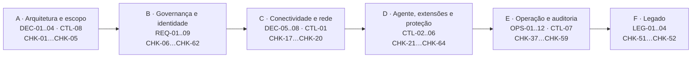

### A.2 Arquitetura de conectividade (público × privado)

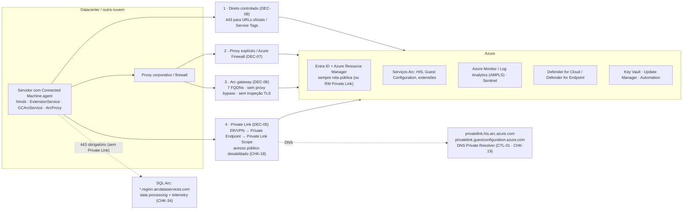

> Com Private Link, Entra ID e ARM continuam pela rota pública (Service Tags `AzureActiveDirectory` e `AzureResourceManager`). Windows Admin Center e SSH via Arc não são suportados sobre Private Link. **SQL Server enabled by Azure Arc:** o data processing service (`*.<region>.arcdataservices.com`) não suporta Private Link e exige saída 443 (direta ou via proxy). Arc gateway usa o método *Public endpoint* — são alternativas.

### A.3 Fluxo da coleta e das evidências


#### Permissões da conta que executa a coleta

O script é somente leitura e, antes de coletar, lê as **permissões efetivas** da conta em cada subscription (API `Microsoft.Authorization/permissions`, que considera grupos e herança de management group). Isso é necessário porque o Azure Resource Graph **não falha** quando falta permissão: ele apenas devolve menos linhas, e um PASS poderia ser falso.

| Área | Ações verificadas | Se faltar |
|---|---|---|
| Arc: máquinas, extensões e SQL | `Microsoft.HybridCompute/machines/read`, `.../machines/extensions/read`, `.../privateLinkScopes/read`, `Microsoft.AzureArcData/sqlServerInstances/read` | CHK afetado vira **PARCIAL** (algumas subscriptions) ou **ERRO** (todas) |
| Rede, DNS e Key Vault | `Microsoft.Network/privateDnsZones/read`, `Microsoft.KeyVault/vaults/read` | idem |
| RBAC | `Microsoft.Authorization/roleAssignments/read`, `.../roleDefinitions/read` | idem |
| Azure Policy | `Microsoft.Authorization/policyAssignments/read`, `Microsoft.PolicyInsights/policyStates/queryResults/read` | idem |
| Defender for Cloud | `Microsoft.Security/pricings/read`, `Microsoft.Security/assessments/read` | idem |
| Monitoramento e logs | `Microsoft.Insights/dataCollectionRuleAssociations/read`, `.../diagnosticSettings/read`, `.../eventtypes/values/read`, `Microsoft.OperationalInsights/workspaces/read` | idem |
| Patches | `Microsoft.HybridCompute/machines/patchAssessmentResults/read` | idem |
| Advisor | `Microsoft.Advisor/recommendations/read` | idem |
| Custo (opcional) | `Microsoft.CostManagement/query/read`, `Microsoft.Consumption/usageDetails/read` | apenas informativo: a coleta atual **não lê custo** |

- Papel recomendado: **Reader** no management group (ou em cada subscription do escopo). Ele cobre todas as ações acima (`*/read`); não é necessário papel de escrita. Papéis como *Security Reader* sozinhos não cobrem Arc, Policy e Monitor.
- Para leitura de custo em escopos de faturamento (EA/MCA), podem ser necessários papéis de billing, fora do escopo deste script.
- O resultado aparece no console, em `findings/permissions.csv`, no `summary.md`, em `results.json` (`permissions`) e na aba de análise do HTML.
- Referências: [Azure RBAC — Management and governance permissions](https://learn.microsoft.com/en-us/azure/role-based-access-control/permissions/management-and-governance) · [Azure built-in roles](https://learn.microsoft.com/en-us/azure/role-based-access-control/built-in-roles) · [Permissions in Azure Resource Graph](https://learn.microsoft.com/en-us/azure/governance/resource-graph/overview#permissions-in-azure-resource-graph)

### A.4 Ciclo de vida fim a fim

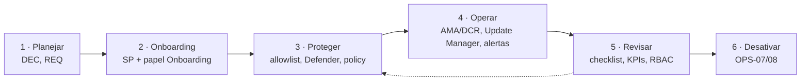

### A.5 Identidade e acesso (onboarding e operação)

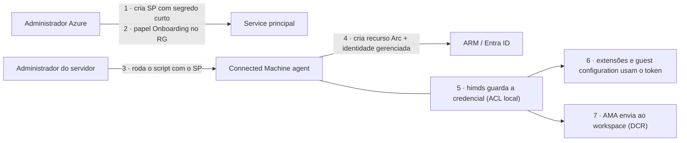

- O administrador local da máquina pode obter tokens da identidade gerenciada: trate qualquer papel dado a essa identidade como acesso desse administrador no Azure (CHK-12).
- Membros do grupo local *Hybrid agent extension applications* também pedem tokens ao himds (CTL-05).
- Referências: [Identity and authorization](https://learn.microsoft.com/en-us/azure/azure-arc/servers/security-identity-authorization) · [Arc Jumpstart](https://jumpstart.azure.com)

### A.6 Remoção (individual e em escala)

O fluxo completo está no **OPS-07** (individual) e no **OPS-08** (em escala), dentro da árvore **D8**.

## Anexo B) Fluxo executivo por fase do checklist

| Fase | Itens do playbook | Verificações |
|---|---|---|
| A · Arquitetura e escopo | DEC-01..DEC-04, CTL-08 | CHK-01, CHK-02, CHK-03, CHK-04, CHK-05 |
| B · Governança e identidade | REQ-01..REQ-09 | CHK-06, CHK-07, CHK-08, CHK-09, CHK-10, CHK-11, CHK-12, CHK-13, CHK-14, CHK-15, CHK-16, CHK-53, CHK-56, CHK-60, CHK-62 |
| C · Conectividade e rede | DEC-05..DEC-08, CTL-01 | CHK-17, CHK-18, CHK-19, CHK-20 |
| D · Agente, extensões e proteção | CTL-02..CTL-06 | CHK-21, CHK-22, CHK-23, CHK-24, CHK-25, CHK-26, CHK-27, CHK-28, CHK-29, CHK-30, CHK-31, CHK-32, CHK-33, CHK-34, CHK-35, CHK-36, CHK-54, CHK-55, CHK-57, CHK-61, CHK-63, CHK-64 |
| E · Operação, monitoramento e auditoria | OPS-01..OPS-12, CTL-07 | CHK-37, CHK-38, CHK-39, CHK-40, CHK-41, CHK-42, CHK-43, CHK-44, CHK-45, CHK-46, CHK-47, CHK-48, CHK-49, CHK-50, CHK-58, CHK-59 |
| F · Legado | LEG-01..LEG-04 | CHK-51, CHK-52 |

## Anexo C) Catálogo de serviços Windows (Arc core + extensões)

Objetivo: padronizar a evidência operacional de **serviços criados/acionados** por Azure Arc e extensões.

> Importante: nome do serviço, conta e tipo de inicialização podem variar por versão do agente/extensão e baseline de segurança. Os serviços do agente (HIMDS, Guest Configuration, Extension Service, Arc Proxy) usam início automático atrasado; a CVE-2026-26117 explorava esse intervalo (corrigida na 1.61). Use esta tabela como baseline e confirme no host (`Get-Service`, `sc qc`, `Get-CimInstance Win32_Service`).

| Serviço (Windows) | Origem | Conta típica | Início típico | Função | Referência oficial |
|---|---|---|---|---|---|
| `himds` (Azure Hybrid Instance Metadata Service) | Agente Arc (core) | `NT SERVICE\himds` | Auto | Endpoint IMDS local e identidade da máquina Arc (tokens/metadata/heartbeat). | https://learn.microsoft.com/en-us/azure/azure-arc/servers/agent-overview |
| `ArcProxy` (Azure Arc Proxy) | Agente Arc (core) | `NT AUTHORITY\NetworkService` | Auto | Proxy local do agente Arc e controle de saída/proxy do tráfego do agente. | https://learn.microsoft.com/en-us/azure/azure-arc/servers/arc-gateway |
| `GCArcService` (Guest Configuration Arc Service) | Agente Arc (core) + Machine Configuration | `LocalSystem` | Auto | Avaliação/aplicação de Machine Configuration dentro do SO convidado. | https://learn.microsoft.com/en-us/azure/governance/machine-configuration/overview |
| `ExtensionService` (Guest Configuration Extension Service) | Agente Arc (core) | `LocalSystem` | Auto | Instala/atualiza/remove extensões Arc e aplica allowlist/blocklist. | https://learn.microsoft.com/en-us/azure/azure-arc/servers/security-extensions |
| `SqlServerExtension` (Microsoft Sql Server Extension Service) | `WindowsAgent.SqlServer` | `NT Service\SqlServerExtension` | Auto | Inventário/gestão SQL Arc (licenciamento, recursos de gestão e integração do SQL Arc). | https://learn.microsoft.com/en-us/sql/sql-server/azure-arc/prerequisites |
| `Microsoft Defender for SQL` (serviço local do ATP) | `AdvancedThreatProtection.Windows` | `NT AUTHORITY\LOCAL SERVICE` | Manual | Defender for SQL: detecção de ameaças e VA para instâncias elegíveis. | https://learn.microsoft.com/en-us/azure/defender-for-cloud/defender-for-sql-usage |
| `AzureNetworkWatcherAgent` | `NetworkWatcherAgentWindows` | `LocalSystem` | Auto | Suporte ao Connection Monitor/Network Watcher a partir do servidor. | https://learn.microsoft.com/en-us/azure/network-watcher/network-watcher-monitoring-overview |
| `WindowsAdminCenter` / `WindowsAdminCenterAccountManagement` | `AdminCenter` | `NetworkService` / `LocalSystem` | Auto / Manual | Gateway e mapeamento de identidade para administração remota via Arc + WAC. | https://learn.microsoft.com/windows-server/manage/windows-admin-center/azure/manage-arc-hybrid-machines |
| `HybridWorkerService` | `HybridWorkerForWindows` | `LocalSystem` | Auto | Execução local de runbooks da Automation Account. | https://learn.microsoft.com/en-us/azure/automation/extension-based-hybrid-runbook-worker-install |
| `Sense` | MDE (onboard via `MDE.Windows`) | `LocalSystem` | Auto | Sensor do Defender for Endpoint (serviço nativo do SO; extensão Arc faz o onboarding). | https://learn.microsoft.com/en-us/azure/defender-for-cloud/quickstart-onboard-machines |
| Tarefa agendada `azcmagent` | Agente Arc (core, 1.48+) | `SYSTEM` | Diária, 01:00–02:00 | Verifica e aplica a atualização automática do agente (`azcmagent_check_updates.ps1`). Foi alvo das CVE-2025-49692 e CVE-2025-55316: manter o agente atualizado e alertar alterações na tarefa. | https://learn.microsoft.com/en-us/azure/azure-arc/servers/manage-agent |
| Tarefa agendada de implantação por GPO | Onboarding por Group Policy | `SYSTEM` | Na aplicação da GPO | Instala e conecta o agente usando o service principal da pasta compartilhada. Remover a GPO e a tarefa ao concluir o onboarding. | https://learn.microsoft.com/en-us/azure/azure-arc/servers/onboard-group-policy-powershell |
| `MMAExtensionHeartbeatService` (legado) | Log Analytics Agent (MMA) legado | `LocalSystem` | Manual | Resquício de MMA legado; deve ser removido/migrado para AMA conforme baseline atual. | https://learn.microsoft.com/en-us/azure/azure-monitor/agents/azure-monitor-agent-migration |

Modelo recomendado de evidência por servidor:
- `ServiceName`, `DisplayName`, `Status`, `StartType`, `StartName`, `PathName`
- extensão Arc correspondente (`publisher`, `type`, `provisioningState`, `typeHandlerVersion`)
- correlação com Activity Log para operação de extensão

> **Verificado por:** CHK-36 — Coleta local em amostra (agente e serviços) (Documental)

## Anexo D) Matriz de rastreabilidade (playbook → verificações)

| Item | Título | Verificações |
|---|---|---|
| DEC-01 | Qual serviço Arc usar por tipo de ambiente | CHK-02 |
| DEC-02 | Cenário misto (on-prem + AWS/GCP + OCI) | CHK-02 |
| DEC-03 | Landing zone e organização de recursos | CHK-03 |
| DEC-04 | Perfil de criticidade | CHK-04, CHK-26 |
| DEC-05 | Modelo de conectividade | CHK-17, CHK-18, CHK-20, CHK-34, CHK-64 |
| DEC-06 | Quando usar Arc Gateway | CHK-17, CHK-20 |
| DEC-07 | Quando usar Azure Firewall Explicit Proxy | CHK-17, CHK-20 |
| DEC-08 | Público direto controlado | CHK-17, CHK-20 |
| REQ-01 | Inventário de elegibilidade | CHK-01 |
| REQ-02 | Modelo de tags (recomendado — boa prática) | CHK-06 |
| REQ-03 | Modelo de identidade | CHK-10, CHK-13, CHK-62 |
| REQ-04 | RBAC mínimo por cenário | CHK-10, CHK-11, CHK-12, CHK-25, CHK-62 |
| REQ-05 | Registro de providers | CHK-07 |
| REQ-06 | Cross-subscription | CHK-16 |
| REQ-07 | Política e baseline | CHK-08, CHK-09, CHK-27, CHK-55 |
| REQ-08 | Segredos e credenciais | CHK-12, CHK-14, CHK-15 |
| REQ-09 | Custo e licenciamento (gratuito × cobrado) | CHK-53, CHK-59, CHK-64 |
| CTL-01 | DNS corporativo integrado ao Azure | CHK-19, CHK-20 |
| CTL-02 | Extensões por allowlist/blocklist | CHK-22, CHK-23, CHK-24 |
| CTL-03 | Operação remota segura | CHK-21, CHK-24, CHK-25, CHK-26, CHK-44 |
| CTL-04 | Least privilege no SQL Arc | CHK-30, CHK-34, CHK-56, CHK-60 |
| CTL-05 | Contas locais e GPO do HIMDS | CHK-35, CHK-36, CHK-56, CHK-60, CHK-61 |
| CTL-06 | Defender for Cloud onboarding | CHK-31, CHK-32, CHK-33, CHK-54, CHK-55, CHK-57, CHK-63 |
| CTL-07 | Sentinel | CHK-39, CHK-40, CHK-41 |
| CTL-08 | Data residency e região | CHK-05 |
| OPS-01 | Piloto obrigatório (30 dias recomendado) | CHK-46 |
| OPS-02 | Rollout por ondas | CHK-47 |
| OPS-03 | Métodos de automação oficiais | CHK-48 |
| OPS-04 | Deploy do AMA em escala | CHK-39, CHK-40, CHK-58 |
| OPS-05 | Atualização de agente Arc | CHK-29 |
| OPS-06 | Atualização de extensões | CHK-28, CHK-30 |
| OPS-07 | Remoção correta de Arc (individual) | CHK-49 |
| OPS-08 | Remoção em escala (stale/disconnected) | CHK-37, CHK-49 |
| OPS-09 | Advisor (confiabilidade) | CHK-37, CHK-38 |
| OPS-10 | Patch management e WSUS | CHK-42 |
| OPS-11 | Métricas mínimas de saúde | CHK-09, CHK-28, CHK-37, CHK-50, CHK-58, CHK-59 |
| OPS-12 | Revisão periódica | CHK-13, CHK-50 |
| LEG-01 | Posicionamento (2012/2012 R2 e 2016) | CHK-51, CHK-52 |
| LEG-02 | Uso permitido | CHK-52 |
| LEG-03 | Segurança mínima | CHK-51 |
| LEG-04 | Plano de modernização | CHK-52 |
| — | Catálogo de serviços | CHK-36 |
| — | Matriz de evidências | CHK-36, CHK-43, CHK-44, CHK-45 |
| — | Movimento lateral | CHK-32, CHK-41, CHK-43, CHK-44, CHK-54 |

## Anexo E) Matriz de validação de evidências (auditoria no cliente)

| Etapa do playbook | Base oficial para validar | O que comprova no cliente | Verificações |
|---|---|---|---|
| 1) Control plane (quem/disparo) | Activity Log + Activity Log schema (`activity-log` + `activity-log-schema`) | `caller`, `operationName`, `correlationId`, `resourceId`, `status`, horário | CHK-44, CHK-43 |
| 2) Operação de Run Command | Arc Run Command + REST `machine-run-commands` | que houve `create/get/list/delete` de run command no recurso Arc | CHK-44, CHK-26 |
| 3) Status e saída do comando | PowerShell `Get-AzConnectedMachineRunCommand` + `New-AzConnectedMachineRunCommand` | `InstanceViewExecutionState`, `ExitCode`, `output` (com limite), uso de `OutputBlobUri`/`ErrorBlobUri` | CHK-26 |
| 4) Retenção/auditoria central | Diagnostic settings + Resource logs (`resource-logs`) | exportação para Log Analytics/Event Hub/Storage e trilha preservada | CHK-43, CHK-45 |
| 5) Evidência no host Arc/extensão | Arc security overview + manage-vm-extensions + agent-overview | validação local da execução da extensão e comportamento do agente | CHK-36 |
| 6) Lateral movement/detecção | Defender for Servers + integração MDE + Defender XDR advanced hunting | correlação de processos, conexões, alertas e identidade no intervalo do evento | CHK-32, CHK-33, CHK-41 |

> **Verificado por:** CHK-36 — Coleta local em amostra (agente e serviços) (Documental) · CHK-43 — Exportação do Activity Log (Automático) · CHK-44 — Operações sensíveis no período (Automático) · CHK-45 — Retenção do Log Analytics (Automático)

## Anexo F) Movimento lateral: trilha de investigação

Para investigação de possíveis movimentos laterais no contexto Arc, a trilha oficial principal é:
1. **Activity Log + Resource logs** para rastrear operações de controle (ex.: criação/execução de Run Command, alterações de extensão e mudanças de configuração).
2. **Defender for Servers + Defender for Endpoint (EDR)** para detecção comportamental no host e correlação de ataque.
3. **Sentinel** para correlação multi-fonte e caça de ameaças.

Não há, na documentação pública de referência, um único artigo Arc com título específico de “lateral movement”; o desenho recomendado é a combinação dos controles acima.

> **Verificado por:** CHK-32 — Defender for Endpoint (Automático) · CHK-41 — Microsoft Sentinel e cobertura das máquinas (Automático) · CHK-43 — Exportação do Activity Log (Automático) · CHK-44 — Operações sensíveis no período (Automático) · CHK-54 — Ameaças e vulnerabilidades (Defender for Cloud) (Automático)

## Anexo G) Mapeamento das verificações para o MCSB v2

Base de cada linha: [baseline do Arc-enabled servers](https://learn.microsoft.com/en-us/security/benchmark/azure/baselines/azure-arc-enabled-servers-security-baseline), [MCSB](https://learn.microsoft.com/en-us/security/benchmark/azure/overview) e documentação do produto. *No baseline do Arc?* indica se o controle aparece no baseline publicado do serviço.

| CHK | Verificação | Camada | Controle MCSB v2 | No baseline do Arc? | Como medir | Árvore |
|---|---|---|---|---|---|---|
| CHK-01 | Inventário e elegibilidade das máquinas Arc | 3 · Requisito do Arc | AM-1 | Não | Coleta (Resource Graph) | D1 |
| CHK-02 | Serviço Arc por tipo de ambiente | 4 · Decisão do cliente | AM-2 | Não | Decisão registrada | D1 |
| CHK-03 | Landing zone e organização de recursos | 4 · Decisão do cliente | AM-1, AM-3 | Não | Decisão registrada | D2 |
| CHK-04 | Perfil de criticidade (Tier 0/1/2) | 4 · Decisão do cliente | AM-1, PA-1 | PA-1 | Decisão registrada (Tier por tag ou RG) | D2 |
| CHK-05 | Região dos metadados e residência de dados | 4 · Decisão do cliente | AM-2 | Não | Coleta × regiões definidas pelo cliente | D2 |
| CHK-06 | Tags recomendadas (boa prática) | 4 · Decisão do cliente | AM-1 | Não | Coleta × tags definidas pelo cliente | D2 |
| CHK-07 | Resource providers registrados | 3 · Requisito do Arc | — | Não | Coleta (providers) | D1 |
| CHK-08 | Atribuições de Azure Policy e baseline | 1 · MCSB | PV-2, AM-2 | AM-2 | Defender: conformidade regulatória MCSB | D6 |
| CHK-09 | Conformidade de policy nas máquinas | 1 · MCSB | PV-2, PV-4 | Não | Defender: conformidade regulatória MCSB | D6 |
| CHK-10 | Papéis privilegiados no escopo | 1 · MCSB | PA-1, PA-7 | PA-1, PA-7 | Coleta (RBAC) + controle MCSB | D4 |
| CHK-11 | Papéis específicos do Arc | 1 · MCSB | PA-7 | PA-7 | Coleta (RBAC) | D4 |
| CHK-12 | Identidade gerenciada das máquinas | 1 · MCSB | IM-3, PA-7 | IM-3, PA-7 | Coleta (RBAC da identidade da máquina) | D4 |
| CHK-13 | Modelo de identidade, PIM e revisão de acesso | 1 · MCSB | PA-2, PA-4 | Não | Evidência documental | D4 |
| CHK-14 | Segredos e credenciais de onboarding | 1 · MCSB | IM-8 | IM-8 | Evidência documental | D4 |
| CHK-15 | Key Vaults | 1 · MCSB | DP-8 | Não | Defender: recomendações de Key Vault | D4 |
| CHK-16 | Cenários cross-subscription | 4 · Decisão do cliente | AM-1, AM-4 | Não | Decisão registrada | D3 |
| CHK-17 | Modelo de conectividade em uso | 1 · MCSB | NS-2 | NS-2 | Coleta (modelo em uso) | D3 |
| CHK-18 | Acesso público do Private Link Scope | 1 · MCSB | NS-2 | NS-2 | Coleta (Private Link Scope) | D3 |
| CHK-19 | DNS privado do Arc | 3 · Requisito do Arc | NS-10 | Não | Coleta (zonas DNS) | D3 |
| CHK-20 | Decisão de conectividade e liberações de rede | 4 · Decisão do cliente | NS-2, NS-9 | NS-2 | Decisão registrada | D3 |
| CHK-21 | Portas de entrada no agente (SSH/WAC) | 3 · Requisito do Arc | IM-1, NS-8 | IM-1 | Coleta (portas do agente) | D5 |
| CHK-22 | Modo do agente | 3 · Requisito do Arc | PV-3 | Não | Coleta (modo do agente) | D5 |
| CHK-23 | Allowlist/blocklist de extensões | 3 · Requisito do Arc | AM-5 | Não | Coleta (allowlist/blocklist) | D5 |
| CHK-24 | Extensões sensíveis | 4 · Decisão do cliente | AM-5, PA-7 | Não | Coleta × decisão por tier | D5 |
| CHK-25 | Acesso Entra ao SO (SSH/RDP/WAC) | 1 · MCSB | IM-1 | IM-1 | Coleta (RBAC de login) | D4 |
| CHK-26 | Run Command e Admin Center por tier | 4 · Decisão do cliente | PA-7 | PA-7 | Decisão registrada | D5 |
| CHK-27 | Guest configuration (Machine Configuration) | 2 · Baseline do SO | PV-4 | Não | Coleta (guest configuration) | D6 |
| CHK-28 | Extensões com falha | 3 · Requisito do Arc | — | Não | Coleta (extensões com falha) | D7 |
| CHK-29 | Versão do agente dentro do suporte | 3 · Requisito do Arc | PV-6 | Não | Coleta × release notes | D7 |
| CHK-30 | Versões e atualização automática das extensões | 3 · Requisito do Arc | PV-6 | Não | Coleta × release notes | D7 |
| CHK-31 | Defender for Servers | 1 · MCSB | LT-1 | LT-1 | Coleta (planos do Defender) | D6 |
| CHK-32 | Defender for Endpoint | 1 · MCSB | ES-1 | Não | Coleta (MDE) | D6 |
| CHK-33 | Recomendações do Defender | 1 · MCSB | PV-5, PV-4 | Não | Defender: recomendações | D6 |
| CHK-34 | SQL Server: Defender for SQL e menor privilégio | 1 · MCSB | LT-1, PA-7 | Não | Coleta + recomendações Defender for SQL | D6 |
| CHK-35 | Contas locais e GPO do HIMDS | 3 · Requisito do Arc | — | Não | Evidência documental | D4 |
| CHK-36 | Coleta local em amostra (agente e serviços) | 3 · Requisito do Arc | — | Não | Evidência documental | D6 |
| CHK-37 | Máquinas desconectadas ou expiradas | 3 · Requisito do Arc | AM-3 | Não | Coleta (status) | D8 |
| CHK-38 | Recomendações do Advisor | 3 · Requisito do Arc | — | Não | Advisor (confiabilidade) | D8 |
| CHK-39 | Azure Monitor Agent | 1 · MCSB | LT-3, LT-5 | Não | Coleta (AMA) | D6 |
| CHK-40 | Associação a DCR | 1 · MCSB | LT-3, LT-5 | Não | Coleta (DCR) | D6 |
| CHK-41 | Microsoft Sentinel e cobertura das máquinas | 1 · MCSB | LT-5, IR-3 | Não | Coleta (Sentinel e DCR) | D6 |
| CHK-42 | Avaliação de patches (Update Manager/WSUS) | 1 · MCSB | PV-6 | Não | Coleta (avaliação de patches) + recomendação do Defender | D7 |
| CHK-43 | Exportação do Activity Log | 1 · MCSB | LT-3, LT-5 | Não | Coleta (diagnostic settings) | D6 |
| CHK-44 | Operações sensíveis no período | 1 · MCSB | LT-3, IR-4 | Não | Coleta (Activity Log) | D6 |
| CHK-45 | Retenção do Log Analytics | 1 · MCSB | LT-6 | Não | Coleta × retenção definida pelo cliente | D6 |
| CHK-46 | Piloto executado e aceito | P · Programa | — | Não | Evidência do programa | P |
| CHK-47 | Rollout por ondas e rollback | P · Programa | — | Não | Evidência do programa | P |
| CHK-48 | Método de automação por ambiente | P · Programa | AM-2, PV-2 | Não | Evidência do programa | P |
| CHK-49 | Remoção individual e em escala | 3 · Requisito do Arc | AM-3 | Não | Procedimento documentado | D8 |
| CHK-50 | KPIs de saúde e revisão periódica | P · Programa | PV-2, PA-4 | Não | Evidência do programa | P |
| CHK-51 | Legado, fim de suporte e ESU | 3 · Requisito do Arc | PV-6 | Não | Coleta × datas oficiais de ESU | D7 |
| CHK-52 | Exceções de legado e plano de saída | 4 · Decisão do cliente | AM-3, PV-6 | Não | Exceção formal | D7 |
| CHK-53 | Custo: serviços cobrados e benefícios por máquina | F · FinOps | — | Não | Coleta × página de preços | D9 |
| CHK-54 | Ameaças e vulnerabilidades (Defender for Cloud) | 1 · MCSB | LT-1, PV-5, IR-3 | LT-1 | Defender (alertas, vulnerabilidades, Secure Score) | D6 |
| CHK-55 | Baseline de segurança do sistema operacional | 2 · Baseline do SO | PV-4 | PV-4 | Coleta (guest configuration e conformidade) | D6 |
| CHK-56 | Auditoria dos administradores locais | 2 · Baseline do SO | PA-1, PA-7 | Não | Coleta (guest configuration) | D4 |
| CHK-57 | Antivírus e EDR saudáveis | 1 · MCSB | ES-1, ES-2, ES-3 | ES-2 | Defender (recomendações) e extensões | D6 |
| CHK-58 | Insights e telemetria por máquina | 3 · Requisito do Arc | LT-3, LT-4 | Não | Coleta (DCR e associações) | D6 |
| CHK-59 | Mapa de recursos do Arc em uso | 3 · Requisito do Arc | AM-1 | Não | Coleta (extensões e licenças) | D9 |
| CHK-60 | Senha do administrador local (Windows LAPS) | 2 · Baseline do SO | PA-1, IM-8 | Não | Entrevista e evidência | D4 |
| CHK-61 | Criptografia do disco do sistema (BitLocker/dm-crypt) | 2 · Baseline do SO | DP-4 | Não | Entrevista e evidência | D6 |
| CHK-62 | Acesso Condicional e MFA para quem administra o Azure | 1 · MCSB | IM-6, IM-7 | Não | Entrevista e evidência | D4 |
| CHK-63 | Defender for Servers por máquina Arc | 1 · MCSB | LT-1, ES-1 | LT-1 | Coleta (plano do Defender por máquina) | D6 |
| CHK-64 | SQL Server: licença e envio de uso (faturamento) | F · FinOps | AM-1, LT-1 | AM-1 | Coleta (extensão do SQL: LicenseType, uploadStatus, último envio de uso) | D9 |

Famílias MCSB: **NS** Segurança de rede · **IM** Gerenciamento de identidades · **PA** Acesso privilegiado · **DP** Proteção de dados · **AM** Gerenciamento de ativos · **LT** Registro em log e detecção de ameaças · **IR** Resposta a incidentes · **PV** Postura e gerenciamento de vulnerabilidades · **ES** Segurança de endpoint · **BR** Backup e recuperação · **DS** Segurança de DevOps · **AI** Segurança de inteligência artificial · **GS** Governança e estratégia (só no v1).

## Anexo H) Referências oficiais Microsoft

### Arquitetura e decisão
- Azure landing zone (CAF atual):  
  https://learn.microsoft.com/en-us/azure/cloud-adoption-framework/ready/landing-zone/
- Choose the right Azure Arc service for machines:  
  https://learn.microsoft.com/en-us/azure/azure-arc/choose-service
- Plan and deploy Azure Arc-enabled servers:  
  https://learn.microsoft.com/en-us/azure/azure-arc/servers/plan-at-scale-deployment
- Azure Arc-enabled servers overview:  
  https://learn.microsoft.com/en-us/azure/azure-arc/servers/overview
- Azure Well-Architected Framework:  
  https://learn.microsoft.com/en-us/azure/well-architected/

### Agente, escala e ciclo de vida
- Deployment options:  
  https://learn.microsoft.com/en-us/azure/azure-arc/servers/deployment-options
- Agent overview:  
  https://learn.microsoft.com/en-us/azure/azure-arc/servers/agent-overview
- Prerequisites:  
  https://learn.microsoft.com/en-us/azure/azure-arc/servers/prerequisites
- Network requirements:  
  https://learn.microsoft.com/en-us/azure/azure-arc/servers/network-requirements
- Connected Machine agent release notes (suporte de 12 meses):  
  https://learn.microsoft.com/en-us/azure/azure-arc/servers/agent-release-notes
- Manage agent versions:  
  https://learn.microsoft.com/en-us/azure/azure-arc/servers/manage-agent
- Uninstall agent:  
  https://learn.microsoft.com/en-us/azure/azure-arc/servers/uninstall-agent
- Resolve Azure Advisor recommendations:  
  https://learn.microsoft.com/en-us/azure/azure-arc/servers/resolve-azure-advisor-recommendations

### Conectividade
- Private Link for Arc servers:  
  https://learn.microsoft.com/en-us/azure/azure-arc/servers/private-link-security
- Arc gateway:  
  https://learn.microsoft.com/en-us/azure/azure-arc/servers/arc-gateway
- Azure Firewall explicit proxy for Arc:  
  https://learn.microsoft.com/en-us/azure/azure-arc/azure-firewall-explicit-proxy
- DNS Private Resolver:  
  https://learn.microsoft.com/en-us/azure/dns/dns-private-resolver-overview
- Private DNS:  
  https://learn.microsoft.com/en-us/azure/dns/private-dns-overview
- Private endpoint cross-subscription approval:  
  https://learn.microsoft.com/en-us/azure/private-link/how-to-approve-private-link-cross-subscription

### Governança e RBAC
- Azure Policy overview:  
  https://learn.microsoft.com/azure/governance/policy/overview
- Arc policy reference (built-ins):  
  https://learn.microsoft.com/en-us/azure/azure-arc/servers/policy-reference
- Azure RBAC built-in roles:  
  https://learn.microsoft.com/en-us/azure/role-based-access-control/built-in-roles
- Azure Connected Machine Onboarding role:  
  https://learn.microsoft.com/en-us/azure/role-based-access-control/built-in-roles#azure-connected-machine-onboarding
- Azure Connected Machine Resource Administrator role:  
  https://learn.microsoft.com/en-us/azure/role-based-access-control/built-in-roles#azure-connected-machine-resource-administrator
- Resource providers and types:  
  https://learn.microsoft.com/en-us/azure/azure-resource-manager/management/resource-providers-and-types

### Segurança, Defender, Sentinel e operações
- Security overview for Arc-enabled servers:  
  https://learn.microsoft.com/en-us/azure/azure-arc/servers/security-overview
- Security extensions (allowlist/blocklist):  
  https://learn.microsoft.com/en-us/azure/azure-arc/servers/security-extensions#allowlists-and-blocklists
- Manage Arc VM extensions:  
  https://learn.microsoft.com/en-us/azure/azure-arc/servers/manage-vm-extensions
- Identity and access authorization for Arc-enabled servers:  
  https://learn.microsoft.com/en-us/azure/azure-arc/servers/security-identity-authorization
- Manage Arc-enabled servers with Windows Admin Center:  
  https://learn.microsoft.com/windows-server/manage/windows-admin-center/azure/manage-arc-hybrid-machines
- Run command on Arc-enabled servers:  
  https://learn.microsoft.com/en-us/azure/azure-arc/servers/run-command
- Azure CLI (run-command):  
  https://learn.microsoft.com/en-us/cli/azure/connectedmachine/run-command?view=azure-cli-latest
- PowerShell (New-AzConnectedMachineRunCommand):  
  https://learn.microsoft.com/en-us/powershell/module/az.connectedmachine/new-azconnectedmachineruncommand?view=azps-16.4.0
- PowerShell (Get-AzConnectedMachineRunCommand):  
  https://learn.microsoft.com/en-us/powershell/module/az.connectedmachine/get-azconnectedmachineruncommand?view=azps-16.4.0
- REST API (Machine Run Commands):  
  https://learn.microsoft.com/en-us/rest/api/hybridcompute/machine-run-commands?view=rest-hybridcompute-2026-09-01
- Azure Monitor Activity Log:  
  https://learn.microsoft.com/en-us/azure/azure-monitor/fundamentals/activity-log
- Azure Monitor Resource logs:  
  https://learn.microsoft.com/en-us/azure/azure-monitor/logs/resource-logs
- Defender for Cloud onboarding for non-Azure machines:  
  https://learn.microsoft.com/en-us/azure/defender-for-cloud/quickstart-onboard-machines
- Plan Defender for Servers:  
  https://learn.microsoft.com/en-us/azure/defender-for-cloud/plan-defender-for-servers
- Defender for Endpoint integration in Defender for Cloud:  
  https://learn.microsoft.com/en-us/azure/defender-for-cloud/integration-defender-for-endpoint
- Just-in-time VM access:  
  https://learn.microsoft.com/en-us/azure/defender-for-cloud/just-in-time-access-overview
- Defender for Endpoint EDR overview:  
  https://learn.microsoft.com/en-us/defender-endpoint/overview-endpoint-detection-response
- Defender for Servers intro:  
  https://learn.microsoft.com/en-us/azure/defender-for-cloud/defender-for-servers-introduction

### Referência complementar (não normativa)
- Azure Arc Jumpstart:  
  https://azurearcjumpstart.io/
- Defender for SQL on machines:  
  https://learn.microsoft.com/en-us/azure/defender-for-cloud/defender-for-sql-usage
- Microsoft Sentinel overview:  
  https://learn.microsoft.com/en-us/azure/sentinel/overview
- Deploy AMA on Arc-enabled servers:  
  https://learn.microsoft.com/en-us/azure/azure-arc/servers/azure-monitor-agent-deployment
- Update Manager overview:  
  https://learn.microsoft.com/en-us/azure/update-manager/overview
- Update Manager support matrix (inclui WSUS):  
  https://learn.microsoft.com/en-us/azure/update-manager/support-matrix

### SQL Arc
- Release notes da extensão SQL (suporte de 12 meses, alvo de auto-upgrade):  
  https://learn.microsoft.com/en-us/sql/sql-server/azure-arc/release-notes?view=sql-server-ver17
- Unsupported configurations (inclui Private Link para o data processing service):  
  https://learn.microsoft.com/en-us/sql/sql-server/azure-arc/overview?view=sql-server-ver17#unsupported-configurations
- Prerequisites (rede, data processing service, NT AUTHORITY\SYSTEM):  
  https://learn.microsoft.com/en-us/sql/sql-server/azure-arc/prerequisites?view=sql-server-ver17
- Private Path (proxy explícito/Azure Firewall para SQL Arc):  
  https://learn.microsoft.com/en-us/sql/sql-server/azure-arc/configure-private-path?view=sql-server-ver17
- Troubleshoot data processing service e telemetry endpoints:  
  https://learn.microsoft.com/en-us/sql/sql-server/azure-arc/troubleshoot-telemetry-endpoint?view=sql-server-ver17
- Manage automatic connection (tag ArcSQLServerExtensionDeployment):  
  https://learn.microsoft.com/en-us/sql/sql-server/azure-arc/manage-autodeploy?view=sql-server-ver17
- SQL Server enabled by Azure Arc overview:  
  https://learn.microsoft.com/en-us/sql/sql-server/azure-arc/overview?view=sql-server-ver17
- SQL Arc least privilege:  
  https://learn.microsoft.com/en-us/sql/sql-server/azure-arc/configure-least-privilege?view=sql-server-ver17
- SQL Arc license and billing:  
  https://learn.microsoft.com/en-us/sql/sql-server/azure-arc/manage-license-billing?view=sql-server-ver17

### Blogs Microsoft (curadoria)
- Azure Arc Blog (TechCommunity):  
  https://techcommunity.microsoft.com/category/azure/blog/azurearcblog
- Microsoft Defender for Cloud Blog (TechCommunity):  
  https://techcommunity.microsoft.com/category/microsoft-defender-for-cloud/blog/microsoftdefendercloudblog

### CAF — Azure Arc-enabled servers (landing zone accelerator)

> **Atenção:** a Microsoft marcou estes artigos do CAF híbrido como descontinuados, com remoção prevista para 30/10/2026. Eles continuam úteis como referência de desenho (é possível baixar o PDF na própria página); a orientação atual está no Azure Architecture Center: [Get started with Azure hybrid and adaptive cloud architecture](https://learn.microsoft.com/en-us/azure/architecture/hybrid/hybrid-start-here) e [Azure hybrid options](https://learn.microsoft.com/en-us/azure/architecture/guide/technology-choices/hybrid-considerations).

- Hybrid and multicloud: enterprise-scale landing zone (fluxo: nova no Azure? → opção de landing zone → acelerador do Arc-enabled servers → onboarding → ESU):  
  https://learn.microsoft.com/en-us/azure/cloud-adoption-framework/scenarios/hybrid/enterprise-scale-landing-zone
- Escolher o serviço Azure Arc:  
  https://learn.microsoft.com/en-us/azure/azure-arc/choose-service
- Organização de recursos (D2):  
  https://learn.microsoft.com/en-us/azure/cloud-adoption-framework/scenarios/hybrid/arc-enabled-servers/eslz-resource-organization
- Conectividade de rede (D3):  
  https://learn.microsoft.com/en-us/azure/cloud-adoption-framework/scenarios/hybrid/arc-enabled-servers/eslz-arc-servers-connectivity
- Identidade e gerenciamento de acesso (D4):  
  https://learn.microsoft.com/en-us/azure/cloud-adoption-framework/scenarios/hybrid/arc-enabled-servers/eslz-identity-and-access-management
- Segurança, governança e conformidade (D5, D6):  
  https://learn.microsoft.com/en-us/azure/cloud-adoption-framework/scenarios/hybrid/arc-enabled-servers/eslz-security-governance-and-compliance
- Gerenciamento e monitoramento (D6, D7):  
  https://learn.microsoft.com/en-us/azure/cloud-adoption-framework/scenarios/hybrid/arc-enabled-servers/eslz-management-and-monitoring-arc-server
- Disciplinas de automação (P):  
  https://learn.microsoft.com/en-us/azure/cloud-adoption-framework/scenarios/hybrid/arc-enabled-servers/eslz-automation-arc-server
- Governança de custos (D9):  
  https://learn.microsoft.com/en-us/azure/cloud-adoption-framework/scenarios/hybrid/arc-enabled-servers/eslz-cost-governance
- Área de design de identidade e acesso da landing zone:  
  https://learn.microsoft.com/en-us/azure/cloud-adoption-framework/ready/landing-zone/design-area/identity-access
- Planejamento de implantação em escala:  
  https://learn.microsoft.com/en-us/azure/azure-arc/servers/plan-at-scale-deployment
- Controle de acesso aos logs do Azure Monitor:  
  https://learn.microsoft.com/en-us/azure/azure-monitor/logs/manage-access
- Trilha de aprendizagem do Azure Arc:  
  https://learn.microsoft.com/en-us/training/paths/manage-hybrid-infrastructure-with-azure-arc/

### Vulnerabilidades do agente e pesquisa de segurança (contexto)
- Guia de atualizações de segurança da Microsoft (MSRC): CVE-2025-49692, CVE-2025-26627, CVE-2025-55316, CVE-2026-26117:  
  https://msrc.microsoft.com/update-guide/
- Reversec Labs — tarefa agendada e janela de console do agente:  
  https://labs.reversec.com/advisories/2026/01/azure-connected-machine-agent-elevation-of-privilege-vulnerability-scheduled-task
- Cymulate — CVE-2026-26117:  
  https://cymulate.com/blog/cve-2026-26117-azure-arc-windows-lpe-cloud-identity-takeover/
- IBM X-Force — abuso do Azure Arc para escalada e persistência híbrida:  
  https://www.ibm.com/think/x-force/identifying-abusing-azure-arc-for-hybrid-escalation-persistence

### Ferramenta de coleta
- Azure Resource Graph overview:  
  https://learn.microsoft.com/en-us/azure/governance/resource-graph/overview
- Azure Resource Graph — paginação e limites:  
  https://learn.microsoft.com/en-us/azure/governance/resource-graph/concepts/work-with-data

### Microsoft Cloud Security Benchmark v2 (preview)
- Visão geral e domínios:  
  https://learn.microsoft.com/en-us/security/benchmark/azure/overview
- Network security · Identity management · Privileged access · Data protection · Asset management:  
  https://learn.microsoft.com/en-us/security/benchmark/azure/mcsb-v2-network-security · https://learn.microsoft.com/en-us/security/benchmark/azure/mcsb-v2-identity-management · https://learn.microsoft.com/en-us/security/benchmark/azure/mcsb-v2-privileged-access · https://learn.microsoft.com/en-us/security/benchmark/azure/mcsb-v2-data-protection · https://learn.microsoft.com/en-us/security/benchmark/azure/mcsb-v2-asset-management
- Logging and threat detection · Incident response · Posture and vulnerability management · Endpoint security · Backup and recovery:  
  https://learn.microsoft.com/en-us/security/benchmark/azure/mcsb-v2-logging-threat-detection · https://learn.microsoft.com/en-us/security/benchmark/azure/mcsb-v2-incident-response · https://learn.microsoft.com/en-us/security/benchmark/azure/mcsb-v2-posture-vulnerability-management · https://learn.microsoft.com/en-us/security/benchmark/azure/mcsb-v2-endpoint-security · https://learn.microsoft.com/en-us/security/benchmark/azure/mcsb-v2-backup-recovery
- DevOps security · AI security (fora do escopo do Arc-enabled servers):  
  https://learn.microsoft.com/en-us/security/benchmark/azure/mcsb-v2-devops-security · https://learn.microsoft.com/en-us/security/benchmark/azure/mcsb-v2-artificial-intelligence-security
- Mapeamento para Azure Policy e para CIS Controls v8.1:  
  https://learn.microsoft.com/en-us/security/benchmark/azure/mcsb-v2-controls-policy-mapping · https://learn.microsoft.com/en-us/security/benchmark/azure/mcsb-v2-cis-controls-mapping
- Controles de conformidade regulatória do Azure Policy para o Arc-enabled servers:  
  https://learn.microsoft.com/en-us/azure/azure-arc/servers/security-controls-policy

### Endurecimento e recuperação do Windows Server
- Baseline de segurança do Windows Server 2025 (Machine Configuration):  
  https://learn.microsoft.com/en-us/azure/governance/policy/samples/guest-configuration-baseline-windows-server-2025
- Best Practices Assessment para Windows Server via Arc (exige SA ou WS PAYG):  
  https://learn.microsoft.com/en-us/windows-server/manage/azure-arc/best-practices-assessment-for-windows-server
- Windows Recovery Environment (WinRE), referência técnica:  
  https://learn.microsoft.com/en-us/windows-hardware/manufacture/desktop/windows-recovery-environment--windows-re--technical-reference?view=windows-11
- Contexto (blogs, não documentação oficial): auditoria e habilitação do WinRE no Arc (preview) · ferramentas de endurecimento do Windows Server · guia introdutório de terceiros:  
  https://techcommunity.microsoft.com/blog/azurearcblog/public-preview-audit-and-enable-windows-recovery-environment-winre-for-azure-arc/4462939 · https://techcommunity.microsoft.com/blog/itopstalkblog/some-tools-and-techniques-for-hardening-windows-server/4539840 · https://www.bdrshield.com/blog/beginners-guide-securing-your-servers-using-azure-arc/

### Recursos do Arc para servidores e endurecimento do SO
- Windows Server Management enabled by Azure Arc (Update Manager, Change Tracking, Machine Configuration, Admin Center, Remote Support, Best Practices Assessment, Site Recovery):  
  https://learn.microsoft.com/en-us/azure/azure-arc/servers/windows-server-management-overview
- Hotpatch do Windows Server:  
  https://learn.microsoft.com/en-us/windows-server/get-started/hotpatch
- Baseline de segurança do Windows (Machine Configuration):  
  https://learn.microsoft.com/en-us/azure/governance/policy/samples/guest-configuration-baseline-windows
- Baseline de segurança do Linux (Machine Configuration):  
  https://learn.microsoft.com/en-us/azure/governance/policy/samples/guest-configuration-baseline-linux
- VM Insights:  
  https://learn.microsoft.com/en-us/azure/azure-monitor/vm/vminsights-overview
- Change Tracking e Inventory:  
  https://learn.microsoft.com/en-us/azure/automation/change-tracking/overview-monitoring-agent
- Windows LAPS:  
  https://learn.microsoft.com/en-us/windows-server/identity/laps/laps-overview
- BitLocker:  
  https://learn.microsoft.com/en-us/windows/security/operating-system-security/data-protection/bitlocker/
- Acesso Condicional do Microsoft Entra:  
  https://learn.microsoft.com/en-us/entra/identity/conditional-access/overview
- MFA obrigatório para o Azure:  
  https://learn.microsoft.com/en-us/entra/identity/authentication/concept-mandatory-multifactor-authentication

### Faturamento do SQL Server habilitado pelo Azure Arc
- Licenciamento e faturamento (tipos de licença, pCore, réplicas passivas, envio de uso por hora, 30 dias sem conexão):  
  https://learn.microsoft.com/en-us/sql/sql-server/azure-arc/manage-license-billing
- Conectividade com o serviço de processamento de dados e telemetria (uploadStatus, timestampUTC, TLS 1.2/1.3):  
  https://learn.microsoft.com/en-us/sql/sql-server/azure-arc/troubleshoot-telemetry-endpoint
- Diagnosticar a extensão do SQL Server:  
  https://learn.microsoft.com/en-us/sql/sql-server/azure-arc/troubleshoot-extension

### Continuidade e regiões
- Dados, replicação e recuperação de desastre dos servidores Arc:  
  https://learn.microsoft.com/en-us/azure/azure-arc/servers/security-data-privacy
- Servidores Arc em cenários desconectados:  
  https://learn.microsoft.com/en-us/azure/azure-arc/servers/troubleshoot-connectivity
- Renomear e migrar servidores Arc entre regiões:  
  https://learn.microsoft.com/en-us/azure/azure-arc/servers/manage-howto-migrate
- Pares de regiões do Azure:  
  https://learn.microsoft.com/en-us/azure/reliability/regions-paired

### Priorização no Defender for Cloud
- Priorização por risco (Defender CSPM):  
  https://learn.microsoft.com/en-us/azure/defender-for-cloud/risk-prioritization
- Regras de governança (responsável e prazo):  
  https://learn.microsoft.com/en-us/azure/defender-for-cloud/governance-rules
- Consultas do Resource Graph para o Defender for Cloud:  
  https://learn.microsoft.com/en-us/azure/defender-for-cloud/resource-graph-samples

## Anexo I) Nota de curadoria

O artigo CAF de hybrid/enterprise-scale para Arc é tratado como referência histórica.  
A trilha primária deste guia é: **Landing Zone + Choose Service + Plan at Scale + Arc Overview + WAF**.

**Origem do conteúdo.** Este material consolida conhecimento de entregas de campo realizadas ao longo de vários anos e a documentação pública da Microsoft listada no Anexo H. A organização, o texto, o código e as traduções foram consolidados com apoio de agentes de inteligência artificial e revisados pelo autor.

**Uso de inteligência artificial.** Conteúdo produzido com apoio de IA pode conter erros, omissões ou informações desatualizadas. Valide cada recomendação na documentação oficial antes de aplicar. A IA não substitui o julgamento técnico de quem conduz a avaliação.

**Responsabilidade de quem usa.** Revise o script antes de executar, teste primeiro em ambiente não produtivo, use contas com menor privilégio, siga as políticas da sua organização e as leis de proteção de dados (por exemplo LGPD e GDPR) e trate o pacote coletado e os relatórios como confidenciais. Decisões e mudanças no ambiente são de responsabilidade de quem as aprova e executa.

## Anexo J) Histórico de versões

### Inventário de cobertura

Totais calculados a partir do catálogo a cada versão. Entre parênteses, o que mudou em relação à v3.8.2.

**Por domínio**

| Domínio | Verificações | Automáticas | Documentais | Alta | Média | Baixa |
|---|---|---|---|---|---|---|
| A · Arquitetura e escopo | 5 | 2 | 3 | 1 | 3 | 1 |
| B · Governança e identidade | 15 | 10 | 5 | 6 | 7 | 2 |
| C · Conectividade e rede | 4 | 3 | 1 | 2 | 2 | 0 |
| D · Agente, extensões e proteção | 22 (+1) | 18 (+1) | 4 | 12 (+1) | 10 | 0 |
| E · Operação, monitoramento e auditoria | 16 | 11 | 5 | 3 | 10 | 3 |
| F · Legado | 2 | 1 | 1 | 2 | 0 | 0 |
| **Total** | **64 (+1)** | **45 (+1)** | **19** | **26 (+1)** | **32** | **6** |

**Por camada de avaliação e por árvore de decisão**

| Camada | Verificações | Árvore | Verificações |
|---|---|---|---|
| 1 · MCSB | 26 | D1 · Onboarding | 3 |
| 2 · Baseline do SO | 5 | D2 · Organização e criticidade | 4 |
| 3 · Requisito do Arc | 17 | D3 · Conectividade | 5 |
| 4 · Decisão do cliente | 10 | D4 · Identidade e acesso | 11 |
| P · Programa | 4 | D5 · Extensões e acesso remoto por tier | 5 |
| F · FinOps | 2 (+1) | D6 · Proteção, baseline, logs e detecção | 20 |
|  |  | D7 · Versões, patches e legado | 6 |
|  |  | D8 · Remoção e recursos abandonados | 3 |
|  |  | D9 · Custo e licenciamento | 3 (+1) |
|  |  | P · Execução do programa | 4 |

**Por domínio do MCSB v2**

| Domínio MCSB v2 | Verificações | Observação |
|---|---|---|
| NS · Segurança de rede | 5 |  |
| IM · Gerenciamento de identidades | 6 |  |
| PA · Acesso privilegiado | 11 |  |
| DP · Proteção de dados | 2 | O Arc não armazena dados do cliente; criptografia do disco do servidor é o CHK-61. |
| AM · Gerenciamento de ativos | 16 |  |
| LT · Registro em log e detecção de ameaças | 12 |  |
| IR · Resposta a incidentes | 3 | Coberto pelos alertas recomendados e pelo Defender. |
| PV · Postura e gerenciamento de vulnerabilidades | 14 |  |
| ES · Segurança de endpoint | 3 |  |
| BR · Backup e recuperação | 0 | O baseline do Arc-enabled servers marca backup como não suportado pelo serviço: o backup do servidor é responsabilidade da solução de backup do cliente. |
| DS · Segurança de DevOps | 0 | Fora do escopo: não há pipeline de DevOps no Arc-enabled servers. |
| AI · Segurança de inteligência artificial | 0 | Fora do escopo: não há carga de IA no Arc-enabled servers. |

**Outros totais:** 9 alertas recomendados · 9 árvores de decisão · 70 referências de documentação no plano de ação. Verificações novas nesta versão: CHK-64 SQL Server: licença e envio de uso (faturamento).

### Histórico

| Versão | Data | Mudanças |
|---|---|---|
| v3.9.5 | 27/10/2026 | Correção final do gate de publicação: impressão robusta em A4/Letter, acesso explícito ao Guide HTML oficial do projeto, indicação de arredondamento e conclusão da localização narrativa PT-BR sem alterar evidências brutas. |
| v3.9.4 | 27/10/2026 | Localização narrativa seletiva final do PT-BR: toda a narrativa e os labels produzidos pelo Arc Posture Review são localizados, enquanto valores/evidências brutas do Azure, comandos, identificadores e títulos raw das recomendações do Defender permanecem inalterados. CHK-41 e CHK-64 preservam a explicação de FAIL conclusivo com cobertura PARTIAL. Os relatórios EN-US/PT-BR são regenerados da mesma execução e a paridade de localização passa por gate. |
| v3.9.3 | 27/10/2026 | Corrige os achados da validação v3.9.2: sincronização Result × Criteria; resultados conclusivos com cobertura PARTIAL; linhas canônicas do CHK-42; semântica null/ausente do CHK-15; corpo conciso do CHK-33; separação assessment/apêndice; localização PT-BR completa; PDF limpo validado; regressão bilíngue ZIP até relatório; e contratos mais rígidos dos 64 checks, CSP e responsividade. O HTML integrado continua canônico e não há download do Guide em Markdown. |
| v3.9.2 | 27/10/2026 | Correções da revisão de lab: taxonomia canônica PASS/WARN/FAIL/INFO/N/A/TODO/PARTIAL/ERROR; separação entre Resultado do controle e Cobertura da evidência; Cobertura da avaliação com confiança; aritmética rastreável dos controles agrupados; comportamento corrigido de CHK-05/23/32/33/39/40/41/42/54/55/56/57/58/64; links para CSV completo; e contrato de evidência por verificação. O HTML integrado continua canônico e não há download do Guide em Markdown. |
| v3.9.1 | 27/10/2026 | O HTML integrado passa a ser o guia canônico do projeto; foram removidos o download do guia em Markdown e o payload Markdown embutido. Os riscos atuais do lab ficam explícitos, e os gates de contrato/navegador impedem o retorno do botão ou do payload. |
| v3.9.0 | 27/10/2026 | Contrato do relatório salvo: layout responsivo no celular, cópia funcional das consultas, expansão completa na impressão, navegação estática acessível e testes automatizados de contrato/navegador. Sem mudança no checklist ou no escopo do coletor. |
| v3.8.3 | 23/10/2026 | Nova verificação CHK-64 (licença e envio de uso do SQL Server: LicenseType, pCore, uploadStatus e último envio); CHK-37 e CHK-29 com o parque inteiro (faixas de desconexão, incluindo 30 a 44 dias, e versões do agente) mesmo com amostra; CHK-33 com risco, caminhos de ataque, idade, isenções e responsável/prazo do Defender; CHK-38 destaca as recomendações do Advisor do Arc; consulta de alertas corrigida (campos do portal, só ativos Low/Medium/High). Novo anexo de continuidade quando a região fica indisponível e referências públicas de faturamento. |
| v3.8.2 | 23/10/2026 | Vários resource groups numa coleta (-ResourceGroup rg-a, rg-b). Subscriptions aceitam IDs separados por vírgula numa única string, e o script para com erro se alguma não for encontrada (antes seguia para a subscription padrão). Ajuste de nome de função apontado pelo PSScriptAnalyzer; verificação do PSScriptAnalyzer antes de cada release. |
| v3.8.1 | 23/10/2026 | Transparência das métricas: nova seção Como as métricas são calculadas (fórmula, números de hoje, pesos e ganho por controle); coluna Ganho com o índice antes e depois; indicadores do parque com a conta, a verificação de origem e cor por faixa. CHK-30 usa a versão da extensão SQL publicada no Azure quando é mais nova que a tabela. Relatório de exemplo atualizado. |
| v3.8.0 | 23/10/2026 | Versões do agente e das extensões lidas do Azure na coleta (por região) e nomes de papéis lidos do Azure; AMA pela janela de suporte de 12 meses; DSC sinalizado; mapa de recursos ampliado; relatório indica amostra ou escopo inteiro, Secure Score por subscription, arquivo salvo mais curto; CHK-32 reconhece EDR de terceiros. |
| v3.7.0 | 23/10/2026 | Limite de máquinas com amostra priorizada por risco (desconectadas, SO legado, agente abaixo de 1.61, SQL Server, tag de criticidade). Privacidade: a página bloqueia conexões de rede (Content Security Policy), pede confirmação antes de carregar o pacote, oculta e-mails nos arquivos salvos e tem botão para limpar os dados guardados no navegador. |
| v3.6.1 | 23/10/2026 | Correção: o script das versões 3.5.1 e 3.6.0 parava no início com o erro de else não reconhecido (linha de log inserida entre if e else). Nova checagem automática para esse tipo de erro. |
| v3.6.0 | 23/10/2026 | Limite de máquinas (MaxMachines) para ambientes grandes, com aviso de amostra no relatório; um único arquivo de análise com o registro do checklist; status da coleta aplicados ao carregar o pacote; botão para voltar à análise; resumo por severidade; script revisado pelo PSScriptAnalyzer (catch com -Verbose, verbos padrão, parâmetros no log). |
| v3.5.0 | 23/10/2026 | Índice do kit no modelo do Secure Score do Defender for Cloud: pontos por severidade, proporção de máquinas saudáveis e verificações com a mesma causa contadas uma vez; leitura rápida com cobertura, Secure Score e maiores ganhos; plano de ação em uma linha por ação; novos indicadores (Defender for Servers, baseline conforme, patches, telemetria); FAIL de severidade alta sempre imediato. |
| v3.4.0 | 23/10/2026 | Nova verificação CHK-63: plano do Defender for Servers lido em cada máquina Arc (FAIL sem plano, WARN se diferente da subscription); a estimativa de custo usa o plano real da máquina. |
| v3.3.0 | 23/10/2026 | Escopo centrado no Azure Arc: papéis, policies, Key Vaults e workspaces só contam quando alcançam as máquinas Arc (os demais aparecem como ignorados); Secure Score rotulado como medida da subscription; controles atualizados para o MCSB v2 (preview), com o domínio Governança e estratégia remapeado para AM, PV e PA; inventário de cobertura por domínio do MCSB v2; referências do MCSB v2, baselines do Windows Server 2025, Best Practices Assessment e Windows Recovery Environment. |
| v3.2.0 | 23/10/2026 | Oito verificações novas (CHK-55 a CHK-62): baseline de segurança do SO com conformidade, auditoria dos administradores locais, antivírus e EDR saudáveis, insights e telemetria por máquina, mapa de recursos do Arc em uso, Windows LAPS, criptografia de disco e Acesso Condicional/MFA para quem administra o Azure; inventário de cobertura por versão; status ERROR/PARTIAL exibidos em inglês na versão en-US; referências de Windows Server Management, Hotpatch, baselines, VM Insights, Change Tracking, LAPS, BitLocker e Acesso Condicional. |
| v3.1.0 | 23/10/2026 | Piso de segurança do agente 1.61 (CVE-2025-49692, CVE-2025-26627, CVE-2025-55316, CVE-2026-26117) no CHK-29 e no ALR-03; tabela de CVEs com CVEs de serviço e da extensão SQL; tarefa agendada azcmagent, tarefa de implantação por GPO e serviços com início atrasado no catálogo de serviços; endurecimento do service principal de onboarding e da GPO; referências do CAF híbrido (áreas de design do Arc-enabled servers) e escolha do serviço Arc; estado ativo nos botões Expandir/Recolher tudo. |
| v3.0.0 | 23/10/2026 | Projeto renomeado para Arc Posture Review (repositório, script Invoke-ArcPostureReview.ps1, pacote arc-posture-review-*.zip, arquivos pt-BR e en-US); cores de status e severidade no padrão do Advisor e do Defender for Cloud, com ícone, contraste AA, modo escuro e alto contraste; compatibilidade de pacote pelo esquema (pacotes v2.x continuam aceitos). |
| v2.6.0 | 23/10/2026 | Versão em inglês (en-US) gerada da mesma fonte por tradução de segmentos (arquivos separados pt-BR e en-US); validação de estrutura e integridade do pacote importado (origem, versão, resultados, SHA-256 do manifest, arquivos fora do manifest, limites de tamanho) e SHA-256 do .zip impresso pelo script; rótulos legíveis nas tabelas; causa dependência ausente (Python) nas extensões com falha. |
| v2.5.0 | 22/10/2026 | Guia reorganizado pelo método do CAF Secure (ciclo de sustentação) com medida pelo MCSB v1: camadas de avaliação, controle MCSB e árvore em cada verificação; 9 árvores de decisão (D1–D9) + execução do programa, com os itens DEC/REQ/CTL/OPS/LEG como detalhes; anexos para mapas, rastreabilidade, evidências e mapeamento MCSB; HTML com seções recolhíveis e placar por camada e controle MCSB. Nenhum conteúdo removido. |
| v2.4.0 | 22/10/2026 | IDs CHK unificados com o checklist HTML v2 (64 verificações: 45 automáticas, 19 documentais); rastreabilidade nos dois sentidos; tags passam a ser recomendação (boa prática); DEC-05/06 atualizados com a documentação atual de Private Link e Arc gateway; novos CHK de região, Sentinel e SQL (menor privilégio); diagramas de fluxo, conectividade e coleta; ameaças e vulnerabilidades (CHK-54). |
| v1.4.0 | — | Versão anterior (checklist CHK-01..22 manual). |

## Anexo K) Continuidade quando a região do Azure fica indisponível

Resumo da documentação pública (Data and privacy for Arc-enabled servers; Troubleshoot disconnected scenarios). A carga de trabalho no servidor continua rodando; o que para é a gestão pelo Azure.

| Tema | O que a documentação diz | O que fazer |
|---|---|---|
| Replicação | Os dados são replicados para outra região da mesma geografia; em falha, o DNS aponta para a região de failover e os agentes reconectam sozinhos. | Nada a configurar. |
| Geografia com uma só região do Arc | Os dados são copiados para backup, mas não há failover: os metadados continuam visíveis e não é possível alterar nem conectar servidores até a região voltar. | Confirmar se o Arc está disponível em uma segunda região da geografia (por exemplo, Brazil Southeast é de acesso restrito; Brazil South é pareada com South Central US, fora do Brasil). |
| Status | Sem heartbeat por mais de 15 minutos, a máquina fica Disconnected. | Alerta de Resource Health (Unavailable). |
| Identidade gerenciada | O HIMDS continua rodando, mas não obtém tokens do Entra ID. | Não depender só da identidade do Arc para funções críticas. |
| Extensões | Continuam rodando; instalar, atualizar ou remover fica na fila por até 6 horas. | Evitar mudanças de extensão durante o incidente. |
| Azure Policy | A atribuição fica guardada localmente por 14 dias. | Acima de 14 dias, reavaliar as atribuições. |
| Azure Monitor Agent | Continua rodando com cache de poucos minutos; nada é enviado sem conexão. | Considerar perda de telemetria no RTO. |
| SQL Server PAYG | O uso tolera interrupções de até 30 dias; acima disso a assinatura PAYG expira. | Monitorar o último envio de uso (CHK-64). |
| Mudança de região | Exige remover extensões, desconectar e conectar de novo em outra região, com novo recurso e indisponibilidade. | Usar só como contingência planejada e testada; considerar residência de dados. |
